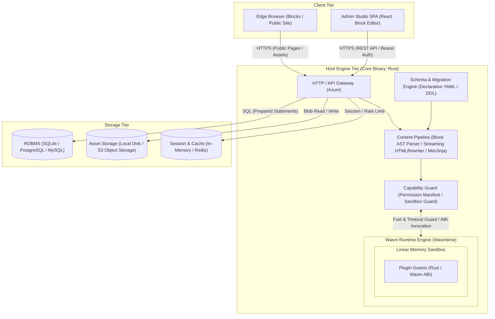
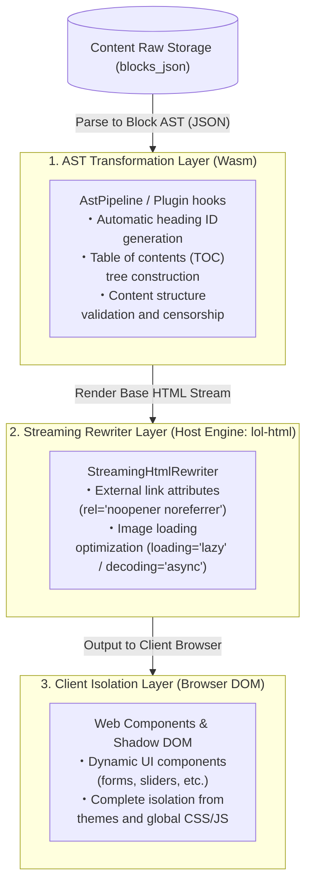

# AegisCMS: A Next-Generation Secure CMS

**English** | [日本語](README.ja.md)

> [!NOTE]
> The READMEs are available in English and Japanese (`README.md` / `README.ja.md` in each directory). The detailed documents under [`docs/`](docs) are currently written in Japanese only.

> [!TIP]
>
> - To try it right away, use the e-commerce sample site [`examples/coffee-shop/`](examples/coffee-shop) (`task demo:shop`) or the forum sample site [`examples/hiking-forum/`](examples/hiking-forum) (`task demo:forum`).
> - To run it straight from the Docker image (GitHub Container Registry): `docker run -d --name aegiscms -p 8080:8080 -v aegis-data:/app/data ghcr.io/takumi-mr/aegiscms:latest`.
> - To publish over HTTPS on a server, use [`deploy/`](deploy) (AegisCMS + Caddy. Write your domains in `sites.toml` and run `./deploy.sh up`. Multiple sites are supported).

---

## 1. System Overview and Design Philosophy

### 1.1 Background and Problems

Monolithic CMSs such as WordPress offer an intuitive editing experience and high extensibility through hooks, but they suffer from the following structural flaws.

1. **No process or memory isolation**: Plugins run with the same privileges and in the same memory space as the core and the database, so a single bug or vulnerability can compromise or take down the whole system.
2. **Query degradation caused by EAV (Entity-Attribute-Value)**: Aggregating metadata as key-value pairs (`wp_postmeta`, etc.) prevents relations and index optimization.
3. **Configuration coupled to data**: Environment-specific settings are serialized into the database, which makes version control with IaC/GitOps and staging migrations difficult.

### 1.2 Core Design Principles

- **Zero-Trust Extensions**: Every plugin runs isolated in a WebAssembly (Wasm) sandbox, and resource access is governed by a capability-based allowlist.
- **Declarative & Typed Schemas**: Content models are defined in declarative schemas (YAML/JSON), and the internal RDB tables are migrated automatically.
- **Code-as-Configuration**: Only "content" such as article bodies and media lives in the database. Settings, schemas, and plugin configuration can all be managed in Git.
- **Deterministic Content Manipulation**: Directly editing raw HTML strings is prohibited. AST (abstract syntax tree) transformations and Shadow DOM encapsulate the UI and its scope.

---

## 2. System Architecture

### 2.1 Overall Diagram



### 2.2 Main Components

1. **Core Host Engine (Rust)**

- Distributed as a single binary (Zero-Config). At startup it loads the configuration and schema definitions and connects to a local database (SQLite) or an external one (PostgreSQL / MySQL).

2. **Admin Studio (TypeScript + React)**

- A Gutenberg-like block editor with drag and drop. The UI talks to the core only through the API and is fully decoupled from it.

3. **Wasm Plugin Supervisor**

- Built on Wasmtime, it permanently enforces fuel limits and epoch interruption to stop timeouts and runaway plugins.

4. **Content & Rendering Pipeline**

- Integrates AST transformers, custom block renderers, and edge cache control (On-demand ISR / Cache-Tag Purge).

### 2.3 Crate Layout and Responsibilities (`crates/`)

AegisCMS is a monorepo built as a Cargo workspace. Each concern is designed and placed as an independent, loosely coupled crate.

```
crates/
├── aegis-core       # Shared contracts: abstract traits (Storage/Cache/Auth/AuditSink), types passed to plugins, unified errors
├── aegis-ast        # Block AST data structures, deterministic HTML renderer, streaming rewriter
├── aegis-schema     # Declarative YAML schema, multi-dialect DDL generation, TS/OpenAPI code generation
├── aegis-runtime    # Wasmtime sandbox, capability validation guard, host API linker
├── aegis-theme      # Loading and rendering of themes (MiniJinja templates)
├── aegis-db         # DatabaseAdapter with SQLite/PostgreSQL/MySQL implementations, order persistence
├── aegis-storage    # StorageBackend implementations (local / S3-compatible)
├── aegis-cache      # CacheBackend implementations (memory / Redis)
├── aegis-audit      # Audit log delivery (AuditService), sinks (log / database), metrics
├── aegis-auth       # Users, passwords, sessions, login throttling, OIDC, SAML
├── aegis-notify     # Notifications: templates (en / ja, text + HTML), the DB outbox, and delivery channels (email = SMTP / log)
├── aegis-members    # Member accounts: sign-up, login, reset, email verification, suspension, withdrawal (shared by shop and forum)
├── aegis-commerce   # E-commerce: quotes, orders, inventory, payments (manual / Stripe)
├── aegis-comments   # Comments: posting, moderation (approval workflow, spam protection), threads, notifications
├── aegis-tags       # Tags: managed tags that can be attached to any content
├── aegis-forum      # Forum: categories, threads, replies, moderation (can be split into its own DB)
├── aegis-captcha    # Optional CAPTCHA verification for forms: Turnstile / hCaptcha / reCAPTCHA / siteverify-compatible
├── aegis-contact    # Contact forms: config-defined forms, spam protection, inbox, notifications
├── aegis-newsletter # Newsletter: double opt-in subscription, unsubscribe links, bulk delivery of published articles
├── aegis-search     # Site search: tantivy index (Japanese is indexed two characters at a time) (feature `search`)
├── aegis-headless   # Headless delivery API: returns published content as JSON shaped by the schema (feature `headless`)
├── aegis-analytics  # Analytics: cookie-less beacon and daily aggregation (feature `analytics`)
├── aegis-backup     # Backup / restore: one-shot ZIP export/import of the DB and storage (feature `backup`)
└── aegis-server     # Axum HTTP layer (routing, handlers, authorization), CLI, Admin SPA delivery
```

Dependencies point in one direction only: `aegis-core` ← domain crates (`aegis-db` / `aegis-storage` / `aegis-cache` / `aegis-audit` / `aegis-auth` / `aegis-notify` / `aegis-members` / `aegis-commerce` / `aegis-comments` / `aegis-forum`, etc.) ← `aegis-server`. Each crate owns its own configuration section (`DatabaseConfig`, `StorageConfig`, `CommerceConfig`, …), and `AegisConfig` (the whole of `aegis.toml`), which bundles them, is defined by `aegis-server`.

| Crate                                           | Role / Responsibility                                       | Main modules and technologies                                                                                                                                                                                     |
| :---------------------------------------------- | :---------------------------------------------------------- | :---------------------------------------------------------------------------------------------------------------------------------------------------------------------------------------------------------------- |
| [aegis-core](crates/aegis-core)                 | Contracts shared by all crates and plugins                  | `storage` / `cache` / `auth` / `audit` (abstract traits and shared types), `entity` / `commerce` (contexts passed to plugins), `manifest` (`PluginManifest`), `error` (`AegisError`)                              |
| [aegis-ast](crates/aegis-ast)                   | Content structure, rendering, and security attributes       | `ast` (`BlockNode`), `pipeline` (`AstPipeline`), `renderer` (`HtmlRenderer`), `rewriter` (`StreamingHtmlRewriter`, Cloudflare `lol-html`), `config` (`SecurityConfig`)                                            |
| [aegis-schema](crates/aegis-schema)             | Declarative schema, multi-DB DDL generation, type generation | `definition` (`SchemaDefinition`, `RelationTarget`), `loader` (`SchemaLoader`), `migration` (`SchemaMigration`, `SqlDialect`), `codegen` (TypeScript, OpenAPI 3.1)                                                |
| [aegis-runtime](crates/aegis-runtime)           | Isolated WebAssembly execution and permission control       | `engine` (Wasmtime, fuel limit, timeout), `guard` (`CapabilityGuard`), `host_api` (host API), `supervisor` (`PluginSupervisor`), `config` (`PluginsConfig`)                                                       |
| [aegis-theme](crates/aegis-theme)               | Theme loading and rendering                                 | `ThemeEngine`, `config` (`ThemeConfig`)                                                                                                                                                                           |
| [aegis-db](crates/aegis-db)                     | Database adapters                                           | `DatabaseAdapter`, `SqliteAdapter` / `PostgresAdapter` / `MySqlAdapter`, `orders` (orders and inventory), `config` (`DatabaseConfig`)                                                                              |
| [aegis-storage](crates/aegis-storage)           | Media storage                                               | `LocalStorageBackend`, `S3StorageBackend` (SigV4), `create_storage_backend`, `config` (`StorageConfig`)                                                                                                           |
| [aegis-cache](crates/aegis-cache)               | Cache                                                       | `MemoryCacheBackend`, `RedisCacheBackend`, `config` (`CacheConfig`)                                                                                                                                               |
| [aegis-audit](crates/aegis-audit)               | Audit log                                                   | `AuditService`, `AuditOrigin`, `log` / `database` sinks, `metrics`, `config` (`AuditConfig`)                                                                                                                      |
| [aegis-auth](crates/aegis-auth)                 | Authentication                                              | `users` (`UserService`), `password` (Argon2id), `session` (`SessionService`), `rate_limit`, `oidc` (feature `oidc`), `saml` (feature `saml`), `sso`, `config` (`AuthConfig`)                                      |
| [aegis-notify](crates/aegis-notify)             | Notifications                                               | `NotificationService` (implements `aegis_core::Notifier`; outbox worker), `channel` (`NotificationChannel`), `email` (SMTP), `log`, `templates`, `html`, `samples`, `config` (`NotificationsConfig`)               |
| [aegis-members](crates/aegis-members)           | Member accounts                                             | `MemberService` (sign-up, login, sessions, reset, email verification, suspension, withdrawal), `MembersConfig`                                                                                                    |
| [aegis-commerce](crates/aegis-commerce)         | E-commerce                                                  | `CommerceService` (quotes, orders, state transitions), `payment` (`PaymentProvider`), `stripe`, `config` (`CommerceConfig`)                                                                                       |
| [aegis-comments](crates/aegis-comments)         | Comments                                                    | `CommentService` (posting, moderation, threads, notifications), `moderation` (approval workflow and spam protection; shared with reviews), `config` (`CommentsConfig`)                                            |
| [aegis-tags](crates/aegis-tags)                 | Tags                                                        | `TagService` (create, update, delete, attach to / detach from content), `config` (`TagsConfig`)                                                                                                                   |
| [aegis-forum](crates/aegis-forum)               | Forum                                                       | `ForumService` (categories, threads, replies, moderation), `config` (`ForumConfig`)                                                                                                                               |
| [aegis-captcha](crates/aegis-captcha)           | Optional CAPTCHA verification for forms                     | `Captcha` (siteverify verification, widget HTML, hosts to add to the CSP), `CaptchaConfig` (defaults switch by `provider`; fail-closed by default)                                                               |
| [aegis-newsletter](crates/aegis-newsletter)     | Newsletter                                                  | `NewsletterService` (subscribe, confirm, unsubscribe, deliver, history), `config` (`NewsletterConfig`), `messages` (en / ja)                                                                                      |
| [aegis-contact](crates/aegis-contact)           | Contact forms                                               | `ContactService` (submission, spam protection, inbox, notifications, retention), `form` (input validation, form HTML), `config` (`ContactConfig`)                                                                 |
| [aegis-search](crates/aegis-search)             | Site search (feature `search`)                              | `SearchIndex` (tantivy index and search), `tokenizer` (CJK two-character split), `snippet` (excerpts with `<mark>`), `text` (extracting text from blocks)                                                         |
| [aegis-headless](crates/aegis-headless)         | Headless delivery API (feature `headless`)                  | `list` / `get` (published only, publication window, cursor, `ETag`), `PublishedSource` (a read-only trait over published versions), `view` (shaping according to the schema)                                      |
| [aegis-analytics](crates/aegis-analytics)       | Analytics (feature `analytics`)                             | `AnalyticsService` (count, batch writes, aggregation), `agent` (crawlers, devices, referrers), `beacon_script`, `config` (`AnalyticsConfig`)                                                                      |
| [aegis-backup](crates/aegis-backup)             | Backup / restore (feature `backup`)                         | `dump` / `restore` (one-shot DB + storage I/O), `manifest` (SHA-256 checksum pre-verification), ZIP package                                                                                                       |
| [aegis-server](crates/aegis-server)             | HTTP layer, CLI, SPA delivery                               | `handlers` (REST API, public pages), `auth` (authorization, hooks), `audit` (`AuditContext` extraction), `state` (`AppState`), `config` (`AegisConfig`), `main` (CLI)                                             |

---

#### 1. `crates/aegis-core` (Shared Contracts)

The lowest-level crate, shared by the domain crates and Wasm plugins. It holds no implementation or configuration; it defines only abstract interfaces and shared data types.

- **`storage`**: The storage abstraction trait `StorageBackend` (`put`, `get`, `delete`, `public_url`) and the metadata type `StorageMeta`.
- **`cache`**: The cache abstraction trait `CacheBackend` (`get`, `set`, `delete`, `exists`).
- **`auth`**: `AuthProvider`, the abstraction for external authentication providers, and `UserAuthContext`, passed to plugins.
- **`audit`**: The audit event model (`AuditEvent`, `AuditAction`, …) and `AuditSink`, the abstraction for destinations.
- **`entity` / `commerce`**: Contexts passed to plugin hooks (`PostContext`, `PageRenderContext`, `OrderContext`, …).
- **`manifest`**: `PluginManifest`, which defines the permissions a plugin requests (network domains, KVS namespace, hooks it uses, memory/fuel limits).
- **`error`**: The system-wide error enum `AegisError` and the `Result` type alias.

#### 2. `crates/aegis-ast` (Content AST & Rendering Pipeline)

Treats content as a structured AST (abstract syntax tree) instead of raw HTML, and is responsible for safe rendering and fast HTML rewriting.

- **`ast`**: `BlockNode`, a tree structure that represents headings, paragraphs, code, images, and custom elements.
- **`pipeline`**: `AstPipeline`, which runs AST transformations in sequence, and the built-in transformer `HeadingIdTransformer`.
- **`renderer`**: `HtmlRenderer`, which expands the AST into an HTML string deterministically and safely.
- **`rewriter`**: `StreamingHtmlRewriter`, built on Cloudflare's CSS-selector streaming parser `lol-html`. It automatically adds `rel="noopener noreferrer"` to external links (with a bypass for your own site) and forcibly injects `loading="lazy"` / `decoding="async"` into `` tags.

#### 3. `crates/aegis-schema` (Declarative Schema & Code Generation Engine)

Parses content schemas written in YAML and automatically generates migration DDL for multiple RDBMSs and type definitions for clients.

- **`definition`**: The schema definition struct `SchemaDefinition`, the field type `FieldType`, and `RelationTarget` for relation targets (e.g. `category.id`).
- **`loader`**: `SchemaLoader`, which automatically scans and loads YAML files from a given directory (`schemas/`).
- **`migration`**: `SchemaMigration`, a DDL generation engine supporting `SqlDialect` (`Sqlite`, `Postgres`, `MySql`). It emits type mappings, unique constraints, and index definitions for each RDBMS.
- **`codegen`**: `TypeScriptGenerator`, which outputs TypeScript type definitions for the frontend from the schema, and `OpenApiGenerator`, which outputs the REST API specification (OpenAPI 3.1).

#### 4. `crates/aegis-runtime` (Zero-Trust Wasm Plugin Runtime)

Provides safe, isolated execution of third-party extensions in a WebAssembly (Wasm) sandbox.

- **`engine`**: `WasmEngine`, which encapsulates Wasmtime. Dual protection against runaways and DoS through fuel (instruction quota) metering and an asynchronous timeout.
- **`guard`**: `CapabilityGuard`, which, based on the plugin's `plugin.manifest.json`, blocks unauthorized network access, KVS access, and execution of unregistered hooks.
- **`host_api`**: A linker that lets code inside the sandbox safely call host functionality (logging `host:log`, HTTP `host:http_fetch`, key-value operations `host:kv_get`/`host:kv_set`).
- **`instance`**: `WasmPluginInstance`, the execution instance of a guest Wasm binary. Data is passed safely through linear memory using the fat pointer format (`ptr:i32, len:i32`) and the guest-side allocator (`allocate`).
- **`supervisor` / `loader`**: `PluginSupervisor` loads the plugins listed in `[plugins].enabled` from `plugins/<name>/` (startup is aborted if one is not installed or is defective) and runs hooks in the order they are listed.

#### 5. Domain Crates (`aegis-db` / `aegis-storage` / `aegis-cache` / `aegis-audit` / `aegis-auth` / `aegis-notify` / `aegis-members` / `aegis-commerce` / `aegis-comments` / `aegis-forum`)

HTTP-independent implementations of each feature. Each crate owns the type of its own configuration section and is assembled and used from `aegis-server`.

- **`aegis-db`**: Concrete multi-RDBMS implementations (`SqliteAdapter`, `PostgresAdapter`, `MySqlAdapter`) of the `DatabaseAdapter` trait. Only for YAML schemas, it supports schema evolution that automatically adds not-yet-applied columns to existing tables (`ALTER TABLE ... ADD COLUMN`). System tables of an old-version DB are not rewritten; if a required column is missing, startup stops with the migration steps (start once on v0.3.x → `task dump` → `task restore`). Order and inventory persistence (`orders`) also lives here.
- **`aegis-storage`**: Concrete multi-storage implementations of the `StorageBackend` trait: `LocalStorageBackend` for local disks and block storage, and `S3StorageBackend` for AWS S3 / Cloudflare R2 / MinIO (with a built-in native AWS SigV4 signing engine).
- **`aegis-cache`**: Concrete cache implementations of the `CacheBackend` trait: the default in-memory cache `MemoryCacheBackend` with TTL expiry management, and an optional `RedisCacheBackend` for distributed and multi-server setups.
- **`aegis-audit`**: `AuditService`, which delivers audit events to the configured destinations; `AuditOrigin`, which represents the origin of an operation (IP, User-Agent); and metrics ([docs/audit.md](docs/audit.md)).
- **`aegis-auth`**: User management `UserService`, Argon2id passwords, session management `SessionService` backed by `CacheBackend`, login attempt throttling, OpenID Connect (feature `oidc`), and SAML 2.0 (feature `saml`; XML signature verification is pure Rust) ([docs/authentication.md](docs/authentication.md)).
- **`aegis-notify`**: Notification delivery `NotificationService`. For each recipient it builds a subject and body (plain text and HTML) from a template (MiniJinja; built-in templates are en / ja), and sends it from the DB outbox (`_aegis_notification_queue`; it survives restarts, and with multiple instances only one of them sends) through a delivery channel `NotificationChannel` (email via an external SMTP server, or log). It retries transient failures and writes audit logs (`notification.send`). Templates can be edited, test-sent, and re-sent from Admin Studio. Audit events that match conditions (admin logins, login lockouts, etc.) can be notified (`AuditNotificationSink`). Adding a channel extends it to Slack, SMS, and so on ([docs/notifications.md](docs/notifications.md)).
- **`aegis-members`**: Visitor member accounts `MemberService` (sign-up, login, Cookie / Bearer sessions, password reset, email verification, suspension, withdrawal). They are separate from admin accounts, and per-feature data such as orders and reviews is not handled here ([docs/members.md](docs/members.md)).
- **`aegis-commerce`**: `CommerceService`, which handles quotes, orders, inventory reservation, state transitions, and payments (manual / Stripe) ([docs/commerce.md](docs/commerce.md)). The DB, plugins, audit, and notifications are received through `CommerceDeps`.
- **`aegis-tags`**: `TagService`, which handles managed tags with a name and a slug that can be attached to any kind of content (create, update, delete, attach/detach) ([docs/tags.md](docs/tags.md)). The tables are `TagStorage` in `aegis-db` (`_aegis_tags` / `_aegis_content_tags`).
- **`aegis-comments`**: `CommentService`, which handles reader comment posting, moderation (the same approval workflow as WordPress, auto-approval of already-approved authors, banned words, link counts, per-IP post counts, a honeypot, and the `check-comment` plugin), threaded display, and notifications ([docs/comments.md](docs/comments.md)). The moderation mechanism (`moderation`) will be shared with upcoming product reviews.
- **`aegis-forum`**: The category / thread / reply forum `ForumService` (keyset pagination, rate limiting of consecutive posts, pinning, locking, auto-lock). It can be placed in a database separate from the main one via `[forum].database_url` ([docs/forum.md](docs/forum.md)).
- **`aegis-contact`**: Contact forms `ContactService` (fields are `[[contact.forms]]` in the config file; invisible bot-trap fields, optional CAPTCHA (the shared `[captcha]`), per-IP submission counts, spam words and link counts, notifications and auto-replies, the Admin Studio inbox, and retention). They are displayed at `/contact` and through the `core/contact-form` body block ([docs/contact.md](docs/contact.md)).
- **`aegis-newsletter`**: The newsletter `NewsletterService` (double opt-in: sign up at `/newsletter` → the subscription starts via the link in the confirmation email; per-email unsubscribe links; delivery of published articles to each subscriber individually, and history. Sending uses the `aegis-notify` outbox, and CAPTCHA is optional). It is managed from Settings › Newsletter in Admin Studio ([docs/newsletter.md](docs/newsletter.md)).
- **`aegis-search`**: Full-text search of published content (tantivy; Japanese is indexed two characters at a time, without a dictionary). It is built in with the server's `search` feature (enabled by default) and exposes `/search` and `GET /api/v1/search` ([docs/search.md](docs/search.md)).
- **`aegis-headless`**: A read-only API that returns only published content as JSON without authentication (`GET /api/v1/public/contents/{type}`). The returned fields are decided by the schema (`public`), and the DB is read through a trait that only provides reads of published versions, so drafts and in-progress edits can never be returned. It is the server's `headless` feature (built in by default; the `[headless]` setting is disabled by default). See [docs/headless.md](docs/headless.md).
- **`aegis-analytics`**: Cookie-less analytics (visitors are distinguished by a hash that changes daily, and only daily aggregates are kept in the DB). It is built in with the server's `analytics` feature and viewable in the Analytics tab of Admin Studio ([docs/analytics.md](docs/analytics.md)).

#### 6. `crates/aegis-server` (HTTP Gateway & Admin SPA Delivery)

A REST API gateway server built on Axum. It assembles the domain crates and is responsible only for HTTP I/O and authorization.

- **`handlers`**: RESTful API endpoints (content CRUD with automatic relation resolution, schema information, dynamic OpenAPI spec delivery, multipart file upload `POST /api/v1/storage/upload`, uploaded file listing `GET /api/v1/storage/objects` and deletion `DELETE /api/v1/storage/objects/{key}` ([docs/media.md](docs/media.md)), editor preview `POST /api/v1/preview`, session authentication `POST/GET/DELETE /api/v1/auth/session` (login with username / password), OpenID Connect single sign-on `GET /api/v1/auth/oidc/login`, SAML 2.0 single sign-on `GET /api/v1/auth/saml/login` / `POST /api/v1/auth/saml/acs` / `GET /api/v1/auth/saml/metadata` ([docs/authentication.md](docs/authentication.md)), the shop API and public pages, the dynamic robots.txt `GET /robots.txt`, sitemap `GET /sitemap.xml`, the SEO settings API `GET/PUT /api/v1/seo`, and health checks).
- **`auth`**: Session extraction from requests, role-based authorization, and plugin authentication hooks.
- **`audit`**: The `AuditContext` extractor, which pulls the actor and origin out of a request.
- **`state`**: `AppState`, the shared state holding `DatabaseAdapter`, `StorageBackend`, `CacheBackend`, `SessionService`, `CommerceService`, schema definitions, and the plugin supervisor.
- **`config`**: `AegisConfig`, which bundles each crate's configuration section (loading from `config/*.toml` and environment variable overrides. [docs/configuration.md](docs/configuration.md)).
- **`main`**: CLI subcommands (starting the server `run`, running migrations `migrate`, type generation `codegen`, creating a backup `dump`, restoring data `restore`, user management `user add|passwd|role|disable|enable|list|link-oidc|link-saml`, plugin status `plugin list`, notification testing `notify test`) and delivery of the Admin Studio SPA (`/admin/`).

#### 7. `crates/aegis-plugin-sdk` & `crates/aegis-plugin-macros` (Official Wasm Plugin SDK)

The official SDK that lets third-party developers build WebAssembly plugins safely and quickly.

- **`#[aegis_plugin]`**: A high-level procedural macro that completely hides the memory allocator (`allocate`), pointer packing, and JSON serialization/deserialization.
- **`Plugin` trait**: A type-safe interface for implementing lifecycle hooks (before saving a post `on_before_save`, content AST transformation `transform_content_ast`).
- **`host` API**: Type-safe functions wrapping the host logger (`log_info!`, `log_warn!`), network access pre-validation (`net::is_allowed`), and namespace-isolated KVS operations (`kv::set`).
- **Built-in native test mocks**: You can unit-test a plugin's business logic with plain `cargo test`, without building for the Wasm environment.
- **Official templates & multi-language packages**: [`sdk/templates/rust`](sdk/templates/rust) to start developing immediately (to add a block that can be placed in the body, use [`sdk/templates/rust-block`](sdk/templates/rust-block); AssemblyScript / TinyGo versions are also bundled in `sdk/templates/`). Official GitHub-centered packages are published and distributed for each language (Rust: the GitHub Git dependency `aegis-plugin-sdk`, AssemblyScript: GitHub Packages `@takumi-mr/plugin-sdk`, TinyGo: Go Modules `github.com/takumi-mr/AegisCMS/sdk/tinygo`). See the [Wasm Plugin Development Guide](docs/plugin_sdk_guide.md) for details.

> [!TIP]
> Documentation index (the documents under `docs/` are in Japanese):
>
> - **[Documentation portal (`docs/README.md`)](docs/README.md)** (the index and map of all documents)
> - Design and development: [Internal design (`docs/architecture.md`)](docs/architecture.md) / [Development guide (`docs/development.md`)](docs/development.md) / [Admin Studio (`admin/README.md`)](admin/README.md)
> - Operations and features: [Configuration reference](docs/configuration.md) / [Authentication & user management](docs/authentication.md) / [Audit log](docs/audit.md) / [Media](docs/media.md) / [E-commerce](docs/commerce.md) / [Notifications](docs/notifications.md) / [Comments](docs/comments.md) / [Forum](docs/forum.md) / [Contact forms](docs/contact.md) / [Site search](docs/search.md) / [Analytics](docs/analytics.md)
> - Themes and body content: [Publishing & theme engine](docs/theme_and_publishing_guide.md) / [Theme authoring guide](docs/theme_authoring_guide.md) / [Body blocks & Markdown](docs/blocks.md)
> - Plugins: [Development guide](docs/plugin_sdk_guide.md) / [Dev server & Plugin Builder](docs/plugin_dev_server.md) / [Hooks & host API](docs/plugin_hooks.md) / [ABI specification](docs/plugin_abi_specification.md) / [Official plugins](plugins/README.md)
> - Outstanding tasks: [TODO.md](TODO.md)

---

## 3. Plugin Sandbox Architecture

### 3.1 Execution Isolation and Memory Boundaries

- The physical memory spaces of the host and the plugin (guest) are completely separate.
- Memory sharing is limited to passing a pointer (`ptr`) to a specific buffer region in Wasm linear memory together with the data length (`len`).
- When the host writes into Wasm memory, it first calls the memory allocator (`allocate`) exported by the plugin to secure a safe region.

### 3.2 Abstract ABI Definition (Wasm Interface Type / WIT)

```wit
package aegis:cms-plugin;

interface types {
    enum log-level { debug, info, warn, error }
    enum http-method { get, post, put, delete }

    record http-request {
        url: string,
        method: http-method,
        headers: list<tuple<string, string>>,
        body: option<list<u8>>,
    }

    record http-response {
        status: u16,
        headers: list<tuple<string, string>>,
        body: list<u8>,
    }

    record block-node {
        name: string,
        attributes-json: string,
        children: list<block-node>,
    }

    record post-context {
        id: string,
        slug: string,
        author-id: string,
        blocks: list<block-node>,
    }
}

interface host-api {
    use types.{log-level, http-request, http-response};

    // Log output (integrated with the console and the core logger)
    log: func(level: log-level, message: string);

    // Restricted network access (manifest validation required)
    http-fetch: func(req: http-request) -> result<http-response, string>;

    // Scope-restricted read-only KVS / queries
    kv-get: func(key: string) -> option<string>;
    kv-set: func(key: string, value: string) -> result<_, string>;
}

world plugin-runtime {
    import host-api;
    use types.{post-context, block-node};

    // Lifecycle hooks
    export init: func() -> result<_, string>;
    export on-before-save: func(post: post-context) -> result<post-context, string>;
    export transform-content-ast: func(blocks: list<block-node>) -> result<list<block-node>, string>;
}

```

### 3.3 Capability-Based Permission Model

A plugin ships a `plugin.manifest.json` in its root directory and explicitly declares the resources it uses. The host engine strictly checks these on every call.

```json
{
    "name": "aegis-plugin-slack-notifier",
    "version": "1.0.0",
    "entrypoint": "plugin.wasm",
    "capabilities": {
        "network": {
            "allowed_domains": ["hooks.slack.com"]
        },
        "storage": {
            "kv_namespace": "slack_notifier_state"
        },
        "hooks": ["on-before-save", "transform-content-ast"]
    },
    "resource_limits": {
        "max_memory_mb": 16,
        "max_fuel_units": 100000000,
        "execution_timeout_ms": 250
    }
}
```

- **Resource quotas**: Instructions are counted with Wasmtime's fuel instrumentation. On an infinite loop or overload, the host raises a trap immediately and protects the main process.
- **Domain allowlist**: An HTTP request to a host outside `allowed_domains` returns a `PermissionDenied` error.

---

## 4. Content and DOM Manipulation Pipeline

To eliminate the XSS and DOM-corruption risks of regex replacement or direct insertion into raw HTML, a three-layer modification model is provided according to what is being manipulated.



1. **AST (abstract syntax tree) transformation**:

- Changes to the content structure (adding nodes, rewriting block attributes) are performed only on the AST inside the Wasm sandbox. This fundamentally prevents unclosed tags and inline script injection.

2. **Streaming HTML rewriter**:

- Attribute injection based on CSS selectors is applied to the host engine's output stream right before it is sent, through the Rust-based `lol-html`. This minimizes the memory footprint.

3. **Frontend isolation with Web Components**:

- Browser UI provided by plugins is emitted as custom elements with Shadow DOM applied (e.g. `<plugin-poll-widget>`). Conflicts with themes and global CSS/JS are eliminated.

---

## 5. Data Model and Configuration Management

### 5.1 Declarative Schema Engine

The EAV pattern is abolished entirely, and content types are defined in YAML.

```yaml
# schemas/articles.yaml
content_type: article
label: "Technical article"
fields:
    - name: title
      type: string
      required: true
      max_length: 255
      index: true
    - name: slug
      type: string
      required: true
      unique: true
    - name: published_at
      type: timestamp
      nullable: true
      index: true
    - name: tech_category
      type: relation
      target: category.id
    - name: custom_meta
      type: jsonb
      indexed_paths:
          - "seo.canonical_url"
```

- **Automatic migration**: When the core engine starts, or when the schema sync command is run, schema differences are detected and migrated automatically to the internal tables (SQLite / PostgreSQL / MySQL).
- **Automatic type generation**: TypeScript type definitions and an OpenAPI specification (OpenAPI 3.1) are generated from the schema definitions.

### 5.2 GitOps and Environment Separation

- **Managed in the repository (Code-as-Configuration)**:
    - Schema definition files (`/schemas/*.yaml`)
    - Site settings and permission role settings (`/config/*.toml`)
    - Installed plugins (`/plugins/<name>/`) and the enabled list (`[plugins].enabled` in the config file; if you toggle or reorder them in Admin Studio, the list in the DB takes precedence)
    - Themes and UI templates (`/themes/*`)

- **Managed in the database**:
    - Post entities and block body data
    - Uploaded media metadata
    - User accounts and session information

---

## 6. Technology Stack Rationale

| Layer                    | Technology                          | Rationale and technical trade-offs                                                                                                                                              |
| ------------------------ | ----------------------------------- | ------------------------------------------------------------------------------------------------------------------------------------------------------------------------------- |
| **Core engine**          | **Rust**                            | Memory safety, zero-cost abstractions, startup speed. Native affinity with the Wasmtime runtime. Can be distributed as a single binary.                                        |
| **Storage**              | **SQLite / PostgreSQL / MySQL**     | SQLite, which runs Zero-Config, for edge / single-server operation. Transparent switching to PostgreSQL/MySQL (JSONB indexes, etc.) for clustering.                            |
| **Sandbox**              | **Wasmtime**                        | A stable runtime compliant with the Bytecode Alliance. Safe, isolated linear-memory execution through fuel (instruction count) limits and timeouts.                            |
| **Plugin languages**     | **Tier 1: AssemblyScript / TinyGo** | **Tier 1**: Lightweight GC, type safety, and compact binaries of tens to hundreds of KB lower the barrier to entry for web developers.                                         |
| **Plugin languages**     | **Tier 2: Rust**                    | **Tier 2**: For processing that demands extreme performance and memory control.                                                                                                |
| **Admin UI**             | **TypeScript + React**              | The rich React ecosystem and a polished, modern UI (CSS Modules) keep the block editing UI fast.                                                                               |
