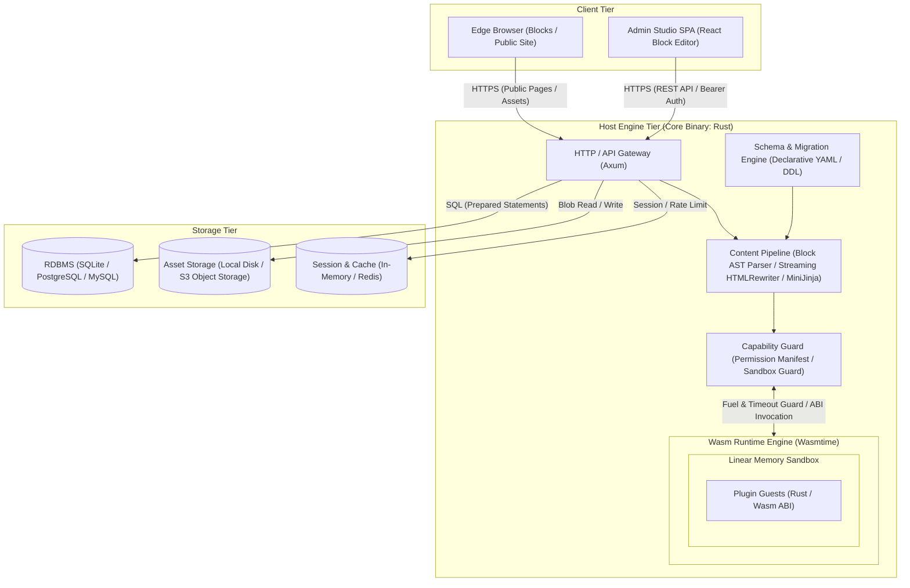
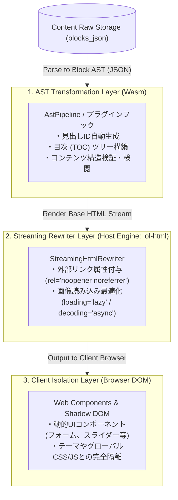

# 次世代セキュアCMS「AegisCMS」

> [!TIP]
> すぐに動かして試すなら、EC のサンプルサイト [`examples/coffee-shop/`](examples/coffee-shop)（`task demo:shop`）か、掲示板のサンプルサイト [`examples/hiking-forum/`](examples/hiking-forum)（`task demo:forum`）をどうぞ。
> サーバーで HTTPS 公開するなら [`deploy/`](deploy)（AegisCMS + Caddy。`sites.toml` にドメインを書いて `./deploy.sh up`。複数サイトにも対応）。

---

## 1. システム概要と設計思想

### 1.1 背景と課題

従来のモノリシックCMS（WordPress等）は、直感的なコンテンツ編集体験とフック機構による高い拡張性を誇る一方、以下の構造的欠陥を抱えていた。

1. **プロセス・メモリ空間の非分離**: プラグインが本体コアやデータベースと同一権限・同一メモリ空間で動作するため、単一の不具合・脆弱性がシステム全体の侵害・停止に直結する。
2. **EAV（Entity-Attribute-Value）によるクエリ劣化**: メタデータ（`wp_postmeta`等）のkey-value集約により、リレーション・インデックス最適化が阻害される。
3. **構成とデータの結合**: 環境依存設定がDB内にシリアライズ保存され、IaC/GitOpsによるバージョン管理やステージング移行が困難。

### 1.2 コア設計原則

- **Zero-Trust Extensions**: プラグインはすべてWebAssembly（Wasm）サンドボックス内で隔離実行し、リソースアクセスはケイパビリティベースのホワイトリスト制とする。
- **Declarative & Typed Schemas**: コンテンツモデルは宣言的スキーマ（YAML/JSON）で定義し、内部RDBテーブルを自動マイグレーションする。
- **Code-as-Configuration**: 記事本文やメディア等の「コンテンツ」のみをDB管理とし、設定・スキーマ・プラグイン構成はすべてGit管理可能とする。
- **Deterministic Content Manipulation**: 生HTML文字列の直接編集を禁止し、AST（抽象構文木）変換およびShadow DOMによってUI/スコープをカプセル化する。

---

## 2. システムアーキテクチャ

### 2.1 全体構成図



### 2.2 主要コンポーネント構成

1. **Core Host Engine (Rust)**

- シングルバイナリ配布（Zero-Config）。起動時に設定・スキーマ定義を読み込み、ローカルDB（SQLite/libSQL）または外部DBへ接続。

2. **Admin Studio (TypeScript + React)**

- Gutenbergライクなドラッグ＆ドロップ対応ブロックエディタ。UIはAPI経由でコアと完全疎結合に動作。

3. **Wasm Plugin Supervisor**

- Wasmtimeを基盤とし、Fuel消費制限およびエポック割り込みによるタイムアウト・暴走防止機構を常駐。

4. **Content & Rendering Pipeline**

- ASTトランスフォーマー、カスタムブロックレンダラー、エッジキャッシュ制御（On-demand ISR / Cache-Tag Purge）を統合。

### 2.3 クレート構成と各モジュールの責務 (`crates/`)

AegisCMS は Cargo ワークスペースによるモノレポ構成を採用しており、各関心事が独立したクレートとして疎結合に設計・配置されています。

```
crates/
├── aegis-core       # 共有契約: 抽象トレイト（Storage/Cache/Auth/AuditSink）、プラグインに渡す型、統一エラー
├── aegis-ast        # Block AST データ構造、HTML決定論的レンダラー、ストリーミングリライター
├── aegis-schema     # 宣言的YAMLスキーマ、マルチダイアレクトDDL生成、TS/OpenAPIコード生成
├── aegis-runtime    # Wasmtimeサンドボックス、ケイパビリティ検証ガード、ホストAPIリンカー
├── aegis-theme      # テーマ（MiniJinja テンプレート）の読み込みと描画
├── aegis-db         # DatabaseAdapter と SQLite/PostgreSQL/MySQL 実装、注文の永続化
├── aegis-storage    # StorageBackend 実装（ローカル / S3 互換）
├── aegis-cache      # CacheBackend 実装（メモリ / Redis）
├── aegis-audit      # 監査ログの配送（AuditService）と出力先（log / database）、メトリクス
├── aegis-auth       # ユーザー・パスワード・セッション・ログイン制限・OIDC・SAML
├── aegis-notify     # 通知: テンプレート（en / ja、テキスト + HTML）・DB の送信待ちと配信チャネル（メール = SMTP / ログ）
├── aegis-commerce   # EC: 見積もり・注文・在庫・決済（手動 / Stripe）
├── aegis-comments   # コメント: 投稿・審査（承認制・スパム対策）・スレッド・通知
├── aegis-tags       # タグ: どのコンテンツにも付けられる管理されたタグ
├── aegis-forum      # 掲示板: カテゴリ・スレッド・レス・モデレーション（専用 DB に分離可）
├── aegis-captcha    # フォームの CAPTCHA 検証（任意）: Turnstile / hCaptcha / reCAPTCHA / siteverify 互換
├── aegis-contact    # 問い合わせフォーム: 設定で決めるフォーム・スパム対策・受信箱・通知
├── aegis-newsletter # ニュースレター: ダブルオプトインの申し込み・解除リンク・公開中の記事の一斉配信
├── aegis-search     # サイト内検索: tantivy の索引（日本語は 2 文字ずつ）（feature `search`）
├── aegis-analytics  # アクセス解析: Cookie なしのビーコンと日ごとの集計（feature `analytics`）
├── aegis-backup     # バックアップ・リストア: DB とストレージの一括 ZIP エクスポート/インポート（feature `backup`）
└── aegis-server     # Axum HTTP 層（ルーティング・ハンドラ・認可）、CLI、Admin SPA 配信
```

依存の向きは `aegis-core` ← ドメインクレート（`aegis-db` / `aegis-storage` / `aegis-cache` / `aegis-audit` / `aegis-auth` / `aegis-notify` / `aegis-commerce` / `aegis-comments` / `aegis-forum` など）← `aegis-server` の一方向です。各クレートは自分の設定セクション（`DatabaseConfig`、`StorageConfig`、`CommerceConfig` …）を持ち、それらを束ねる `AegisConfig`（`aegis.toml` 全体）は `aegis-server` が定義します。

| クレート名                                                    | 役割・責務                                               | 主な構成モジュール・対応技術                                                                                                                                           |
| :------------------------------------------------------------ | :------------------------------------------------------- | :--------------------------------------------------------------------------------------------------------------------------------------------------------------------- |
| [aegis-core](crates/aegis-core)                               | 全クレート・プラグインで共有する契約                     | `storage` / `cache` / `auth` / `audit` (抽象トレイトと共有型), `entity` / `commerce` (プラグインに渡すコンテキスト), `manifest` (`PluginManifest`), `error` (`AegisError`) |
| [aegis-ast](crates/aegis-ast)                                 | コンテンツ構造化表現・レンダリング・セキュリティ属性付与 | `ast` (`BlockNode`), `pipeline` (`AstPipeline`), `renderer` (`HtmlRenderer`), `rewriter` (`StreamingHtmlRewriter`, Cloudflare `lol-html`), `config` (`SecurityConfig`) |
| [aegis-schema](crates/aegis-schema)                           | 宣言的スキーマ定義・マルチDB DDL生成・型定義生成         | `definition` (`SchemaDefinition`, `RelationTarget`), `loader` (`SchemaLoader`), `migration` (`SchemaMigration`, `SqlDialect`), `codegen` (TypeScript, OpenAPI 3.1)     |
| [aegis-runtime](crates/aegis-runtime)                         | WebAssembly サンドボックス隔離実行・権限制御             | `engine` (Wasmtime, Fuel制限, タイムアウト), `guard` (`CapabilityGuard`), `host_api` (ホストAPI), `supervisor` (`PluginSupervisor`), `config` (`PluginsConfig`)         |
| [aegis-theme](crates/aegis-theme)                             | テーマの読み込み・描画                                   | `ThemeEngine`, `config` (`ThemeConfig`)                                                                                                                                |
| [aegis-db](crates/aegis-db)                                   | データベースアダプタ                                     | `DatabaseAdapter`, `SqliteAdapter` / `PostgresAdapter` / `MySqlAdapter`, `orders` (注文・在庫), `config` (`DatabaseConfig`)                                             |
| [aegis-storage](crates/aegis-storage)                         | メディアストレージ                                       | `LocalStorageBackend`, `S3StorageBackend` (SigV4), `create_storage_backend`, `config` (`StorageConfig`)                                                                 |
| [aegis-cache](crates/aegis-cache)                             | キャッシュ                                               | `MemoryCacheBackend`, `RedisCacheBackend`, `config` (`CacheConfig`)                                                                                                    |
| [aegis-audit](crates/aegis-audit)                             | 監査ログ                                                 | `AuditService`, `AuditOrigin`, `log` / `database` 出力先, `metrics`, `config` (`AuditConfig`)                                                                           |
| [aegis-auth](crates/aegis-auth)                               | 認証                                                     | `users` (`UserService`), `password` (Argon2id), `session` (`SessionService`), `rate_limit`, `oidc` (feature `oidc`), `saml` (feature `saml`), `sso`, `config` (`AuthConfig`)                            |
| [aegis-notify](crates/aegis-notify)                           | 通知                                                     | `NotificationService`（`aegis_core::Notifier` の実装・送信待ちのワーカー）, `channel` (`NotificationChannel`), `email` (SMTP), `log`, `templates`, `html`, `samples`, `config` (`NotificationsConfig`) |
| [aegis-commerce](crates/aegis-commerce)                       | EC                                                       | `CommerceService` (見積もり・注文・状態遷移), `payment` (`PaymentProvider`), `stripe`, `config` (`CommerceConfig`)                                                       |
| [aegis-comments](crates/aegis-comments)                       | コメント                                                 | `CommentService` (投稿・審査・スレッド・通知), `moderation` (承認制・スパム対策。レビューと共有), `config` (`CommentsConfig`)                                          |
| [aegis-tags](crates/aegis-tags)                               | タグ                                                     | `TagService` (作成・更新・削除・コンテンツへの付け外し), `config` (`TagsConfig`)                                                                                      |
| [aegis-forum](crates/aegis-forum)                             | 掲示板                                                   | `ForumService` (カテゴリ・スレッド・レス・モデレーション), `config` (`ForumConfig`)                                                                                    |
| [aegis-captcha](crates/aegis-captcha)                         | フォームの CAPTCHA 検証（任意）                          | `Captcha` (siteverify の検証・ウィジェットの HTML・CSP に足すホスト), `CaptchaConfig` (`provider` で既定値を切り替え。fail-closed が既定)                              |
| [aegis-newsletter](crates/aegis-newsletter)                   | ニュースレター                                           | `NewsletterService` (申し込み・確認・解除・配信・履歴), `config` (`NewsletterConfig`), `messages` (en / ja)                                                             |
| [aegis-contact](crates/aegis-contact)                         | 問い合わせフォーム                                       | `ContactService` (送信・スパム対策・受信箱・通知・保存期間), `form` (入力の検査・フォームの HTML), `config` (`ContactConfig`)                                            |
| [aegis-search](crates/aegis-search)                           | サイト内検索（feature `search`）                         | `SearchIndex` (tantivy の索引・検索), `tokenizer` (CJK の 2 文字分割), `snippet` (`<mark>` 付きの抜粋), `text` (ブロックの文字の取り出し)                                 |
| [aegis-analytics](crates/aegis-analytics)                     | アクセス解析（feature `analytics`）                      | `AnalyticsService` (数える・まとめて書く・集計), `agent` (クローラー・端末・参照元), `beacon_script`, `config` (`AnalyticsConfig`)                                       |
| [aegis-backup](crates/aegis-backup)                           | バックアップ・リストア（feature `backup`）               | `dump` / `restore` (DB + ストレージの一括入出力), `manifest` (SHA-256 チェックサム事前検証), ZIP パッケージ                                                            |
| [aegis-server](crates/aegis-server)                           | HTTP 層・CLI・SPA配信                                    | `handlers` (REST API・公開ページ), `auth` (認可・フック), `audit` (`AuditContext` 抽出), `state` (`AppState`), `config` (`AegisConfig`), `main` (CLI)                     |

---

#### 1. `crates/aegis-core` (共有契約)

ドメインクレートと Wasm プラグインが共有する最下層クレートです。実装や設定は持たず、抽象インターフェースと共有データ型だけを定義します。

- **`storage`**: ストレージ抽象化トレイト `StorageBackend`（`put`, `get`, `delete`, `public_url`）およびメタデータ `StorageMeta` の定義。
- **`cache`**: キャッシュ抽象化トレイト `CacheBackend`（`get`, `set`, `delete`, `exists`）の定義。
- **`auth`**: 外部認証プロバイダの抽象 `AuthProvider` と、プラグインに渡す `UserAuthContext`。
- **`audit`**: 監査イベントのモデル（`AuditEvent`, `AuditAction` …）と出力先の抽象 `AuditSink`。
- **`entity` / `commerce`**: プラグインフックに渡すコンテキスト（`PostContext`, `PageRenderContext`, `OrderContext` …）。
- **`manifest`**: プラグインが要求する権限（ネットワークドメイン、KVSネームスペース、利用フック、メモリ/Fuel制限）を定義する `PluginManifest`。
- **`error`**: システム統一エラー列挙体 `AegisError` および `Result` 型エイリアス。

#### 2. `crates/aegis-ast` (コンテンツ AST & レンダリングパイプライン)

コンテンツを生 HTML ではなく構造化された AST（抽象構文木）として扱い、安全なレンダリングと高速な HTML 改変を担当します。

- **`ast`**: 見出し、段落、コード、画像、カスタム要素を表現する木構造 `BlockNode`。
- **`pipeline`**: AST 変換処理を直列実行する `AstPipeline` およびビルトイントランスフォーマー `HeadingIdTransformer`。
- **`renderer`**: AST を決定論的かつ安全に HTML 文字列へ展開する `HtmlRenderer`。
- **`rewriter`**: Cloudflare 製 CSS セレクタストリーミングパーサー `lol-html` を用いた `StreamingHtmlRewriter`。外部リンクへの `rel="noopener noreferrer"` 自動付与（自サイト除外バイパス対応）や、`` タグへの `loading="lazy"` / `decoding="async"` 強制インジェクションを実行。

#### 3. `crates/aegis-schema` (宣言的スキーマ & コード生成エンジン)

YAML で記述されたコンテンツスキーマを解析し、マルチ RDBMS 向けのマイグレーション DDL やクライアント向けの型定義を自動生成します。

- **`definition`**: スキーマ定義構造体 `SchemaDefinition`、フィールド型 `FieldType`、およびリレーション先参照 `RelationTarget`（例: `category.id`）。
- **`loader`**: 指定ディレクトリ（`schemas/`）から YAML ファイルを自動走査・読み込む `SchemaLoader`。
- **`migration`**: `SqlDialect`（`Sqlite`, `Postgres`, `MySql`）に対応した DDL 自動生成エンジン `SchemaMigration`。型マッピング、ユニーク制約、インデックス定義を各 RDBMS 向けに出力。
- **`codegen`**: スキーマ定義からフロントエンド用 TypeScript 型定義を出力する `TypeScriptGenerator`、および REST API 仕様を出力する `OpenApiGenerator`（OpenAPI 3.1 仕様）。

#### 4. `crates/aegis-runtime` (ゼロ・トラスト Wasm プラグインランタイム)

WebAssembly（Wasm）サンドボックスによるサードパーティ拡張の安全な隔離実行を提供します。

- **`engine`**: Wasmtime をカプセル化した `WasmEngine`。Fuel（命令数クォータ）計測と非同期タイムアウトによる二重の暴走・DoS 防御。
- **`guard`**: プラグインの `plugin.manifest.json` に基づき、未許可のネットワーク通信・KVSアクセス・未登録フック実行を遮断する `CapabilityGuard`。
- **`host_api`**: サンドボックス内からホスト側の機能（ロギング `host:log`、HTTP通信 `host:http_fetch`、Key-Value操作 `host:kv_get`/`host:kv_set`）を安全に呼び出すリンカー。
- **`instance`**: ゲスト Wasm バイナリの実行インスタンス `WasmPluginInstance`。Fat Pointer 形式（`ptr:i32, len:i32`）およびゲスト側アロケータ（`allocate`）を用いた安全なリニアメモリデータ受け渡し。
- **`supervisor` / `loader`**: `[plugins].enabled` に書いたプラグインを `plugins/<name>/` から読み込み（未インストール・不備があれば起動を中止）、書いた順にフックを実行する `PluginSupervisor`。

#### 5. ドメインクレート (`aegis-db` / `aegis-storage` / `aegis-cache` / `aegis-audit` / `aegis-auth` / `aegis-notify` / `aegis-commerce` / `aegis-comments` / `aegis-forum`)

HTTP に依存しない機能ごとの実装です。各クレートは自分の設定セクションの型を持ち、`aegis-server` から組み立てて使います。

- **`aegis-db`**: `DatabaseAdapter` トレイトに基づくマルチ RDBMS 具象実装（`SqliteAdapter`, `PostgresAdapter`, `MySqlAdapter`）。`PRAGMA table_info` や `information_schema.columns` を走査し、既存テーブルへの未反映カラムを自動追加するスキーマ進化マイグレーション（`ALTER TABLE ... ADD COLUMN`）を内蔵。注文・在庫の永続化（`orders`）もここに置きます。
- **`aegis-storage`**: `StorageBackend` トレイトに基づくマルチストレージ具象実装。ローカルディスク・ブロックストレージ対応の `LocalStorageBackend` と、AWS S3 / Cloudflare R2 / MinIO 対応の `S3StorageBackend`（ネイティブ AWS SigV4 認証署名エンジン内蔵）。
- **`aegis-cache`**: `CacheBackend` トレイトに基づくキャッシュ具象実装。TTL 有効期限管理を備えたデフォルトのインメモリキャッシュ `MemoryCacheBackend` と、分散環境・マルチサーバー構成対応の `RedisCacheBackend`（オプショナル）。
- **`aegis-audit`**: 監査イベントを設定された出力先へ配送する `AuditService`、操作元（IP・User-Agent）を表す `AuditOrigin`、メトリクス（[docs/audit.md](docs/audit.md)）。
- **`aegis-auth`**: ユーザー管理 `UserService`、Argon2id パスワード、`CacheBackend` をバックストアとするセッション管理 `SessionService`、ログイン試行制限、OpenID Connect（feature `oidc`）・SAML 2.0（feature `saml`。XML 署名の検証は純 Rust）（[docs/authentication.md](docs/authentication.md)）。
- **`aegis-notify`**: 通知の配信 `NotificationService`。宛先ごとにテンプレート（MiniJinja、組み込みは en / ja）から件名・本文（プレーンテキストと HTML）を作り、DB の送信待ち（`_aegis_notification_queue`。再起動しても失われず、複数台では 1 台だけが送る）から配信チャネル `NotificationChannel`（外部の SMTP サーバーへのメール・ログ）で送る。一時的な失敗の再試行と監査ログ（`notification.send`）。Admin Studio からのテンプレート編集・テスト送信・再送。条件に合う監査イベント（管理者のログイン・ログインのロックなど）の通知（`AuditNotificationSink`）。チャネルを足せば Slack・SMS などにも広げられる（[docs/notifications.md](docs/notifications.md)）。
- **`aegis-commerce`**: 見積もり・注文・在庫引当・状態遷移・決済（手動 / Stripe）を扱う `CommerceService`（[docs/commerce.md](docs/commerce.md)）。DB・プラグイン・監査・通知は `CommerceDeps` で受け取ります。
- **`aegis-tags`**: どの種類のコンテンツにも付けられる、名前と slug を持つ管理されたタグ（作成・更新・削除・付け外し）を扱う `TagService`（[docs/tags.md](docs/tags.md)）。表は `aegis-db` の `TagStorage`（`_aegis_tags` / `_aegis_content_tags`）。
- **`aegis-comments`**: 読者のコメントの投稿・審査（WordPress と同じ承認制・承認済みの投稿者の自動承認・NG ワード・リンク数・IP ごとの投稿数・ハニーポット・`check-comment` プラグイン）・スレッド表示・通知を扱う `CommentService`（[docs/comments.md](docs/comments.md)）。審査の仕組み（`moderation`）は今後の商品レビューと共有します。
- **`aegis-forum`**: カテゴリ・スレッド・レスの掲示板 `ForumService`（キーセット方式のページ送り・連投の制限・ピン留め・ロック・自動ロック）。`[forum].database_url` で本体と別の DB に置けます（[docs/forum.md](docs/forum.md)）。
- **`aegis-contact`**: 問い合わせフォーム `ContactService`（項目は設定ファイルの `[[contact.forms]]`。ボット除けの見えない欄・任意の CAPTCHA（`[contact.captcha]`）・IP ごとの送信数・スパムの語とリンク数・運営者への通知と自動返信・Admin Studio の受信箱・保存期間）。`/contact` と本文のブロック `core/contact-form` で表示します（[docs/contact.md](docs/contact.md)）。
- **`aegis-newsletter`**: ニュースレター `NewsletterService`（`/newsletter` の申し込み → 確認メールのリンクで購読が始まるダブルオプトイン・メールごとの停止リンク・公開中の記事を購読者に 1 通ずつ送る配信と履歴。送信は `aegis-notify` の送信待ちを使い、CAPTCHA は任意）。Admin Studio の Settings › Newsletter から管理します（[docs/newsletter.md](docs/newsletter.md)）。
- **`aegis-search`**: 公開中のコンテンツの全文検索（tantivy。日本語は辞書なしで 2 文字ずつに分けて索引）。サーバーの feature `search`（既定で有効）で組み込み、`/search` と `GET /api/v1/search` を出します（[docs/search.md](docs/search.md)）。
- **`aegis-analytics`**: Cookie を使わないアクセス解析（日ごとに変わるハッシュで訪問者を見分け、DB には日ごとの集計だけを残す）。サーバーの feature `analytics` で組み込み、Admin Studio の Analytics タブで見られます（[docs/analytics.md](docs/analytics.md)）。

#### 6. `crates/aegis-server` (HTTP Gateway & Admin SPA 配信)

Axum を基盤とした REST API Gateway サーバーです。ドメインクレートを組み立て、HTTP の入出力と認可だけを担当します。

- **`handlers`**: RESTful API エンドポイント群（コンテンツ CRUD・リレーション自動解決、スキーマ情報、動的 OpenAPI 仕様配信、マルチパートファイルアップロード `POST /api/v1/storage/upload`、アップロード済みファイル一覧 `GET /api/v1/storage/objects`・削除 `DELETE /api/v1/storage/objects/{key}`（[docs/media.md](docs/media.md)）、エディタのプレビュー `POST /api/v1/preview`、セッション認証 `POST/GET/DELETE /api/v1/auth/session`（ユーザー名 / パスワードでログイン）・OpenID Connect によるシングルサインオン `GET /api/v1/auth/oidc/login`・SAML 2.0 によるシングルサインオン `GET /api/v1/auth/saml/login` / `POST /api/v1/auth/saml/acs` / `GET /api/v1/auth/saml/metadata`（[docs/authentication.md](docs/authentication.md)）、ショップ API・公開ページ、動的 robots.txt `GET /robots.txt`・サイトマップ `GET /sitemap.xml`・SEO 設定 API `GET/PUT /api/v1/seo`、ヘルスチェック）。
- **`auth`**: リクエストからのセッション抽出、ロールに基づく認可、プラグインの認証フック。
- **`audit`**: リクエストから操作者と操作元を取り出す `AuditContext` エクストラクタ。
- **`state`**: `DatabaseAdapter`、`StorageBackend`、`CacheBackend`、`SessionService`、`CommerceService`、スキーマ定義、プラグインスーパーバイザーを保持する共有状態 `AppState`。
- **`config`**: 各クレートの設定セクションを束ねる `AegisConfig`（`config/*.toml` からの読み込みおよび環境変数オーバーライド。[docs/configuration.md](docs/configuration.md)）。
- **`main`**: CLI サブコマンド（サーバー起動 `run`、マイグレーション実行 `migrate`、型生成 `codegen`、バックアップ生成 `dump`、データ復元 `restore`、ユーザー管理 `user add|passwd|role|disable|enable|list|link-oidc|link-saml`、プラグインの状態 `plugin list`、通知のテスト `notify test`）および Admin Studio SPA の配信（`/admin/`）。

#### 7. `crates/aegis-plugin-sdk` & `crates/aegis-plugin-macros` (公式 Wasm プラグイン SDK)

サードパーティ開発者が安全・高速に WebAssembly プラグインを開発するための公式 SDK です。

- **`#[aegis_plugin]`**: メモリアロケータ（`allocate`）、ポインタパッキング、JSON シリアライズ/デシリアライズを完全自動隠蔽する高水準手続型マクロ。
- **`Plugin` トレイト**: ライフサイクルフック（記事保存前 `on_before_save`、コンテンツ AST 変換 `transform_content_ast`）の型安全な実装インターフェース。
- **`host` API**: ホスト側ロガー（`log_info!`, `log_warn!`）、ネットワークアクセス事前検証（`net::is_allowed`）、ネームスペース分離 KVS 操作（`kv::set`）をラップした型安全関数群。
- **ネイティブテストモック内蔵**: Wasm 環境にビルドせずとも通常の `cargo test` でプラグインのビジネスロジックを単体テスト可能。
- **公式テンプレート & マルチ言語パッケージ**: 即座に開発を開始できる [`sdk/templates/rust`](sdk/templates/rust)（AssemblyScript / TinyGo 版も `sdk/templates/` に同梱）。各言語向けに GitHub を中心とした公式パッケージ（Rust: GitHub Git 依存 `aegis-plugin-sdk`, AssemblyScript: GitHub Packages `@takumi-mr/plugin-sdk`, TinyGo: Go Modules `github.com/takumi-mr/AegisCMS/sdk/tinygo`）を公開・配布（詳細は [Wasm プラグイン開発ガイド](docs/plugin_sdk_guide.md) を参照）。

> [!TIP]
> ドキュメント一覧:
>
> - **[総合ドキュメントポータル (`docs/README.md`)](docs/README.md)**（全ドキュメントのインデックスとマップ)
> - 設計・開発: [内部設計 (`docs/architecture.md`)](docs/architecture.md) / [開発ガイド (`docs/development.md`)](docs/development.md) / [Admin Studio (`admin/README.md`)](admin/README.md)
> - 運用・機能: [設定リファレンス](docs/configuration.md) / [認証 & ユーザー管理](docs/authentication.md) / [監査ログ](docs/audit.md) / [メディア](docs/media.md) / [EC](docs/commerce.md) / [通知](docs/notifications.md) / [コメント](docs/comments.md) / [掲示板](docs/forum.md) / [問い合わせフォーム](docs/contact.md) / [サイト内検索](docs/search.md) / [アクセス解析](docs/analytics.md)
> - テーマ・本文: [公開 & テーマエンジン](docs/theme_and_publishing_guide.md) / [テーマ作成ガイド](docs/theme_authoring_guide.md) / [本文のブロック & Markdown](docs/blocks.md)
> - プラグイン: [開発ガイド](docs/plugin_sdk_guide.md) / [フック & ホスト API](docs/plugin_hooks.md) / [ABI 仕様](docs/plugin_abi_specification.md) / [公式プラグイン](plugins/README.md)
> - 未着手のタスク: [TODO.md](TODO.md)

---

## 3. プラグイン・サンドボックスアーキテクチャ

### 3.1 実行分離とメモリ境界

- ホストとプラグイン（Guest）の物理メモリ空間は完全分離。
- メモリ共有はWasmリニアメモリ上の特定バッファ領域へのポインタ（`ptr`）およびデータ長（`len`）による受け渡しに限定。
- ホスト側からWasmメモリを書き換える際は、プラグインがエクスポートするメモリアロケータ（`allocate`）を事前に呼び出して安全領域を確保。

### 3.2 抽象ABI定義（Wasm Interface Type / WIT）

```wit
package aegis:cms-plugin;

interface types {
    enum log-level { debug, info, warn, error }
    enum http-method { get, post, put, delete }

    record http-request {
        url: string,
        method: http-method,
        headers: list<tuple<string, string>>,
        body: option<list<u8>>,
    }

    record http-response {
        status: u16,
        headers: list<tuple<string, string>>,
        body: list<u8>,
    }

    record block-node {
        name: string,
        attributes-json: string,
        children: list<block-node>,
    }

    record post-context {
        id: string,
        slug: string,
        author-id: string,
        blocks: list<block-node>,
    }
}

interface host-api {
    use types.{log-level, http-request, http-response};

    // ログ出力（コンソール・コアロガー統合）
    log: func(level: log-level, message: string);

    // 制限付きネットワーク通信（マニフェストによる検証必須）
    http-fetch: func(req: http-request) -> result<http-response, string>;

    // スコープ制限付き読み込み専用KVS/クエリ
    kv-get: func(key: string) -> option<string>;
    kv-set: func(key: string, value: string) -> result<_, string>;
}

world plugin-runtime {
    import host-api;
    use types.{post-context, block-node};

    // ライフサイクルフック
    export init: func() -> result<_, string>;
    export on-before-save: func(post: post-context) -> result<post-context, string>;
    export transform-content-ast: func(blocks: list<block-node>) -> result<list<block-node>, string>;
}

```

### 3.3 ケイパビリティベースの権限モデル

プラグインはルートディレクトリに `plugin.manifest.json` を同梱し、利用リソースを明示宣言する。ホストエンジンは呼び出し時にこれらを厳格に照合する。

```json
{
    "name": "aegis-plugin-slack-notifier",
    "version": "1.0.0",
    "entrypoint": "plugin.wasm",
    "capabilities": {
        "network": {
            "allowed_domains": ["hooks.slack.com"]
        },
        "storage": {
            "kv_namespace": "slack_notifier_state"
        },
        "hooks": ["on-before-save", "transform-content-ast"]
    },
    "resource_limits": {
        "max_memory_mb": 16,
        "max_fuel_units": 100000000,
        "execution_timeout_ms": 250
    }
}
```

- **リソースクォータ**: WasmtimeのFuelインストルメンテーションにより命令数を計数。無限ループや過負荷時はホスト側で即座にトラップを発生させ、本体プロセスを保護。
- **ドメインホワイトリスト**: `allowed_domains` 外へのHTTPリクエスト試行時は `PermissionDenied` エラーを返却。

---

## 4. コンテンツ・DOM操作パイプライン

生HTMLの正規表現置換や直接挿入によるXSS・DOM破損リスクを排除するため、操作対象に応じた3層の改変モデルを提供する。



1. **AST（抽象構文木）変換**:

- コンテンツ構造の変更（ノード追加、ブロック属性書き換え）はWasmサンドボックス内でASTに対してのみ実行。不正なタグ閉じ忘れやスクリプト直埋め込みを根本から防止。

2. **ストリーミングHTMLリライター**:

- ホストエンジンの出力直前ストリームに対し、Rust製 `lol-html` 経由でCSSセレクタに基づく属性注入を適用。メモリフットプリントを最小化。

3. **Web Components によるフロントエンド隔離**:

- プラグインが提供するブラウザUIはShadow DOMを適用したカスタム要素（例: `<plugin-poll-widget>`）として出力。テーマやグローバルCSS/JSとの衝突をゼロ化。

---

## 5. データモデルと構成管理

### 5.1 宣言的スキーマエンジン

EAVパターンを完全廃止し、コンテンツタイプはYAML形式で定義する。

```yaml
# schemas/articles.yaml
content_type: article
label: "技術記事"
fields:
    - name: title
      type: string
      required: true
      max_length: 255
      index: true
    - name: slug
      type: string
      required: true
      unique: true
    - name: published_at
      type: timestamp
      nullable: true
      index: true
    - name: tech_category
      type: relation
      target: category.id
    - name: custom_meta
      type: jsonb
      indexed_paths:
          - "seo.canonical_url"
```

- **自動マイグレーション**: コアエンジン起動時またはスキーマ同期コマンド実行時に、スキーマ差分を検出し内部テーブル（PostgreSQL/SQLite）へ自動マイグレーションを実行。
- **型定義自動生成**: スキーマ定義からTypeScript型定義およびGraphQL/OpenAPI仕様書をコンパイル時に出力。

### 5.2 GitOps・環境分離構成

- **リポジトリ管理対象（Code-as-Configuration）**:
    - スキーマ定義ファイル (`/schemas/*.yaml`)
    - サイト設定・権限ロール設定 (`/config/*.json`)
    - インストール済みプラグイン (`/plugins/<name>/`) と有効化リスト（設定ファイルの `[plugins].enabled`。Admin Studio で切り替え・並べ替えると DB の一覧が優先される）
    - テーマ・UIテンプレート (`/themes/*`)

- **データベース管理対象**:
    - 記事エンティティ・ブロック本文データ
    - アップロードメディアメタデータ
    - ユーザーアカウント・セッション情報

---

## 6. 技術スタック選定基準

| レイヤー               | 採用技術                            | 選定理由・技術的トレードオフ                                                                                                 |
| ---------------------- | ----------------------------------- | ---------------------------------------------------------------------------------------------------------------------------- |
| **コアエンジン**       | **Rust**                            | メモリ安全性、ゼロコスト抽象化、起動速度。Wasmtimeランタイムとのネイティブ親和性。単一バイナリ配布が可能。                   |
| **ストレージ**         | **SQLite (libSQL) / PostgreSQL**    | エッジ/単一サーバー運用時はZero-Configで動くSQLiteを使用。クラスタリング時はPostgreSQL/JSONBインデックスへ透過的に切替可能。 |
| **サンドボックス**     | **Wasmtime + Extism**               | Bytecode Alliance準拠の安定したランタイム。Extismをラッパーに採用することでマルチ言語SDKの生成コストを圧縮。                 |
| **プラグイン開発言語** | **Tier 1: AssemblyScript / TinyGo** | **Tier 1**: 軽量GC・型安全・数十〜数百KBのコンパクトバイナリでWeb開発者の参入障壁を低減。                                    |
| **プラグイン開発言語** | **Tier 2: Rust**                    | **Tier 2**: 極限のパフォーマンスとメモリ制御を要する処理用。                                                                 |
| **管理画面**           | **TypeScript + React**              | 豊富なReactエコシステムと洗練されたモダンUI（CSS Modules）によるブロック編集UIの高速動作。                                  |

---

## 7. 開発・運用ロードマップ

- **フェーズ 1 (PoC・コア基盤確立)** — ✅ 完了
    - Rust製コアエンジンとWasmtime組み込み、AST変換フックとメモリ受け渡し（Fat Pointer方式）。

- **フェーズ 2 (スキーマエンジンとエディタ統合)** — ✅ 完了
    - YAMLスキーマからのDB自動マイグレーション（SQLite / PostgreSQL / MySQL）、ブロックエディタ（Admin Studio）とREST API。
    - 認証（ローカル・OIDC・SAML）・RBAC・監査ログ・メディア・テーマエンジン・EC・通知。

- **フェーズ 3 (SDK整備とエコシステム公開)** — 進行中
    - ✅ 言語非依存 共通 ABI 仕様書および Rust / AssemblyScript / TinyGo 向け公式プラグイン SDK & テンプレートの提供。
    - ✅ プラグイン・テーマのインストールと有効化の分離、ストア用メタデータ。
    - プラグイン・テーマのストア（パッケージの検証・署名・導入）、ケイパビリティ検証ガードおよびマニフェストパーサーのセキュリティ監査。

現在の未着手タスクは [TODO.md](TODO.md) を参照してください。
