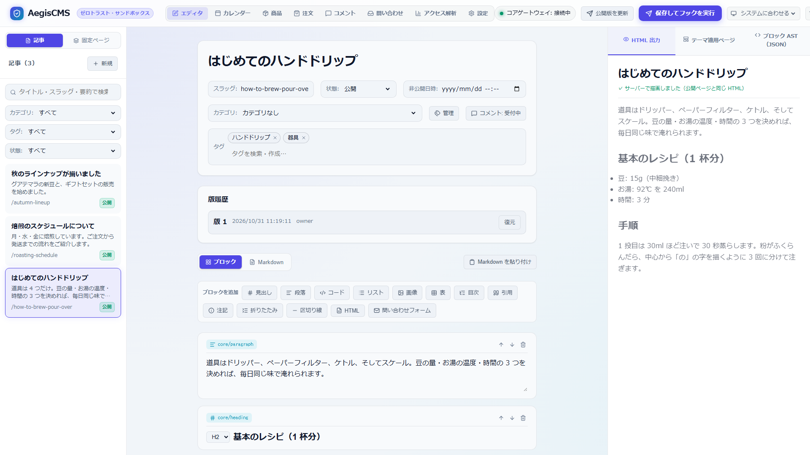

[← ドキュメント一覧へ戻る](README.ja.md)

[English](admin-editing.md) | **日本語**

# コンテンツを書いて公開する

このページは**エディタ**タブの説明です。記事や固定ページを書き、プレビューで確かめ、サイトに載せるまでを扱います。

## 1. 画面の構成

- **左: 一覧。** **記事**と**固定ページ**を切り替え、タイトル・スラッグ・要約で検索し、カテゴリ・タグ・状態で絞り込みます。**新規**で新しく作ります。一覧は 20 件ずつ表示されます。
- **中央: エディタ。** タイトル、設定の行、本文。
- **右: プレビュー。**

記事はニュースやブログのような投稿、固定ページは「会社概要」「お問い合わせ」のような単独のページです。

## 2. 書く

### タイトル・スラッグ・設定

| 項目             | 内容                                                                                                                                                                    |
| ---------------- | ----------------------------------------------------------------------------------------------------------------------------------------------------------------------- |
| **タイトル**     | 必須です。                                                                                                                                                              |
| **スラッグ**     | アドレスの最後の部分。`my-first-post` なら `/articles/my-first-post` になります。必須です。英数字とハイフンを使い、記事の中（固定ページの中）で重複させないでください。 |
| **状態**         | コンテンツの進み具合。[状態と公開](#4-状態と公開)を参照してください。                                                                                                   |
| **カテゴリ**     | 記事に 1 つ。**管理**でカテゴリの設定が開きます。                                                                                                                       |
| **レイアウト**   | 固定ページだけ。**テーマ標準**はテーマの通常のページ、**ブランク / フル幅LP**はランディングページ向けの飾りのないページです。                                           |
| **閲覧できる人** | 会員機能が有効なときに表示。**だれでも**、またはあるレベル以上の会員だけ（[会員](members.ja.md)）。                                                                     |
| **コメント**     | このコンテンツのコメントの受付を開閉します（[コメント](comments.ja.md)）。                                                                                              |

タグもエディタで選びます。タグを作るのは**設定 › タグ**です。

### 本文: ブロックか Markdown か

本文の上の**ブロック / Markdown**で切り替えます。どちらも同じ内容を編集するので、いつでも切り替えられます。

- **ブロック**: **ブロックを追加**を押して、見出し・段落・リスト・画像・コードブロック・表・目次・引用・コールアウト・詳細（折りたたみの Q&A）・区切り線・脚注・HTML・問い合わせフォームから選びます。ブロックは上下に動かしたり、削除したりできます。プラグインが独自のブロックを同じ一覧に足すこともあります。各ブロックの働きは[本文ブロック](blocks.ja.md)にあります。
- **Markdown**: Markdown を直接入力します。ツールバーで書式を挿入でき、<kbd>Tab</kbd> でインデント、<kbd>Ctrl</kbd>+<kbd>S</kbd> で保存します。ブロックのモードで **Markdown を貼り付け**を使うと、クリップボードの文章がブロックに変換されます。結果を確認してから、末尾に追加するか、全体を置き換えるかを選べます。

文章の中では `**太字**`、`*斜体*`、`` `コード` ``、`[リンク](URL)` が使えます。

### 画像

画像ブロックにファイルをドラッグするか、クリックして選ぶと、アップロードされてブロックに反映されます。**メディアライブラリから選ぶ**と、すでにアップロードした画像を再利用できます。大きすぎるファイルは、管理者が決めたアップロードの上限で断られます（[メディア](media.ja.md)）。画像にはすべて代替テキストを書いてください。スクリーンリーダーや、画像が読み込めないときに使われます。

## 3. プレビュー

右側に、訪問者にどう見えるかが出ます。入力を止めて少しすると更新されます。タブは次のとおりです。

- **HTML 出力**: サーバーが描画した本文。
- **テーマ適用ページ**: テーマの中の、ヘッダーとフッターを含むページ全体。
- **ブロック AST（JSON）**: 内容の元になるブロックの構造。開発者やプラグイン作者向けです。

「閲覧できる人」を限定しているときは、**見る人**のセレクターで、スタッフ・ゲスト・各レベルの会員から見た表示を確かめられます。**全画面表示**でプレビューを広げ、**別ウィンドウで開く**とそのときのページを別ウィンドウで見られます。

## 4. 状態と公開

| 状態             | 意味                                                       |
| ---------------- | ---------------------------------------------------------- |
| **下書き**       | 作業中。訪問者には見えません（404 になります）。           |
| **レビュー待ち** | 編集者か校閲者の承認を待っています。訪問者には見えません。 |
| **予約公開**     | **公開日時**になると自動で公開されます。日時を選びます。   |
| **公開**         | 訪問者に見えます。                                         |

サイトから外したいときは、**下書き**に戻します。

**保存**は作業を保存します。すでに**公開**しているコンテンツでは、保存した編集は作業用のコピーとして残り、**「公開版を更新」を押すまで、訪問者には前の公開版が見え続けます**。公開中のページを安全に編集して、準備ができてから反映できます。**公開版を更新**のボタンは、公開中のコンテンツを編集しているときに出ます。

公開・予約中のコンテンツには**非公開日時**も設定できます。キャンペーンのように、日付で終わらせたいものに使います。その時刻を過ぎると、サイトから自動で消えます。

予定をまとめて見るには、**カレンダー**タブを開きます。公開と非公開の日付を、月表示か一覧で、コンテンツの種類で絞って見られます。非公開日時の変更・解除や、エディタへの移動もできます。

### レビュー: 公開の権限なしで書く

**寄稿者**は、下書きを書いてレビューに出せますが、公開はできません。状態を**レビュー待ち**にして保存します。レビュー担当へのメモも付けられます。編集者か校閲者が、次のどちらかをします。

- **承認する**: **公開**または**予約公開**で保存します。
- **差し戻す**: 理由のメモを付けて**下書き**で保存します。本人に通知が届き、メモは版の履歴に残ります。

一覧には、レビュー待ちの件数が出ます。寄稿者が自分の公開済みの記事を編集したときも、同じようにレビューに出ます。承認されるまで、訪問者には公開版が見え続けます。詳しくは[コンテンツの公開とレビュー](theme_and_publishing_guide.ja.md#レビュー寄稿者の下書きを承認して公開する)にあります。

## 5. 版履歴と、間違えたとき

保存した内容はすべて残ります。**版履歴**を押すと、過去の版が見られます。それぞれ**確認**でプレビューでき、今エディタにある内容との**差分**（追加・削除されたところ）を見て、**復元**できます。復元するとエディタの内容が置き換わるので、残したいときは保存してください。

## 6. ヒント

- スラッグは公開する前に決めてください。公開済みのスラッグをあとで変えると、AegisCMS が古いアドレスからのリダイレクトを自動で追加します（**設定 › リダイレクト**）。
- ページを離れる前と、ログインが切れる前に保存してください。
- 別のツールやスクリプトから取り込むときは、[投稿 API](content-api.ja.md) を使います。
