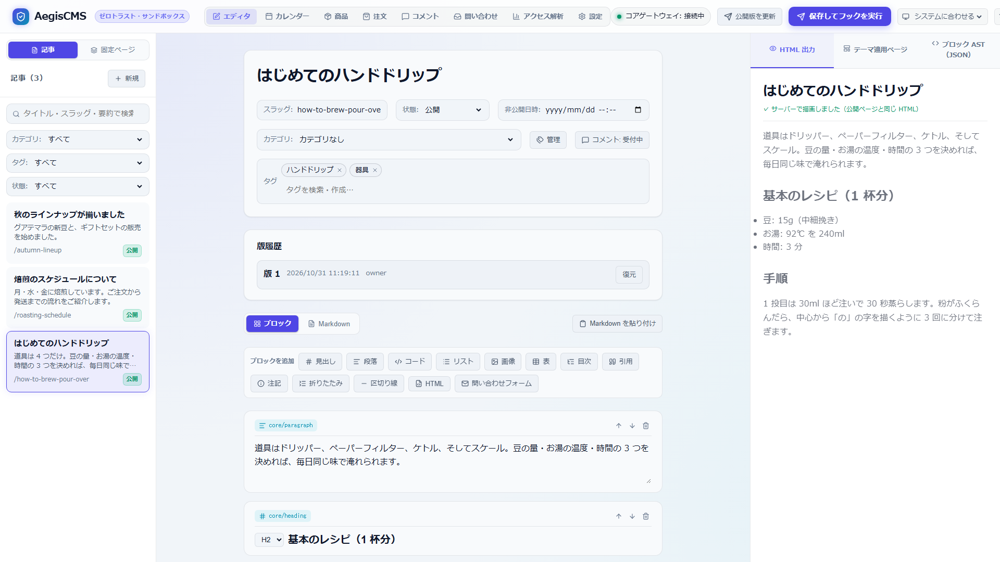

[← Back to the documentation index](README.md)

**English** | [日本語](admin-editing.ja.md)

# Writing and Publishing Content

This page is about the **Editor** tab: writing an article or a page, previewing it, and getting it onto your site.

## 1. The Layout

- **Left: the list.** Switch between **Articles** and **Pages**, search by title, slug or summary, and filter by category, tag and status. Click **+ New** to start a new one. The list is shown 20 at a time.
- **Middle: the editor.** The title, the settings row, and the body.
- **Right: the preview.**

Articles are for posts such as news and blog entries; pages are standalone pages such as About or Contact.

## 2. Write

### Title, slug and settings

| Field               | What it does                                                                                                                                                                  |
| ------------------- | ----------------------------------------------------------------------------------------------------------------------------------------------------------------------------- |
| **Title**           | Required.                                                                                                                                                                     |
| **slug**            | The last part of the address: `my-first-post` gives `/articles/my-first-post`. Required. Use letters, digits and hyphens. It must be unique among articles (and among pages). |
| **status**          | Where the content stands. See [Status](#4-status-and-publishing).                                                                                                             |
| **category**        | One category per article. **Manage** opens the category settings.                                                                                                             |
| **layout**          | Pages only. **Theme Default** uses the theme's normal page; **Blank / Full-width LP** gives a bare page for landing pages.                                                    |
| **Who can read it** | Shown when member accounts are on. **Everyone**, or only members of a level and above ([Members](members.md)).                                                                |
| **Comments**        | Opens or closes comments for this item ([Comments](comments.md)).                                                                                                             |

Tags are picked in the editor too; you create them in **Settings › Tags**.

### Body: Blocks or Markdown

Switch with **Blocks / Markdown** above the body. Both edit the same content, so you can change your mind at any time.

- **Blocks**: click **Add Block** and choose a heading, paragraph, list, image, code block, table, table of contents, quote, callout, details (a collapsible Q&A), separator, footnote, HTML, or a contact form. Move blocks up and down, or delete them. Plugins can add their own blocks to the same list. What each block does is in [Body blocks](blocks.md).
- **Markdown**: type Markdown directly. The toolbar inserts formatting, <kbd>Tab</kbd> indents and <kbd>Ctrl</kbd>+<kbd>S</kbd> saves. **Paste Markdown** in Blocks mode converts text from your clipboard into blocks; you see the result before choosing to add it at the end or replace everything.

In text you can use `**bold**`, `*italic*`, `` `code` `` and `[link](URL)`.

### Images

On an image block, drag a file onto it or click to choose one. It is uploaded and the block is filled in. **Choose from media library** lets you reuse an image you already uploaded. Large files are refused according to the upload limit set by your administrator ([Media](media.md)). Write an alt text for every image; it is used by screen readers and when the image cannot load.

## 3. Preview

The right side shows how the content will look to visitors. It updates a moment after you stop typing. Tabs:

- **Live HTML Output**: the body as rendered by the server.
- **Themed Page**: the whole page inside your theme, with the header and footer.
- **Block AST (JSON)**: the block structure behind the content. This is for developers and plugin authors.

When "Who can read it" is limited, use the **Preview as** selector to see the page as staff, a guest, or a member of each level would see it. **Full screen** enlarges the preview; **Open in a separate window** shows the page as it is at that moment.

## 4. Status and Publishing

| Status             | Meaning                                                                  |
| ------------------ | ------------------------------------------------------------------------ |
| **Draft**          | Work in progress. Visitors cannot see it (they get a 404).               |
| **Pending review** | Waiting for an editor or reviewer to approve it. Visitors cannot see it. |
| **Scheduled**      | Becomes public by itself at **publish at**. Choose the date and time.    |
| **Published**      | Visible to visitors.                                                     |

To take something off the site, set it back to **Draft**.

**Save** stores your work. For content that is already **Published**, saving keeps your edits as a working copy: **visitors still see the previous published version until you click Publish changes.** This lets you edit a live page safely and release the edit when it is ready. The **Publish changes** button appears while you are editing published content.

You can also set **unpublish at** on published or scheduled content, for something that should end on a date, such as a campaign. After that time the item disappears from the site by itself.

To see everything that is scheduled, open the **Calendar** tab. It shows publish and unpublish dates by month or as a list, filtered by content type, and lets you change or clear an unpublish date or jump to the editor.

### Review: writing without publishing rights

If you are a **Contributor**, you can write drafts and send them for review, but you cannot publish. Set the status to **Pending review** and save; you may add a note for the reviewer. An editor or reviewer then:

- **approves** it by saving it as **Published** or **Scheduled**, or
- **sends it back** by saving it as **Draft** with a note saying why. You are notified and the note is kept with the version.

The list shows how many items are waiting for review. A contributor who edits their own published item sends the change for review the same way; visitors keep seeing the published version until it is approved. More in [Content publishing, Review](theme_and_publishing_guide.md#review-approving-and-publishing-a-contributors-draft).

## 5. Version History and Mistakes

Every save is kept. Click **Version history** to see earlier versions of the item. For each one you can **Preview** it, see **Changes** against what is in the editor now (what was added and removed), and **Restore** it. Restoring replaces the editor content; save to keep it.

## 6. Tips

- Pick the slug before you publish. If you change the slug of a published item later, AegisCMS adds a redirect from the old address automatically (**Settings › Redirects**).
- Save before you leave the page, and before your session expires.
- To bring content in from another tool or script, use the [Content API](content-api.md).
