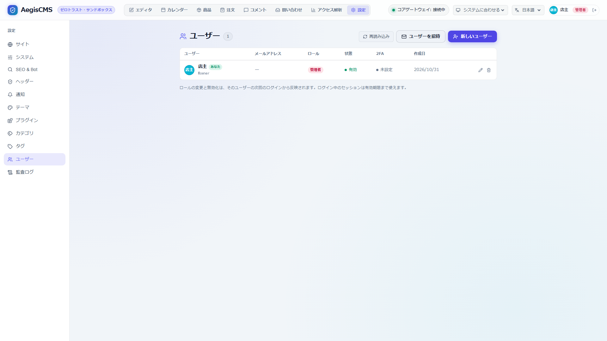

[← ドキュメント一覧へ戻る](README.ja.md)

[English](admin-settings.md) | **日本語**

# Admin Studio でのサイトの設定

**設定**タブを開きます。左のメニューに項目が並びます。見えるのは、自分のロールが使える項目だけです。サーバーで無効にしている機能の項目は、隠れるか、有効にする必要があることが表示されます。以下の項目の多くは**管理者**向けです。

ここでの変更は、サーバーを再起動せずにすぐ反映されます。サーバーの設定ファイルで行う設定は、[設定リファレンス](configuration.ja.md)を参照してください。

## サイトについて

### サイト

サイトの**名前**と、**ファビコン**（ブラウザのタブの小さなアイコン）。ファビコンは、メディアライブラリから選ぶか、アップロードするか、URL を入力します。空で保存すると、サーバーの設定ファイルの値に戻ります。

### SEO & Bot

検索エンジンやクローラーからの見え方です。変更は、公開ページ、`/robots.txt`、`/sitemap.xml` にすぐ反映されます。

- **正規 URL**: サイトのアドレス（`https://` から。例: `https://example.com`）。正規リンク、サイトマップ、フィード、SNS での共有に使われます。サイトを公開したら設定してください。
- **既定のメタディスクリプション**と**キーワード**: ページに要約がないときに使われます。
- **SNS で共有するときの画像**: 自分の画像がないページが共有されたときに出ます。
- **Bot のルール**: AI のスクレイパーを含め、どのクローラーの訪問を許すか。

### テーマ

公開サイトの見た目です。インストール済みのテーマが、プレビュー付きのカードで並びます。**このテーマを使う**でサイトが切り替わり、公開サイトを新しいタブで開いて確認もできます。新しいテーマを入れるには、サーバーに置きます（[テーマ制作ガイド](theme_authoring_guide.ja.md)）。マーケットプレイスのタブは、まだ使えません。

### プラグイン

サーバーに入っている拡張です。プラグインを開くと、その設定を変えられます。どのプラグインを有効にするかはサーバーで決めます（[設定リファレンス](configuration.ja.md#26-runtime--wasm-プラグインランタイム)）。入っていても有効になっていないプラグインは、無効と表示されます。

### カテゴリとタグ

- **カテゴリ**: タイトル、説明、色。記事には 1 つ付きます。編集者以上のロールなら作れ、エディタの**管理**からこの画面が開きます。
- **タグ**: 記事・固定ページ・商品に、いくつでも付けられます。名前で探し、編集し、それぞれが何件で使われているかが分かります。タグを削除すると、すべてのコンテンツから外れます。

### リダイレクト

古いアドレスを新しいアドレスへ送るルールです。**301**（恒久）か **302**（一時）を選びます。公開済みのコンテンツのスラッグを変えると、ルールが自動で追加され、**auto** と表示されます。移動・削除したページのルールは、この画面で追加します。

### お知らせ

すべての公開ページの上部に出るバナーです。たとえばメンテナンスの案内に使います。メッセージと、必要なら表示する期間を入力します。一覧には、それぞれが表示中・予約中・終了・無効のどれかが出ます。時刻はブラウザのローカル時間で入力します。

### リンク切れチェック

公開済みの記事と固定ページで、サイト内と他サイトへのリンクが切れていないか調べます。**検査を開始**を押すと、結果に切れていたリンクが一覧で出ます。

## 訪問者への連絡

### ニュースレター

公開済みの記事を購読者に送ります。購読中・確認待ち・停止の件数が見え、要約の編集、自分へのテスト送信、送信前の確認ができます。購読者の一覧（検索、削除、CSV の書き出し）と送信の履歴もあります。管理者がニュースレターを有効にしている必要があります（[ニュースレター](newsletter.ja.md)）。

### 通知

AegisCMS が送るメール（新しいコメントやレビュー依頼など）です（[通知](notifications.ja.md)）。送信が動いているかの確認、失敗した通知の再送・破棄、テスト送信、メールごとの件名と本文の編集（保存前にプレビュー）ができます。**初期状態に戻す**と、変更が取り消されます。

## ユーザーとセキュリティ

### ユーザー

アカウントの作成・編集・無効化・削除、ロールの変更、パスワードの再設定ができます。**ユーザーを招待**すると、本人がユーザー名とパスワードを決めるリンク付きのメールが送られます。自己登録して承認を待っているアカウントには**承認待ち**のバッジが付くので、編集のダイアログから**承認して有効化**します。最後の管理者は外せません（[ロール](admin-studio.ja.md#3-ロール)）。

### 監査ログ

いつ、誰が、何をしたかの記録です。ログイン、ユーザー・コンテンツ・設定の変更、権限がなくて拒否された操作が残ります。「これは誰が変えたのか」を調べるときに使います（[監査ログ](audit.ja.md)）。

### ヘッダー

サーバーが送る HTTP ヘッダーです。ブラウザの保護（Content-Security-Policy、X-Frame-Options など）を含みます。欄を空にすると組み込みの既定値が使われ、ほとんどのサイトではそれが適切です。値を間違えると、サイトが壊れたり、安全でなくなったりします。理由が分かるときだけ変えてください（[Content-Security-Policy](csp.ja.md)）。

### システム

サーバーを再起動せずに変えられる運用の設定です。

- **メンテナンスモード**と、訪問者に表示するメッセージ
- **アップロードサイズの上限**
- **ブラウザと CDN のキャッシュ**と、ページを保持する時間
- **自己登録**のオン・オフ
- ログインに何回失敗したらロックするか
- コメントとフォーラム投稿のオン・オフ

既定値に戻すボタンがあります（[設定リファレンス](configuration.ja.md#53-システム運用設定-system)）。

### ライセンス

AegisCMS と、使っているオープンソースソフトウェアのライセンスです。

## 関連ガイド

- [Admin Studio をはじめる](admin-studio.ja.md)
- [コンテンツを書いて公開する](admin-editing.ja.md)
- [メディアライブラリとアップロード](media.ja.md)
