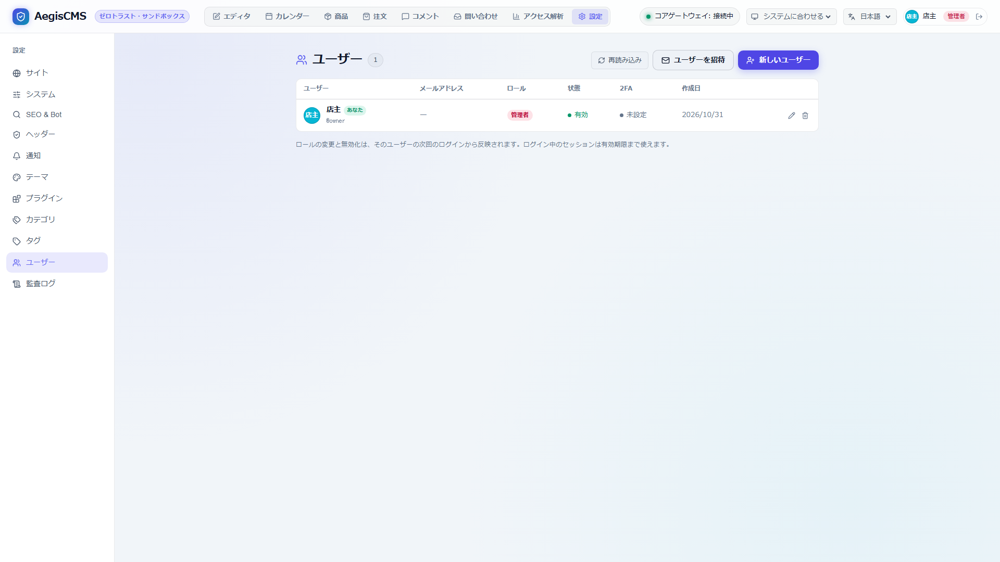

[← Back to the documentation index](README.md)

**English** | [日本語](admin-settings.ja.md)

# Site Settings in Admin Studio

Open the **Settings** tab. The menu on the left lists the sections. You see only the sections your role may use, and the ones for a feature that is turned off on your server are hidden or explain what must be enabled. Most of the sections below are for **administrators**.

Changes here take effect right away, without restarting the server. For settings that are made in the server's configuration file instead, see the [Configuration reference](configuration.md).

## Your Site

### Site

The **name** of the site and its **favicon** (the small icon in the browser tab). For the favicon, choose an image from the media library, upload one, or enter a URL. Saving an empty value returns to the value in the server's configuration file.

Below them, **Previous and next articles** sets which articles an article page links to: from the same category or not, whether to fall back to all articles, and the order (publication or creation date). Themes and plugins such as Post Navigation get the same articles. Choosing "Configuration file" uses `[adjacent_articles]` ([configuration reference](configuration.md#229-adjacent_articles--previous-and-next-articles)).

### Public URLs

The first part of the URL of each content type's public pages (for example, moving articles from `/articles` to `/news`). For each type, write one segment (`/news`: lowercase letters, digits, `-`, and `_`), or `auto` (`/<type name>`). A type that has no public pages can be given one too (the pages appear). A value that another type already uses, or a name the server uses (such as `/api`), cannot be saved.

- A saved value goes into the database and **takes effect when the server restarts**. The schema file (`schemas/*.yaml`) is not changed. The screen shows three values: "in use now", "after restart", and "schema file".
- Clearing it ("Use the schema file's value") removes the override and uses the file's value.
- When the article URL changes, the old `/articles` is redirected (301) to the new URL. The specification is in [3.1.1a of theme_authoring_guide.md](theme_authoring_guide.md#311a-urls-of-articles-and-custom-types-the-schemas-public_path).
- `page`, `category`, and the product type are not listed, because their public URLs are fixed.
- The API is `GET /api/v1/public-paths` and `PUT /api/v1/public-paths/{content_type}` (admin only). Changes are recorded in the audit log as `site.update`.

### SEO & Bot

How search engines and crawlers see the site. Changes apply immediately to public pages, `/robots.txt` and `/sitemap.xml`.

- **Canonical URL**: your site's address, with `https://` (for example, `https://example.com`). It is used for canonical links, the sitemap, the feeds, and social sharing. Set this once the site is public.
- **Default meta description** and **keywords**: used when a page does not have its own summary.
- **Image for social sharing**: shown when a page without its own image is shared.
- **Bot rules**: which crawlers may visit, including AI scrapers.

### Themes

The look of the public site. Each installed theme is a card with a preview. **Activate** switches the site to it, and you can open the public site in a new tab to check. To add a theme, install it from the **Store** tab, upload a ZIP there, or place it on the server ([Theme authoring guide](theme_authoring_guide.md)).

### Store (on the Themes and Plugins screens)

The packages of the [package store](store.md), for administrators. Packages the catalog recommends (code highlighting, diagrams, content blocks) come first under **Recommended** until they are installed, since a new site has no plugin turned on. Each card shows the version, whether it is installed, and whether a newer version runs on this server. **Install** (or **Update to v…**) first shows what the package will be allowed to do (its hooks, the hosts it talks to or embeds, what it adds to the CSP); the package is installed only if it matches the catalog's checksum and signature. Installing does not enable it: turn the plugin on, or switch to the theme, on the Installed tab. A catalog that cannot be used (for example, its signature does not verify) is shown with the reason, and the store tab says so when `[store].enabled = false`.

### Plugins

The extensions installed on the server. Open a plugin to change its settings. Which plugins are turned on is decided on the server ([Configuration reference](configuration.md#26-runtime--wasm-plugin-runtime)); a plugin that is installed but not turned on is shown as disabled. To add a plugin, install it from the **Store** tab or upload a ZIP there.

### Categories and Tags

- **Categories**: a title, a description and a colour. An article has one category. Anyone with the editor role or above can create them, and **Manage** in the editor opens this screen.
- **Tags**: any number of tags can be put on articles, pages and products. You find them by name, edit them, and see how many items use each one. Deleting a tag removes it from everything.

### Redirects

Rules that send an old address to a new one, as **301** (permanent) or **302** (temporary). When you change the slug of a published item, a rule is added for you and marked **auto**. Use this screen to add rules for pages you moved or removed.

### Notices

A banner shown at the top of every public page, for example a maintenance announcement. Give it a message and, if you like, the period to show it. The list shows each notice as showing, scheduled, ended or disabled. Times are entered in your browser's local time.

### Broken Links

Checks the published articles and pages for links that no longer work, both inside your site and to other sites. Click **Scan Now**; the result lists the links that failed.

## Visitors and Communication

### Newsletter

Send a published article to your subscribers. The screen shows how many are subscribed, waiting for confirmation, or stopped; lets you edit the summary, send a test to yourself, and confirm before sending; and lists subscribers (search, delete, export as CSV) and what was sent. Needs the newsletter to be turned on by your administrator ([Newsletter](newsletter.md)).

### Notifications

The emails AegisCMS sends, such as new comments or review requests ([Notifications](notifications.md)). You can see whether sending works, retry or discard notifications that failed, send a test message, and edit the subject and text of each message, with a preview before saving. **Restore defaults** undoes your changes.

## People and Security

### Users

Create, edit, disable and delete accounts, change roles, and reset passwords. **Invite user** sends an email with a link where the person chooses their own username and password. Accounts that registered themselves and wait for approval show a **Pending approval** badge; approve and enable them from the edit dialog. The last administrator cannot be removed ([Roles](admin-studio.md#3-roles)).

### Audit Logs

A record of who did what and when: sign-ins, changes to users, content and settings, and operations refused for lack of permission. Use it to answer "who changed this?" ([Audit log](audit.md)).

### Headers

The HTTP headers the server sends, including the browser protections (Content-Security-Policy, X-Frame-Options and others). Leave a field empty to use the built-in default, which is right for nearly every site. A wrong value can break the site or make it less safe, so change it only when you know why ([Content-Security-Policy](csp.md)).

- **Hosts allowed for embeds**: the hosts that generic embed blocks (blocks of plugins that declare `capabilities.embed.site_domains` in the manifest, such as "Embed (allowed sites)" in `official-embeds`) can embed, one per line (without `https://`; e.g. `forms.example.com`; up to 50). These hosts are added to the CSP `frame-src` only while a plugin that accepts them is enabled. Hosts in `[embed].frame_domains` in the config file cannot be removed here (they are shown on the screen). When no plugin that accepts them is enabled, the screen says so. Authors can write any URL, so add only sites you trust. This site's own host (the canonical URL in SEO & Bot, and the host Admin Studio is opened on) cannot be added (the generic embed opens pages with `allow-same-origin`, so a same-origin page could remove its sandbox). Changes are recorded in the audit log as `headers.update`.

### System

Operating settings that you can change without restarting the server:

- **Maintenance mode**, with the text shown to visitors
- The **upload size limit**
- **Browser and CDN caching**, and how long to keep pages
- Turning **self-registration** off and on
- How many failed sign-ins lock an account
- Turning comments and forum posts off and on

There is a button to return to the defaults ([Configuration reference](configuration.md#53-system-operation-settings-system)).

### Licenses

The licenses of AegisCMS and of the open-source software it uses.

## Related Guides

- [Getting started with Admin Studio](admin-studio.md)
- [Writing and publishing content](admin-editing.md)
- [Media library and uploads](media.md)
