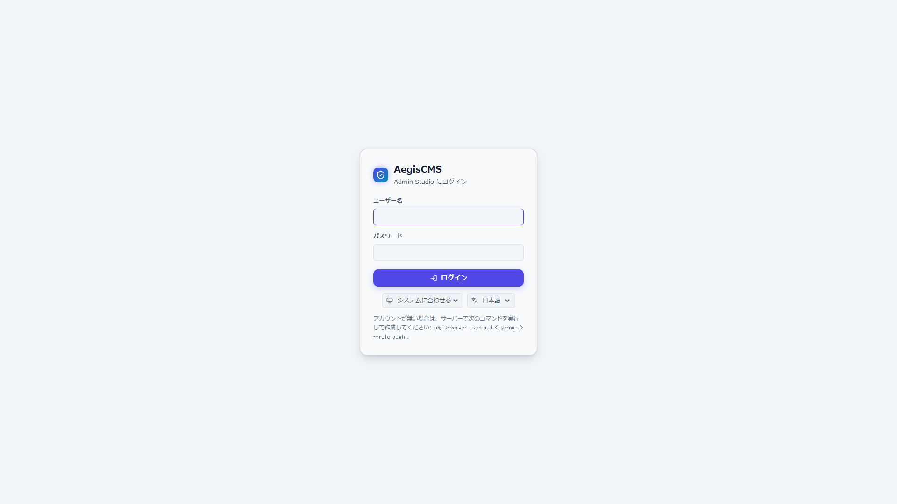
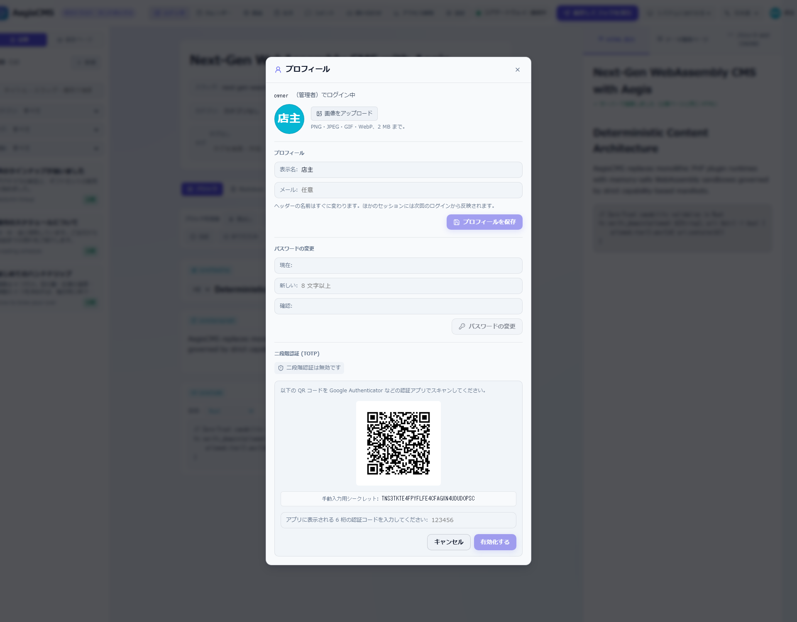

[← ドキュメント一覧へ戻る](README.ja.md)

[English](admin-studio.md) | **日本語**

# Admin Studio をはじめる

Admin Studio は、サイトを書いて管理するための画面です。サイトの `/admin/`（例: `http://localhost:8080/admin/`）を開きます。

このページでは、ログイン、画面の各部分の役割、ロールごとにできることを説明します。続きは[コンテンツを書いて公開する](admin-editing.ja.md)と[サイトの設定](admin-settings.ja.md)です。

## 1. 最初のログイン

### 新しいサイト: 初期セットアップ

新しいサイトで初めて `/admin/` を開くと、まだアカウントがないため、ログインフォームの代わりに**初期セットアップ**が出ます。次を入力します。

| 項目                             | 補足                                                                   |
| -------------------------------- | ---------------------------------------------------------------------- |
| **サイト名**                     | サイトの名前。あとで「設定」から変えられます。                         |
| **管理者ユーザー名**             | 最初の管理者です。                                                     |
| **管理者パスワード**             | 8 文字以上。                                                           |
| **管理者メールアドレス**         | 任意。パスワード再設定のメールに必要です。                             |
| **初期サンプルコンテンツを作成** | ウェルカム記事と固定ページを作ります。まっさらにしたいときは外します。 |

**インストール完了**を押すと、そのままログインした状態になります。

> [!WARNING]
> これを済ませるまでは、**最初に `/admin/` を開いた人が管理者になります**。インターネットに公開する前にセットアップを終えてください。または、サーバー側で `aegis-server user add` を使って管理者を作ります（[導入](install.ja.md#4-管理者を作成する)）。

### ログインする

**ユーザー名**と**パスワード**を入力して**ログイン**を押します。サイトによっては、次も表示されます。

- **… でログイン**: 組織のIDプロバイダーを使うシングルサインオン（[認証](authentication.ja.md)）。失敗したときは、理由がメッセージに出ます（例: アカウントがまだ用意されていない場合は、管理者に頼みます）。
- **アカウントを作成**: 管理者が自己登録を許可しているときだけ表示されます。確認メールが届くので、リンクを開きます。管理者の承認が必要な場合もあります。
- **パスワードをお忘れですか？**: メールアドレスを入力し、届いたメールのリンクに従います。
- 管理者からの**招待リンク**: 開いて、ユーザー名とパスワードを決めると、アカウントが使えるようになります。

### 二段階認証

二段階認証を有効にしている場合は、パスワードのあとに認証アプリの 6 桁のコードを求められます。スマートフォンをなくしたときは、**バックアップコードを使用する**で、保存しておいた 6 つのバックアップコードのうち 1 つを入力します。

### 失敗が続いたとき

パスワードを何度か間違えると、正しいパスワードでも一定時間（既定は 15 分）ログインできなくなります。待つ分数は画面に出ます。管理者が解除することもできます（[トラブル対応](troubleshooting.ja.md#ログインできない)）。

ログインは一定時間（既定は 1 時間）で切れます。切れると、お知らせとともにログイン画面に戻り、保存していない変更は失われます。こまめに保存してください。

## 2. 画面の見方

ヘッダーにタブが並びます。表示されるタブは、ロールと、サイトで有効にしている機能によって変わります。

| タブ                             | 用途                                                                              |
| -------------------------------- | --------------------------------------------------------------------------------- |
| **エディタ**                     | 記事と固定ページを書く・編集する（[ガイド](admin-editing.ja.md)）                 |
| **カレンダー**                   | 予約公開・非公開を月ごとに見る                                                    |
| **商品**・**注文**・**レビュー** | ショップ（[EC](commerce.ja.md)）。ショップが有効なときだけ表示                    |
| **会員**                         | 訪問者のアカウント（[会員](members.ja.md)）。有効なときだけ表示                   |
| **コメント**                     | コメントの承認と管理（[コメント](comments.ja.md)）。有効なときだけ表示            |
| **フォーラム**                   | フォーラムの管理（[フォーラム](forum.ja.md)）。有効なときだけ表示                 |
| **問い合わせ**                   | 問い合わせフォームのメッセージ（[問い合わせ](contact.ja.md)）。有効なときだけ表示 |
| **アクセス解析**                 | ページビューと訪問者数（[アクセス解析](analytics.ja.md)）。有効なときだけ表示     |
| **設定**                         | そのほかすべて（[サイトの設定](admin-settings.ja.md)）                            |

ヘッダーの右側には、接続の状態（**コアゲートウェイ: 接続中**。**オフライン**と出たらサーバーに届いていません）、編集中の保存・公開ボタン、自分の名前があります。名前を押すと**プロフィール**が開き、**ログアウト**もできます。

スマートフォンでは、タブはメニューにまとまり、エディタは記事一覧・エディタ・プレビューを 1 つずつ切り替えて表示します。

## 3. ロール

アカウントにはロールが 1 つあります。上のロールは、下のロールができることをすべて含みます。

| ロール     | できること                                                                                             |
| ---------- | ------------------------------------------------------------------------------------------------------ |
| **管理者** | すべて。ユーザー・テーマ・プラグイン・設定・監査ログも含みます                                         |
| **編集者** | 公開・予約・非公開、他の人のコンテンツの編集、レビューの承認、カテゴリ・タグ・ショップ・コメントの管理 |
| **校閲者** | レビュー待ちのコンテンツの校正、承認、差し戻し。新規作成と削除はできません                             |
| **寄稿者** | 自分の下書きを書いて、レビューに出す。公開は編集者か校閲者が行います                                   |
| **閲覧者** | 見るだけ。変更するボタンは無効になります                                                               |

ロールは、管理者が**設定 › ユーザー**で変えます。変更はすぐに反映され、本人はログアウトされて、新しいロールで入り直します。最後の管理者は、降格・無効化・削除ができないので、誰も入れなくなる事故は起きません。詳しくは[認証](authentication.ja.md#ロールと-api-の権限)にあります。

## 4. プロフィール

ヘッダーの自分の名前を押します。

- **アバター・表示名・メールアドレス**: ここで変えます。アバターがないときは、イニシャルが出ます。
- **パスワード**: ここで変えます。シングルサインオンでログインするアカウントは、IDプロバイダー側で変えます。
- **二段階認証 (TOTP)**: 有効にすると、ログインのたびに認証アプリのコードを求められます。**バックアップコードが 6 つ**出ます。表示は一度きりなので、安全な場所に保存してください。管理者には、有効にすることを強くおすすめします。
- **API トークン**: コンテンツを投稿するツールやスクリプト用です（[投稿 API](content-api.ja.md)）。トークンは自分のロールで動きます。パスワードと同じに扱い、不要になったら削除してください。

## 次に読むもの

- [コンテンツを書いて公開する](admin-editing.ja.md)
- [サイトの設定](admin-settings.ja.md)
- [トラブル対応](troubleshooting.ja.md)
