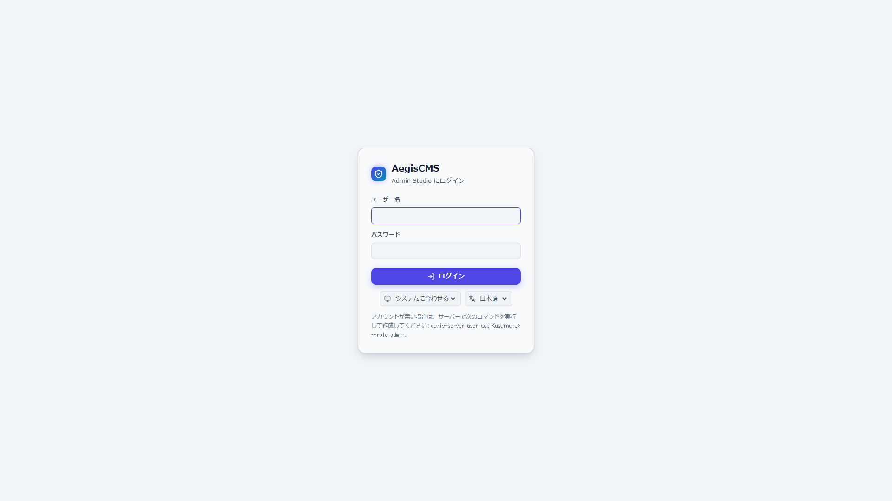
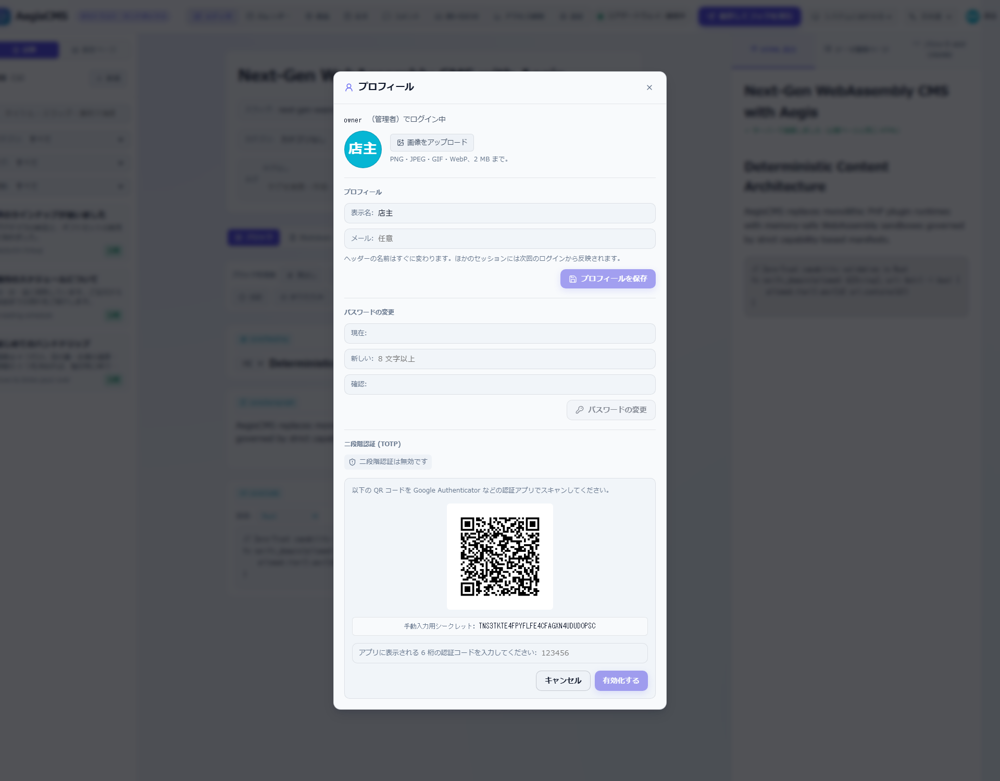

[← Back to the documentation index](README.md)

**English** | [日本語](admin-studio.ja.md)

# Admin Studio: Getting Started

Admin Studio is the screen where you write and manage your site. Open `/admin/` on your site (for example, `http://localhost:8080/admin/`).

This page covers signing in, what each part of the screen is for, and what each role can do. Next: [Writing and publishing content](admin-editing.md) and [Site settings](admin-settings.md).

## 1. First Sign-in

### A new site: initial setup

The first time you open `/admin/` on a new site, there are no accounts yet, so Admin Studio shows **Initial Setup** instead of the sign-in form. Fill in:

| Field                     | Notes                                                          |
| ------------------------- | -------------------------------------------------------------- |
| **Site Title**            | The name of your site. You can change it later in Settings.    |
| **Admin Username**        | The first administrator.                                       |
| **Admin Password**        | At least 8 characters.                                         |
| **Admin Email**           | Optional. Needed for password reset emails.                    |
| **Create sample content** | Adds a welcome article and page. Turn it off for a clean site. |

Click **Complete Installation** and you are signed in.

> [!WARNING]
> Until this is done, **the first person to open `/admin/` becomes the administrator**. Complete the setup before you publish the site on the internet, or create the administrator on the server instead with `aegis-server user add` ([Installing](install.md#4-create-an-administrator)).

### Signing in

Enter your **Username** and **Password** and click **Sign in**. Depending on your site, you may also see:

- **Sign in with …**: single sign-on through your organization's identity provider ([Authentication](authentication.md)). If it fails, the message says why (for example, your account is not set up yet; ask an administrator).
- **Create an account**: shown only when the administrator allows self-registration. You get a confirmation email and must open the link. An administrator may need to approve the account before you can sign in.
- **Forgot your password?**: enter your email address and follow the link in the email.
- An **invitation link** from an administrator: open it, choose a username and password, and your account is ready.

### Two-factor authentication

If you turned on two-factor authentication, you are asked for a 6-digit code from your authenticator app after the password. If you lost the phone, use **Use a backup code instead** with one of the 6 backup codes you saved.

### Too many failed attempts

After several wrong passwords, sign-in is locked for a while (15 minutes by default), even with the correct password. The screen tells you how many minutes to wait. An administrator can release it ([Troubleshooting](troubleshooting.md#i-cannot-log-in)).

A sign-in lasts for a limited time (one hour by default). When it ends, you are returned to the sign-in screen with a notice, and unsaved changes are lost, so save often.

## 2. The Screen

The header has tabs. Which ones you see depends on your role and on which features your site has turned on.

| Tab                                   | What it is for                                                                  |
| ------------------------------------- | ------------------------------------------------------------------------------- |
| **Editor**                            | Write and edit articles and pages ([guide](admin-editing.md))                   |
| **Calendar**                          | See scheduled publishing and unpublishing by month                              |
| **Products**, **Orders**, **Reviews** | The shop ([E-commerce](commerce.md)). Shown only when the shop is enabled       |
| **Members**                           | Visitor accounts ([Members](members.md)). Shown only when enabled               |
| **Comments**                          | Approve and manage comments ([Comments](comments.md)). Shown only when enabled  |
| **Forum**                             | Moderate the forum ([Forum](forum.md)). Shown only when enabled                 |
| **Inbox**                             | Messages from the contact form ([Contact](contact.md)). Shown only when enabled |
| **Analytics**                         | Page views and visitors ([Analytics](analytics.md)). Shown only when enabled    |
| **Settings**                          | Everything else ([Site settings](admin-settings.md))                            |

On the right of the header you see the connection state (**Core Gateway: Connected**; if it says **Offline**, the server cannot be reached), the save and publish buttons while you edit, and your name. Click your name to open **My profile**, or choose **Sign out**.

On a phone, the tabs fold into a menu, and the editor shows one pane at a time: the article list, the editor, or the preview.

## 3. Roles

Every account has one role. A role includes everything the roles below it can do.

| Role            | What it can do                                                                                                                      |
| --------------- | ----------------------------------------------------------------------------------------------------------------------------------- |
| **Admin**       | Everything, including users, themes, plugins, settings, and audit logs                                                              |
| **Editor**      | Publish, schedule and take down content, edit anyone's content, approve reviews, and manage categories, tags, the shop and comments |
| **Reviewer**    | Proofread and approve or send back content that is waiting for review. Cannot create or delete                                      |
| **Contributor** | Write drafts of their own and send them for review. An editor or reviewer publishes them                                            |
| **Viewer**      | Look only. Buttons that change anything are disabled                                                                                |

An administrator changes roles in **Settings › Users**. The change applies immediately: the person is signed out and signs in again with the new role. The last administrator cannot be demoted, disabled, or deleted, so you cannot lock everyone out by mistake. Details are in [Authentication](authentication.md#roles-and-api-permissions).

## 4. My Profile

Click your name in the header.

- **Avatar, display name, email address**: change them here. Without an avatar, your initials are shown.
- **Password**: change it here. Accounts that sign in with single sign-on change their password at the identity provider instead.
- **Two-factor authentication (TOTP)**: turn it on to ask for a code from an authenticator app at every sign-in. You get **6 backup codes**; save them somewhere safe, because they are shown only once. Anyone with the password and no code cannot sign in, so turning this on is strongly recommended for administrators.
- **API tokens**: for tools and scripts that post content ([Content API](content-api.md)). A token acts with your role. Treat it like a password and delete it when you no longer need it.

## Where to Next

- [Writing and publishing content](admin-editing.md)
- [Site settings](admin-settings.md)
- [Troubleshooting](troubleshooting.md)
