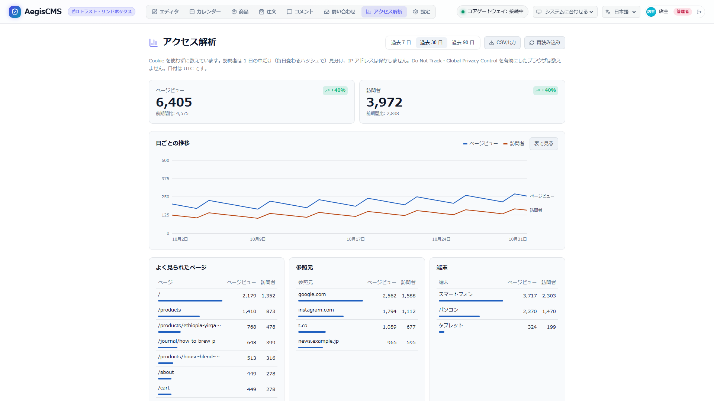

[← Back to the documentation index](README.md)

**English** | [日本語](analytics.ja.md)

# Analytics

Counts page views and visitors on the public site without using cookies (`[analytics]`). In Admin Studio's **Analytics** tab you can see day-by-day trends, the most viewed pages, referrers, and device types. It does not hand visitors' data to an external service like Google Analytics, and no cookie consent banner is needed.

The feature lives in the `aegis-analytics` crate and is built in with the server's Cargo feature `analytics` (built in by default; it runs only when `enabled = true`).

```text
 Public page (a small script in <head>)
        │  POST /api/v1/analytics/event  {"p": "/articles/hello", "r": "https://www.google.com/"}
        │  (browsers with Do Not Track or Global Privacy Control enabled do not send it)
        ▼
 Exclude crawlers → identify the day's visitor (a hash, held only in the cache and gone in 2 days)
        │
        ▼
 Aggregate per day in memory ──(every 30 s and at shutdown)──▶ _aegis_analytics (only counts per day × page, referrer, and device)
```

---

## 1. Enabling It

```toml
[analytics]
enabled = true
retention_days = 400        # days to keep the aggregates (0 never deletes)
flush_interval_secs = 30    # interval for writing aggregates to the DB (seconds)
exclude_paths = []          # paths not to count (prefix match, e.g. ["/preview"])
```

When enabled, the beacon goes into the `<head>` (`extra_head`) of every public page rendered by the theme. There is no work on the theme side. The beacon is an external file (`/_aegis/analytics.js`; the endpoint URL is the `<script>`'s `data-endpoint`) rather than an inline script, so the CSP `script-src` does not need `'unsafe-inline'`.

## 2. What Is Counted

| Item                     | Description                                                                                                                                                                                                        |
| ------------------------ | ------------------------------------------------------------------------------------------------------------------------------------------------------------------------------------------------------------------ |
| Page views               | The number of times a page was displayed                                                                                                                                                                           |
| Visitors                 | Unique visitors for the day. The same person on different days is counted separately (a period's visitor count is the sum of the days)                                                                             |
| Most viewed pages        | Page views and visitors per path (excluding the query string and anything after `#`)                                                                                                                               |
| Referrers                | The referrer host name (without `www.`) of page views that came from other sites. "Direct / no referrer" is from bookmarks, apps, and sites that do not send a referrer. Navigation within the site is not counted |
| Devices                  | `desktop` / `mobile` / `tablet`, determined from the User-Agent                                                                                                                                                    |
| Search keywords          | Keywords searched on the public search page (`/search?q=...`) (counted only for the first page)                                                                                                                    |
| Searches with no results | Keywords whose search returned 0 results (for analyzing demand for content users want)                                                                                                                             |

Not counted:

- Crawlers, monitoring services, and command-line tools (determined by User-Agent), and automated browsers (`navigator.webdriver`)
- Browsers with Do Not Track (`DNT: 1`) or Global Privacy Control (`Sec-GPC: 1`) enabled
- Access that does not run JavaScript
- Paths in `exclude_paths`

## 3. Privacy

- It uses no cookies or localStorage. Nothing is left in the visitor's browser.
- Visitors are distinguished by a SHA-256 of "a secret value for that day only + IP address + User-Agent + host name". The secret value is recreated every day and held only in the cache (`[cache]`; shared by all servers with Redis), so across days it cannot be known to be the same person.
- IP addresses, User-Agents, and hashes are not stored in the DB. Only the daily aggregate counts are in the DB.
- No visitor information is sent to external services.

In your privacy policy you can write, for example, "We aggregate page view counts with cookie-less analytics. No personally identifiable information is stored."

## 4. Admin Studio



In the **Analytics** tab (shown only when `[analytics].enabled = true`; viewer and above), you can see aggregates for the past 7 / 30 / 90 days.

- **Totals of page views and visitors, and comparison with the previous period**: shows the comparison (percentage change and the previous period's figures) with the immediately preceding period of the same length as the selected one (the previous week, previous month, etc.).
- **Day-by-day trend**: switchable between a graph (daily values can be read with the arrow keys) and a table.
- **Breakdown rankings**: shows the top of the most viewed pages, referrers, devices, UTM sources (`utm_source`), UTM campaigns (`utm_campaign`), search keywords (top queries), and searches with no results (queries with 0 hits).
- **CSV export**: from the "CSV export" button at the top right, you can download a report CSV (with a UTF-8 BOM so Excel does not garble it) containing the day-by-day trend of the displayed period and each ranking.

Dates are split in UTC.

## 5. API

`GET /api/v1/analytics/summary?from=2026-10-01&to=2026-10-31&limit=10` (viewer and above)

| Parameter     | Description                                                                                              |
| ------------- | -------------------------------------------------------------------------------------------------------- |
| `from` / `to` | The period (`YYYY-MM-DD`, UTC, both ends inclusive; up to 366 days). If omitted, the 30 days up to today |
| `limit`       | Number of top pages, referrers, and devices (default 10, max 100)                                        |

```json
{
  "from": "2026-10-01",
  "to": "2026-10-31",
  "pageviews": 1234,
  "visitors": 456,
  "daily": [{ "day": "2026-10-01", "pageviews": 40, "visitors": 15 }],
  "top_pages": [{ "value": "/", "pageviews": 300, "visitors": 120 }],
  "top_referrers": [{ "value": "google.com", "pageviews": 80, "visitors": 70 }],
  "devices": [{ "value": "mobile", "pageviews": 600, "visitors": 250 }],
  "top_utm_sources": [{ "value": "twitter", "pageviews": 150, "visitors": 90 }],
  "top_utm_campaigns": [{ "value": "autumn_sale", "pageviews": 150, "visitors": 90 }],
  "top_search_queries": [{ "value": "rust", "pageviews": 40, "visitors": 25 }],
  "top_search_empty": [{ "value": "kubernetes", "pageviews": 12, "visitors": 10 }],
  "previous": {
    "from": "2026-08-31",
    "to": "2026-09-30",
    "pageviews": 1100,
    "visitors": 400,
    "pageviews_change_pct": 12.2,
    "visitors_change_pct": 14.0
  }
}
```

- `GET /api/v1/analytics/export?from=2026-10-01&to=2026-10-31` (viewer and above): downloads the period's aggregates (overview, comparison with the previous period, day-by-day trend, popular pages, referrers, devices, UTM) as a CSV file with a UTF-8 BOM.
- The beacon endpoint `POST /api/v1/analytics/event` accepts a body `{"p": path, "q": query string, "r": referrer}` (up to 4KB) and returns `204` whether or not it was counted.
