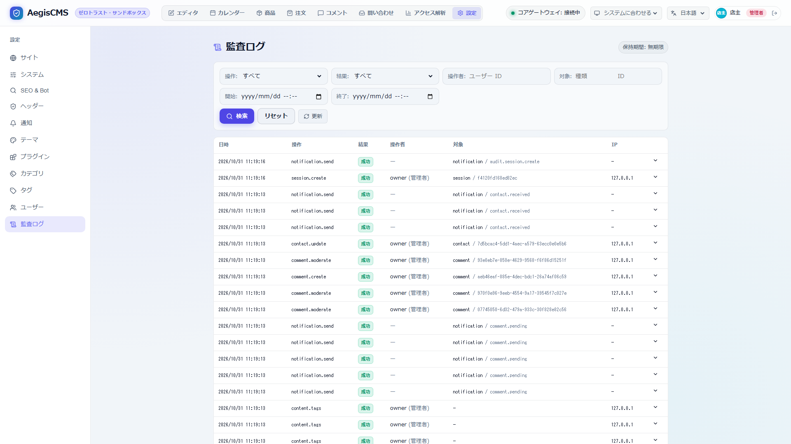

[← Back to the documentation index](README.md)

**English** | [日本語](audit.ja.md)

# AegisCMS Audit Log Reference

AegisCMS records content creation, session operations, file uploads, and plugin errors as audit events.
The destinations are abstracted by the `AuditSink` trait, and several destinations can be enabled at the same time in the settings.

Related sources:

- Event types / the `AuditSink` trait: [`crates/aegis-core/src/audit.rs`](../crates/aegis-core/src/audit.rs)
- Destination implementations and delivery: [`crates/aegis-audit/`](../crates/aegis-audit)
- Query API / metrics: [`crates/aegis-server/src/handlers/audit.rs`](../crates/aegis-server/src/handlers/audit.rs)

---

## 1. Settings

```toml
[audit]
enabled = true
sinks = ["database", "log", "prometheus"]
trust_forwarded_for = false
retention_days = 90
purge_interval_secs = 3600
```

For the description of each item, see the [Configuration reference](./configuration.md#28-audit--audit-log).

| Destination (`sinks`) | Description | Main integrations |
| --- | --- | --- |
| `database` | Persists to the `_aegis_audit_logs` table and makes it searchable with `GET /api/v1/audit-logs` (default) | SQLite / PostgreSQL / MySQL |
| `log` | Outputs structured logs, one JSON per line, to the `aegis::audit` target | CloudWatch Logs, Loki, Datadog, etc. (via forwarding of standard output) |
| `prometheus` | Exposes the `aegis_audit_events_total` counter at `GET /metrics` | Prometheus, CloudWatch Agent (Prometheus collection) |

- Even if writing to a destination fails, **the request does not fail** (an `ERROR` log is written and processing continues).
- For when to use the `database` sink and its caveats, see [Choosing a destination](#11-choosing-a-destination).
- With `enabled = false` or `sinks = []`, nothing is recorded.
- To notify specific events, such as administrator logins and login lockouts, by email, configure `[[notifications.audit.rules]]` ([Notifications document 2.1](notifications.md#21-notifying-audit-events)).

### 1.1 Choosing a Destination

The `database` sink INSERTs into `_aegis_audit_logs` synchronously while processing the request (there is no asynchronous queue or batch writing). If writing the audit log gets slow, it directly affects the request's response time.

| Operation | Recommended destination |
| --- | --- |
| Standalone SQLite operation, or a small to medium site centered on administrator operations | `database` (usable for viewing and searching in Admin Studio and automatic deletion by `retention_days`) |
| A high-traffic site using PostgreSQL / MySQL | `log` (standard output) + storage and search at the forwarding destination. Drop `database`, or if used together, keep the count down |
| Only aggregating counts or alerting | `prometheus` |

**Cautions when using `database`**

- **Throughput**: when measuring only the recording of unauthenticated 401s at 50 concurrent, the guide figures are about 2,000 req/s for SQLite (WAL), about 990 req/s for PostgreSQL, and about 230 req/s for MySQL (on Docker; [measurement details](development.md#63-per-database-performance-comparison-task-benchdbs--scriptscompare-dbsmjs)). With an external RDBMS, network round trips and commit waits add on, so the impact grows as the site's overall write volume grows. On the other hand, pure 401 responses excluding the audit log DB write reach about 1,600–1,960 req/s on all 3 engines, and the content list API also maintains about 820–860 req/s on external DBs.
- **Capacity and backups**: if there are many events recorded on every access (such as `access.denied`), the table grows large and DB backups bloat too. Be sure to set `retention_days` (the default `0` is unlimited; [Retention period](#5-retention-period-and-automatic-deletion)).
- **Contention with main data**: audit log writes use the same DB and the same connection pool as main data such as content.
- **Loss**: events whose write failed remain only in the `ERROR` log and are not retried. For uses where no loss is acceptable, use `log` together to keep them in a separate path too.

It is not suited to accumulating a large volume of logs in the DB and searching them. In that case, aggregate the `log` output into Loki / CloudWatch Logs or the like ([Structured logs](#7-structured-logs-log)).

---

## 2. Recorded Events

| `action` | When recorded | `outcome` | `resource_type` / `resource_id` | Main `details` |
| --- | --- | --- | --- | --- |
| `content.create` | `POST /api/v1/contents/{content_type}` | `success` / `denied` (the `on-before-save` hook refused or failed) / `failure` (DB error) | `content` / content ID | `content_type`, `slug`, `title`, `status`, `reason` / `error` |
| `content.update` | `PUT /api/v1/contents/{content_type}/{slug}` | Same as `content.create` | `content` / content ID | Same as `content.create` |
| `content.delete` | `DELETE /api/v1/contents/{content_type}/{slug}` | `success` / `failure` (DB error) | `content` / content ID | `content_type`, `slug`, `title`, `error` |
| `content.publish` | The server published content scheduled for publication (`status: "scheduled"`) when the `published_at` time arrived ([Scheduled publishing of content](theme_and_publishing_guide.md)) | `success` / `failure` (DB error) | `content` / content ID | `content_type`, `slug`, `title`, `published_at`, `error` (no operator `actor`) |
| `content.unpublish` | The server unpublished (`status: "archived"`) time-limited content when the `unpublish_at` time arrived ([Scheduled unpublishing of content](theme_and_publishing_guide.md)) | `success` / `failure` (DB error) | `content` / content ID | `content_type`, `slug`, `title`, `unpublish_at`, `error` (no operator `actor`) |
| `content.review` | A content item's review status changed ([Review](theme_and_publishing_guide.md#review-approving-and-publishing-a-contributors-draft)): made awaiting review (`pending`), an item awaiting review was published or scheduled, someone other than the author reverted it to draft, or the author reverted it to draft | `success` | `content` / content ID | `decision` (`submitted` / `approved` / `returned` / `withdrawn`), `content_type`, `slug`, `title`, `status`, `note` (the `review_note` at save time) |
| `session.create` | `POST /api/v1/auth/session` (login) | `success` / `failure` (including authentication failure) / `denied` (locked by login attempt rate limiting, refused by an `on-user-authenticated` plugin) | `session` / session fingerprint | `expires_at`, `provider`, `username` (on failure or refusal), `error` (failure reason: `unknown_user` / `invalid_password` / `account_disabled` / `rate_limited` / `plugin_rejected` / `plugin_failed`, SSO reasons ([Authentication 6.4](authentication.md#64-reasons-for-failure-login_error-error-in-the-audit-log-sessioncreate)), etc.), `reason` (the content of a plugin's refusal or failure), `role_mapped` (`from` / `to` when a plugin changed the role), `locked` (the unit locked by that failure: `username` / `ip`), `lock_scope` / `retry_after_secs` (on `denied`) |
| `session.delete` | `DELETE /api/v1/auth/session` | `success` / `failure` | `session` / session fingerprint | `error` |
| `storage.upload` | `POST /api/v1/storage/upload` | `success` / `failure` (storage error) | `asset` / storage key | `original_name`, `content_type`, `size`, `url`, `error` |
| `storage.delete` | `DELETE /api/v1/storage/objects/{key}` ([Media](media.md#deleting-a-file--delete-apiv1storageobjectskey)) | `success` / `failure` (storage error) | `asset` / storage key | `url`, `force`, `references` (the number of referrers), `error` |
| `plugin.error` | A Wasm plugin hook failed to run (trap, timeout, fuel exhaustion, etc.) | `failure` | `content` / content ID (`session` / none for `on-user-authenticated`, `order` / order ID for `on-order-status-changed`) | `hook`, `content_type` / `username` / `plugin`, `error` |
| `plugin.enable` / `plugin.disable` | `PUT /api/v1/plugins/{name}/enabled` ([Toggling plugins on and off](plugin_hooks.md#71-toggling-on-and-off-from-admin-studio)) | `success` / `failure` (cannot load, DB error) | `plugin` / plugin name | `from` / `to` (the enabled list), `error` |
| `plugin.reorder` | `PUT /api/v1/plugins/order` ([Reordering execution order](plugin_hooks.md#72-reordering-hook-execution-and-returning-to-the-config-files-values)) | `success` / `failure` | `plugin` / none | `from` / `to`, `error` |
| `plugin.reset` | `DELETE /api/v1/plugins/order` (return to `[plugins].enabled` in the config file) | `success` / `failure` (cannot load, DB error) | `plugin` / none | `from` / `to`, `error` |
| `audit.purge` | When one or more audit logs past the retention period were deleted ([5. Retention period](#5-retention-period-and-automatic-deletion)) | `success` | `audit_log` / none | `deleted`, `cutoff`, `retention_days` |
| `access.denied` | An API that needs a session and role ([required roles](authentication.md#roles-and-api-permissions)) was refused for no or an invalid session (401) or an insufficient role (403) | `denied` | `endpoint` / `method path` (e.g. `POST /api/v1/contents/article`; the query string is not included) | `reason` (`missing_session` / `invalid_session` / `insufficient_role` / `not_own_account` (access to another user's profile or avatar; `resource_type` is `user`) / `invalid_webhook_signature` (the payment webhook's signature is invalid)), `required_role`, `session` (the fingerprint of an invalid token; `invalid_session` only) |
| `theme.switch` | `PUT /api/v1/themes/active` | `success` | none | `from_theme`, `to_theme` |
| `site.update` | `PUT /api/v1/site` (the public site's name and favicon; [Themes and publishing](theme_and_publishing_guide.md#site-name-and-favicon-admin-studio)) | `success` / `failure` (DB error) | none | `title` / `favicon` (each `from` / `to`; `null` is the config file's value), `error` |
| `user.create` | `POST /api/v1/users` ([User management API](authentication.md#3-user-management-api)) | `success` / `failure` (DB error) | `user` / username | `role`, `error` |
| `user.update` | `PATCH /api/v1/users/{username}`, `PUT` / `DELETE /api/v1/users/{username}/avatar` | `success` / `failure` | `user` / username | `changed` (the items that actually changed: `email` / `display_name` / `role` / `disabled` / `password` / `avatar`; password values are not kept), `role` (`from` / `to`), `disabled`, `avatar_key`, `size`, `error` |
| `user.delete` | `DELETE /api/v1/users/{username}` | `success` / `failure` | `user` / username | `role`, `error` |
| `user.register` | `POST /api/v1/auth/registration` (application), `POST /api/v1/auth/registration/verify` (confirmation; [Account registration](authentication.md#7-account-registration)) | `success` / `denied` (invalid input, duplicate username, already registered email address, disallowed domain, application count limit, invalid confirmation link) / `failure` (server error) | `user` / username (only on successful confirmation) | `stage` (`requested` / `confirmed`), `username`, `role`, `pending_approval`, `error` (`email_in_use` / `rate_limited` / `username_taken` / `invalid_token`, etc.). Email addresses and tokens are not kept |
| `order.create` | `POST /api/v1/shop/checkout` ([E-commerce](commerce.md)) | `success` | `order` / order ID | `number`, `total`, `currency`, `items`, `provider` |
| `order.update` | An order's status changed (administrator operation, payment webhook, expiry), or a payment problem | `success` / `failure` (amount mismatch `amount_mismatch`, payment after cancellation `paid_after_cancel`) | `order` / order ID | `number`, `from`, `to`, `source` (`admin` / `payment_webhook` / `payment_expired` / `payment_failed` / `expired` / `payment_start_failed`), `restocked`, `note`, `problem`, `event_id` |
| `purchase.create` | `POST /api/v1/members/purchases`, `GET /account/purchase` (purchasing an article), an administrator's free grant, the start of a subscription (webhook). [Members 16](members.md#16-purchases-single-article-purchases-and-subscriptions) | `success` | `purchase` / purchase ID; for subscriptions `subscription` / contract ID | `content_type`, `content_id`, `amount`, `currency`; for grants `manual`, `granted_by`; for subscriptions `plan_id`, `level`, `status` |
| `purchase.update` | A purchase's or contract's status changed (webhooks for payment, refund, expiry, failure, renewal, cancellation; an administrator's cancel, refund, or termination; termination by withdrawal), or a payment problem | `success` / `failure` (amount mismatch `amount_mismatch`) | `purchase` / purchase ID | `from`, `to`, `source` (`payment_webhook`), `problem` (`amount_mismatch` / `duplicate_payment` / `unknown_plan` / `unknown_member`), `event_id` |
| `notification.send` | Delivery of a notification (per channel; for transient failures, the result after retries; including test sends from Admin Studio and the CLI) | `success` / `failure` | `notification` / notification kind (such as `order.placed`) | `channel`, `recipient` (`person` / `staff`; the address is not kept), `subject`, `attempts`, `error`, `order_number` |
| `member.password_reset` | A member's password reset was completed (from the link in the email; on completion, all of that member's sessions end) | `success` | `member` / member ID | — |
| `member.verify` | A member's email address confirmation was completed (from the link in the email; after confirmation they can log in) | `success` | `member` / member ID | — |
| `member.delete` | A member's withdrawal (deleting their own account; identity is confirmed by password). Orders are detached from the member and reviews are anonymized and kept | `success` | `member` / member ID | — (the email address is not recorded) |
| `comment.create` | A reply to a comment from Admin Studio (`POST /api/v1/comments/{id}/replies`; [Comments](comments.md)) | `success` / `failure` | `comment` / the reply's comment ID | `parent_id`, `content_type`, `content_id`, `error` |
| `comment.moderate` | A change of comment status (approved, awaiting approval, spam, trash; one or in bulk) | `success` / `failure` | `comment` / comment ID (when one) | `ids`, `status`, `count` (number changed), `error` |
| `comment.update` | Editing a comment's body (`body` of `PATCH /api/v1/comments/{id}`) | `success` / `failure` | `comment` / comment ID | `content_type`, `content_id`, `length` (`from` / `to`; character count; the body is not kept), `error` |
| `comment.delete` | Deleting comments (one or in bulk) | `success` / `failure` | `comment` / comment ID (when one) | `ids`, `count`, `error` |
| `comment.settings_update` | A change of comment approval settings (`PUT /api/v1/comments/settings`), or the per-content acceptance switch (`PUT /api/v1/contents/{type}/{id}/comments/state`) | `success` / `failure` | None for approval settings; content kind / content ID for the acceptance switch | For approval settings `require_approval` / `auto_approve_known` (`from` / `to`; `null` is the config file's value); for the acceptance switch `content_type` / `content_id` / `comments_open`. Both have `error` |
| `notification.template_update` | Saving or resetting a notification template (`PUT` / `DELETE /api/v1/notifications/templates/{name}`; [Notifications 6](notifications.md#6-managing-from-admin-studio)) | `success` / `failure` (DB error) | `notification_template` / template name | `operation` (`save` / `reset`), `previous_source` (`custom` / `file` / `builtin`), `bytes`, `error` |
| `notification.queue_update` | Resending a failed notification, or discarding one in the outbox (`POST /api/v1/notifications/queue/{id}/retry`, `DELETE /api/v1/notifications/queue/{id}`) | `success` | `notification` / notification kind | `operation` (`retry` / `discard`), `id`, `channel`, `attempts` |

- Requests rejected before processing begins because of invalid input (missing required fields, a nonexistent schema, etc.) are not recorded.
- When the `on-before-save` hook fails (trap, timeout, etc.), two events are recorded: `plugin.error` and `content.create` (`denied`). When a plugin returns `Err` and refuses the save, it is not a plugin failure, so there is only one: `content.create` (`denied`, with the refusal reason in `reason`).
- The `actor` of `access.denied` is the session's user for an insufficient role (403), and empty for 401. A login failure (a 401 of `POST /api/v1/auth/session`) is recorded not as `access.denied` but as `session.create` (`failure`).
- `access.denied` is also recorded for requests with no session, so the count rises with mechanical access to an API exposed to the internet. Combine it with periodic deletion by `retention_days` and source restrictions and rate limiting at the reverse proxy.

### 2.1 The Actor (`actor`)

The session is resolved from the request's `Authorization: Bearer <token>` / `X-Session-Id` header, and the `user_id` and `role` are recorded. If there is no session or it is invalid, it is `null`.
For `session.create`, the user of the created session is the `actor`.

### 2.2 Session Fingerprint

A session token is itself a credential, so it is **not recorded** in the audit log.
Instead, the first 16 digits of its SHA-256 hash (the session fingerprint) are recorded in `resource_id` so that `session.create` and `session.delete` can be matched up.

### 2.3 Client Information

| Field | Description |
| --- | --- |
| `ip` | The connecting IP. When `trust_forwarded_for = true`, the address from `X-Forwarded-For` with `forwarded_for_hops` entries (default 1) removed from the right end is preferred |
| `user_agent` | The `User-Agent` header (up to 512 characters) |

> [!WARNING]
> The left (first) side of `X-Forwarded-For` is not used because clients can write it freely. The address a proxy appended on the right is adopted as the `forwarded_for_hops`-th from the right end (default 1 = the rightmost). If you append in 2 stages, such as CDN → load balancer, set `forwarded_for_hops = 2`. If the header is shorter than the number of stages or cannot be read as an address, the connecting address is used. Enable `trust_forwarded_for` only behind a trusted reverse proxy.

---

## 3. Event Format

```json
{
  "id": "c2ec7420-f797-4fca-8168-2f0466988926",
  "occurred_at": "2026-10-21T18:23:23.508321Z",
  "action": "content.create",
  "outcome": "success",
  "actor": { "user_id": "alice", "role": "editor" },
  "resource_type": "content",
  "resource_id": "9ec53581-4616-441d-9473-8014acc52674",
  "ip": "127.0.0.1",
  "user_agent": "curl/8.5.0",
  "details": { "content_type": "article", "slug": "hello", "title": "Hello", "status": "draft" }
}
```

`occurred_at` is always UTC, microsecond precision, and RFC 3339 ending in `Z` (so lexicographic order and chronological order of the strings match).

---

## 4. Query API: `GET /api/v1/audit-logs`

Available when the `database` destination is enabled. **An `admin` role session is required.**

| Query parameter | Description |
| --- | --- |
| `action` | An action name such as `content.create` |
| `outcome` | `success` / `failure` / `denied` |
| `actor_id` | The actor's user ID |
| `resource_type`, `resource_id` | The target resource |
| `since` | From this time (inclusive). RFC 3339 (e.g. `2026-10-21T00:00:00+09:00`) |
| `until` | Before this time (exclusive). RFC 3339 |
| `limit` | Number to fetch (default 50, max 500) |
| `offset` | Number to skip (default 0) |

```bash
curl -H "Authorization: Bearer $ADMIN_TOKEN" \
  "http://localhost:8080/api/v1/audit-logs?action=content.create&since=2026-10-21T00:00:00Z&limit=20"
```

```json
{ "items": [ { "id": "...", "action": "content.create", "...": "..." } ], "limit": 20, "offset": 0, "retention_days": 90 }
```

Results are newest first by `occurred_at`. `retention_days` is the retention period in days, and `null` when unlimited.

| Status | Condition |
| --- | --- |
| `401` | No session header, or the session is invalid |
| `403` | The session's role is not `admin` (for the role required by each API, see [Authentication & user management](authentication.md#roles-and-api-permissions)) |
| `400` | An invalid `action` / `outcome` / date and time |
| `404` | The `database` destination is disabled |

> [!NOTE]
> The session's role is decided from the user account at login (`POST /api/v1/auth/session`). For how to create an `admin` user, see [Authentication & user management](authentication.md).

---

## 5. Retention Period and Automatic Deletion

Setting `retention_days` to 1 or more periodically deletes audit logs stored in the `database` destination that are older than the retention days.

| Setting | Default | Description |
| --- | --- | --- |
| `retention_days` | `0` | Days to keep. `0` is unlimited (nothing is deleted) |
| `purge_interval_secs` | `3600` | Interval for running deletion (seconds, minimum 60). Also runs once right after server startup |

- The reference time for deletion is "run time − `retention_days` days", and events with an `occurred_at` earlier than this are deleted.
- When one or more were deleted, the fact of deletion itself is recorded as an `audit.purge` event (`deleted`: the number deleted, `cutoff`: the reference time). This is so the fact that audit logs disappeared can be traced later.
- Only the `database` destination is covered. The retention period of the `log` destination is at the forwarding destination (such as CloudWatch Logs log group settings), and `prometheus` is out of scope because it resets on restart. If you set `retention_days` while the `database` destination is disabled, a warning log is written at startup.
- In a multi-instance setup, each instance runs deletion, but since it is a `DELETE` with the same condition, the result does not change.

---

## 6. The Admin Studio Viewer

When you log in to Admin Studio (`/admin`) as a user with the `admin` role, **Audit Logs** appears under **Settings** in the header, and you can browse audit logs (it is not shown to `editor` / `viewer`). For creating users, see [Authentication & user management](authentication.md).



- **Filtering**: action / outcome / actor / resource (kind, ID) / period (since, until; entered in the browser's local time and sent converted to UTC)
- **List**: shown 50 at a time, newest first, with **Newer** / **Older** for paging. Clicking a row expands the event ID, User-Agent, and `details` JSON
- At the top right, it shows the retention period configured on the server (`unlimited` if unlimited)
- For 403 / 404, the cause (insufficient role, `database` destination disabled) is shown on screen. If the session expired (401), it returns to the login screen

---

## 7. Structured Logs (`log`)

Outputs the event JSON as the message, one line at a time, at `INFO` level to the `aegis::audit` target.

```text
2026-10-21T18:22:53.520299Z  INFO aegis::audit: {"id":"ade1ec8b-...","occurred_at":"2026-10-21T18:22:53.513401Z","action":"session.create",...}
```

- The output can be controlled with `RUST_LOG` (for example, `RUST_LOG=warn,aegis::audit=info` suppresses everything other than audit logs).
- **CloudWatch Logs**: forward the container's standard output with the `awslogs` log driver (ECS) or CloudWatch Agent / Fluent Bit, and parse what follows `aegis::audit:` as JSON.
- **Loki and others**: it can be ingested the same way with the regex / json parsers of Promtail / Fluent Bit.

---

## 8. Metrics (`prometheus`)

`GET /metrics` exposes counters in Prometheus text format. It exposes all `action` × `outcome` combinations from 0, so alert rules can be written before any events occur.

```text
# HELP aegis_audit_events_total Total number of audit events recorded since startup.
# TYPE aegis_audit_events_total counter
aegis_audit_events_total{action="content.create",outcome="success"} 12
aegis_audit_events_total{action="plugin.error",outcome="failure"} 0
...
```

- If Wasm plugins are enabled, the counters of the `on-render-page` result cache ([architecture.md 10.8](architecture.md#108-caching-the-result-of-on-render-page-aegis-runtimesrcwasmresult_cachers)), `aegis_render_cache_{hits,misses,stale,stores}_total`, are included in the same output. The hit rate is `hits / (hits + misses)` (`stale` is the number of times it could not be used due to a settings change, and is also counted in `misses`). If it stays low (such as on sites with a long tail where each article is viewed only once), leaving it to a CDN suits better than the in-server cache.
- Counters are held in the process's memory and return to 0 on restart (Prometheus's `rate()` / `increase()` take this into account).
- In a multi-instance setup, scrape each instance and aggregate.
- `/metrics` is exposed without authentication. Limit its exposure with the network / reverse proxy as needed.
- In CloudWatch it can be ingested with CloudWatch Agent's Prometheus metrics collection.

Alert example:

```yaml
- alert: AegisPluginErrors
  expr: increase(aegis_audit_events_total{action="plugin.error"}[5m]) > 0
```

---

## 9. Adding a Destination

Implement `aegis_core::AuditSink` and register it in `AuditService::from_config` (`crates/aegis-audit/src/lib.rs`).

```rust
#[async_trait]
impl AuditSink for MySink {
    fn name(&self) -> &str {
        "my-sink"
    }

    async fn record(&self, event: &AuditEvent) -> Result<()> {
        // send the event to the outside
        Ok(())
    }
}
```

`record` is `await`ed in order within request processing. For time-consuming processing such as sending to an external service, queue internally or otherwise avoid delaying requests.
