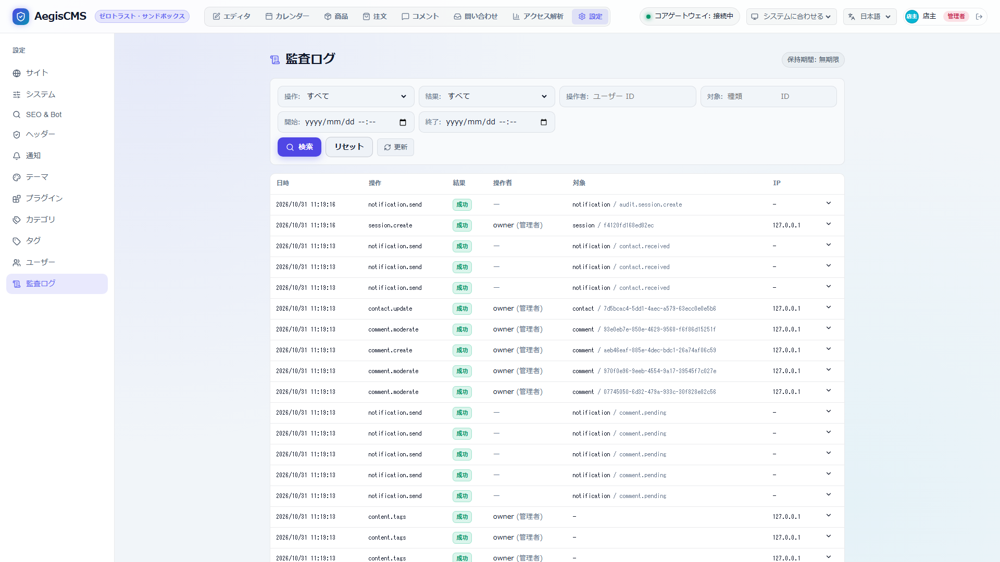

[← ドキュメント一覧に戻る](README.md)

# AegisCMS 監査ログリファレンス (Audit Log)

AegisCMS は、コンテンツ作成・セッション操作・ファイルアップロード・プラグインのエラーを監査イベントとして記録します。
出力先は `AuditSink` トレイトで抽象化されており、設定で複数の出力先を同時に有効にできます。

関連ソース:

- イベント型 / `AuditSink` トレイト: [`crates/aegis-core/src/audit.rs`](../crates/aegis-core/src/audit.rs)
- 出力先の実装と配送: [`crates/aegis-audit/`](../crates/aegis-audit)
- 参照 API / メトリクス: [`crates/aegis-server/src/handlers/audit.rs`](../crates/aegis-server/src/handlers/audit.rs)

---

## 1. 設定

```toml
[audit]
enabled = true
sinks = ["database", "log", "prometheus"]
trust_forwarded_for = false
retention_days = 90
purge_interval_secs = 3600
```

各項目の説明は [設定リファレンス](./configuration.md#28-audit--監査ログ) を参照してください。

| 出力先 (`sinks`) | 内容 | 主な連携先 |
| --- | --- | --- |
| `database` | `_aegis_audit_logs` テーブルへ永続化し、`GET /api/v1/audit-logs` で検索可能にする（既定） | SQLite / PostgreSQL / MySQL |
| `log` | `aegis::audit` ターゲットへ 1 行 1 JSON の構造化ログを出力 | CloudWatch Logs, Loki, Datadog など（標準出力の転送経由） |
| `prometheus` | `aegis_audit_events_total` カウンタを `GET /metrics` で公開 | Prometheus, CloudWatch Agent (Prometheus 収集) |

- 出力先への書き込みに失敗しても**リクエストは失敗しません**（`ERROR` ログを出して処理を続行）。
- `database` シンクはリクエストハンドラ内で同期 INSERT されます。SQLite (WAL モード) では 2,000+ req/s を維持しますが、外部 RDBMS（特に MySQL）ではトランザクションコミットの fsync やコネクションプールの競合によりスループットが低下しやすいため、高負荷環境では出力先の選定（`log` シンクなど）や将来の非同期キュー導入が有効です（詳細は [architecture.md 2.2](architecture.md#22-databaseadapter) および [development.md 6.3](development.md#63-データベース別パフォーマンス比較-task-benchdbs--scriptscompare-dbsmjs) 参照）。
- `enabled = false` または `sinks = []` の場合は記録を行いません。
- 管理者のログインやログインのロックなど、特定のイベントをメールで知らせるには `[[notifications.audit.rules]]` を設定します（[通知ドキュメント 2.1](notifications.md#21-監査イベントの通知)）。

---

## 2. 記録されるイベント

| `action` | 記録タイミング | `outcome` | `resource_type` / `resource_id` | 主な `details` |
| --- | --- | --- | --- | --- |
| `content.create` | `POST /api/v1/contents/{content_type}` | `success` / `denied`（`on-before-save` フックが拒否・失敗）/ `failure`（DB エラー） | `content` / コンテンツ ID | `content_type`, `slug`, `title`, `status`, `reason` / `error` |
| `content.update` | `PUT /api/v1/contents/{content_type}/{slug}` | `content.create` と同じ | `content` / コンテンツ ID | `content.create` と同じ |
| `content.delete` | `DELETE /api/v1/contents/{content_type}/{slug}` | `success` / `failure`（DB エラー） | `content` / コンテンツ ID | `content_type`, `slug`, `title`, `error` |
| `content.publish` | 予約公開（`status: "scheduled"`）のコンテンツを、`published_at` の日時になったときにサーバーが公開した（[コンテンツの予約公開](theme_and_publishing_guide.md)） | `success` / `failure`（DB エラー） | `content` / コンテンツ ID | `content_type`, `slug`, `title`, `published_at`, `error`（操作者 `actor` は無し） |
| `content.unpublish` | 期限付き公開コンテンツを、`unpublish_at` の日時になったときにサーバーが非公開化（`status: "archived"`）した（[コンテンツの予約非公開化](theme_and_publishing_guide.md)） | `success` / `failure`（DB エラー） | `content` / コンテンツ ID | `content_type`, `slug`, `title`, `unpublish_at`, `error`（操作者 `actor` は無し） |
| `session.create` | `POST /api/v1/auth/session`（ログイン） | `success` / `failure`（認証失敗を含む）/ `denied`（ログイン試行のレート制限でロック中、`on-user-authenticated` プラグインが拒否） | `session` / セッション指紋 | `expires_at`, `provider`, `username`（失敗・拒否時）, `error`（失敗理由: `unknown_user` / `invalid_password` / `account_disabled` / `rate_limited` / `plugin_rejected` / `plugin_failed`、SSO の理由（[認証 6.4](authentication.md#64-失敗時の理由login_error監査ログ-sessioncreate-の-error)）など）, `reason`（プラグインの拒否・失敗の内容）, `role_mapped`（プラグインがロールを変えた場合の `from` / `to`）, `locked`（その失敗でロックがかかった単位: `username` / `ip`）, `lock_scope` / `retry_after_secs`（`denied` 時） |
| `session.delete` | `DELETE /api/v1/auth/session` | `success` / `failure` | `session` / セッション指紋 | `error` |
| `storage.upload` | `POST /api/v1/storage/upload` | `success` / `failure`（ストレージエラー） | `asset` / ストレージキー | `original_name`, `content_type`, `size`, `url`, `error` |
| `storage.delete` | `DELETE /api/v1/storage/objects/{key}`（[メディア](media.md#ファイルの削除--delete-apiv1storageobjectskey)） | `success` / `failure`（ストレージエラー） | `asset` / ストレージキー | `url`, `force`, `references`（参照元の件数）, `error` |
| `plugin.error` | Wasm プラグインフックの実行失敗（トラップ、タイムアウト、Fuel 枯渇など） | `failure` | `content` / コンテンツ ID（`on-user-authenticated` では `session` / なし、`on-order-status-changed` では `order` / 注文 ID） | `hook`, `content_type` / `username` / `plugin`, `error` |
| `plugin.enable` / `plugin.disable` | `PUT /api/v1/plugins/{name}/enabled`（[プラグインの有効・無効の切り替え](plugin_hooks.md#51-admin-studio-からの有効無効の切り替え)） | `success` / `failure`（読み込めない、DB エラー） | `plugin` / プラグイン名 | `from` / `to`（有効化リスト）, `error` |
| `plugin.reorder` | `PUT /api/v1/plugins/order`（[実行順の並べ替え](plugin_hooks.md#52-フックの実行順の並べ替えと設定ファイルの値に戻す)） | `success` / `failure` | `plugin` / なし | `from` / `to`, `error` |
| `plugin.reset` | `DELETE /api/v1/plugins/order`（設定ファイルの `[plugins].enabled` に戻す） | `success` / `failure`（読み込めない、DB エラー） | `plugin` / なし | `from` / `to`, `error` |
| `audit.purge` | 保持期間切れの監査ログを 1 件以上削除したとき（[5. 保持期間](#5-保持期間と自動削除)） | `success` | `audit_log` / なし | `deleted`, `cutoff`, `retention_days` |
| `access.denied` | セッションとロールが必要な API（[必要なロール](authentication.md#ロールと-api-の権限)）を、セッション無し・無効（401）またはロール不足（403）で拒否したとき | `denied` | `endpoint` / `メソッド パス`（例: `POST /api/v1/contents/article`。クエリ文字列は含めない） | `reason`（`missing_session` / `invalid_session` / `insufficient_role` / `not_own_account`（他のユーザーのプロフィール・アバターへのアクセス。`resource_type` は `user`）/ `invalid_webhook_signature`（決済の Webhook の署名が不正））, `required_role`, `session`（無効なトークンの指紋。`invalid_session` のみ） |
| `theme.switch` | `PUT /api/v1/themes/active` | `success` | なし | `from_theme`, `to_theme` |
| `site.update` | `PUT /api/v1/site`（公開サイトの名前と favicon。[テーマと公開](theme_and_publishing_guide.md#サイト名と-faviconadmin-studio)） | `success` / `failure`（DB エラー） | なし | `title` / `favicon`（それぞれ `from` / `to`。`null` は設定ファイルの値）, `error` |
| `user.create` | `POST /api/v1/users`（[ユーザー管理 API](authentication.md#3-ユーザー管理-api)） | `success` / `failure`（DB エラー） | `user` / ユーザー名 | `role`, `error` |
| `user.update` | `PATCH /api/v1/users/{username}`、`PUT` / `DELETE /api/v1/users/{username}/avatar` | `success` / `failure` | `user` / ユーザー名 | `changed`（実際に変わった項目: `email` / `display_name` / `role` / `disabled` / `password` / `avatar`。パスワードの値は残さない）, `role`（`from` / `to`）, `disabled`, `avatar_key`, `size`, `error` |
| `user.delete` | `DELETE /api/v1/users/{username}` | `success` / `failure` | `user` / ユーザー名 | `role`, `error` |
| `user.register` | `POST /api/v1/auth/registration`（申し込み）、`POST /api/v1/auth/registration/verify`（確認。[アカウント登録](authentication.md#7-アカウント登録)） | `success` / `denied`（入力の不備・ユーザー名の重複・登録済みのメールアドレス・許可されていないドメイン・申し込み数の制限・無効な確認リンク）/ `failure`（サーバーのエラー） | `user` / ユーザー名（確認の成功時のみ） | `stage`（`requested` / `confirmed`）, `username`, `role`, `pending_approval`, `error`（`email_in_use` / `rate_limited` / `username_taken` / `invalid_token` など）。メールアドレスとトークンは残さない |
| `order.create` | `POST /api/v1/shop/checkout`（[EC](commerce.md)） | `success` | `order` / 注文 ID | `number`, `total`, `currency`, `items`, `provider` |
| `order.update` | 注文の状態の変化（管理者の操作、決済の Webhook、期限切れ）、決済の問題 | `success` / `failure`（金額の不一致 `amount_mismatch`、取り消し後の入金 `paid_after_cancel`） | `order` / 注文 ID | `number`, `from`, `to`, `source`（`admin` / `payment_webhook` / `payment_expired` / `payment_failed` / `expired` / `payment_start_failed`）, `restocked`, `note`, `problem`, `event_id` |
| `notification.send` | 通知の配信（チャネルごと。一時的な失敗は再試行した後の結果。Admin Studio・CLI のテスト送信を含む） | `success` / `failure` | `notification` / 通知の種類（`order.placed` など） | `channel`, `recipient`（`person` / `staff`。アドレスは残さない）, `subject`, `attempts`, `error`, `order_number` |
| `comment.create` | Admin Studio からのコメントへの返信（`POST /api/v1/comments/{id}/replies`。[コメント](comments.md)） | `success` / `failure` | `comment` / 返信のコメント ID | `parent_id`, `content_type`, `content_id`, `error` |
| `comment.moderate` | コメントの状態の変更（承認・承認待ち・スパム・ゴミ箱。1 件・まとめて） | `success` / `failure` | `comment` / コメント ID（1 件のとき） | `ids`, `status`, `count`（変えた件数）, `error` |
| `comment.update` | コメントの本文の編集（`PATCH /api/v1/comments/{id}` の `body`） | `success` / `failure` | `comment` / コメント ID | `content_type`, `content_id`, `length`（`from` / `to`。文字数。本文は残さない）, `error` |
| `comment.delete` | コメントの削除（1 件・まとめて） | `success` / `failure` | `comment` / コメント ID（1 件のとき） | `ids`, `count`, `error` |
| `comment.settings_update` | コメントの承認の設定の変更（`PUT /api/v1/comments/settings`）、コンテンツごとの受付の切り替え（`PUT /api/v1/contents/{type}/{id}/comments/state`） | `success` / `failure` | 承認の設定は なし、受付の切り替えは コンテンツの種類 / コンテンツ ID | 承認の設定は `require_approval` / `auto_approve_known`（`from` / `to`。`null` は設定ファイルの値）、受付の切り替えは `content_type` / `content_id` / `comments_open`。どちらも `error` |
| `notification.template_update` | 通知のテンプレートの保存・元に戻す（`PUT` / `DELETE /api/v1/notifications/templates/{名前}`。[通知 6](notifications.md#6-admin-studio-から管理する)） | `success` / `failure`（DB エラー） | `notification_template` / テンプレートの名前 | `operation`（`save` / `reset`）, `previous_source`（`custom` / `file` / `builtin`）, `bytes`, `error` |
| `notification.queue_update` | 送れなかった通知の再送・送信待ちの破棄（`POST /api/v1/notifications/queue/{id}/retry`、`DELETE /api/v1/notifications/queue/{id}`） | `success` | `notification` / 通知の種類 | `operation`（`retry` / `discard`）, `id`, `channel`, `attempts` |

- 入力不備（必須フィールド欠落、存在しないスキーマなど）で処理に入る前に弾かれたリクエストは記録しません。
- `on-before-save` フックが失敗した場合（トラップ、タイムアウトなど）は、`plugin.error` と `content.create`（`denied`）の 2 件が記録されます。プラグインが `Err` を返して保存を拒否した場合はプラグインの失敗ではないため、`content.create`（`denied`。`reason` に拒否理由）の 1 件だけです。
- `access.denied` の `actor` は、ロール不足（403）ならそのセッションのユーザー、401 なら空です。ログイン失敗（`POST /api/v1/auth/session` の 401）は `access.denied` ではなく `session.create`（`failure`）として記録します。
- `access.denied` はセッションを持たないリクエストでも記録されるため、インターネットに公開した API への機械的なアクセスで件数が増えます。`retention_days` による定期削除や、リバースプロキシでのアクセス元制限・レート制限と組み合わせてください。

### 2.1 操作主体 (`actor`)

リクエストの `Authorization: Bearer <token>` / `X-Session-Id` ヘッダーからセッションを解決し、`user_id` と `role` を記録します。セッションが無い・無効な場合は `null` です。
`session.create` では、作成されたセッションのユーザーが `actor` になります。

### 2.2 セッション指紋

セッショントークンは認証情報そのものであるため、監査ログには**記録しません**。
代わりに SHA-256 ハッシュの先頭 16 桁（セッション指紋）を `resource_id` に記録し、`session.create` と `session.delete` を突き合わせられるようにしています。

### 2.3 クライアント情報

| フィールド | 内容 |
| --- | --- |
| `ip` | 接続元 IP。`trust_forwarded_for = true` の場合は `X-Forwarded-For` の先頭アドレスを優先 |
| `user_agent` | `User-Agent` ヘッダー（最大 512 文字） |

> [!WARNING]
> `X-Forwarded-For` はクライアントが自由に設定できるため、`trust_forwarded_for` は ALB / nginx などの信頼できるリバースプロキシ配下でのみ有効にしてください。

---

## 3. イベントの形式

```json
{
  "id": "c2ec7420-f797-4fca-8168-2f0466988926",
  "occurred_at": "2026-10-21T18:23:23.508321Z",
  "action": "content.create",
  "outcome": "success",
  "actor": { "user_id": "alice", "role": "editor" },
  "resource_type": "content",
  "resource_id": "9ec53581-4616-441d-9473-8014acc52674",
  "ip": "127.0.0.1",
  "user_agent": "curl/8.5.0",
  "details": { "content_type": "article", "slug": "hello", "title": "Hello", "status": "draft" }
}
```

`occurred_at` は常に UTC・マイクロ秒精度・`Z` 終端の RFC 3339 形式です（文字列の辞書順と時系列順が一致します）。

---

## 4. 参照 API: `GET /api/v1/audit-logs`

`database` 出力先が有効な場合に利用できます。**`admin` ロールのセッションが必要です。**

| クエリパラメータ | 説明 |
| --- | --- |
| `action` | `content.create` などのアクション名 |
| `outcome` | `success` / `failure` / `denied` |
| `actor_id` | 操作主体のユーザー ID |
| `resource_type`, `resource_id` | 対象リソース |
| `since` | この時刻以降（含む）。RFC 3339 (例: `2026-10-21T00:00:00+09:00`) |
| `until` | この時刻より前（含まない）。RFC 3339 |
| `limit` | 取得件数（既定 50、最大 500） |
| `offset` | 読み飛ばす件数（既定 0） |

```bash
curl -H "Authorization: Bearer $ADMIN_TOKEN" \
  "http://localhost:8080/api/v1/audit-logs?action=content.create&since=2026-10-21T00:00:00Z&limit=20"
```

```json
{ "items": [ { "id": "...", "action": "content.create", "...": "..." } ], "limit": 20, "offset": 0, "retention_days": 90 }
```

結果は `occurred_at` の新しい順です。`retention_days` は保持期間の日数で、無期限の場合は `null` です。

| ステータス | 条件 |
| --- | --- |
| `401` | セッションヘッダーが無い、またはセッションが無効 |
| `403` | セッションのロールが `admin` ではない（API ごとの必要ロールは [認証 & ユーザー管理](authentication.md#ロールと-api-の権限)） |
| `400` | 不正な `action` / `outcome` / 日時 |
| `404` | `database` 出力先が無効 |

> [!NOTE]
> セッションのロールは、ログイン（`POST /api/v1/auth/session`）時にユーザーアカウントから決まります。`admin` ユーザーの作成方法は [認証 & ユーザー管理](authentication.md) を参照してください。

---

## 5. 保持期間と自動削除

`retention_days` に 1 以上を設定すると、`database` 出力先に保存した監査ログのうち、保持日数より古いものを定期的に削除します。

| 設定 | 既定値 | 説明 |
| --- | --- | --- |
| `retention_days` | `0` | 保持日数。`0` は無期限（削除しない） |
| `purge_interval_secs` | `3600` | 削除を実行する間隔（秒、最小 60）。サーバー起動直後にも 1 回実行 |

- 削除の基準時刻は「実行時刻 − `retention_days` 日」で、`occurred_at` がこれより前のイベントを削除します。
- 1 件以上削除した場合は、削除したこと自体を `audit.purge` イベント（`deleted`: 削除件数、`cutoff`: 基準時刻）として記録します。監査ログが消えた事実を後から追跡できるようにするためです。
- 対象は `database` 出力先のみです。`log` 出力先の保存期間は転送先（CloudWatch Logs のロググループ設定など）で、`prometheus` は再起動でリセットされるため対象外です。`database` 出力先が無効なまま `retention_days` を設定すると、起動時に警告ログを出します。
- 複数インスタンス構成では各インスタンスが削除を実行しますが、同じ条件の `DELETE` なので結果は変わりません。

---

## 6. Admin Studio の閲覧画面

Admin Studio（`/admin`）に `admin` ロールのユーザーでログインすると、ヘッダーの **Settings** に **Audit Logs** が表示され、監査ログを閲覧できます（`editor` / `viewer` には表示されません）。ユーザーの作成は [認証 & ユーザー管理](authentication.md) を参照してください。



- **絞り込み**: action / outcome / actor / resource（種別・ID）/ 期間（since・until。ブラウザのローカル時刻で入力し、UTC に変換して送信）
- **一覧**: 新しい順に 50 件ずつ表示し、**Newer** / **Older** でページ送り。行をクリックすると、イベント ID・User-Agent・`details` の JSON を展開表示
- 右上に、サーバーに設定された保持期間を表示（無期限なら `unlimited`）
- 403 / 404 の場合は、原因（ロール不足、`database` 出力先が無効）を画面に表示。セッションが切れた（401）場合はログイン画面に戻る

---

## 7. 構造化ログ (`log`)

`aegis::audit` ターゲットへ `INFO` レベルで、イベント JSON をメッセージとして 1 行ずつ出力します。

```text
2026-10-21T18:22:53.520299Z  INFO aegis::audit: {"id":"ade1ec8b-...","occurred_at":"2026-10-21T18:22:53.513401Z","action":"session.create",...}
```

- `RUST_LOG` で出力を制御できます（例: `RUST_LOG=warn,aegis::audit=info` で監査ログ以外を抑制）。
- **CloudWatch Logs**: コンテナの標準出力を `awslogs` ログドライバ（ECS）や CloudWatch Agent / Fluent Bit で転送し、`aegis::audit:` 以降を JSON としてパースします。
- **Loki など**: Promtail / Fluent Bit の regex / json パーサーで同様に取り込めます。

---

## 8. メトリクス (`prometheus`)

`GET /metrics` で Prometheus テキスト形式のカウンタを公開します。全 `action` × `outcome` の組み合わせを 0 から公開するため、イベント発生前からアラートルールを書けます。

```text
# HELP aegis_audit_events_total Total number of audit events recorded since startup.
# TYPE aegis_audit_events_total counter
aegis_audit_events_total{action="content.create",outcome="success"} 12
aegis_audit_events_total{action="plugin.error",outcome="failure"} 0
...
```

- カウンタはプロセス内メモリに保持され、再起動で 0 に戻ります（Prometheus の `rate()` / `increase()` はこれを考慮します）。
- 複数インスタンス構成では、各インスタンスをスクレイプして集約してください。
- `/metrics` は認証なしで公開されます。必要に応じてネットワーク / リバースプロキシで公開範囲を制限してください。
- CloudWatch では CloudWatch Agent の Prometheus メトリクス収集で取り込めます。

アラート例:

```yaml
- alert: AegisPluginErrors
  expr: increase(aegis_audit_events_total{action="plugin.error"}[5m]) > 0
```

---

## 9. 出力先の追加

`aegis_core::AuditSink` を実装し、`AuditService::from_config`（`crates/aegis-audit/src/lib.rs`）に登録します。

```rust
#[async_trait]
impl AuditSink for MySink {
    fn name(&self) -> &str {
        "my-sink"
    }

    async fn record(&self, event: &AuditEvent) -> Result<()> {
        // event を外部へ送信する
        Ok(())
    }
}
```

`record` はリクエスト処理の中で順番に `await` されます。外部サービスへの送信など時間のかかる処理は、内部でキューイングするなどしてリクエストの遅延を避けてください。
