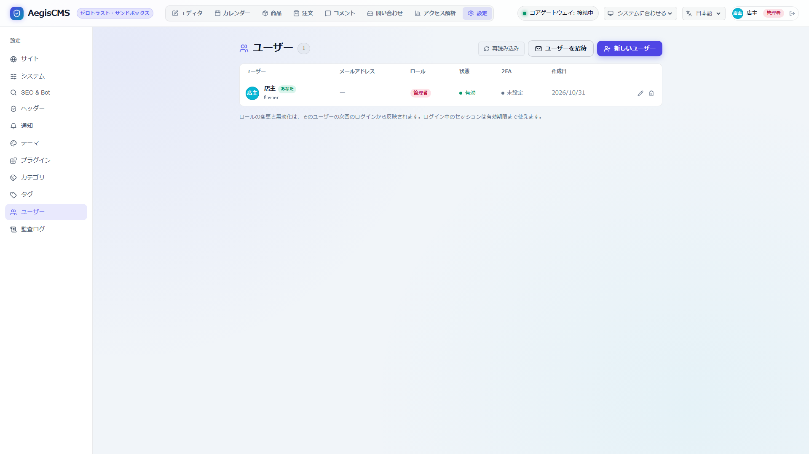
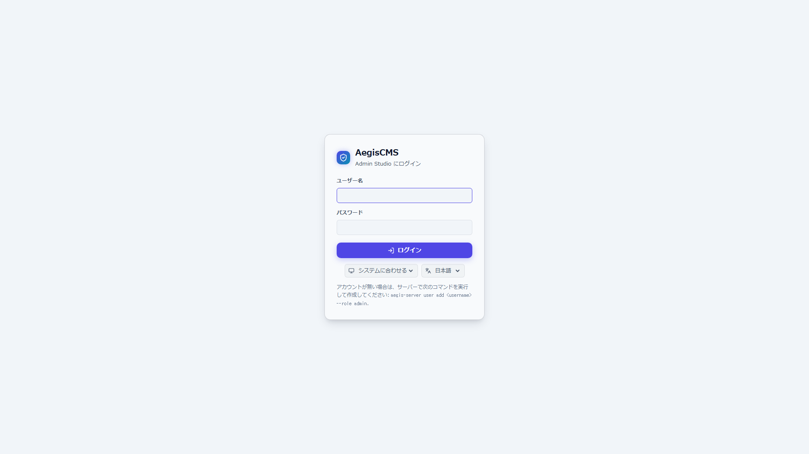
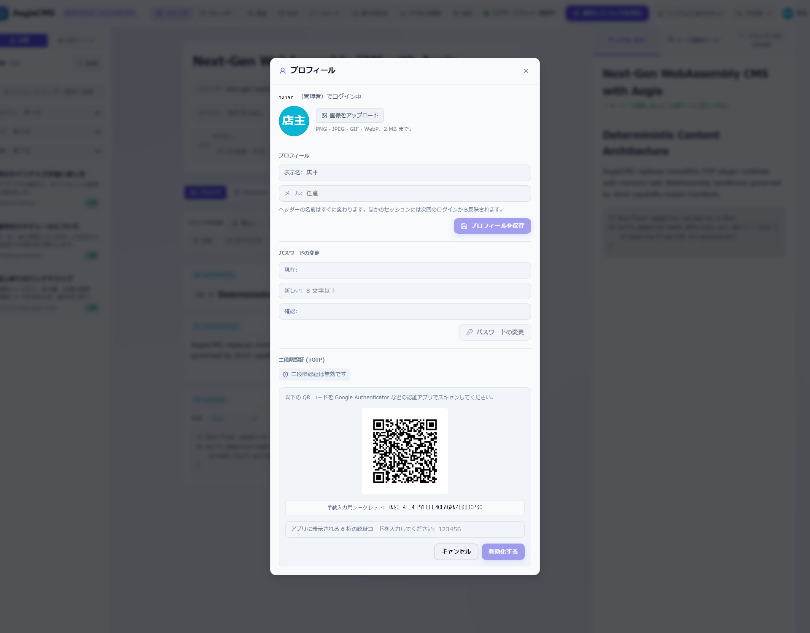

[← Back to the documentation index](README.md)

**English** | [日本語](authentication.ja.md)

# Authentication & User Management

AegisCMS login issues a session (Bearer token) only when an `AuthProvider` has verified the username and password. The role is decided not by the request but by the user account registered on the server.

The providers are local authentication (`LocalAuthProvider`, the `_aegis_users` table) and the external IdP OpenID Connect ([6. Single sign-on](#6-single-sign-on-openid-connect), `[auth.oidc]`). SAML is not supported.

---

## 1. User Accounts

Accounts are stored in the DB system table `_aegis_users` (common to SQLite / PostgreSQL / MySQL; created automatically at server startup and CLI execution).



| Column                      | Description                                                                                                                                         |
| --------------------------- | --------------------------------------------------------------------------------------------------------------------------------------------------- |
| `id`                        | UUID                                                                                                                                                |
| `username`                  | Login name (unique; alphanumerics and `.` `_` `-` `@`, 1–64 characters). Becomes the session's `user_id` and the audit log's actor                  |
| `email` / `display_name`    | Optional. Go into the session's `metadata`                                                                                                          |
| `role`                      | `admin` / `editor` / `reviewer` / `contributor` / `viewer`                                                                                          |
| `password_hash`             | An Argon2id (default parameters) PHC string. Plain text is not stored                                                                               |
| `disabled`                  | If `1`, login is not possible                                                                                                                       |
| `avatar_key`                | The storage key of the avatar image (`avatars/...`). NULL if unset. The column is added to existing DBs at startup                                  |
| `pending_approval`          | If `1`, the account is awaiting administrator approval after self-registration. It is updated to `0` automatically when an administrator enables it |
| `totp_secret`               | A Base32-encoded TOTP secret (NULL if unset)                                                                                                        |
| `totp_enabled`              | If `1`, two-factor authentication is enabled                                                                                                        |
| `backup_codes`              | An array of SHA-256 hashes of single-use backup codes (a JSON string)                                                                               |
| `created_at` / `updated_at` | RFC 3339 (UTC)                                                                                                                                      |

### Roles and API Permissions

The basic strength of roles is `admin` ⊃ `editor` ⊃ `reviewer` ⊃ `contributor` ⊃ `viewer` (a higher role covers the operations of lower roles, but `reviewer` is a least-privilege role specialized for review work, restricted from creating and deleting).

| Role          | What it can do                                                                                                                                                                                                                                                                                                                                             |
| ------------- | ---------------------------------------------------------------------------------------------------------------------------------------------------------------------------------------------------------------------------------------------------------------------------------------------------------------------------------------------------------- |
| `admin`       | Everything (including users, themes, settings, and audit logs)                                                                                                                                                                                                                                                                                             |
| `editor`      | Publishing, scheduling, and archiving content, changing others' content, approving and sending back reviews, and managing categories, tags, the shop, comments, and so on                                                                                                                                                                                  |
| `reviewer`    | Proofreading (touching up body and title), approving (`published` / `scheduled`), and sending back (`draft`) content awaiting review (`pending`), and uploading media for proofreading. Cannot create (POST) or delete (DELETE) on its own, or directly change published content (least privilege for LLM multi-agent proofreading and external reviewers) |
| `contributor` | Drafts (`draft`) of their own content and requesting review (`pending`), and uploading media. Publishing is done by `editor` / `reviewer` ([Review](theme_and_publishing_guide.md#review-approving-and-publishing-a-contributors-draft))                                                                                                                   |
| `viewer`      | Viewing (including drafts)                                                                                                                                                                                                                                                                                                                                 |

| API                                                                                                                                                                                                                                                                     | Required role                                                                                                                                                                                                                                                                                                                                                                                                                                                     |
| ----------------------------------------------------------------------------------------------------------------------------------------------------------------------------------------------------------------------------------------------------------------------- | ----------------------------------------------------------------------------------------------------------------------------------------------------------------------------------------------------------------------------------------------------------------------------------------------------------------------------------------------------------------------------------------------------------------------------------------------------------------- |
| `GET /api/v1/health` (the product name and version are returned only to an `admin` session), `/metrics`                                                                                                                                                                 | Not needed (public)                                                                                                                                                                                                                                                                                                                                                                                                                                               |
| `GET /setup` (the Web installer screen), `GET /api/v1/setup/status`, `POST /api/v1/setup` (initial setup)                                                                                                                                                               | Not needed (accepted only when uninitialized; after setup completes, 403 or a redirect)                                                                                                                                                                                                                                                                                                                                                                           |
| The public site (`/`, `/articles/*`, `/{slug}`, `/theme/assets/*`, `/uploads/*`), Admin Studio's static files                                                                                                                                                           | Not needed (public)                                                                                                                                                                                                                                                                                                                                                                                                                                               |
| `POST /api/v1/auth/session` (login), `POST /api/v1/auth/session/verify-2fa` ([two-factor authentication](#12-two-factor-authentication-2fa--totp)), `GET` / `DELETE /api/v1/auth/session`                                                                               | Not needed (decided by credentials, session, or 2FA verification)                                                                                                                                                                                                                                                                                                                                                                                                 |
| `GET /api/v1/auth/providers`, `GET /api/v1/auth/oidc/login`, `GET /api/v1/auth/oidc/callback` ([Single sign-on](#6-single-sign-on-openid-connect))                                                                                                                      | Not needed                                                                                                                                                                                                                                                                                                                                                                                                                                                        |
| `POST /api/v1/auth/password-reset`, `POST /api/v1/auth/password-reset/confirm` ([Password reset](#9-password-reset))                                                                                                                                                    | Not needed (email confirmation and token verification)                                                                                                                                                                                                                                                                                                                                                                                                            |
| `GET /api/v1/auth/invitations/info`, `POST /api/v1/auth/invitations/accept` ([Invitation links](#10-user-invitation-links))                                                                                                                                             | Not needed (invitation token verification)                                                                                                                                                                                                                                                                                                                                                                                                                        |
| The shop (`/products`, `/cart`, `/orders/{id}`, `/shop/cart.js`, `/api/v1/shop/*`; [E-commerce](commerce.md#61-public-no-login-needed))                                                                                                                                 | Not needed (order confirmation by token, webhooks by signature)                                                                                                                                                                                                                                                                                                                                                                                                   |
| `GET /api/v1/schemas`, `GET /api/v1/schemas/{type}`, `GET /api/v1/openapi.json`                                                                                                                                                                                         | `viewer`                                                                                                                                                                                                                                                                                                                                                                                                                                                          |
| `GET /api/v1/contents/{type}`, `GET /api/v1/contents/{type}/{slug}` (including drafts)                                                                                                                                                                                  | `viewer`                                                                                                                                                                                                                                                                                                                                                                                                                                                          |
| `GET /api/v1/storage/objects`                                                                                                                                                                                                                                           | `viewer`                                                                                                                                                                                                                                                                                                                                                                                                                                                          |
| `POST /api/v1/preview` (the editor's preview; does not save. You can choose a reader kind `viewer` to view, but a real member session is not used)                                                                                                                      | `viewer`                                                                                                                                                                                                                                                                                                                                                                                                                                                          |
| `POST /api/v1/contents/{type}`, `PUT` / `DELETE /api/v1/contents/{type}/{slug or id}`, `POST .../versions/{revision}/restore`, `PUT .../tags` ([Content posting API](content-api.md))                                                                                   | `contributor` (their own `draft` / `pending`. For published items they can only submit changes as `pending`, and cannot delete, restore versions, or attach/detach tags. The status can only be `draft` / `pending`). `reviewer` can only proofread `pending`, approve (`published`/`scheduled`), send back (`draft`), and adjust tags (no creating, deleting, or restoring). Freely changing others' content, publishing directly, and deleting require `editor` |
| `GET /api/v1/orders`, `GET /api/v1/orders/{id}`, `POST /api/v1/orders/{id}/status` ([E-commerce](commerce.md#62-administration-editor-and-above))                                                                                                                       | `editor`                                                                                                                                                                                                                                                                                                                                                                                                                                                          |
| `POST /api/v1/storage/upload` ([Media](media.md))                                                                                                                                                                                                                       | `contributor` (including `reviewer` and above)                                                                                                                                                                                                                                                                                                                                                                                                                    |
| `DELETE /api/v1/storage/objects/{key}` ([Media](media.md))                                                                                                                                                                                                              | `editor`                                                                                                                                                                                                                                                                                                                                                                                                                                                          |
| `GET /api/v1/users/{username}`, `PATCH /api/v1/users/{username}`, `PUT` / `DELETE /api/v1/users/{username}/avatar`, `POST /api/v1/users/me/2fa/*` ([User management API](#3-user-management-api), [Two-factor authentication](#12-two-factor-authentication-2fa--totp)) | The person themself (`viewer` and above) or `admin`                                                                                                                                                                                                                                                                                                                                                                                                               |
| `GET` / `POST /api/v1/users/me/tokens`, `DELETE /api/v1/users/me/tokens/{id}` ([API tokens](#13-api-tokens))                                                                                                                                                            | The person themself (`viewer` and above). Cannot be called with an API token                                                                                                                                                                                                                                                                                                                                                                                      |
| `POST /api/v1/users/{username}/2fa/reset` ([Resetting two-factor authentication](#123-removal-and-recovery-by-administrators))                                                                                                                                          | `admin`                                                                                                                                                                                                                                                                                                                                                                                                                                                           |
| `GET /api/v1/users`, `POST /api/v1/users`, `DELETE /api/v1/users/{username}`                                                                                                                                                                                            | `admin`                                                                                                                                                                                                                                                                                                                                                                                                                                                           |
| `POST /api/v1/auth/invitations` ([Invitation links](#10-user-invitation-links))                                                                                                                                                                                         | `admin`                                                                                                                                                                                                                                                                                                                                                                                                                                                           |
| `GET /api/v1/audit-logs`                                                                                                                                                                                                                                                | `admin`                                                                                                                                                                                                                                                                                                                                                                                                                                                           |

- With no session, an invalid one, or an expired one, `401` is returned; with an insufficient role, `403`; and `access.denied` (reason, required role, endpoint) is recorded in the audit log ([Audit log](audit.md#2-recorded-events)).
- When creating content, `author_id` becomes the logged-in user (`user_id`) if omitted. Only `admin` can specify another user as `author_id` (otherwise `403`).
- `/metrics` (Prometheus) stays public on the assumption of retrieval from monitoring systems. If you expose it externally, restrict the source with a reverse proxy or the like.

### Role Mapping and Login Restriction by Plugins

After credentials are verified and before the session is issued, the `on-user-authenticated` hook ([Plugin hooks](plugin_hooks.md#14-on-user-authenticated)) is called. A plugin can change the session's role, display name, and `metadata`, or refuse the login (`403`). When the role is changed, it is recorded in `details.role_mapped` of the audit log `session.create`.

---

## 2. User Management from the CLI (`aegis-server user`)

```bash
# Create the first administrator (the password is entered interactively; hidden and confirmed in a terminal)
aegis-server user add admin --role admin --email admin@example.com --display-name "Site Admin"

# Non-interactive (CI / Docker): read the password from an environment variable or one line of standard input
AEGIS_USER_PASSWORD='change-me-please' aegis-server user add editor1 --role editor
echo 'change-me-please' | aegis-server user add viewer1 --role viewer

aegis-server user passwd editor1        # change the password (existing sessions are revoked immediately)
aegis-server user role editor1 admin    # change the role (existing sessions are revoked immediately)
aegis-server user disable editor1       # make login impossible (existing sessions are revoked immediately)
aegis-server user enable editor1
aegis-server user disable-2fa editor1   # emergency removal of two-factor authentication (sessions are revoked immediately)
aegis-server user list
aegis-server user unlock editor1         # release the login lock (consecutive failures). Requires [cache].backend = "redis"
aegis-server user unlock-ip 203.0.113.7  # release a lock per IP
aegis-server user link-oidc alice 248289761001   # link an existing user to an IdP account (sub)
```

- During development, run it as `cargo run -p aegis-server -- user add ...`, and in Docker as `docker exec -it <container> aegis-server user add ...`. It connects to `[database]` in the config file (`-c` / `AEGIS_CONFIG`).
- Passwords must be 8 characters or more.
- If the server starts with no users at all, it writes a warning log showing how to create one.

> [!NOTE]
> Changing a role, disabling, and changing a password immediately revoke already issued sessions (a blacklist check by a revocation marker in the cache). The target user's existing sessions become `401 Unauthorized` on the next access and require logging in again (a disabled user cannot log in again either). When the cache (Redis) is used, changes from the CLI are shared immediately too.

---

## 3. User Management API

Admin Studio's "Users" screen (`admin`) and "My profile" opened from the header avatar (all roles) use this API. The user in the response has the following shape, and the password hash is not returned.

```json
{
  "id": "8a9e4ef1-4039-4b0f-b1fb-ea684ae66697",
  "username": "carol",
  "email": "carol@example.com",
  "display_name": "Carol Writer",
  "role": "editor",
  "disabled": false,
  "avatar_url": "/uploads/avatars/8a9e4ef1-4039-4b0f-b1fb-ea684ae66697-6665ae18.png",
  "created_at": "2026-10-22T23:23:26Z",
  "updated_at": "2026-10-22T23:23:30Z"
}
```

| API                                      | Description                                                                                                    |
| ---------------------------------------- | -------------------------------------------------------------------------------------------------------------- |
| `GET /api/v1/users`                      | All users (`{"users": [...]}`, ordered by username)                                                            |
| `POST /api/v1/users`                     | Create. The body is `username` / `password` / `role` (required) and `email` / `display_name` (optional). `201` |
| `GET /api/v1/users/{username}`           | One person (the person themself or `admin`)                                                                    |
| `PATCH /api/v1/users/{username}`         | Change. Omitted items stay as they are, and `email` / `display_name` are deleted with an empty string          |
| `DELETE /api/v1/users/{username}`        | Delete (also deletes identity links and the avatar image; the content's `author_id` remains). `204`            |
| `PUT /api/v1/users/{username}/avatar`    | Set the avatar image (the multipart `file`)                                                                    |
| `DELETE /api/v1/users/{username}/avatar` | Remove the avatar image                                                                                        |

`PATCH` items and permissions:

| Item                    | The person themself                                       | `admin` (another user)                 |
| ----------------------- | --------------------------------------------------------- | -------------------------------------- |
| `email`, `display_name` | ✓                                                         | ✓                                      |
| `password`              | ✓ (needs `current_password`; a wrong one gives `403`)     | ✓ (no current password needed = reset) |
| `role`, `disabled`      | ✗ (`400` even for `admin` on themselves, `403` otherwise) | ✓                                      |

- Access by `viewer` / `editor` to a user other than themselves is refused with `403`, and `access.denied` (`reason: not_own_account`, `resource_type: user`) is recorded.
- The last active `admin` cannot be demoted, disabled, or deleted (`400`; to prevent everyone being locked out). You also cannot delete yourself. The CLI (such as `aegis-server user role`) does not check, for recovery.
- **Avatar images**: PNG / JPEG / GIF / WebP, up to 2 MB. The format is determined by the file's first bytes (the client's Content-Type is not used), and SVG, which can contain scripts, is not accepted (`415`). Over 2 MB gives `413`. It is stored in the `[storage]` backend as `avatars/{user ID}-{random 8 chars}.{extension}`, and each replacement changes the key (against caching) and deletes the previous image.
- Creating, changing, and deleting are recorded in the audit logs `user.create` / `user.update` / `user.delete` ([Audit log](audit.md#2-recorded-events)). Passwords are not recorded.
- Users created through single sign-on do not know their password, so Admin Studio's "My profile" does not show password change.

> [!NOTE]
> Changing a role, disabling, deleting, and changing a password are reflected immediately in already issued sessions (a per-user revocation marker in the cache invalidates existing sessions at once, giving `401`). A demoted or disabled user cannot keep operating illegitimately with their previous session.

---

## 4. Session API

### `POST /api/v1/auth/session` — Login

```bash
curl -s -X POST http://127.0.0.1:8080/api/v1/auth/session \
  -H 'Content-Type: application/json' \
  -d '{"username":"admin","password":"change-me-please"}'
```

| Field      | Required | Description                                                                                        |
| ---------- | -------- | -------------------------------------------------------------------------------------------------- |
| `username` | ✓        | Login name (surrounding whitespace is ignored)                                                     |
| `password` | ✓        | Password                                                                                           |
| `ttl_secs` |          | Expiry (seconds). A value over `[cache].default_ttl_secs` (default 3600) is clipped to the default |

On success it returns `201` with the following. In later requests, attach `Authorization: Bearer <id>` (or `X-Session-Id: <id>`).

```json
{
  "id": "ses_0ce22abac5cc409298d05447e7a002b1",
  "user_id": "admin",
  "role": "admin",
  "created_at": "2026-10-22T04:44:14.066870871+00:00",
  "expires_at": "2026-10-22T05:44:14.066870871+00:00",
  "metadata": { "provider": "local", "display_name": "Site Admin", "email": "admin@example.com" }
}
```

| Status | Condition                                                                                                                                                                    |
| ------ | ---------------------------------------------------------------------------------------------------------------------------------------------------------------------------- |
| `401`  | The user does not exist, the password does not match, or the account is disabled (all responses are `Invalid username or password` and not distinguished)                    |
| `403`  | The credentials are correct but an `on-user-authenticated` plugin refused the login (the body is the plugin's message)                                                       |
| `422`  | `username` / `password` is missing (the earlier `{"user_id", "role"}` form is not accepted)                                                                                  |
| `429`  | Locked because login failures continued (the seconds until release are in the `Retry-After` header and the body's `retry_after_secs`; refused even for the correct password) |
| `500`  | DB or cache error, or failure of an `on-user-authenticated` plugin                                                                                                           |

### `GET /api/v1/auth/session` / `DELETE /api/v1/auth/session`

Get the current session and log out (unchanged).

### Admin Studio

Admin Studio (`/admin`) logs in with this API from the login screen, keeps the token in `sessionStorage`, and attaches it to all API calls. When the API returns `401`, it returns to the login screen. Operations the role lacks (such as saving or uploading as `viewer`) are also disabled on screen.



---

## 5. Security Behavior

- **Guarding against username guessing**: even for nonexistent users, the same Argon2 verification is done with a dummy hash, aligning the response time and content. Whether an account is disabled is determined only when the correct password is sent.
- **Audit log**: the success or failure of login is recorded as `session.create`. On failure, `details` keeps `username`, `provider`, and `error` (`unknown_user` / `invalid_password` / `account_disabled` / `unsupported_credentials`). Passwords are not recorded.
- **CPU load**: Argon2 verification runs with `spawn_blocking` and does not block the async runtime's workers.
- **Rate limiting of login attempts** (`[auth.login_rate_limit]`): authentication failures (user absent, password mismatch, account disabled) are counted per username and per client IP, and when the limit is reached within `window_secs` (default 15 minutes) (default: 5 for the username / 20 for the IP), they are refused with `429` for `lockout_secs` (default 15 minutes).
    - While locked, credentials are not verified (refused even with the correct password, and no Argon2 load either). The response does not distinguish whether the lock was by username or IP.
    - Usernames are counted case-insensitively, and nonexistent usernames are counted the same way (so the presence of a lock cannot be used to guess whether a user exists).
    - A successful login resets that username's failure count. The IP's failure count is not reset, so that an attacker holding one valid account cannot erase the count.
    - Failure counts are stored in the `[cache]` backend (keys `login:fail:*` / `login:lock:*`). With `memory` they are per process and vanish on restart, so use `redis` when running multiple instances.
    - Behind a reverse proxy all requests come from the proxy's IP, so set `[audit].trust_forwarded_for = true` (when enabled `X-Forwarded-For` can be spoofed, so do so only behind a trusted proxy).
    - A per-username lock can also be used by a third party to fail on purpose and temporarily prevent that user from logging in. If this is a problem in operation, increase `max_failures_per_user` and mainly use the per-IP limit. Releasing a lock is by the CLI only (`aegis-server user unlock <username>` / `user unlock-ip <IP>`; the failure count also returns to 0). It cannot be released from the API or Admin Studio. Locks are in the server's cache, so the CLI can release them only with `redis` (with `memory`, restart the server).

---

## 6. Single Sign-On (OpenID Connect)

Enabling `[auth.oidc]` ([Configuration reference](configuration.md#210-authoidc--single-sign-on-openid-connect)) shows a **Sign in with {display_name}** button on Admin Studio's login screen, and you can log in with an external IdP (any that supports OpenID Connect, such as Microsoft Entra ID, Google, Okta, and Keycloak). Local login by password can still be used as is.

### 6.1 IdP-Side Settings

1. Register a "web application" (a confidential client) with the IdP and issue a client ID and secret.
2. Register `https://<AegisCMS host>/api/v1/auth/oidc/callback` as the redirect URI and set the same value in `redirect_url`.
3. If you want to divide roles by group, configure the IdP so that claims such as `groups` go into the ID token.

```toml
[auth.oidc]
enabled = true
display_name = "Company SSO"
issuer_url = "https://login.example.com/realms/staff"
client_id = "aegis-cms"
client_secret = "..."
redirect_url = "https://cms.example.com/api/v1/auth/oidc/callback"
role_claim = "groups"
post_login_redirect = "https://cms.example.com/admin/"

[auth.oidc.role_mapping]
cms-admins = "admin"
cms-editors = "editor"
```

### 6.2 Login Flow

1. The button (`GET /api/v1/auth/oidc/login`) redirects to the IdP's authorization endpoint. The verification values for `state`, `nonce`, and PKCE (`S256`) are stored in the cache (`[cache]`) for 10 minutes.
2. After logging in at the IdP, `GET /api/v1/auth/oidc/callback` exchanges the authorization code for tokens and verifies the ID token (signature via JWKS, `iss`, `aud`, `exp`, `nonce`, `azp`; signature algorithms only RS / PS / ES families). `state` is single-use.
3. The user is determined (6.3), and the session is issued through the `on-user-authenticated` hook ([Plugin hooks](plugin_hooks.md#14-on-user-authenticated)).
4. It redirects to `post_login_redirect` with `#session=<token>` appended, and Admin Studio stores the token and removes it from the address bar. On failure it returns with `#login_error=<reason>` and shows it on the login screen.

The fragment (after `#`) does not remain in server logs or `Referer`, which is why it is used for handing over the token.

### 6.3 Users and Roles

- The mapping between IdP accounts (Issuer + `sub`) and AegisCMS users is stored in the `_aegis_user_identities` table.
- **First login**: with `auto_create_users = true` (default), a user is created with `username_claim` (default `preferred_username`, or `email` if absent) as the username, and linked. The password is a random value nobody knows, so that user cannot log in with a password.
- **If a user with the same name already exists, it is not linked** (`username_taken`). This is to prevent entering an existing account (such as a local administrator) just by claiming the same name on the IdP side. To use SSO with that account, an administrator links it with `aegis-server user link-oidc <username> <sub>`.
- With `auto_create_users = false`, only linked users can log in (others get `not_provisioned`).
- **Roles**: when `role_claim` is set, at every login the claim's values are converted with `role_mapping` (the strongest role if several match; `default_role` if none match), and the user account's role is updated too. If `role_claim` is empty, the role is the user account's (changed with `aegis-server user role`), and new users get `default_role`. In either case it can be overridden by an `on-user-authenticated` plugin.
- The email address and display name (the `email` / `name` claims) are reflected in the user account at every login.
- A disabled user (`aegis-server user disable`) cannot log in via SSO either (`account_disabled`).
- The session's `metadata` holds `provider: "oidc"`, `issuer`, `sub`, and `claims` (the ID token's claims).
- How users are determined is shared with SAML (8.3).

### 6.4 Reasons for Failure (`login_error`, `error` in the audit log `session.create`)

| Reason             | Description                                                                                  |
| ------------------ | -------------------------------------------------------------------------------------------- |
| `idp_error`        | The IdP returned an error (such as the user cancelled)                                       |
| `invalid_state`    | `state` is missing, expired, or already used                                                 |
| `invalid_token`    | Token exchange failed, or ID token verification failed (details in the server's warning log) |
| `missing_username` | The claim to use as the username is missing or contains unusable characters                  |
| `username_taken`   | A (not linked) user with the same name already exists                                        |
| `not_provisioned`  | `auto_create_users = false` and there is no linked user                                      |
| `account_disabled` | The user is disabled                                                                         |
| `server_error`     | Cannot connect to the IdP, DB error, etc. (details in the server's error log)                |

When an `on-user-authenticated` plugin refuses, the plugin's message becomes `login_error`.

> [!NOTE]
> SSO logins are protected on the IdP side, so they are outside `[auth.login_rate_limit]`. The discovery document (`/.well-known/openid-configuration`) is fetched at the first login and cached in the process, and JWKS is refetched when an unknown `kid` arrives (at minimum 60-second intervals). If you change the IdP's Issuer, restart the server.

## 7. Account Registration

Enabling `[auth.registration]` ([Configuration reference](configuration.md#211-authregistration--account-registration)) shows **Create an account** on Admin Studio's login screen, so people can apply for an account themselves without an administrator creating users. Email address confirmation is required, and the confirmation email is sent through [Notifications](notifications.md).

```toml
[auth.registration]
enabled = true
admin_url = "https://cms.example.com/admin/"   # where the confirmation link opens
default_role = "viewer"
require_approval = true                         # cannot log in even after confirmation until an admin enables it
# allowed_email_domains = ["example.com"]       # limit to internal addresses only

[notifications]
enabled = true
channels = ["email"]   # during development, ["log"] outputs to the server log
```

The server does not start if any of these apply: notifications (`[notifications].enabled`) are disabled, `account.verify` is in `disabled_events`, the confirmation link's destination (`admin_url`, or `[commerce].public_url` + `/admin/` if absent) cannot be determined, or `default_role` is `admin` or an unknown role.

### 7.1 Registration Flow

1. From **Create an account** on the login screen, submit a username, email address, display name (optional), and password (`POST /api/v1/auth/registration`).
2. The server validates the input, keeps the application in the cache (`[cache]`) for only the confirmation link's validity period (`token_ttl_secs`, default 24 hours), and sends a confirmation link (`{admin_url}#verify-email=<token>`) to the email address (the notification `account.verify`). **No user is created at this point.**
3. When the link is opened, Admin Studio calls `POST /api/v1/auth/registration/verify`, and the user is created. `account.registered` is sent to operators (`staff_recipients`).
4. With `require_approval = true` (default), the account is created in a **disabled** state. When an admin enables it in **Settings → Users**, it can log in. With `false`, it can log in as soon as it is confirmed.

Unconfirmed applications do not occupy usernames. If there are multiple applications for the same username, the one confirmed first is created.

### 7.2 API

#### `POST /api/v1/auth/registration` — Application

```json
{ "username": "hanako", "email": "hanako@example.com", "password": "...", "display_name": "Hanako" }
```

- `202 Accepted`: `{ "status": "pending_verification", "expires_in_secs": 86400 }`
- On failure it returns `{ "error": "<text>", "code": "<reason>" }`. The `code` is `invalid_username` / `invalid_email` / `password_too_short` (`400`), `username_taken` (`409`), `email_domain_not_allowed` (`403`), or `rate_limited` (`429`; with `Retry-After`).
- If registration is disabled, it returns `404`.

#### `POST /api/v1/auth/registration/verify` — Confirmation

```json
{ "token": "<the confirmation link's token>" }
```

- `201 Created`: `{ "status": "active" | "pending_approval", "username": "hanako" }`
- On failure: `invalid_token` (`400`; invalid, expired, or used) and `username_taken` / `email_taken` (`409`; a user with the same username or email address was created after the application).

The `registration` (`true` / `false`) of `GET /api/v1/auth/providers` decides whether to show **Create an account** on the login screen.

### 7.3 Security Behavior

- **Email address confirmation**: an account is created only when the confirmation link is opened, so it cannot be created with someone else's email address.
- **Hiding registered email addresses**: even if an application is made with an existing user's email address, the response is the same `202` as usual and no email is sent (it remains in the audit log as `email_in_use`). Password hash computation is done the same as usual too, so the two cannot be told apart by response time either. For usernames, the application screen needs to tell about duplicates, so `username_taken` is returned.
- **The confirmation link**: the token is a 256-bit random value that can be used only once. It is stored in the cache keyed by the token's SHA-256, and the token itself is not kept. It is passed in the URL fragment (`#`), so it does not remain in server logs or `Referer`. Admin Studio removes it from the address bar after reading it.
- **The link URL is not built from the request**: the destination of the confirmation link is built only from settings (`admin_url`). It is not possible to spoof the `Host` header to make a link to an attacker's site be sent to the person.
- **Limit on the number of applications**: applications from the same client IP are limited to `max_per_ip_per_hour` per hour (default 5). Exceeding it returns `429`. How the client IP is handled follows `[audit].trust_forwarded_for`.
- **Password**: hashed with Argon2id at the time of application, and plain text is not stored. 8 or more characters are required.
- **Audit log**: the application (`stage: requested`) and confirmation (`stage: confirmed`) are recorded in `user.register`. Email addresses and tokens are not recorded ([Audit log](audit.md)).
- **Log channel**: with `channels = ["log"]`, the confirmation email's body (including the confirmation link) goes to the server log. Use email in production. The confirmation email is also passed to plugin notification channels (`plugin:<name>`), so for plugins that send to Slack and the like, configure them not to send `account.verify` (for `official-order-notifier`, `channel_kinds`).

---

## 8. Single Sign-On (SAML 2.0)

Enabling `[auth.saml]` ([Configuration reference](configuration.md#214-authsaml--single-sign-on-saml-20)) shows a **Sign in with {display_name}** button on the login screen, and you can log in with a SAML 2.0 IdP (Microsoft Entra ID, Okta, AD FS, Keycloak, Google Workspace, etc.). It can be used together with OpenID Connect (6) and passwords.

What is supported is **SP-initiated Web Browser SSO** (login started from AegisCMS's button). The AuthnRequest is sent with the HTTP-Redirect binding and the response is received with the HTTP-POST binding. Login started from the IdP's portal (IdP-initiated), encrypted assertions (`EncryptedAssertion`), and single logout are not supported.

### 8.1 IdP-Side Settings

1. Have the IdP load AegisCMS's SP metadata `https://<host>/api/v1/auth/saml/metadata` (obtainable after starting with `enabled = true`), or register the following values by hand.
    - **Entity ID (identifier)**: the same value as `entity_id`
    - **ACS (reply URL)**: `https://<host>/api/v1/auth/saml/acs` (the same value as `acs_url`). The binding is HTTP-POST
2. **Signature**: configure it to sign the assertion (recommended) or the whole response (either one is enough). The signature method is RSA-SHA256 or stronger (SHA-1 is rejected).
3. **NameID**: use `persistent` (an unchanging ID) or `emailAddress`. `transient`, which changes on every login, is rejected because it cannot identify the user.
4. Configure the IdP to send the email address, display name, and groups as attributes, and write those attribute names in `email_attribute` and the like.
5. From the IdP's metadata, take out the **Entity ID**, the **SSO URL** (HTTP-Redirect), and the **signing certificate** and set them.

```toml
[auth.saml]
enabled = true
display_name = "Company SSO"
entity_id = "https://cms.example.com/api/v1/auth/saml/metadata"
acs_url = "https://cms.example.com/api/v1/auth/saml/acs"
idp_entity_id = "https://sts.windows.net/<tenant ID>/"
idp_sso_url = "https://login.microsoftonline.com/<tenant ID>/saml2"
idp_certificates = ["""
-----BEGIN CERTIFICATE-----
MIIC8DCCAdigAwIBAgIQ...
-----END CERTIFICATE-----
"""]
email_attribute = "http://schemas.xmlsoap.org/ws/2005/05/identity/claims/emailaddress"
display_name_attribute = "http://schemas.microsoft.com/identity/claims/displayname"
role_attribute = "http://schemas.microsoft.com/ws/2008/06/identity/claims/groups"
post_login_redirect = "https://cms.example.com/admin/"

[auth.saml.role_mapping]
"<admin group ID>" = "admin"
"<editor group ID>" = "editor"
```

When switching the IdP's signing key, list both the old and new certificates in `idp_certificates`, switch on the IdP side, and then remove the old one.

### 8.2 Login Flow

1. The button (`GET /api/v1/auth/saml/login`) redirects to the IdP's SSO URL with an AuthnRequest. The AuthnRequest's `ID` is stored in the cache (`[cache]`) for 10 minutes.
2. After logging in at the IdP, the browser sends the `SAMLResponse` to `POST /api/v1/auth/saml/acs`. AegisCMS verifies the signature and content (8.4). The AuthnRequest `ID` that the response answers is single-use, and sending the same response again does not work.
3. The user is determined (8.3), and the session is issued through the `on-user-authenticated` hook ([Plugin hooks](plugin_hooks.md#14-on-user-authenticated)).
4. As with OpenID Connect, it returns to Admin Studio with `#session=<token>` (or `#login_error=<reason>` on failure) appended to `post_login_redirect`.

### 8.3 Users and Roles

The same rules as OpenID Connect (6.3).

- The mapping between IdP accounts (the IdP's Entity ID + NameID) and AegisCMS users is stored in the `_aegis_user_identities` table (provider name `saml`).
- **First login**: with `auto_create_users = true` (default), a user is created with `username_attribute` (the NameID if empty) as the username, and linked. From the second time on, the same user is found by NameID, so the account does not change even if the username attribute changes.
- **If a user with the same name already exists, it is not linked** (`username_taken`). To use SAML with an existing account, an administrator links it with `aegis-server user link-saml <username> <NameID>`.
- With `auto_create_users = false`, only linked users can log in (`not_provisioned`).
- **Roles**: when `role_attribute` is set, at every login that attribute's values are converted with `role_mapping` (the strongest role if several match; `default_role` if none match), and the user account's role is updated too. If empty, the role is the user account's.
- The email address and display name are reflected in the user account at every login. A disabled user cannot log in (`account_disabled`).
- The session's `metadata` holds `provider: "saml"`, `issuer` (the IdP's Entity ID), `name_id`, `name_id_format`, `session_index`, and `attributes` (attribute name → array of values).

### 8.4 What Is Verified

| Target    | Verification                                                                                                                                                                                                                                                                                         |
| --------- | ---------------------------------------------------------------------------------------------------------------------------------------------------------------------------------------------------------------------------------------------------------------------------------------------------- |
| XML       | Documents containing a DTD, processing instructions, undeclared namespace prefixes, or duplicate attributes, and responses over 256 KiB, are rejected                                                                                                                                                |
| Signature | At least one of the whole response or the assertion needs a signature by a key in `idp_certificates`. The certificate in the response's `KeyInfo` is not used. Only Exclusive C14N and enveloped-signature; RSA-SHA256 / 384 / 512. The `ID` the signature references must be unique in the document |
| Response  | `StatusCode` is `Success` (otherwise `idp_error`), `Destination` is `acs_url`, `Issuer` is `idp_entity_id`, and there is exactly one assertion                                                                                                                                                       |
| Assertion | `Issuer` is `idp_entity_id`, it is within the `Conditions` validity period, `AudienceRestriction` contains `entity_id`, and there is an `AuthnStatement`                                                                                                                                             |
| Subject   | There is a NameID (other than `transient`). The bearer `SubjectConfirmationData`'s `Recipient` is `acs_url`, `NotOnOrAfter` is in the future, and `InResponseTo` is the `ID` of an issued, unused AuthnRequest                                                                                       |

A 60-second tolerance is allowed in time verification.

**Countermeasure against XML Signature Wrapping**: after verifying the signature, nothing is read from the received document. The signed target (the response or the assertion) is parsed anew from the very bytes the digest was computed over (the canonicalized XML), and the username, attributes, and conditions are all read from there. Tampering such as hiding a signed assertion elsewhere and placing a forged one, or adding an element with the same `ID`, either fails signature verification or does not enter what is read. Even if a comment is inserted in the middle of a NameID, the value is read as the whole, as signed.

### 8.5 Reasons for Failure

The same reason codes as OpenID Connect (6.4) are used. `invalid_token` is when response verification fails (signature, conditions, format; details in the server's warning log), `invalid_state` is when the AuthnRequest the response answers is missing, expired, or used, and `idp_error` is when the IdP returned a failure `StatusCode`.

> [!NOTE]
> SAML logins are also outside `[auth.login_rate_limit]`. The AuthnRequest is not signed (the metadata has `AuthnRequestsSigned="false"`). If the IdP requires signed AuthnRequests, turn that off.

### 8.6 Future Extension Policy and Unsupported Features

AegisCMS implements standard SP-initiated Web Browser SSO (AuthnRequest, ACS, RSA-SHA256 signature verification, attribute and role mapping), and basic integration with major IdPs such as Microsoft Entra ID and Okta is possible.

Today's enterprise and organizational single sign-on is JSON/REST-based and simple to configure, and **OpenID Connect (OIDC, [6. Single sign-on](#6-single-sign-on-openid-connect))** is the first recommendation, sufficient in more than 95% of cases.

The following advanced SAML extensions are currently unsupported (on hold) to avoid the vulnerability risk and maintenance cost that come with XML encryption and protocol complexity. They will be reconsidered when strong requests arise in real operation, such as for academic authentication federations (GakuNin / Shibboleth) or specific legacy internal rules:

- **Automatic loading from an IdP metadata URL**: currently the Entity ID, SSO URL, and signing certificate are set explicitly in the config file (`aegis.toml`).
- **Encrypted assertions (`EncryptedAssertion`)**: decrypting encrypted assertions is not supported (only signature verification of plain assertions).
- **Signing AuthnRequests**: `AuthnRequestsSigned="false"` (IdPs that force signed requests are not supported).
- **Single logout (SLO)**: logging out on the AegisCMS side only revokes the AegisCMS session and does not destroy the IdP-side session.
- **ECDSA signature support**: the signature algorithms are RSA-SHA256 / RSA-SHA384 / RSA-SHA512 (ECDSA is not supported).

---

## 9. Password Reset

Enabling `[auth.password_reset]` ([Configuration reference](configuration.md)) shows a **Forgot your password?** link on the login screen, and a reset link is sent to the email address so the password can be changed safely. Sending email requires [Notifications](notifications.md) (`[notifications].enabled = true`).

```toml
[auth.password_reset]
enabled = true
admin_url = "https://cms.example.com/admin/"   # where the reset link opens (if omitted, [auth.registration].admin_url or [commerce].public_url + /admin/)
token_ttl_secs = 3600                          # validity of the reset link (1 hour)
max_per_ip_per_hour = 5                        # request limit from the same IP (brute-force prevention)
```

### 9.1 Reset Flow

1. From **Forgot your password?** on the login screen, enter the registered email address and submit (`POST /api/v1/auth/password-reset`).
2. If the email address exists and the user is enabled (`disabled = false`), a cryptographically random token (256 bits) is issued and stored in the cache (`password_reset:<hash>`) keyed by its SHA-256 hash together with the username (validity: `token_ttl_secs`).
3. A notification email (`account.password_reset`) containing the reset link (`{admin_url}#reset-password=<token>`) is sent to the user.
4. When the user opens the link, Admin Studio reads the token from the URL fragment, immediately removes it from the address bar history, and shows the new password form.
5. When the user enters and submits a new password (8 or more characters) (`POST /api/v1/auth/password-reset/confirm`), the server verifies and consumes the token (single use), hashes it with Argon2id, and updates the password.
6. When the reset succeeds, the audit log `user.password_reset` is recorded and it returns to the login screen.

### 9.2 API

#### `POST /api/v1/auth/password-reset` — Issuing a Reset Link

```json
{ "email": "user@example.com" }
```

- `202 Accepted`: `{ "status": "accepted" }`
- **Account enumeration protection**: even when the entered email address does not exist in the system or is disabled, **the same `202 Accepted` is always returned**. Dummy hash computation is also done, so guessing whether an email address exists from the response time is prevented too.
- Exceeding the per-client-IP rate limit (`max_per_ip_per_hour`) returns `429 Too Many Requests`.

#### `POST /api/v1/auth/password-reset/confirm` — Confirming the New Password

```json
{ "token": "<token>", "new_password": "NewSecurePassword123" }
```

- `200 OK`: `{ "status": "success", "username": "hanako" }`
- On failure, `400 Bad Request` (`invalid_token`, `password_too_short`, etc.). Once a token is used, it is deleted from the cache immediately.

---

## 10. User Invitation Links

Enabling `[auth.invitation]` ([Configuration reference](configuration.md)) lets an `admin`-role administrator invite a new user into the system by specifying an email address and the role to grant. The account is created in a pre-approved form, so it can issue an immediately active account, bypassing the administrator approval flow (`require_approval`) of self-registration (`[auth.registration]`).

```toml
[auth.invitation]
enabled = true
admin_url = "https://cms.example.com/admin/"   # where the invitation link opens
token_ttl_secs = 604800                        # validity of the invitation link (7 days)
```

### 10.1 Invitation Flow

1. An `admin` user enters the invitee's email address and the role to assign (`admin` / `editor` / `viewer`) from the **Invite user** button in Admin Studio's **Settings → Users** and submits (`POST /api/v1/auth/invitations`).
2. The server generates a 256-bit invitation token and stores the email address and role in the cache (`invitation:<hash>`) keyed by its SHA-256 hash.
3. A notification email (`account.invite`) containing the invitation link (`{admin_url}#invite=<token>`) is sent to the invitee, and the audit log `user.invite` is recorded.
4. When the invited user opens the link, Admin Studio extracts the token from the fragment, removes it from the address bar, and then calls `GET /api/v1/auth/invitations/info?token=<token>` to show the invited email address and role.
5. The user enters their desired username, password, and display name (optional) and submits acceptance (`POST /api/v1/auth/invitations/accept`).
6. The server verifies and consumes the token and creates an immediately active account (`disabled = false, pending_approval = false`). After registration they can log in right away and start working.

### 10.2 API

#### `POST /api/v1/auth/invitations` — Creating an Invitation (Requires the `admin` Role)

```json
{ "email": "newcomer@example.com", "role": "editor" }
```

- `201 Created`: `{ "email": "newcomer@example.com", "role": "editor", "expires_in_secs": 604800 }`
- If an account with the same email address already exists, `409 Conflict` (`email_taken`) is returned.

#### `GET /api/v1/auth/invitations/info?token=<token>` — Getting Invitation Information (Public)

- `200 OK`: `{ "email": "newcomer@example.com", "role": "editor" }`
- If the token is invalid or expired, `400 Bad Request` (`invalid_token`) is returned.

#### `POST /api/v1/auth/invitations/accept` — Accepting the Invitation and Creating the Account (Public)

```json
{
  "token": "<token>",
  "username": "taro",
  "password": "SecurePassword123",
  "display_name": "Taro Yamada"
}
```

- `201 Created`: `{ "status": "success", "username": "taro" }`
- On failure, `400 Bad Request` (`invalid_token`, `invalid_username`, `password_too_short`) or `409 Conflict` (`username_taken`, `email_taken`).

---

## 11. Approval Notification (`account.approved`)

With self-registration (`[auth.registration]`) and `require_approval = true` (the default), a user who has completed email address confirmation is created in a pending state with `disabled = true` and `pending_approval = true`.

1. When an administrator opens Admin Studio's **Settings → Users** (`UserManager.tsx`), accounts awaiting approval show a **Pending approval** badge.
2. When the administrator opens the user's edit screen, a banner about pending approval appears at the top, and they save with the **Approve and enable** button or the "Enable account" toggle (`disabled: false` via `PATCH /api/v1/users/{username}`).
3. When the server enables the user (`disabled = false`), it simultaneously clears `pending_approval = false` and automatically sends an account approval notification email (`account.approved`) to that user's email address.
4. After confirming the email that arrived, the user can log in immediately. This notification is not sent when updating a user whose `pending_approval` is `false`, such as simply lifting a temporary disablement.

---

## 12. Two-Factor Authentication (2FA / TOTP)

In addition to password authentication, AegisCMS supports two-factor authentication (2FA) with **TOTP (Time-based One-Time Password / RFC 6238)**.

- **Supported apps**: standard TOTP apps such as Google Authenticator, 1Password, Authy, and Apple's Passwords keychain
- **Backup codes**: **6** single-use recovery codes are issued on enabling. The codes are SHA-256 hashed and stored in the database, and consumed on each use.
- **Emergency removal**: if the authentication device or backup codes are lost, it can be removed immediately by an `admin`-role administrator resetting it from the web screen, or by a CLI command on the server machine (`aegis-server user disable-2fa <username>`).

### 12.1 Steps to Set Up Two-Factor Authentication (Users)



1. Open **My profile** from the avatar at the top right of Admin Studio's header.
2. In the **Two-factor authentication (TOTP)** section, click **Set up two-factor authentication**.
3. Scan the displayed QR code with your authenticator app (a Base32 secret for manual entry is also shown).
4. Enter the 6-digit code shown in the authenticator app and click **Enable**.
5. When enabling succeeds, **6 single-use backup codes** (e.g. `A1B2-C3D4`) are shown on screen. Click **Copy all** to save them in a safe place, and click **I saved them (close)** to finish.

### 12.2 Two-Factor Login Flow

1. Enter the username and password on the normal login screen (`LoginView.tsx`).
2. After verifying the password, if the target user has 2FA enabled, the server (`POST /api/v1/auth/session`) does not issue a session and instead returns a temporary token valid for 5 minutes (`challenge_token`) and `{ "mfa_required": true }`.
3. The screen switches automatically to the two-factor code input form.
4. The user enters and submits the 6-digit authentication code (or, from "Use a backup code", an 8-digit backup code) (`POST /api/v1/auth/session/verify-2fa`).
5. The server verifies the code and issues a proper Bearer session. If a backup code was used, that code is consumed and deleted from the DB automatically.

### 12.3 Removal and Recovery by Administrators

If there is a user who can no longer log in because of a lost device or the like, an administrator can remove 2FA in either of the following ways.

1. **Removal from Admin Studio**:
    - Open **Settings → Users** (`UserManager.tsx`) and check the "2FA" column (enabled badge) of the target user in the list.
    - Open the user edit modal, click the **Force-remove 2FA** button, and accept the confirmation dialog (`POST /api/v1/users/{username}/2fa/reset`).
2. **Emergency removal from the CLI**:
    ```bash
    aegis-server user disable-2fa <username>
    ```
    Along with the removal, the target user's existing sessions are revoked immediately, and from next time they can log in with the password alone.

---

## 13. API Tokens

Long-lived Bearer tokens to hand to AI agents (LLMs), scripts, and CI instead of a username and password. You need not hand over the password in plain text, and if one leaks, revoking it is enough.

```bash
curl -s http://127.0.0.1:8080/api/v1/contents/article \
  -H 'Authorization: Bearer aegis_pat_...'
```

A value starting with `aegis_pat_` can be used simply by attaching it to the same header as a normal session (`ses_...`) (`Authorization: Bearer` or `X-Session-Id`). The role required by each API is as in the table in [1](#roles-and-api-permissions).

### 13.1 Permissions

- **The role ceiling**: at issuance, choose from `viewer` / `contributor` / `reviewer` / `editor`. You cannot choose a role higher than the owner's role. **`admin` cannot be chosen** (`admin` APIs such as user management, settings, and audit logs cannot be used with a token).
- **The lower of the owner's current role**: if the owner is demoted after issuance, the token's permissions drop immediately. If the owner is disabled or deleted, the token becomes unusable (deletion also removes the tokens).
- **Operations limited to human sessions**: with a token, you cannot issue, list, or revoke tokens (`/api/v1/users/me/tokens`), change the password, or set up or remove two-factor authentication (`403`). This is so that a leaked token cannot be used to create other tokens or take over the account.
- **Expiry**: decided at issuance in days (1–3650) (default 90 days). It can also be unlimited. An expired one gives `401`.
- Up to 20 per user.

### 13.2 Storage and Records

- The token is a 244-bit random value, and **the plain text appears only once, in the response at issuance**. Only the SHA-256 hash and the leading part for telling them apart in the list (`aegis_pat_` + 4 characters) are stored in the DB (`_aegis_api_tokens`). The plain text remains in neither server logs, audit logs, nor backups.
- **They are not included in backups.** In a restored environment, issue the tokens again.
- The last-used time is recorded at intervals of at most once per minute.
- Issuance and revocation are recorded in the audit log `user.update` (`details.action` is `api_token.create` / `api_token.revoke`). The token value is not recorded.
- A token that fails verification records only its fingerprint in `access.denied` (`invalid_session`), like other sessions.
- In `GET /api/v1/auth/session`, a session authenticated by a token can be recognized by `metadata.provider = "api_token"` (the `id` is `pat_<token ID>`, and the token itself is not returned).

### 13.3 API (The Logged-In User Themself; Cannot Be Called with a Token)

| API                                   | Description                                                                                                                                                                                                                                               |
| ------------------------------------- | --------------------------------------------------------------------------------------------------------------------------------------------------------------------------------------------------------------------------------------------------------- |
| `GET /api/v1/users/me/tokens`         | The list of your own tokens (`{"tokens": [...]}`, newest first). Does not include hashes or token bodies                                                                                                                                                  |
| `POST /api/v1/users/me/tokens`        | Issue. The body is `name` (required, up to 64 characters), `role` (`viewer` / `contributor` / `reviewer` / `editor`; default `viewer`), and `expires_in_days` (default 90, `null` is unlimited). Returns `201` with the list item plus `token` (the body) |
| `DELETE /api/v1/users/me/tokens/{id}` | Revoke (another person's token is `404`). `204`. It becomes unusable immediately                                                                                                                                                                          |

```json
{
  "id": "5b0f6a62-...",
  "name": "claude-code",
  "prefix": "aegis_pat_3f9a",
  "role": "editor",
  "created_at": "2026-11-12T00:00:00Z",
  "expires_at": "2027-02-10T00:00:00Z",
  "last_used_at": null,
  "token": "aegis_pat_3f9a..."
}
```

### 13.4 Admin Studio and the CLI

- **Admin Studio**: open **My profile** from the header avatar, and in the **API tokens** section you can issue, list, and revoke. The body is shown only once, right after issuance.
- **CLI** (issuing on the server machine; for when you want to hand it over without logging in):

```bash
aegis-server user token-create alice --name claude-code --role editor --days 90
aegis-server user token-create alice --name ci --role viewer --no-expiry
aegis-server user token-list alice
aegis-server user token-revoke alice <token ID>
```

### 13.5 Notes When Handing to an LLM

- Give the minimum necessary role (`viewer` if it only reads). If you have it write content, `contributor` (up to drafts and requesting review) is safe, and if you have it proofread and approve, `reviewer`.
- Issue a separate token per use and write the use in its name, so that if one leaks, only that one can be revoked.
- Treat tokens on the assumption that they will remain in prompts and conversation logs. Keep the expiry short, and revoke them when done.
