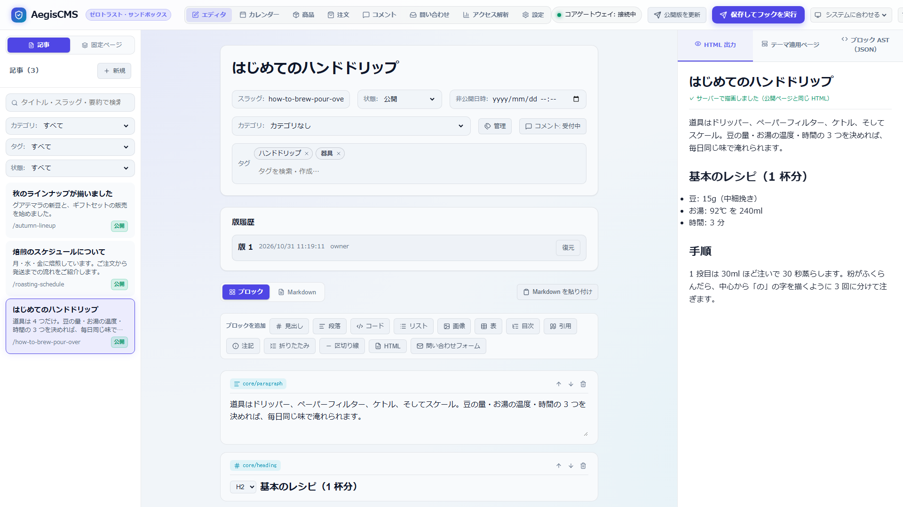

[← ドキュメント一覧に戻る](README.md)

# 本文のブロック

記事・固定ページ・商品の本文は、HTML ではなくブロックの木（`BlockNode`）として保存します。保存時に見出しの id を付け、プラグインの `transform-content-ast` フックを通してから、`aegis-ast` の `HtmlRenderer` が HTML にします（[architecture.md 3.1](architecture.md#31-html-の生成経路-aegis-serversrcrenderrs)）。

Admin Studio ではブロックごとに編集するか、Markdown で書きます。両者は相互に変換され（`admin/src/utils/markdown.ts`）、どちらで書いても同じブロックとして保存されます。

```json
{ "name": "core/heading", "attributes": { "level": 2, "id": "install" }, "text": "インストール", "children": [] }
```

## 1. ブロックの一覧



| ブロック | 属性 | Markdown | 出力する HTML |
|---|---|---|---|
| `core/heading` | `level`（1〜6、既定 2）、`id`（保存時に自動で付く） | `## 見出し` | `<h2 id="...">` |
| `core/paragraph` | | 空行で区切った文章 | `<p>` |
| `core/list` | `ordered`（真偽値）。項目は子の `core/list-item` の `text` | `- 項目` / `1. 項目` | `<ul>` / `<ol>` |
| `core/code` | `language`、`filename`（任意。120 文字まで） | ` ```rust ` 〜 ` ``` `（ファイル名は ` ```rust title="src/main.rs" `） | `<pre data-filename="src/main.rs"><code class="language-rust">`（`data-filename` はファイル名があるときだけ。表示は[公式プラグイン `official-code-lines`](../plugins/official-code-lines)かテーマの CSS） |
| `core/image` | `src`、`alt` | `` | `<figure>` |
| `core/table` | `rows`（文字列の配列の配列）、`header`（1 行目を見出し行にする。既定 `true`）、`align`（列ごとの `"left"` / `"center"` / `"right"` / `null`） | GFM の表（下記） | `<div class="aegis-table"><table>` |
| `core/toc` | `title`（空なら見出しを出さない）、`maxLevel`（2〜6、既定 3） | `[TOC]`、`[TOC title="目次" maxLevel=4]` | `<nav class="aegis-toc">` |
| `core/quote` | `cite`（出典。任意） | `> 引用`（最後の行が `> — 出典` なら出典） | `<blockquote>`（出典があれば `<figure class="aegis-quote">` と `<figcaption>`） |
| `core/callout` | `variant`（`note` / `tip` / `important` / `warning` / `caution`、既定 `note`）、`title`（任意） | `> [!WARNING] 見出し` に続く `> 本文`、または `:::warning 見出し` 〜 `:::` | `<aside class="aegis-callout aegis-callout-warning" role="note">` |
| `core/separator` | | `---`（`***`・`___` も可） | `<hr>` |
| `core/details` | `summary`（見出し）、`open`（最初から開く。既定 `false`） | `:::details 見出し` 〜 `:::`（開いた状態は `:::details+`） | `<details class="aegis-details"><summary>` |
| `core/contact-form` | `form`（`[[contact.forms]]` の名前。既定 `default`） | `[CONTACT]`、`[CONTACT form="sales"]` | [問い合わせフォーム](contact.md#2-フォームを置く)（`[contact].enabled` のときだけ） |
| `core/html` | `mode`（`sanitized` / `sandbox`） | ` ```html ` / ` ```html:sandbox ` | [カスタム HTML](theme_authoring_guide.md#31-どの-url-でどのテンプレートが使われるか) |

`<プラグイン名>/<ブロック名>` のブロックは、そのプラグインが描画します（[4. プラグインのブロック](#4-プラグインのブロック)）。それ以外の知らない名前のブロックは、名前の `/` を `-` にしたカスタム要素（`<my-plugin-card>`）として出力します。

### 1.1 表

```markdown
| 名前 | 種類 | 価格 |
| --- | :---: | ---: |
| エチオピア | **浅煎り** | 1,780円 |
```

- 区切りの行の `:---`・`:---:`・`---:` が列の揃え（左・中央・右）になります。
- 見出し行を空にすると、見出し行の無い表（`header: false`）になります。
- セルの中の `|` は `\|` と書きます。セルではインライン書式（下記）が使えます。
- 狭い画面では表だけが横にスクロールします（`.aegis-table` に `overflow-x: auto`）。セルには `overflow-wrap: break-word` を指定しているので、テーマが `overflow-wrap: anywhere` でも単語の途中で折り返して列が細くなりすぎることはありません。

### 1.2 目次

`[TOC]` を置いた位置に、本文の見出し（H2 〜 `maxLevel`）を入れ子の番号付きリストにして出します。リンク先は見出しの `id` です。

- 見出しの `id` は保存時にインライン書式の記号を除いたテキストから作り、同じ文書の中で重なれば `-2`、`-3` … を付けます。既に `id` のある見出しは変えません。
- 目次は描画のたびに見出しから作るので、見出しを直して保存すれば目次も変わります。
- H2 の次に H4 があるときは、H3 の位置に入れます（1 段ずつしか深くしない）。

### 1.3 引用と注記

```markdown
> 小さな焙煎所から、季節の豆をお届けします。
> — 朝凪珈琲

> [!TIP] 保存のこつ
> 2 週間を過ぎる場合は**冷凍**がおすすめです。

:::caution
この操作は取り消せません。
:::
```

注記の種類は GitHub のアラートと同じ 5 種類です。本文は空行で段落に分かれ、インライン書式が使えます。

### 1.4 折りたたみ

Q&A や補足の詳細に使います。HTML 標準の `<details>` / `<summary>` なので、JavaScript は使わず、キーボードでも開け閉めでき、閉じていても本文は検索エンジンに読まれます。

```markdown
:::details 無料で使えますか？
はい。**オープンソース**です。

商用利用もできます。
:::

:::details+ 最初から開いておく項目
本文
:::
```

見出しと本文ではインライン書式が使えます。本文は空行で段落に分かれます。見出しが空なら `Details` と表示します。

## 2. インライン書式

段落・リストの項目・見出し・表のセル・引用・注記・折りたたみの本文と見出しで使えます。

| 書き方 | 出力 |
|---|---|
| `**太字**` | `<strong>` |
| `*斜体*` | `<em>` |
| `~~取り消し線~~` | `<del>` |
| `` `コード` `` | `<code>`（中の記号はそのまま） |
| `[テキスト](URL)` | `<a href="URL">` |
| `\*` | 記号をそのまま出す |

- `*` の直後・閉じの `*` の直前が空白だと書式になりません（`2 * 3 * 4` はそのまま）。閉じの無い記号もそのまま出ます。
- `_斜体_` は使えません（`snake_case` の識別子を壊さないため）。
- HTML のタグは書けません。すべて文字としてエスケープします（HTML が必要なときは `core/html`）。
- リンクの URL は `http:`・`https:`・`mailto:`・`tel:` とスキームの無い相対 URL（`/docs`、`#install` など）だけです。それ以外（`javascript:`・`data:` など）や空白を含む URL のリンクは、テキストだけを出します。外部リンクの `rel` などは、これまでどおり `[security]` の設定で後から付きます。
- 抜粋（一覧の `excerpt`、フィードの `<summary>`）と目次には、記号を除いたテキストを使います。

## 3. 見た目

表・目次・引用の出典・注記・折りたたみには、最低限のスタイルが組み込まれています（全ページの `<head>` の `<style id="aegis-block-styles">`）。セレクタを `:where()` で包んで詳細度を 0 にしているので、テーマの CSS がいつも優先されます。色は文字色の濃淡と、注記の種類ごとの CSS 変数 `--aegis-callout` だけを使うので、明るいテーマでも暗いテーマでも読めます。

テーマで見た目を変えるときのクラス:

| クラス | 要素 |
|---|---|
| `.aegis-table` | 表を包む `<div>`（横スクロール） |
| `.aegis-toc`、`.aegis-toc-title` | 目次の `<nav>` と見出し |
| `.aegis-quote` | 出典のある引用の `<figure>`（出典は `figcaption`） |
| `.aegis-callout`、`.aegis-callout-{note,tip,important,warning,caution}`、`.aegis-callout-title` | 注記と種類・見出し |
| `.aegis-details`、`.aegis-details-body` | 折りたたみと、その本文 |
| `.aegis-contact-form`、`.aegis-contact-field`、`.aegis-contact-error`、`.aegis-contact-required`、`.aegis-contact-submit` | 問い合わせフォームと項目・誤り・必須の印・送信ボタン |

```css
/* 例: 注記の「警告」の色をテーマの色に合わせる */
.aegis-callout-warning { --aegis-callout: #c2410c; }
```

## 4. プラグインのブロック

Wasm プラグインは、本文に置けるブロックを足せます（作り方は [plugin_hooks.md 1.10](plugin_hooks.md#110-render-blocks)）。公式プラグイン [`official-blocks`](../plugins/official-blocks) のボタン（`official-blocks/button`）・リンクカード（`official-blocks/link-card`）・動画（`official-blocks/video`。YouTube・Vimeo）が例です。

- 有効なプラグインのブロックは、Admin Studio のブロックの追加ボタンに並びます（`GET /api/v1/blocks`）。編集画面には、プラグインのマニフェストで宣言した入力欄のフォームが出ます。
- 保存するのはブロック名と属性だけで、HTML は**表示のたびに**プラグインが作ります。プラグインを更新すると、保存し直さなくても表示が変わります。
- プラグインが返した HTML は、カスタム HTML ブロックの標準モードと同じくサニタイズしてから出力します（`<script>`・`on*` 属性・`javascript:` の URL などは残りません）。外側は `<div class="aegis-plugin-block" data-block="<名前>">` です。
- `<iframe>` は、プラグインがマニフェストで宣言したホスト（`capabilities.embed.frame_domains`）のものだけが残り、そのホストは CSP の `frame-src` にも自動で足されます（[plugin_hooks.md 3.2](plugin_hooks.md#32-外部のページの埋め込み-capabilitiesembed)）。動画の埋め込みはこの仕組みで行い、カスタム HTML ブロックは使いません（標準モードでは `<iframe>` が消え、サンドボックスモードでは中のプレーヤーにも制限が掛かります）。
- プラグインを無効にしてもブロックは消えません。Admin Studio には「プラグインが無効」と表示され、公開ページには表示されません。

Markdown では 1 行で書き、属性は JSON のオブジェクトです（属性が無ければ省略できます）。

```markdown
::: official-blocks/button {"label": "はじめる", "url": "/docs/start", "style": "primary"}

::: official-blocks/link-card {"url": "https://github.com/takumi-mr/aegiscms", "title": "AegisCMS"}

::: official-blocks/video {"url": "https://www.youtube.com/watch?v=dQw4w9WgXcQ", "aspect": "16x9"}
```

JSON として読めない行は、そのまま段落になります。
