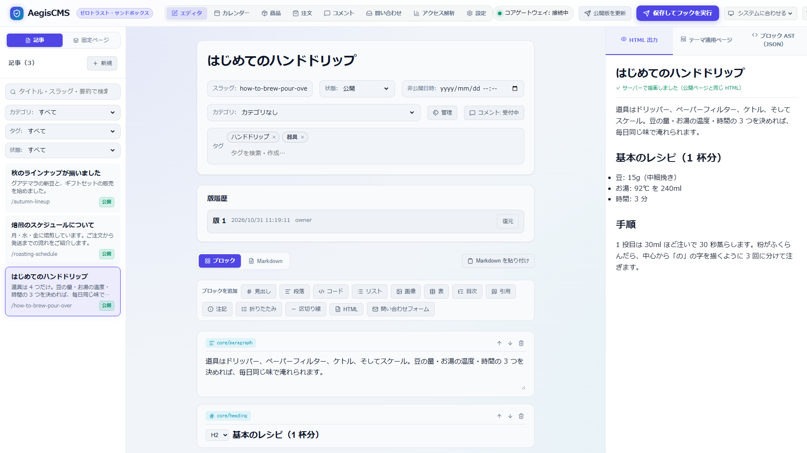
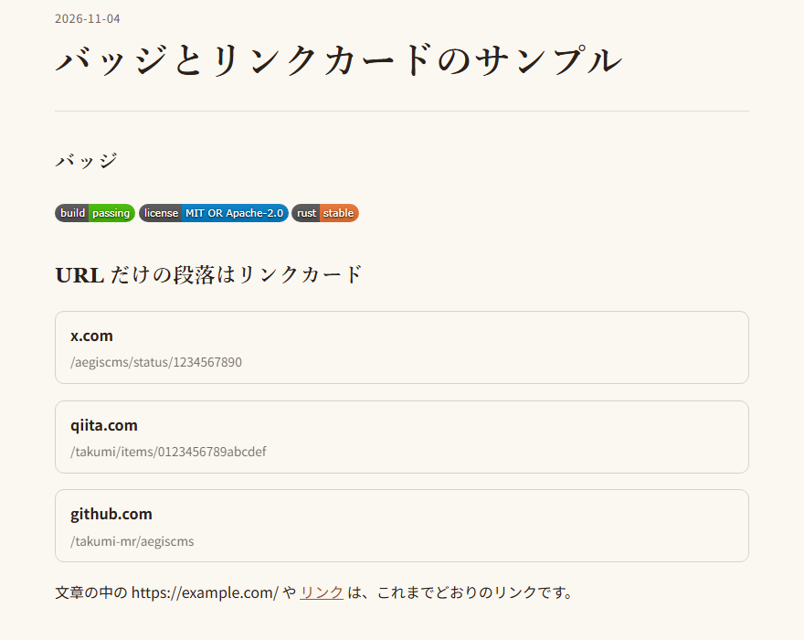

[← Back to the documentation index](README.md)

**English** | [日本語](blocks.ja.md)

# Body Blocks

The body of articles, static pages, and products is stored not as HTML but as a tree of blocks (`BlockNode`). On save, heading ids are added, it goes through the plugins' `transform-content-ast` hook, and then `aegis-ast`'s `HtmlRenderer` turns it into HTML ([architecture.md 3.1](architecture.md#31-the-html-generation-path-aegis-serversrcrenderrs)).

In Admin Studio you edit block by block, or write in Markdown. The two convert to each other (`admin/src/utils/markdown.ts`), and whichever you write in, it is saved as the same blocks.

```json
{ "name": "core/heading", "attributes": { "level": 2, "id": "install" }, "text": "Installation", "children": [] }
```

## 1. List of Blocks



| Block               | Attributes                                                                                                                                                           | Markdown                                                                  | HTML output                                                                                                                                                                                                                                                                                                              |
| ------------------- | -------------------------------------------------------------------------------------------------------------------------------------------------------------------- | ------------------------------------------------------------------------- | ------------------------------------------------------------------------------------------------------------------------------------------------------------------------------------------------------------------------------------------------------------------------------------------------------------------------ |
| `core/heading`      | `level` (1–6, default 2), `id` (added automatically on save)                                                                                                         | `## Heading`                                                              | `<h2 id="...">`                                                                                                                                                                                                                                                                                                          |
| `core/paragraph`    |                                                                                                                                                                      | Text separated by blank lines                                             | `<p>`                                                                                                                                                                                                                                                                                                                    |
| `core/list`         | `ordered` (boolean). The items are the `text` of child `core/list-item`s. Task list items have `attributes.checked` (boolean)                                        | `- item` / `1. item` / `- [ ] not done` / `- [x] done`                    | `<ul>` / `<ol>` (with tasks, `class="contains-task-list"`, and items are `<li class="task-list-item"><input type="checkbox" disabled>`; a read-only checkbox as in GFM)                                                                                                                                                  |
| `core/code`         | `language`, `filename` (optional; up to 120 characters)                                                                                                              | ` ```rust ` to ` ``` ` (for a file name, ` ```rust title="src/main.rs" `) | `<pre data-filename="src/main.rs"><code class="language-rust">` (`data-filename` only when there is a file name; shown by the [official plugin `official-code-lines`](../plugins/official-code-lines) or the theme's CSS)                                                                                                |
| `core/image`        | `src`, `alt`                                                                                                                                                         | ``                                                             | `<figure>`                                                                                                                                                                                                                                                                                                          |
| `core/table`        | `rows` (an array of arrays of strings), `header` (make the first row a header row; default `true`), `align` (per column, `"left"` / `"center"` / `"right"` / `null`) | A GFM table (below)                                                       | `<div class="aegis-table"><table>`                                                                                                                                                                                                                                                                                       |
| `core/toc`          | `title` (no heading if empty), `maxLevel` (2–6, default 3)                                                                                                           | `[TOC]`, `[TOC title="Contents" maxLevel=4]`                              | `<nav class="aegis-toc">`                                                                                                                                                                                                                                                                                                |
| `core/quote`        | `cite` (the source; optional)                                                                                                                                        | `> quote` (if the last line is `> — source`, that is the source)          | `<blockquote>` (with a source, `<figure class="aegis-quote">` and `<figcaption>`)                                                                                                                                                                                                                                        |
| `core/callout`      | `variant` (`note` / `tip` / `important` / `warning` / `caution`, default `note`), `title` (optional)                                                                 | `> [!WARNING] Title` followed by `> body`, or `:::warning Title` to `:::` | `<aside class="aegis-callout aegis-callout-warning" role="note">`                                                                                                                                                                                                                                                        |
| `core/separator`    |                                                                                                                                                                      | `---` (`***` and `___` also work)                                         | `<hr>`                                                                                                                                                                                                                                                                                                                   |
| `core/details`      | `summary` (the heading), `open` (open at first; default `false`)                                                                                                     | `:::details Heading` to `:::` (`:::details+` for the open state)          | `<details class="aegis-details"><summary>`                                                                                                                                                                                                                                                                               |
| `core/footnote`     | `label` (alphanumerics, `_`, `-`, up to 40 characters). The note's text is `text`                                                                                    | `[^1]` in the body, and the definition `[^1]: note` (one line)            | A `<section class="aegis-footnotes">` at the end of the document (references in the body are `<sup class="aegis-fnref">`)                                                                                                                                                                                                |
| `core/paywall`      | None                                                                                                                                                                 | `<!-- paywall -->` (an HTML comment; nothing is shown on GitHub)          | A "members only from here" divider. It takes effect only when the article or page has `access`, and what comes after it does not appear in the HTML, feeds, search, or API for viewers without the required level. Nothing is shown to viewers who can read ([members.md 15.3](members.md#153-from-here-on-in-the-body)) |
| `core/contact-form` | `form` (the name in `[[contact.forms]]`; default `default`)                                                                                                          | `[CONTACT]`, `[CONTACT form="sales"]`                                     | The [contact form](contact.md#2-placing-the-form) (only when `[contact].enabled`)                                                                                                                                                                                                                                        |
| `core/html`         | `mode` (`sanitized` / `sandbox`)                                                                                                                                     | ` ```html ` / ` ```html:sandbox `                                         | [Custom HTML](theme_authoring_guide.md#31-which-template-is-used-at-which-url)                                                                                                                                                                                                                                           |

A block named `<plugin name>/<block name>` is rendered by that plugin ([4. Plugin blocks](#4-plugin-blocks)). Any other block with an unknown name is output as a custom element with the `/` in the name turned into `-` (`<my-plugin-card>`).

### 1.1 Tables

```markdown
| Name | Kind | Price |
| --- | :---: | ---: |
| Ethiopia | **Light roast** | $17.80 |
```

- `:---`, `:---:`, and `---:` in the separator row become the column alignment (left, center, right).
- Leaving the header row empty makes a table with no header row (`header: false`).
- Write `|` inside a cell as `\|`. Inline formatting (below) can be used in cells.
- On narrow screens only the table scrolls horizontally (`overflow-x: auto` on `.aegis-table`). Cells have `overflow-wrap: break-word`, so even if the theme uses `overflow-wrap: anywhere`, columns do not get too narrow by wrapping in the middle of words.

### 1.2 Table of Contents

At the position where you place `[TOC]`, the body's headings (H2 to `maxLevel`) are output as a nested numbered list. The link targets are the headings' `id`s.

- A heading's `id` is made on save from the text without inline formatting marks, and if it collides within the same document, `-2`, `-3`, ... is appended. Headings that already have an `id` are not changed.
- The table of contents is built from the headings on every render, so if you fix a heading and save, the table of contents changes too.
- When an H4 follows an H2, it goes at the H3 position (levels deepen only one step at a time).

### 1.2a Footnotes

The syntax is the same as GitHub (the block with definitions is `core/footnote`).

```markdown
The first sentence[^1], and the next sentence[^note].

[^1]: The note's text. Inline formatting such as **bold** can be used.
[^note]: Another note.
```

- Numbers are assigned in **the order first referenced in the body** (not the order the definitions were written). However many times the same footnote is referenced, the number is the same, and the back-links in the note at the end grow as `↩` `↩²`.
- Notes are output **together at the end of the document**, not at the position of the definition.
- **A `[^x]` with no definition stays as text**, and **a definition that is not referenced is not output** (the same as GitHub).
- A definition is a single line of text only (GitHub's multi-paragraph definitions are not supported). Labels are alphanumerics, `_`, and `-`, up to 40 characters.
- A hash made from the definition's content is added to the `id`s (`fn-1-1a2b3c4d`, `fnref-1-1a2b3c4d`). Even when separate bodies are lined up on one page, such as in the content API's list, they do not collide.
- Headings, the table of contents, excerpts, and search use the text with the `[^1]` references removed (the note text is searched).
- References can be used where inline formatting is available (paragraphs, list items, headings, table cells, quotes, notes, collapsibles). They cannot be used inside plugin blocks.

### 1.3 Quotes and Notes

```markdown
> We deliver seasonal beans from a small roastery.
> — Asanagi Coffee

> [!TIP] Storage tip
> If it will be more than 2 weeks, we recommend **freezing** it.

:::caution
This operation cannot be undone.
:::
```

The note kinds are the same 5 as GitHub's alerts. The body is split into paragraphs by blank lines, and inline formatting can be used.

### 1.4 Collapsibles

Used for Q&A and details of supplementary information. They are the standard HTML `<details>` / `<summary>`, so they use no JavaScript, can be opened and closed from the keyboard, and the body is read by search engines even when closed.

```markdown
:::details Is it free to use?
Yes. It is **open source**.

Commercial use is fine too.
:::

:::details+ An item left open from the start
Body
:::
```

Inline formatting can be used in the heading and body. The body is split into paragraphs by blank lines. If the heading is empty, `Details` is shown.

## 2. Inline Formatting

Usable in the bodies and headings of paragraphs, list items, headings, table cells, quotes, notes, and collapsibles.

| Syntax                                  | Output                                                                                  |
| --------------------------------------- | --------------------------------------------------------------------------------------- |
| `**bold**`                              | `<strong>`                                                                              |
| `*italic*`                              | `<em>`                                                                                  |
| `~~strikethrough~~`                     | `<del>`                                                                                 |
| `` `code` ``                            | `<code>` (symbols inside are left as is)                                                |
| `[text](URL)`                           | `<a href="URL">`                                                                        |
| ``                      | `` (writing only an image on a line makes a `core/image` block)     |
| `[](link target)` | `<a></a>` (badges from GitHub, shields.io, etc.; the image host is not restricted) |
| `\*`                                    | Output the symbol as is                                                                 |

- If there is whitespace right after `*` or right before the closing `*`, it is not formatting (`2 * 3 * 4` stays as is). Symbols with no closing one also stay as is.
- `_italic_` cannot be used (so as not to break `snake_case` identifiers).
- HTML tags cannot be written. Everything is escaped as text (use `core/html` when you need HTML).
- Link URLs are only `http:`, `https:`, `mailto:`, `tel:`, and relative URLs with no scheme (such as `/docs` and `#install`). Links with anything else (`javascript:`, `data:`, etc.) or a URL containing whitespace output only the text. For external links, `rel` and so on are added afterward by the `[security]` settings as before.
- Image URLs are only `http:`, `https:`, and relative URLs. Anything else (`data:`, `javascript:`, etc.) outputs only the alt text.
- **A paragraph that is only a URL becomes a link card.** When a paragraph is just one `https://…` (with no text or other links before or after), it outputs the site name (host) and path as `<p class="aegis-linkcard" data-provider="qiita"><a href data-host="qiita.com">`. It makes no external requests. There is no per-site code; you change the look by selecting `data-provider` (the label just before the host's trailing domain: `x`, `qiita`, `github`, `zenn`) and `data-host` in CSS (`.aegis-linkcard[data-provider="x"] { … }`). Adding a supported site needs no server or plugin update. Links within sentences and paragraphs that are only `[text](URL)` are ordinary links as before.
  
- Excerpts (the list's `excerpt` and the feed's `<summary>`) and the table of contents use the text with the symbols removed.

## 3. Appearance

Minimal styles are built in for tables, the table of contents, quote sources, notes, collapsibles, and footnotes (the `<style id="aegis-block-styles">` in every page's `<head>`). Selectors are wrapped in `:where()` to give zero specificity, so the theme's CSS always takes precedence. Colors use only shades of the text color and the CSS variable `--aegis-callout` per note kind, so they are readable on both light and dark themes.

Classes for changing the look in a theme:

| Class                                                                                                                     | Element                                                                   |
| ------------------------------------------------------------------------------------------------------------------------- | ------------------------------------------------------------------------- |
| `.aegis-table`                                                                                                            | The `<div>` wrapping a table (horizontal scroll)                          |
| `.aegis-toc`, `.aegis-toc-title`                                                                                          | The table of contents `<nav>` and its heading                             |
| `.aegis-quote`                                                                                                            | The `<figure>` of a quote with a source (the source is the `figcaption`)  |
| `.aegis-callout`, `.aegis-callout-{note,tip,important,warning,caution}`, `.aegis-callout-title`                           | A note, its kind, and its heading                                         |
| `.aegis-details`, `.aegis-details-body`                                                                                   | A collapsible and its body                                                |
| `.aegis-linkcard` (`data-provider`), `.aegis-linkcard-site`, `.aegis-linkcard-path`                                       | The link card of a URL-only paragraph, and the site name and path         |
| `.aegis-contact-form`, `.aegis-contact-field`, `.aegis-contact-error`, `.aegis-contact-required`, `.aegis-contact-submit` | The contact form and its fields, errors, required mark, and submit button |

```css
/* Example: match the note's "warning" color to the theme's color */
.aegis-callout-warning { --aegis-callout: #c2410c; }
```

## 4. Plugin Blocks

Wasm plugins can add blocks that can be placed in the body (for how to build them, see [plugin_hooks.md 1.10](plugin_hooks.md#110-render-blocks)). Examples are the official plugin [`official-blocks`](../plugins/official-blocks)'s button (`official-blocks/button`), link card (`official-blocks/link-card`), video (`official-blocks/video`; YouTube, Vimeo), audio (`official-blocks/audio`), file download (`official-blocks/file`), map (`official-blocks/map`; OpenStreetMap), image gallery (`official-blocks/gallery`), FAQ (`official-blocks/faq`), steps (`official-blocks/steps`), columns (`official-blocks/columns`), image and text (`official-blocks/media-text`), image with caption (`official-blocks/figure`), timeline (`official-blocks/timeline`), chat bubbles (`official-blocks/chat`), tabs (`official-blocks/tabs`), stats (`official-blocks/stats`), definition list (`official-blocks/definition-list`), and rating (`official-blocks/rating`; with schema.org Review).

- The blocks of enabled plugins line up in Admin Studio's add-block button (`GET /api/v1/blocks`). The edit screen shows a form of the input fields declared in the plugin's manifest.
- What is saved is only the block name and attributes, and the plugin builds the HTML **on every display**. When you update the plugin, the display changes without re-saving.
- The HTML a plugin returns is sanitized in the same way as the custom HTML block's standard mode before output (`<script>`, `on*` attributes, `javascript:` URLs, etc. do not remain). The outside is `<div class="aegis-plugin-block" data-block="<name>">`.
- For `<iframe>`, only those from hosts the plugin declared in the manifest (`capabilities.embed.frame_domains`) remain, and those hosts are also added automatically to the CSP `frame-src` ([plugin_hooks.md 3.2](plugin_hooks.md#32-embedding-external-pages-capabilitiesembed)). Video embedding uses this mechanism and not the custom HTML block (in standard mode the `<iframe>` disappears, and in sandbox mode restrictions also apply to the player inside).
- Disabling a plugin does not make its blocks disappear. Admin Studio shows "Plugin disabled", and they are not shown on public pages.

In Markdown they are written on one line, with attributes as a JSON object (omittable if there are no attributes).

```markdown
::: official-blocks/button {"label": "Get started", "url": "/docs/start", "style": "primary"}

::: official-blocks/link-card {"url": "https://github.com/takumi-mr/aegiscms", "title": "AegisCMS"}

::: official-blocks/video {"url": "https://www.youtube.com/watch?v=dQw4w9WgXcQ", "aspect": "16x9"}

::: official-blocks/audio {"url": "/uploads/episode-1.mp3", "title": "Episode 1"}

::: official-blocks/file {"url": "/uploads/guide.pdf", "title": "Getting started guide", "size": "PDF, 2.4 MB"}

::: official-blocks/map {"latitude": 35.6812, "longitude": 139.7671, "zoom": 16, "title": "Tokyo Station"}

::: official-blocks/gallery {"images": [{"image": "/uploads/a.jpg", "caption": "Exterior"}, {"image": "/uploads/b.jpg", "caption": "Interior"}], "columns": "2"}

::: official-blocks/faq {"items": [{"question": "Is it free?", "answer": "Yes, it is free."}, {"question": "How do I start?", "answer": "Download the binary and run it."}]}

::: official-blocks/steps {"items": [{"title": "Install", "description": "Download the binary."}, {"title": "Start", "description": "Start the server."}]}

::: official-blocks/columns {"items": [{"image": "/uploads/a.jpg", "title": "Fast", "text": "Renders in milliseconds."}, {"image": "/uploads/b.jpg", "title": "Safe", "text": "Plugins run inside Wasm."}]}

::: official-blocks/media-text {"image": "/uploads/a.jpg", "alt": "Roaster", "title": "Roasted weekly", "text": "What arrives is freshly roasted beans.", "side": "right"}
```

A line that cannot be read as JSON becomes a paragraph as is.

From the API, write `name` and `attributes` in the `blocks` elements (`<plugin name>/<block name>`. You do not write HTML; the plugin builds it on every display).

```bash
curl -X POST http://localhost:8080/api/v1/contents/article \
  -H "Authorization: Bearer $TOKEN" -H "Content-Type: application/json" \
  -d '{"title": "Example", "slug": "example", "status": "draft",
       "blocks": [{"name": "official-blocks/button",
                   "attributes": {"label": "Get started", "url": "/docs/start", "style": "primary"}}]}'
```

How to build them is collected in [Creating your first block plugin](plugin_block_tutorial.md).

## 5. OGP / oEmbed

The card for a URL-only paragraph ([2](#2-inline-formatting)) can show that page's title, description, and image. AegisCMS runs as an oEmbed **provider** (the distributing side) built in, and the **consumer** (the fetching side) is the official plugin [`official-link-embed`](../plugins/official-link-embed). The consumer fetches inside the sandbox.

### 5.1 Provider: `GET /oembed`

For the URL of a published article, static page, or product, it returns [oEmbed](https://oembed.com/) JSON (`type: "link"`).

```bash
curl 'https://example.com/oembed?url=https%3A%2F%2Fexample.com%2Farticles%2Fhello&format=json'
```

```json
{ "version": "1.0", "type": "link", "title": "Hello", "provider_name": "My Site",
  "provider_url": "https://example.com", "url": "https://example.com/articles/hello",
  "description": "The article's excerpt", "thumbnail_url": "https://example.com/uploads/cover.png" }
```

- `description` is an oEmbed extension field (the article's `excerpt`), and `thumbnail_url` is `featured_image` / `image`. HTML (`html`) is not returned.
- Only URLs of this site are covered (those whose host and port are the same as the public URL; the public URL is [the SEO setting `canonical_base_url`](configuration.md), or the request's Host if absent). URLs of other sites, drafts, unpublished, and nonexistent content give 404, and a `format` other than `json` gives 501.
- If `[seo].canonical_base_url` is set, a discovery link `<link rel="alternate" type="application/json+oembed" href="/oembed?url=…&format=json">` goes into the `<head>` of content pages. Consumers on other sites (CMSs and chat tools with this feature) can discover the oEmbed from the URL.

OGP (`og:title`, `og:description`, `og:image`, and `twitter:` cards) still appears in every page's `<head>` as before.

### 5.2 Consumer: `official-link-embed`

When enabled, if a body **paragraph is only one `https://…` URL**, at save time (and in the editor's preview too) it fetches that page and stores the title, description, image, and site name in the attributes of an `official-link-embed/embed` block. It makes no requests at display time (even if the external site is down or slow, public pages are unaffected).

- Fetch order: (1) for hosts in the settings' `oembed_endpoints` (X by default; sites whose pages have no OGP), oEmbed; (2) the page's `og:` / `twitter:` / `<title>`; (3) if no title can be obtained, the page's oEmbed discovery link. The `html` oEmbed returns (third-party HTML and scripts) is not used, and only the body text is used as the description.
- A paragraph whose URL could not be fetched or is not allowed stays as it is and is displayed with the built-in link card (host and path).
- After saving, it is not updated automatically (Wasm has no clock, so expiry cannot be decided). To refresh, press the embed block's "Refetch" button, or rewrite the block's `url` and save (the URL at the time of fetching is remembered in `fetched_url`, and it is refetched if different). If refetching fails, the previous contents are kept.
- A single save fetches up to 3 URLs (the rest use the built-in card; saving again fetches the rest).

**Fetch destinations (allowed domains)** are added in the settings, not in code.

```toml
[plugins.settings.official-link-embed]
extra_allowed_domains = "speakerdeck.com, example.org"   # added to the defaults qiita.com, zenn.dev, github.com, note.com, x.com (subdomains included)
oembed_endpoints = "x.com=https://publish.twitter.com/oembed"  # for sites whose pages have no OGP (the endpoint's domain must be allowed too)
```

It can also be set from Admin Studio's plugin management screen and takes effect without restarting the server ([`extra_allowed_domains`](configuration.md#plugins--enabling-plugins)).

**Network restrictions** (common to all plugins; [plugin_hooks.md 5.4](plugin_hooks.md#54-http-requests-hosthttp_fetch)): only `http` / `https`, and ports only 443 for `https` and 80 or 8080 for `http`. It does not connect to internal IP addresses (loopback, private, link-local = cloud metadata, etc.) or host names that resolve to them, even if written in the allowed domains. Redirects are followed up to 3 times, with the allowed domains and the above restrictions checked at each destination.

The classes for changing the look in a theme are `.oe-card`, `.oe-body`, `.oe-title`, `.oe-description`, `.oe-site`, and `.oe-image` (zero-specificity `:where()`).
