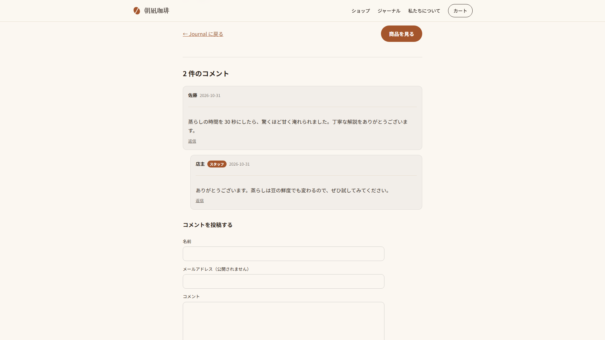
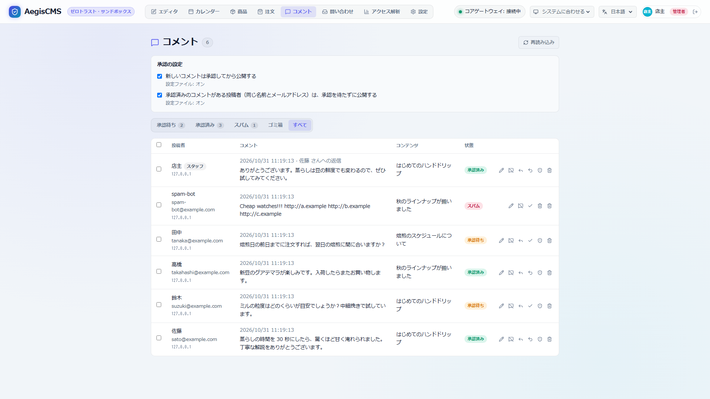

[← Back to the documentation index](README.md)

**English** | [日本語](comments.ja.md)

# Comments

Lets readers write comments on articles, static pages, and product pages on the public site (`[comments]`). Submissions are moderated with the same thinking as WordPress (an approval workflow, auto-approval of already-approved posters, banned words, and link counts), and in Admin Studio's **Comments** tab you approve, mark as spam, and reply. Email notifies you of new comments, of items awaiting approval, of replies, and of your comment being approved ([Notifications](notifications.md)).

```text
 Reader (the form on a public page)
        │  POST /api/v1/contents/{type}/{slug}/comments
        ▼
 Checks: required fields and length → is it open → honeypot (bots are not saved) → posts per IP → consecutive identical bodies
        │
 Initial status: banned words and link count → approval workflow (already-approved posters are auto-approved) → check-comment plugin
        │
        ├── approved ──▶ shown on the public page. comment.posted to the author, comment.replied to the poster of the replied-to comment
        ├── pending ───▶ comment.pending to the author and operators → approve in Admin Studio → comment.approved to the poster, comment.replied to the poster of the replied-to comment
        └── spam ──────▶ nobody is notified (the poster is shown "awaiting approval")
```

> [!NOTE]
> Product reviews (star ratings, reviews that only purchasers can write) are planned as a separate feature from comments, to be built together with customer accounts. The moderation mechanism (approval workflow, spam protection, notifications) will be shared with comments ([architecture.md 13](architecture.md#13-comments-aegis-comments)).

---

## 1. Enabling It

```toml
[comments]
enabled = true
content_types = ["article"]   # content kinds that accept comments (also "product" for products)
max_depth = 3                 # reply depth (0 for no replies)
close_after_days = 0          # close comments this many days after publication (0 never closes)

[comments.moderation]
require_approval = true       # publish after approval (can be switched from Admin Studio)
auto_approve_known = true     # people with an approved comment are published without waiting for approval (same)
max_links = 2                 # more links than this awaits approval
hold_words = []               # words that put a comment awaiting approval
spam_words = []               # words that make a comment spam
max_per_ip_per_hour = 10      # posts per hour from the same IP
```

Other `[comments]` items: `avatars` ([3.1](#31-avatars)) and `reject_duplicates` ([2.3](#23-protection-against-bots-and-consecutive-posts)).

- For the list of settings, see the [Configuration reference](configuration.md#215-comments--comments).
- If the schema for a kind in `content_types` is missing, the server does not start.
- To send notifications, also enable `[notifications]`. The unsubscribe link for reply notifications and the URLs in the body are built from `[commerce].public_url` (without it, no links are included).

---

## 2. Approval and Spam Protection

### 2.1 How the Initial Status Is Decided

A post's status is decided in the following order, and later steps can only be stricter than earlier ones.

| Order | Condition | Status |
| --- | --- | --- |
| 1 | The name, email address, or body contains a word from `spam_words` | `spam` |
| 2 | It has a word from `hold_words`, or more links (`http://` / `https://` / `www.`) than `max_links` | `pending` |
| 3 | With the approval workflow (`require_approval`), there is no approved comment with the same name and email address (or `auto_approve_known` is off) | `pending` |
| 4 | Otherwise | `approved` |
| 5 | The `check-comment` plugin returned `hold` / `spam` ([6](#6-moderating-with-plugins)). If the plugin fails, `pending` | `pending` / `spam` |

- Word matching is a case-insensitive substring match.
- Posts caught as spam or by the honeypot also get the same response as "awaiting approval" for the poster (so as not to reveal the judgment).
- There are 4 statuses: `pending` (awaiting approval) / `approved` (published) / `spam` / `trash`. Only `approved` appears on the public page.

### 2.2 Switching the Approval Workflow

With "Approval settings" at the top of the **Comments** tab, you can switch the approval workflow (`require_approval`) and auto-approval of approved posters (`auto_approve_known`) (`admin` only; `editor` can only view). The values are stored in the DB (`comments.require_approval` / `comments.auto_approve_known` in `_aegis_settings`) and take effect from the next post without a restart. They are read from the DB on every post, so they apply to all servers even when running several. "Reset to config file values" returns them to the config file's values.

### 2.3 Protection Against Bots and Consecutive Posts

- **Honeypot**: the form has a field invisible to people (`website`), and if it has a value the post is treated as a bot and neither saved nor notified.
- **Posts per IP**: exceeding `max_per_ip_per_hour` gives `429` (counted in `[cache]`). Behind a reverse proxy, unless you set `[audit].trust_forwarded_for = true`, everyone is counted as the same IP.
- **Consecutive identical bodies**: if the same person (same email address or IP address) has already posted the same body on the same content, it is refused with `409` (preventing double submission and spamming; `reject_duplicates = false` turns it off). Comments in the trash are not counted. MySQL is often configured so that string comparison is case-insensitive, and in that case differences only in case also count as duplicates. A body counts as a duplicate only when it matches exactly apart from whitespace differences (leading/trailing and line-ending differences). Because it goes by IP address, a different person on the same connection (a company, a school, etc.) writing a short remark such as "thanks" on the same content may be refused.
- **CAPTCHA (optional)**: putting `comments` in the shared `[captcha]` `targets` puts a widget in the post form and the server verifies it (for settings see [Configuration reference 2.24](configuration.md#224-captcha--shared-captcha), for the mechanism [Contact form 1.2](contact.md#12-captcha-optional)). The built-in templates support it automatically. In your own template, place `{{ comments.captcha_html | safe }}` inside the `<form>` and add `captcha_token` (the value of the field named `comments.captcha_field`) to the post JSON. If it fails, it is `400 {"code": "captcha_failed"}`, and if the verification service cannot be reached, `503 {"code": "captcha_unavailable"}`. Posts with a value in the invisible field (honeypot) are not sent to the verification service.
- **Plugins**: external spam detection services (Akismet, etc.) can be used through the `check-comment` hook.

---

## 3. Public Site

The public pages (`article.html` / `page.html` / `product.html`) of the kinds in `content_types` are given the template variable `comments`. The built-in templates and the bundled themes include the built-in comment section `comments.html` after the body.

```jinja

```

| Variable | Description |
| --- | --- |
| `comments.count` | The number of approved comments |
| `comments["items"]` | Approved comments (in thread order; replies right after their parent) |
| `comments.open` | Whether new comments are accepted (`close_after_days`, stopping acceptance in Admin Studio) |
| `comments.post_url` | The post destination (`POST`, including the base path) |
| `comments.content_id` | The content's ID |
| `comments.max_depth` / `comments.max_length` | The depth replies can go / the maximum number of characters in the body |

Each element of `items` has `id` / `parent_id` / `author_name` / `body_html` (the escaped body; paragraphs and line breaks only) / `created_at` / `depth` (from 0, up to `max_depth`) / `staff` (a reply from Admin Studio) / `avatar_url` ([3.1](#31-avatars); `null` if none). Email addresses and IP addresses are not passed to the template. `items` overlaps with a Jinja dict method name, so reference it as `comments["items"]`.

- The built-in comment section submits the form with a script (`Content-Type: application/json`). When the comment becomes approved, it reloads at that comment's position (`#comment-<id>`), and if awaiting approval it shows a notice. The name and email address are remembered in the browser (`localStorage`).
- To change the look in a theme, place a template of the same name at the theme's `templates/comments.html` ([How to build themes](theme_authoring_guide.md)). To submit from your own form, use the API in [5.1](#51-public-no-login-needed).
- The unsubscribe link in reply notification emails is `/comments/unsubscribe?id=...&token=...`, and the theme's `page.html` shows "Notifications stopped". Reply notifications and approval notifications are the same preference (the form's checkbox), and the unsubscribe link stops both.

### 3.1 Avatars

With `[comments].avatars = "gravatar"`, `avatar_url` holds the URL of a [Gravatar](https://gravatar.com/) image, and the built-in comment section shows it next to the name.



- The URL is built from the SHA-256 of the email address (lowercase, no surrounding whitespace) (`https://www.gravatar.com/avatar/<hash>?s=96&d=<avatar_default>&r=g`). The email address itself appears neither in the URL nor on the page.
- The image is **fetched from gravatar.com by the reader's browser** (the reader's IP address is passed to Gravatar). Sites that want to avoid external connections should leave the default `none`.
- People without an image on Gravatar get the `avatar_default` image (such as `identicon`). With `404` there is no image and the display breaks (use it only if you hide it in the theme with `onerror` or the like).
- If you write your own theme `comments.html`, use it like ``.

---

## 4. Admin Studio



In the **Comments** tab (`editor` and above; not shown if `[comments].enabled = false`) you can do the following. The links in notification emails (Admin Studio's URL + `#comments`) also open this tab.

- A list per status (awaiting approval, approved, spam, trash, all; with counts). The poster's name, email address, and IP address, the body, and the content the comment was left on (a link to the public page).
- Approve, unapprove (return to awaiting approval), mark as spam, trash, and delete permanently. Checkboxes let you operate in bulk (up to 200). Approving from awaiting approval (or spam) sends `comment.approved` to posters who chose "notify me by email" when posting.
- Editing the body (the pencil button): comments of any status can be fixed. It is reflected on the public page immediately. Use it to correct typos or remove personal information you do not want published. Edits are recorded in the audit log (only the character count, not the body). The poster is not notified.
- Switching acceptance per content (the button on the comment row, or the button on the content or product edit screen): stops or resumes new comments on that content. Even while stopped, existing comments remain on the public page, and "Comments are closed." appears in place of the form. "Acceptance stopped" is shown on the content row and the edit screen (content with 0 comments can also be switched from the edit screen). Deleting the content also removes this setting.
- Reply: under the Admin Studio user's display name, published immediately as approved (with a "Staff" badge on the public page). Replying to a comment awaiting approval approves that comment too.
- Approval settings ([2.2](#22-switching-the-approval-workflow)).

Deleting content also deletes its comments.

---

## 5. API

### 5.1 Public (No Login Needed)

| Method and path | Description |
| --- | --- |
| `GET /api/v1/contents/{type}/{slug or id}/comments` | Approved comments (the same shape as the template's `comments`) |
| `POST /api/v1/contents/{type}/{slug or id}/comments` | Post. The body is `name` / `email` / `body` (required), `parent_id` (the reply target), `notify_replies` (notify by email of replies and approval), and `website` (the honeypot; leave empty) |
| `GET /comments/unsubscribe?id=...&token=...` | Stop reply notifications (the link in notification emails; HTML) |

The response to a post is `201` with `{"status": "approved", "comment": {...}}` when published, and `202` with `{"status": "pending"}` when awaiting approval (including spam and honeypot). Errors are `400` (invalid input, no reply target, too deep), `403` (comments closed: `close_after_days` passed or stopped in Admin Studio), `404` (not published, or a kind that does not accept comments), `409` (the same body was already posted), `422` (a plugin refused it; `error` is text to show the poster), and `429` (too many posts).

### 5.2 Administration

| Method and path | Role | Description |
| --- | --- | --- |
| `GET /api/v1/comments` | `editor` | A list (newest first). `status` / `content_type` / `content_id` / `limit` (default 50, max 200) / `offset`. The response is `comments`, `total`, and the counts per status `counts` |
| `PATCH /api/v1/comments/{id}` | `editor` | Change the status (such as `{"status": "approved"}`) or fix the body (`{"body": "..."}`). Both at once is fine (the body is fixed first). Neither gives `400` |
| `GET /api/v1/contents/{type}/{id}/comments/state` | `editor` | Get the acceptance state of new comments on that content. `id` is an ID or slug. The response is `{"content_type", "content_id", "open"}` |
| `PUT /api/v1/contents/{type}/{id}/comments/state` | `editor` | Stop or resume new comments on that content (`{"open": false}`). `id` is an ID or slug. The response is `{"content_type", "content_id", "open"}` |
| `DELETE /api/v1/comments/{id}` | `editor` | Delete permanently |
| `POST /api/v1/comments/bulk` | `editor` | Operate in bulk (`{"ids": [...], "action": "approved" \| "pending" \| "spam" \| "trash" \| "delete"}`). The response is `{"count": number changed}` |
| `POST /api/v1/comments/{id}/replies` | `editor` | Reply (`{"body": "..."}`) |
| `GET /api/v1/comments/settings` | `editor` | Approval settings (`policy`: the actual values, `overrides`: values changed in Admin Studio, `defaults`: the config file's values) |
| `PUT /api/v1/comments/settings` | `admin` | Change the approval settings (`{"require_approval": false, "auto_approve_known": null}`; `null` returns to the config file's value) |

The audit log records `comment.create` (a reply from Admin Studio) / `comment.moderate` / `comment.update` (editing the body) / `comment.delete` / `comment.settings_update` (approval settings and the per-content acceptance switch) ([Audit log](audit.md)).

---

## 6. Moderating with Plugins

A plugin that declares the `check-comment` hook receives posts from the public site before they are saved, and can return `allow` (as is) / `hold` (awaiting approval) / `spam`. Returning an error (`PluginError::Rejected` in the Rust SDK) refuses the post and shows the message to the poster. For details, see the [hook list](plugin_hooks.md#19-check-comment).

```rust
fn check_comment(&mut self, comment: CommentSubmission) -> Result<CommentVerdict> {
    if comment.body.contains("casino") {
        return Ok(CommentVerdict::Spam { reason: Some("casino".into()) });
    }
    Ok(CommentVerdict::Allow)
}
```

---

## 7. Security and Limitations

- **The body is plain text**: HTML and Markdown are not interpreted; everything is escaped and reduced to paragraphs and line breaks only. Links are not turned into links automatically either (to reduce the motive for spam).
- **Personal information**: email addresses, IP addresses, and browsers (User-Agent) appear only in Admin Studio (`editor` and above) and in the awaiting-approval notifications to authors and operators. Reply notifications (to readers) do not include the replier's email address.
- **Unsubscribe link for reply notifications**: an unguessable per-comment token, and the unsubscribe page has `Referrer-Policy: no-referrer`.
- Up to 1,000 comments per content item, oldest first, appear on the public page.
- There is no translation of comment bodies (translating the comment section).
- Even if you edit a body, no "edited" mark or edit history remains on the public page (the audit log records the fact of the edit and the character count).
