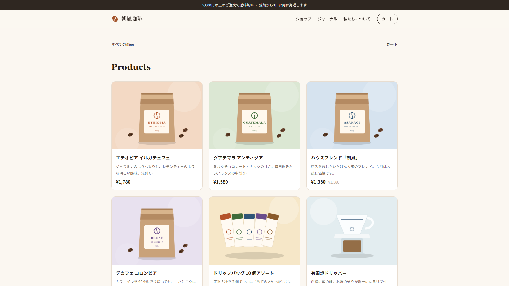
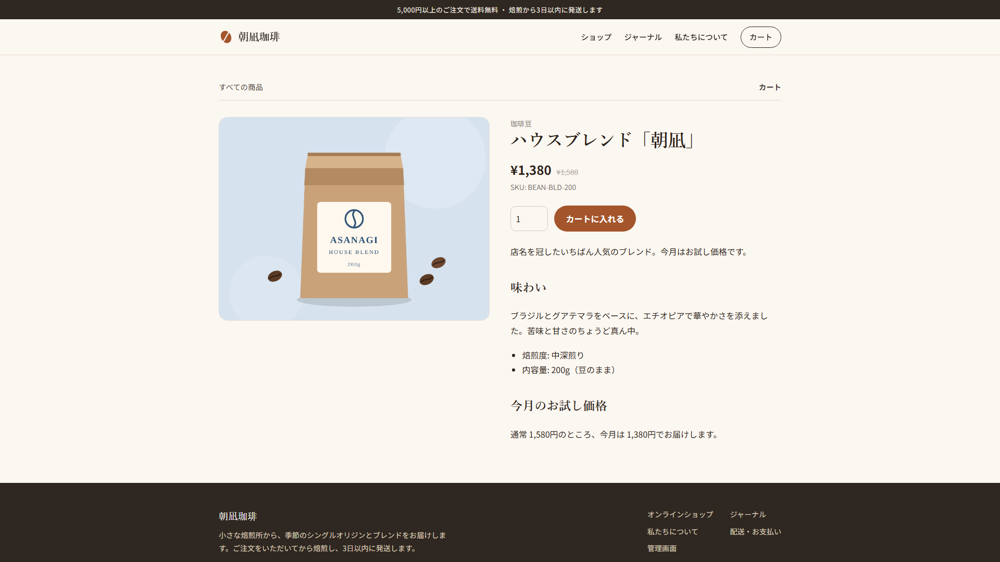
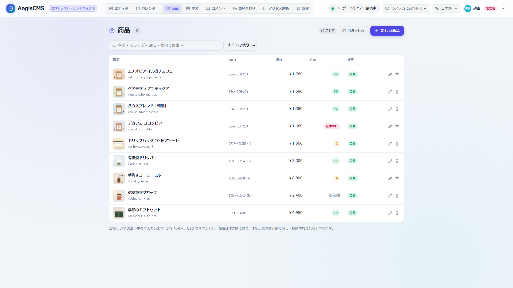
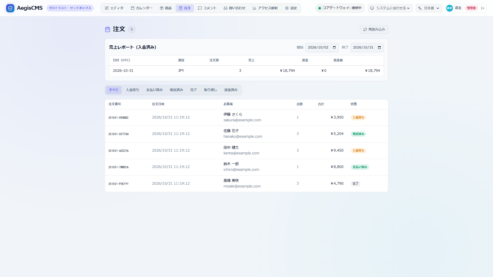

[← Back to the documentation index](README.md)

**English** | [日本語](commerce.ja.md)

# E-Commerce (Shop Features)

AegisCMS has cart, order, inventory, and payment features (`[commerce]`). Products are ordinary content (the `product` schema) managed in Admin Studio, and the public site gains a product list, product pages, a cart, and an order confirmation page. Shipping, tax, coupons, and order notifications can be swapped with Wasm plugins.

> [!TIP]
> As a working sample, there is a coffee bean shop, [`examples/coffee-shop/`](../examples/coffee-shop) (start it with `task demo:shop`).

```text
 Product (product content) ──▶ /products, /products/{slug}
        │                          │ add to cart (the browser's localStorage)
        │                          ▼
        │                 /cart ── POST /api/v1/shop/quote ── calculate-order plugin (shipping, tax, discounts)
        │                          │
        │                          ▼ POST /api/v1/shop/checkout
        │                 Compute the price on the server → reserve inventory and create the order (one transaction)
        │                          │
        │          ┌───────────────┴───────────────┐
        │     manual (bank transfer, COD)     stripe (Stripe Checkout)
        │     payment instructions on the     to the payment page → confirm payment by webhook
        │     order confirmation page
        │          └───────────────┬───────────────┘
        ▼                          ▼
  Admin Studio "Orders": paid → shipped → completed / cancelled (inventory restored)
                                   │
                         on-order-status-changed plugin (Slack notification, etc.)
```

---

## 1. Enabling It

```toml
[commerce]
enabled = true
currency = "jpy"            # ISO 4217 (lowercase). All amounts are integers in this currency's smallest unit (yen for JPY)
provider = "manual"         # "manual" (bank transfer, COD) or "stripe"
low_stock_threshold = 5      # notify operators when inventory drops to this or below. null disables
# public_url = "https://shop.example.com"   # where to return after payment. If empty, from the request's Host

[commerce.manual]
instructions = "Please transfer to the following account: XX Bank, XX Branch, Savings 1234567"
payment_due_hours = 72      # time until unpaid orders are cancelled and inventory restored
```

- The product schema (default `product`, `[commerce].product_type`) needs `price` (integer, required). If it has `stock` (integer), inventory is counted. The bundled [`schemas/products.yaml`](../schemas/products.yaml) can be used as is. It is checked at startup, and the server does not start if something is missing.
- Even with `[commerce].enabled = false`, the product list and product pages are shown (the cart is disabled). Putting an external payment link (such as Stripe Payment Links) in a product's `buy_url` makes a "Buy now" button.
- `low_stock_threshold` is a threshold common to products and variants. When an order for a product whose inventory is counted drops below the threshold, `stock.low` is sent to operators (requires `[notifications].enabled = true`). Products whose stock is `null` are not covered.

For the list of settings, see the [Configuration reference](configuration.md#212-commerce--e-commerce).

---

## 2. Products

Create, edit, and delete in Admin Studio's **Products** tab (`editor` and above).

| Field                                           | Description                                                                                                                        |
| ----------------------------------------------- | ---------------------------------------------------------------------------------------------------------------------------------- |
| `price`                                         | The selling price (an integer in the currency's smallest unit; yen for JPY). When operating tax-inclusive, the tax-inclusive price |
| `compare_at_price`                              | The pre-discount price (display only; struck through)                                                                              |
| `stock`                                         | Inventory count. If empty, inventory is not counted (unlimited)                                                                    |
| `sku` / `image_url` / `excerpt` / `category_id` | Product number, image (chosen from the media library), summary for lists, category                                                 |
| `buy_url`                                       | A link for selling externally without using `[commerce]`                                                                           |
| Body (blocks)                                   | The product page's description. Entered in Markdown in Admin Studio                                                                |

- Only `published` products can be ordered.
- Even if you delete a product, past orders keep the product name and unit price at the time of the order.
- In the API, it is `POST /api/v1/contents/product` (create) and `PUT` / `DELETE /api/v1/contents/product/{id or slug}` (update, delete) ([Content API](authentication.md#roles-and-api-permissions)). Product fields such as price and stock go in `fields` (`{"title": "...", "slug": "...", "fields": {"price": 1780, "stock": 24}}`). `PUT` replaces everything, and omitted fields become empty (omitting `stock` makes it a product whose inventory is not counted).
- Orders reduce inventory continually, so when saving a product without changing inventory, send the latest `stock`. If the stock field has not been edited, Admin Studio rereads the latest inventory right before saving and sends that.

### 2.1 Variants (Size, Color, etc.)

You can register variants per product (table `_aegis_product_variants`; created, edited, and deleted from the product edit screen in Admin Studio).

| Item             | Description                                                                                                                           |
| ---------------- | ------------------------------------------------------------------------------------------------------------------------------------- |
| `title`          | Display name (e.g. `M / Black`). On order lines it appears as "product name - display name"                                           |
| `sku`            | Product number                                                                                                                        |
| `price_override` | This variant's price. If empty, the parent product's `price`                                                                          |
| `stock`          | This variant's inventory. If empty, unlimited                                                                                         |
| `attributes`     | Arbitrary attributes (such as `{"size": "M", "color": "black"}`). A fixed per-currency price can also be placed as `price_<currency>` |
| `position`       | Sort order                                                                                                                            |

- Cart rows and order lines are distinguished by "product × variant" (different variants of the same product are separate rows).
- An order that specifies a variant reduces the variant's `stock`, not the parent product's (the same for reservation, cancellation, and restoring on refund).

### 2.2 Multiple Currencies

```toml
[commerce]
currency = "jpy"                         # base currency. The product's price is in this currency
supported_currencies = ["jpy", "usd", "eur"]
currency_rates = { usd = 0.0067, eur = 0.0062 }   # per 1 unit of the base currency
```

The unit price is decided in the following order (for both quotes and orders, with the request's `currency`; the base currency if omitted):

1. The variant's `attributes` `price_<currency>` (e.g. `price_usd`)
2. The variant's `price_override` (converted at the rate if not the base currency)
3. The parent product's field `price_<currency>`
4. The parent product's `price` (converted at the rate if not the base currency)

- Conversion rounds to the number of decimal digits of each currency (0 for JPY and others, 2 for USD and others, 3 for KWD and others).
- If a currency is not in `supported_currencies`, or conversion is needed for a currency with no rate, it is `400`.
- The amount in the order currency's smallest unit is passed to Stripe as is.

### Public Site Pages

| URL                                               | Template        | Description                                                                                                             |
| ------------------------------------------------- | --------------- | ----------------------------------------------------------------------------------------------------------------------- |
| `/products` (`?page=N`)                           | `products.html` | The list of published products (`[theme].posts_per_page` at a time)                                                     |
| `/products/{slug}`                                | `product.html`  | A product page (quantity, add to cart)                                                                                  |
| `/cart`                                           | `cart.html`     | Cart, coupon, checkout                                                                                                  |
| `/orders/{id}?token=...`                          | `order.html`    | Order confirmation (for customers; the token in the URL is required)                                                    |
| `/account`, `/account/login`, `/account/register` | `account.html`  | Member account: My Page (order history, reviews, registration info), login, and sign-up ([Member accounts](members.md)) |





If the theme has none of these templates, the built-in templates are used (they are displayed inside the theme's `base.html`). To make your own, see [5. Customizing themes](#5-customizing-themes). `/products`, `/cart`, and `/orders` take precedence over static pages of the same name.

---

## 3. Orders and Inventory

### 3.1 Order Status

```text
pending_payment ──▶ paid ───────▶ shipped ──▶ completed
      │               │              │            │
      │               ├─(refund)─────┼─(refund)───┼─(refund)─┐
      │               ▼              ▼            ▼          ▼
      └──▶ cancelled ─┴──────▶ refunded ◀─────────┴──────────┘
           (an option to restore inventory on pre-shipment cancel/refund)
```

| Status            | Meaning                                       | What changes it                                                                  |
| ----------------- | --------------------------------------------- | -------------------------------------------------------------------------------- |
| `pending_payment` | Inventory is reserved and waiting for payment | Creating the order (if the total is 0, it is `paid` from the start)              |
| `paid`            | Paid                                          | `manual`: Admin Studio's "Mark as paid" / `stripe`: webhook only                 |
| `shipped`         | Shipped                                       | Admin Studio's "Mark as shipped" (a note such as a tracking number can be left)  |
| `completed`       | Completed                                     | Admin Studio's "Mark as completed"                                               |
| `cancelled`       | Cancelled                                     | Admin Studio's "Cancel order", payment expiry, Stripe expiry or failure          |
| `refunded`        | Refunded                                      | Admin Studio's "Refund" (on a full refund), Stripe's webhook (`charge.refunded`) |

- A status change is a conditional update: "change to Y only when the current status is X". Duplicate webhooks and simultaneous operations are not processed twice.
- Cancelling a `paid` order does not trigger an automatic refund by the payment service. To refund, run "Refund" from the detail modal in Admin Studio (for Stripe payments the Stripe Refund API is run online, and for manual payments the refund history is recorded. On a full refund it moves automatically to the `refunded` status).

### 3.2 Inventory

- When an order is created, in the **same transaction** as saving the order, it runs `stock = stock - quantity` (only when `stock >= quantity`). If even one item is short, nothing is saved and `409` is returned, so there is no overselling even with simultaneous orders.
- Cancelling before shipment (`pending_payment` / `paid`) restores inventory. After shipment it is not restored.
- Unpaid orders past their deadline (`manual`: `payment_due_hours`, `stripe`: `reservation_minutes`) are cancelled and inventory restored by processing every minute (there is a 5-minute grace period to wait for the payment service's notification). Even when running several servers, it is a conditional update, so inventory is not restored twice.
- **ACID guarantees on real RDBMSs**: in addition to in-memory SQLite verification, the behavior of atomic inventory decrement, rollback on partial shortage across multiple products, and inventory return (restock) on order cancellation has been verified and tested on real PostgreSQL 16 and MySQL 8.0 container environments on Docker (for how to run them, see [development.md](development.md#7-real-database-verification-postgresql--mysql)).

### 3.3 Admin Studio

In the **Orders** tab (`editor` and above) you can filter by status, see order details (lines, a breakdown such as shipping and the plugin that added it, shipping address, contact, payment ID), and change the status. Orders contain customers' personal information, so they are not shown to `viewer`.





The **Products** / **Orders** tabs are shown only when `[commerce].enabled = true` (the `enabled` of `GET /api/v1/shop/config` is read at login). After changing the setting, restart the server and reload Admin Studio.

### 3.4 Email Notifications

When `[notifications]` is enabled, customers are notified by email of order receipt (with payment instructions), payment confirmation, shipping, and cancellation, and operators (`staff_recipients`) of new orders and cancellations. The note entered when marking as shipped (carrier, tracking number, etc.) goes into the shipping email. For changing settings and templates, see the [Notifications document](notifications.md).

---

## 4. Payment

### 4.1 `manual` (Bank Transfer, Cash on Delivery, etc.)

`[commerce.manual].instructions` is shown on the order confirmation page. When you confirm payment, mark it "Mark as paid" in Admin Studio.

### 4.2 `stripe` (Stripe Checkout)

Card numbers and the like are entered on Stripe's payment page and do not pass through AegisCMS.

```toml
[commerce]
enabled = true
provider = "stripe"
public_url = "https://shop.example.com"
reservation_minutes = 60     # expiry of the payment page (30–1440 minutes)

[commerce.stripe]
# Instead of writing in the config file, they can also be passed via the environment variables AEGIS_STRIPE_SECRET_KEY / AEGIS_STRIPE_WEBHOOK_SECRET
secret_key = ""
webhook_secret = ""
async_payment_due_hours = 72 # payment deadline for deferred payments such as convenience-store payment
```

1. In the Stripe dashboard, create the webhook endpoint `https://shop.example.com/api/v1/shop/webhooks/stripe` and select these events: `checkout.session.completed`, `checkout.session.async_payment_succeeded`, `checkout.session.async_payment_failed`, `checkout.session.expired`.
2. Set the displayed signing secret (`whsec_...`) in `webhook_secret`.
3. When an order is created, a Checkout Session is created and the customer is sent to the payment page. After paying, they return to the order confirmation page, and when the webhook makes it `paid`, the page updates automatically.

- The webhook verifies the signature (`Stripe-Signature`, HMAC-SHA256, time tolerance 5 minutes) and makes the order `paid` only when the order ID, the Checkout Session ID, and **the amount and currency match the order**. A mismatch is left in the audit log `order.update` (`failure`, `problem: amount_mismatch`).
- If payment arrives after cancellation due to expiry, it is left in the audit log and error log as `paid_after_cancel` (please refund).
- Products and additions such as shipping are shown on Stripe's line items. When there is a discount (a negative amount), the whole order is combined into one line (`Order {number}`) (the amount is the same).
- An `Idempotency-Key` is attached so that a Checkout Session is not created twice for the same order. For an order whose Session could not be created, the order is cancelled, inventory is restored, and `502` is returned.

### 4.3 Refunds

External payment integration goes through an abstraction layer (the `PaymentProvider` trait), designed to support not only Stripe but also manual payments and various future payment providers.

- **Stripe Refund API integration**: for Stripe-paid orders (the confirmed transaction ID `transaction_id` = `pi_...`), a refund from Admin Studio or the API calls the Stripe API (`POST /v1/refunds`) online. An idempotency key (`Idempotency-Key`) is attached to avoid duplicate execution.
- **Refund records for manual payments**: for manual payments such as bank transfer and cash on delivery, the refund history and cumulative refunded amount are safely recorded in the CMS without external communication.
- **ACID guarantee and inventory return (restock)**: adding to the refund history, adding to the cumulative refunded amount, updating the status, and (optionally) returning the order's inventory are executed atomically in the same database transaction (`record_order_refund`).
- **Partial and full refunds**: refunds split over multiple times are supported, and the status moves automatically to `refunded` when the cumulative refunded amount reaches the order total (`total`).
- **Automatic sync by webhook**: even when refunded directly on the Stripe dashboard, the webhook event `charge.refunded` is received and the CMS order status is updated to `refunded` automatically.

---

## 5. Customizing Themes

Placing `products.html` / `product.html` / `cart.html` / `order.html` in the theme's `templates/` uses them instead of the built-in ones. The built-in templates put their shared part in `shop_common.html` (styles, shop navigation, cart script).

Values usable in templates:

| Value                                                               | Description                                                                                      |
| ------------------------------------------------------------------- | ------------------------------------------------------------------------------------------------ |
| `items` (list) / `fields` (product page)                            | The product's fields (such as `fields.price`). `fields.id` on the product page is the product ID |
| `theme_vars.shop_enabled`                                           | `"true"` / `"false"` (`[commerce].enabled`)                                                      |
| `theme_vars.currency`                                               | The base currency code                                                                           |
| `theme_vars.supported_currencies` / `currency_rates`                | Selectable currencies and rates (JSON strings)                                                   |
| `theme_vars.products_url` / `cart_url` / `shop_api` / `cart_script` | URLs including the base path                                                                     |
| `{{ fields.price \| money(theme_vars.currency) }}`                  | Displaying an amount (`¥1,200`, `$12.50`)                                                        |

The cart script (`/shop/cart.js`) finds and operates on the following elements.

```html
<script src="{{ theme_vars.cart_script }}" data-api="{{ theme_vars.shop_api }}"
        data-currency="{{ theme_vars.currency }}" data-cart-url="{{ theme_vars.cart_url }}"
        data-products-url="{{ theme_vars.products_url }}" data-shop-enabled="{{ theme_vars.shop_enabled }}" defer></script>

<!-- The add-to-cart button (data-quantity-input is the selector of the quantity input; 1 if omitted) -->
<button data-aegis-add-to-cart data-product-id="{{ fields.id }}" data-product-slug="{{ slug }}"
        data-product-title="{{ title }}" data-product-price="{{ fields.price }}">Add to cart</button>

<!-- Variant selection: adding data-variant-select="#variant" to the button uses the selected value
     (it also reads the option's data-variant-title / data-variant-price). For a fixed one, data-variant-id -->
<select id="variant"><option value="{{ variant.id }}" data-variant-price="{{ variant.price_override }}">M</option></select>

<!-- Currency switch (the chosen currency is kept in localStorage `aegis_currency` (the prefix is `[server].namespace`) and the cart is requoted) -->
<select data-aegis-currency-selector><option value="jpy">JPY</option><option value="usd">USD</option></select>

<span data-aegis-cart-count></span>   <!-- the cart quantity -->
<div id="aegis-cart"></div>            <!-- the cart and checkout (cart.html) -->
<div id="aegis-order" data-order-id="{{ slug }}"></div>   <!-- order confirmation (order.html) -->
```

The cart's contents are in the browser's `localStorage` (`aegis.cart.v1`), and the prices and totals shown are always taken from the server's quote (`POST /api/v1/shop/quote`).

---

## 6. API

### 6.1 Public (No Login Needed)

| API                                               | Description                                                                                       |
| ------------------------------------------------- | ------------------------------------------------------------------------------------------------- |
| `GET /api/v1/shop/config`                         | `{ "enabled", "currency", "supported_currencies", "currency_rates", "product_type", "provider" }` |
| `GET /api/v1/shop/products/{id or slug}/variants` | The list of a product's variants                                                                  |
| `POST /api/v1/shop/quote`                         | A quote (nothing is saved)                                                                        |
| `POST /api/v1/shop/checkout`                      | Create an order (`201`)                                                                           |
| `GET /api/v1/shop/orders/{id}?token=...`          | The customer's order confirmation                                                                 |
| `POST /api/v1/shop/webhooks/{provider}`           | Notifications from the payment service (`stripe`)                                                 |

Body of a quote or order:

```json
{
  "items": [{ "product": "ceramic-mug", "quantity": 2 }, { "product": "8f0c…", "variant": "a1b2…", "quantity": 1 }],
  "currency": "usd",
  "email": "hanako@example.com",
  "name": "Hanako Yamada",
  "shipping_address": { "postal_code": "100-0001", "region": "Tokyo", "city": "Chiyoda", "line1": "1-1 Marunouchi" },
  "coupon_code": "WELCOME10"
}
```

- `product` is the product's ID or slug, and `variant` is the variant's ID (optional). Rows of the same product and variant are merged. `currency` is the base currency if omitted. `email` / `name` are required only for orders.
- The order response is `{ "order": {...}, "token": "...", "order_url": "/orders/{id}?token=...", "redirect_url": "https://checkout.stripe.com/..." | null }`. If there is a `redirect_url`, go there; otherwise go to `order_url`. The `token` is needed for order confirmation, and the server stores only its SHA-256 (it cannot be reissued).

| Status | Condition                                                                                                                 |
| ------ | ------------------------------------------------------------------------------------------------------------------------- |
| `400`  | Empty cart, quantity 0 or over the limit (`max_quantity_per_item`), more products than `max_items`, invalid email address |
| `404`  | The product does not exist, is not published, or has no price; the shop is disabled                                       |
| `409`  | Insufficient inventory (includes `product_id`)                                                                            |
| `422`  | The `calculate-order` plugin refused (such as an invalid coupon; `error` is a message to show the customer)               |
| `429`  | Orders from the same IP exceeded `max_orders_per_ip_per_hour` (a measure against cornering stock)                         |
| `502`  | Could not start payment at the payment service (the order is cancelled and inventory is restored)                         |

### 6.2 Administration (`editor` and Above)

| API                                                         | Description                                                                                                                                               |
| ----------------------------------------------------------- | --------------------------------------------------------------------------------------------------------------------------------------------------------- |
| `GET /api/v1/orders?status=&limit=&offset=`                 | The order list (newest first; `limit` default 50, max 200). `{ "orders", "total", "limit", "offset" }`                                                    |
| `GET /api/v1/orders/report?start=YYYY-MM-DD&end=YYYY-MM-DD` | Daily sales report (payment time in UTC, the end date inclusive; up to 367 days)                                                                          |
| `GET /api/v1/orders/{id}`                                   | Order details (including the customer's email address, payment ID, notes, `can_mark_paid`, `can_refund`, `supports_online_refund`)                        |
| `POST /api/v1/orders/{id}/status`                           | `{ "status": "paid" \| "shipped" \| "completed" \| "cancelled", "note": "optional" }`. `409` if the transition is not possible                            |
| `POST /api/v1/orders/{id}/refund`                           | `{ "amount": 1000 (the full remaining amount if omitted), "reason": "optional", "restock": true }`. Records and runs a refund (`409` if not `can_refund`) |

The Admin Studio Orders tab shows the daily order count, sales, refunded amount, and post-refund amount of the last 30 days per currency, and the period can be changed. Sales include orders that are paid, shipped, completed, and refunded.

**Returning inventory on refund (`restock`)**: even if you specify `restock: true`, to prevent returning inventory twice, inventory is not returned in these cases (it is not an error, and only the refund succeeds).

- When the order is `cancelled`. Inventory was already returned at the time of cancellation.
- When inventory was already returned by a past refund of the same order (when repeating partial refunds). A refund that returned inventory has `restocked: true` recorded in the refund history.

When returning inventory, all of the order's lines are returned. The audit log's `restocked` holds whether it was actually returned. Inventory is not returned on a refund notification (webhook) from the payment provider.

The audit log records `order.create` (the order), `order.update` (status changes; `from` / `to` / `source` (`admin` / `payment_webhook` / `payment_expired` / `expired`, etc.) / `restocked`), and `order.refund` (a refund executed; `order_number` / `amount` / `total_refunded` / `refund_ref` / `restocked`).

---

## 7. Extending with Plugins

| Hook                                                                    | When to use                                                                                                            |
| ----------------------------------------------------------------------- | ---------------------------------------------------------------------------------------------------------------------- |
| [`calculate-order`](plugin_hooks.md#15-calculate-order)                 | Shipping, tax, coupons, bulk discounts, refusing regions that cannot be delivered to, calling an external shipping API |
| [`on-order-status-changed`](plugin_hooks.md#16-on-order-status-changed) | Integration with Slack, email delivery services, accounting software, and inventory management systems                 |

Plugins cannot change prices or lines (only `adjustments` and `metadata`), and the host recalculates the total. For communication with external services use `http::fetch` (only destinations in `allowed_domains`), and for API keys use `[plugins.settings.<name>]` and `env:` ([Host API](plugin_hooks.md#5-host-api)).

### 7.1 Official Plugins

#### `official-shop-rules` (Shipping, Coupons, Tax)

```toml
[plugins]
enabled = ["official-shop-rules"]

[plugins.settings.official-shop-rules]
shipping_fee = 600              # shipping fee (if unset, no shipping line is added)
free_shipping_over = 10000      # free shipping if the discounted product total is at or above this
shipping_label = "Shipping"
coupons = "WELCOME10:10%:100,SAVE500:500"   # code:discount (% or amount):usage limit (optional)
tax_rate_percent = 0            # tax rate when prices are tax-exclusive (0 adds no tax line)
tax_label = "Tax"
```

For coupons with a usage limit, the number of orders that became paid is counted in the KV store (`[cache]`). With `[cache].backend = "memory"` it resets on restart, so use `redis` when using limits.

#### `official-order-notifier` (Slack / Webhook Notification)

```toml
[plugins]
enabled = ["official-order-notifier"]

[plugins.settings.official-order-notifier]
webhook_url = "env:SLACK_WEBHOOK_URL"          # Slack Incoming Webhook
notify_on = "pending_payment,paid,cancelled"   # statuses to notify
format = "slack"                               # "json" POSTs OrderStatusChange as is
```

The destination must be included in `allowed_domains` of `plugins/official-order-notifier/plugin.manifest.json` (default `hooks.slack.com`). To send to another service, add its domain (manifest changes are to be made by a trusted administrator).

This plugin also serves as a notification channel (`[notifications].channels = ["plugin:official-order-notifier"]`), and can send subjects and bodies built from the host's templates, including audit events such as administrator logins and login lockouts, to Slack (narrowed with `channel_recipients` / `channel_kinds`; [Notifications 5.1](notifications.md#51-adding-with-a-wasm-plugin)). When using it as a channel, set `notify_on = "none"` so orders do not arrive twice.

---

## 8. Security and Limitations

- **The server decides prices**: the unit price is read from the product in the DB at order time, and the cart's (browser's) values are not used. Plugins cannot change prices either.
- **Card information is not handled**: Stripe's payment page is used, and the webhook verifies the signature and amount.
- **The order confirmation token**: both the order ID and the token are needed, and the token is an unguessable random value (only its hash is stored). The order confirmation page has `Referrer-Policy: no-referrer`, so the token is not sent externally.
- **Measures against cornering stock**: there are limits on quantity per product, number of products, and orders per IP, and unpaid orders are cancelled by deadline. Behind a reverse proxy, unless you set `[audit].trust_forwarded_for = true`, everyone is counted as the same IP.
- **Personal information**: the order list and details are for `editor` and above only.

Current limitations:

- There is no automatic tax rate determination (calculate it with a `calculate-order` plugin). Exchange rates are fixed values in the config file and are not updated automatically.
- Member accounts (sign-up, login, order history, reviews; `[members]`) are usable through purchaser-facing screens, password reset, email verification, and withdrawal ([Member accounts](members.md)). Guest purchases without an account are also possible, and order confirmation is done with the URL's token.
