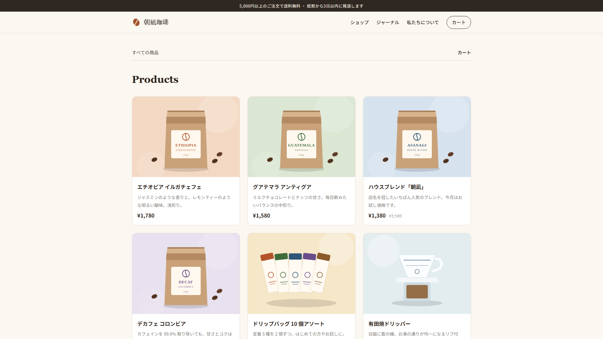
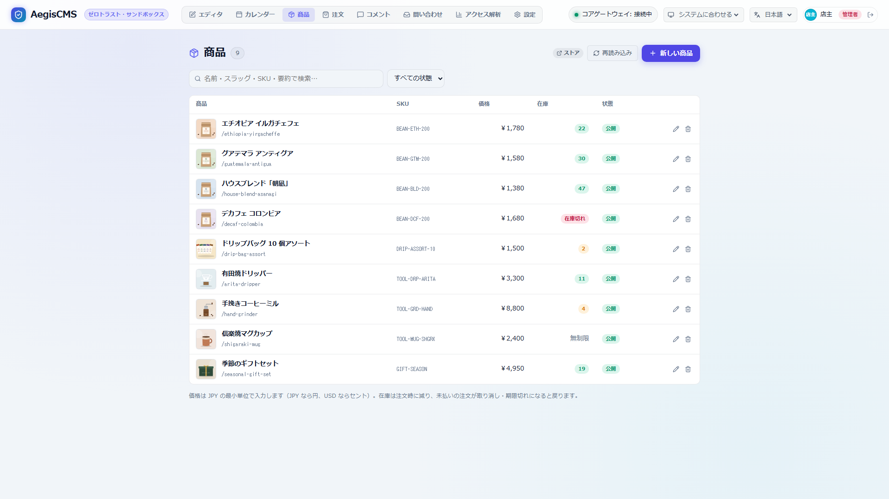
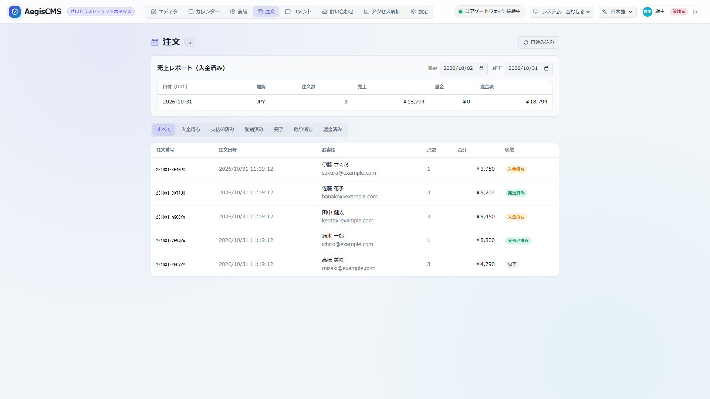

[← ドキュメント一覧に戻る](README.md)

# EC（ショップ機能）

AegisCMS にはカート・注文・在庫・決済の機能があります（`[commerce]`）。商品は普通のコンテンツ（`product` スキーマ）として Admin Studio で管理し、公開サイトに商品一覧・商品ページ・カート・注文確認ページが加わります。送料・税・クーポンや注文の通知は Wasm プラグインで差し替えられます。

> [!TIP]
> 動くサンプルとして、コーヒー豆のショップ [`examples/coffee-shop/`](../examples/coffee-shop)（`task demo:shop` で起動）があります。

```text
 商品（product コンテンツ）──▶ /products, /products/{slug}
        │                          │ カートに追加（ブラウザの localStorage）
        │                          ▼
        │                 /cart ── POST /api/v1/shop/quote ── calculate-order プラグイン（送料・税・割引）
        │                          │
        │                          ▼ POST /api/v1/shop/checkout
        │                 価格をサーバーで計算 → 在庫を確保して注文を作成（1 トランザクション）
        │                          │
        │          ┌───────────────┴───────────────┐
        │     manual（振込・代引き）            stripe（Stripe Checkout）
        │     注文確認ページに支払い案内        決済ページへ → Webhook で入金を確認
        │          └───────────────┬───────────────┘
        ▼                          ▼
  Admin Studio「Orders」: 支払い済み → 発送 → 完了 / 取り消し（在庫を戻す）
                                   │
                         on-order-status-changed プラグイン（Slack 通知など）
```

---

## 1. 有効にする

```toml
[commerce]
enabled = true
currency = "jpy"            # ISO 4217（小文字）。金額はすべてこの通貨の最小単位の整数（JPY なら円）
provider = "manual"         # "manual"（銀行振込・代引き）または "stripe"
low_stock_threshold = 5      # 在庫がこの数以下になったとき運営者に通知。null で無効
# public_url = "https://shop.example.com"   # 決済後の戻り先。空ならリクエストの Host から

[commerce.manual]
instructions = "下記口座にお振り込みください: ○○銀行 ○○支店 普通 1234567"
payment_due_hours = 72      # 未払いの注文を取り消して在庫を戻すまでの時間
```

- 商品のスキーマ（既定 `product`、`[commerce].product_type`）には `price`（integer、必須）が必要です。`stock`（integer）があれば在庫を数えます。同梱の [`schemas/products.yaml`](../schemas/products.yaml) をそのまま使えます。起動時に確かめ、足りなければ起動しません。
- `[commerce].enabled = false` でも商品一覧・商品ページは表示されます（カートは無効）。商品の `buy_url` に外部の決済リンク（Stripe Payment Links など）を入れると「Buy now」ボタンになります。
- `low_stock_threshold` は商品・バリエーション共通の閾値です。在庫を数える商品の注文で閾値を下回ったとき `stock.low` を運営者に送ります（`[notifications].enabled = true` が必要）。在庫が `null` の商品は対象外です。

設定項目の一覧は [設定リファレンス](configuration.md#212-commerce--ec) を参照してください。

---

## 2. 商品

Admin Studio の **Products** タブ（`editor` 以上）で作成・編集・削除します。

| フィールド | 内容 |
| --- | --- |
| `price` | 販売価格（通貨の最小単位の整数。JPY なら円）。税込みで運用する場合は税込み価格 |
| `compare_at_price` | 値引き前の価格（表示のみ。打ち消し線） |
| `stock` | 在庫数。空なら在庫を数えない（無制限） |
| `sku` / `image_url` / `excerpt` / `category_id` | 品番・画像（メディアライブラリから選択）・一覧用の要約・カテゴリ |
| `buy_url` | `[commerce]` を使わずに外部で販売する場合のリンク |
| 本文（ブロック） | 商品ページの説明。Admin Studio では Markdown で入力 |

- 注文できるのは `published` の商品だけです。
- 商品を削除しても、過去の注文には注文時の商品名・単価が残ります。
- API では `POST /api/v1/contents/product`（作成）、`PUT` / `DELETE /api/v1/contents/product/{id または slug}`（更新・削除）です（[コンテンツ API](authentication.md#ロールと-api-の権限)）。`PUT` は全体の置き換えで、省略したフィールドは空になります（`stock` を省略すると在庫を数えない商品になる）。
- 注文で在庫は随時減るため、在庫を変えずに商品を保存するときは最新の `stock` を送ってください。Admin Studio は在庫の欄を編集していなければ、保存の直前に最新の在庫を読み直して送ります。

### 2.1 バリエーション（サイズ・色など）

商品ごとにバリエーションを登録できます（表 `_aegis_product_variants`。Admin Studio の商品の編集画面から作成・編集・削除）。

| 項目 | 内容 |
| --- | --- |
| `title` | 表示名（例: `M / Black`）。注文明細には「商品名 - 表示名」で出る |
| `sku` | 品番 |
| `price_override` | このバリエーションの価格。空なら親商品の `price` |
| `stock` | このバリエーションの在庫。空なら無制限 |
| `attributes` | 任意の属性（`{"size": "M", "color": "black"}` など）。`price_<通貨>` で通貨ごとの固定価格も置ける |
| `position` | 並び順 |

- カートの行・注文明細は「商品 × バリエーション」で区別します（同じ商品の別のバリエーションは別の行）。
- バリエーションを指定した注文は、親商品ではなくバリエーションの `stock` を減らします（引き当て・取り消し・返金での戻しも同じ）。

### 2.2 複数通貨

```toml
[commerce]
currency = "jpy"                         # 基軸通貨。商品の price はこの通貨
supported_currencies = ["jpy", "usd", "eur"]
currency_rates = { usd = 0.0067, eur = 0.0062 }   # 基軸通貨 1 単位あたり
```

単価は次の順に決まります（見積もり・注文とも、リクエストの `currency`。省略時は基軸通貨）:

1. バリエーションの `attributes` の `price_<通貨>`（例: `price_usd`）
2. バリエーションの `price_override`（基軸通貨以外ならレートで換算）
3. 親商品のフィールド `price_<通貨>`
4. 親商品の `price`（基軸通貨以外ならレートで換算）

- 換算では通貨ごとの小数の桁（JPY などは 0、USD などは 2、KWD などは 3）に合わせて四捨五入します。
- `supported_currencies` に無い通貨や、レートが無い通貨で換算が要る場合は `400` です。
- Stripe には注文の通貨の最小単位の金額をそのまま渡します。

### 公開サイトのページ

| URL | テンプレート | 内容 |
| --- | --- | --- |
| `/products`（`?page=N`） | `products.html` | 公開中の商品一覧（`[theme].posts_per_page` 件ずつ） |
| `/products/{slug}` | `product.html` | 商品ページ（数量・カートに追加） |
| `/cart` | `cart.html` | カート・クーポン・購入手続き |
| `/orders/{id}?token=...` | `order.html` | 注文確認（顧客用。URL のトークンが必要） |



テーマにこれらのテンプレートが無ければ組み込みのテンプレートを使います（テーマの `base.html` の中に表示されます）。独自に作る場合は [5. テーマのカスタマイズ](#5-テーマのカスタマイズ) を参照してください。`/products`・`/cart`・`/orders` は同名の固定ページより優先されます。

---

## 3. 注文と在庫

### 3.1 注文の状態

```text
pending_payment ──▶ paid ───────▶ shipped ──▶ completed
      │               │              │            │
      │               ├─(返金)───────┼─(返金)─────┼─(返金)─┐
      │               ▼              ▼            ▼        ▼
      └──▶ cancelled ─┴──────▶ refunded ◀─────────┴────────┘
           （発送前の取り消し/返金時に在庫を戻すオプションあり）
```

| 状態 | 意味 | 変わるきっかけ |
| --- | --- | --- |
| `pending_payment` | 在庫を確保して支払いを待っている | 注文の作成（合計 0 円なら最初から `paid`） |
| `paid` | 支払い済み | `manual`: Admin Studio の「Mark as paid」/ `stripe`: Webhook のみ |
| `shipped` | 発送済み | Admin Studio の「Mark as shipped」（メモに追跡番号などを残せる） |
| `completed` | 完了 | Admin Studio の「Mark as completed」 |
| `cancelled` | 取り消し | Admin Studio の「Cancel order」、支払い期限切れ、Stripe の期限切れ・失敗 |
| `refunded` | 返金済み | Admin Studio の「Refund」（全額返金時）、Stripe の Webhook（`charge.refunded`） |

- 状態の変更は「今の状態が X のときだけ Y にする」という条件付きの更新です。Webhook の重複・同時の操作で二重に処理されません。
- `paid` の注文を取り消しても決済サービスの自動返金は行われません。返金を行う場合は Admin Studio の詳細モーダルから「返金」を実行してください（Stripe 決済の場合は Stripe Refund API がオンライン実行され、手動決済の場合は返金履歴が記録されます。全額返金時は自動的に `refunded` 状態へ遷移します）。

### 3.2 在庫

- 注文の作成時に、注文の保存と**同じトランザクション**で `stock = stock - 数量`（`stock >= 数量` のときだけ）を実行します。1 つでも足りなければ何も保存せず `409` を返すため、同時に注文されても売り越しません。
- 発送前（`pending_payment` / `paid`）の取り消しで在庫を戻します。発送後は戻しません。
- 未払いの注文は期限（`manual`: `payment_due_hours`、`stripe`: `reservation_minutes`）を過ぎると、1 分ごとの処理で取り消して在庫を戻します（決済サービスの通知を待つため 5 分の猶予があります）。複数のサーバーで動かしても、条件付きの更新なので二重に戻りません。
- **RDBMS 実機での ACID 保証**: SQLite のインメモリ検証に加え、Docker 上の PostgreSQL 16 および MySQL 8.0 実機コンテナ環境においても、アトミックな在庫減算・複数商品における部分不足時のロールバック・注文キャンセル時の在庫復帰（restock）の動作を検証・テスト済みです（実行手順は [development.md](development.md#7-データベース実機検証-postgresql--mysql) を参照）。

### 3.3 Admin Studio

**Orders** タブ（`editor` 以上）で、状態での絞り込み・注文の詳細（明細・送料などの内訳とそれを加えたプラグイン・配送先・連絡先・決済 ID）・状態の変更ができます。注文には顧客の個人情報が含まれるため、`viewer` には表示しません。





**Products** / **Orders** タブは `[commerce].enabled = true` のときだけ表示します（ログイン時に `GET /api/v1/shop/config` の `enabled` を読む）。設定を変えたらサーバーを再起動し、Admin Studio を再読み込みしてください。

### 3.4 メール通知

`[notifications]` を有効にすると、注文の受付（支払い方法の案内つき）・入金確認・発送・取り消しを顧客に、新しい注文と取り消しを運営者（`staff_recipients`）にメールで知らせます。発送にしたときのメモ（配送業者・追跡番号など）は発送のメールに入ります。設定・テンプレートの変更は [通知ドキュメント](notifications.md) を参照してください。

---

## 4. 決済

### 4.1 `manual`（銀行振込・代引きなど）

注文確認ページに `[commerce.manual].instructions` を表示します。入金を確認したら Admin Studio で「Mark as paid」にします。

### 4.2 `stripe`（Stripe Checkout）

カード番号などは Stripe の決済ページで入力され、AegisCMS を通りません。

```toml
[commerce]
enabled = true
provider = "stripe"
public_url = "https://shop.example.com"
reservation_minutes = 60     # 決済ページの有効期限（30〜1440 分）

[commerce.stripe]
# 設定ファイルに書かず、環境変数 AEGIS_STRIPE_SECRET_KEY / AEGIS_STRIPE_WEBHOOK_SECRET でも渡せる
secret_key = ""
webhook_secret = ""
async_payment_due_hours = 72 # コンビニ払いなど後払いの支払い期限
```

1. Stripe ダッシュボードで Webhook エンドポイント `https://shop.example.com/api/v1/shop/webhooks/stripe` を作り、次のイベントを選びます: `checkout.session.completed`、`checkout.session.async_payment_succeeded`、`checkout.session.async_payment_failed`、`checkout.session.expired`。
2. 表示された署名シークレット（`whsec_...`）を `webhook_secret` に設定します。
3. 注文の作成時に Checkout Session を作り、顧客を決済ページへ移動します。支払い後は注文確認ページに戻り、Webhook で `paid` になるとページが自動で更新されます。

- Webhook は署名（`Stripe-Signature`、HMAC-SHA256、時刻の許容差 5 分）を確かめ、注文 ID・Checkout Session ID・**金額と通貨が注文と一致する**ときだけ `paid` にします。不一致は監査ログ `order.update`（`failure`、`problem: amount_mismatch`）に残ります。
- 期限切れで取り消した後に支払われた場合は `paid_after_cancel` として監査ログとエラーログに残します（返金してください）。
- 商品と送料などの加算は Stripe の明細に表示します。割引（負の金額）がある場合は、注文全体を 1 行（`Order {番号}`）にまとめます（金額は同じ）。
- 同じ注文で Checkout Session を二重に作らないよう、`Idempotency-Key` を付けます。Session を作れなかった注文は取り消して在庫を戻し、`502` を返します。

### 4.3 返金（Refund）

外部決済連携は抽象化層（`PaymentProvider` トレイト）を挟んでおり、Stripe だけでなく手動決済や将来の多様な決済プロバイダに対応できる設計となっています。

- **Stripe Refund API 連携**: Stripe 決済の注文（確定取引 ID `transaction_id` = `pi_...`）に対し、Admin Studio または API から返金を行うと Stripe API（`POST /v1/refunds`）がオンライン呼び出しされます。重複実行を避けるため冪等性キー（`Idempotency-Key`）を付与します。
- **手動決済の返金記録**: 銀行振込・代引きなどの手動決済では、外部通信を行わずに CMS 上に返金履歴・累計返金額を安全に記録します。
- **ACID 保証と在庫復帰（Restock）**: 返金履歴の追加、累計返金額の加算、ステータス更新、および注文商品の在庫復帰（オプション）は同一のデータベーストランザクション（`record_order_refund`）でアトミックに実行されます。
- **部分返金・全額返金**: 複数回に分けた部分返金に対応し、累計返金額が注文合計（`total`）に達した時点で自動的にステータスが `refunded` に遷移します。
- **Webhook による自動同期**: Stripe ダッシュボード側から直接返金された場合も、Webhook イベント `charge.refunded` を受信して CMS 上の注文状態を自動的に `refunded` に更新します。

---

## 5. テーマのカスタマイズ

テーマの `templates/` に `products.html` / `product.html` / `cart.html` / `order.html` を置くと、組み込みのものの代わりに使います。組み込みのテンプレートは共通部分を `shop_common.html`（スタイル・ショップのナビゲーション・カートのスクリプト）にまとめています。

テンプレートで使える値:

| 値 | 内容 |
| --- | --- |
| `items`（一覧）/ `fields`（商品ページ） | 商品のフィールド（`fields.price` など）。商品ページの `fields.id` は商品 ID |
| `theme_vars.shop_enabled` | `"true"` / `"false"`（`[commerce].enabled`） |
| `theme_vars.currency` | 基軸通貨のコード |
| `theme_vars.supported_currencies` / `currency_rates` | 選べる通貨・レート（JSON 文字列） |
| `theme_vars.products_url` / `cart_url` / `shop_api` / `cart_script` | ベースパス込みの URL |
| `{{ fields.price \| money(theme_vars.currency) }}` | 金額の表示（`¥1,200`、`$12.50`） |

カートのスクリプト（`/shop/cart.js`）は、次の要素を見つけて動きます。

```html
<script src="{{ theme_vars.cart_script }}" data-api="{{ theme_vars.shop_api }}"
        data-currency="{{ theme_vars.currency }}" data-cart-url="{{ theme_vars.cart_url }}"
        data-products-url="{{ theme_vars.products_url }}" data-shop-enabled="{{ theme_vars.shop_enabled }}" defer></script>

<!-- カートに追加するボタン（data-quantity-input は数量の input のセレクタ。省略すると 1） -->
<button data-aegis-add-to-cart data-product-id="{{ fields.id }}" data-product-slug="{{ slug }}"
        data-product-title="{{ title }}" data-product-price="{{ fields.price }}">Add to cart</button>

<!-- バリエーションの選択: ボタンに data-variant-select="#variant" を付けると選択中の値を使う
     （option の data-variant-title / data-variant-price も読む）。固定なら data-variant-id -->
<select id="variant"><option value="{{ variant.id }}" data-variant-price="{{ variant.price_override }}">M</option></select>

<!-- 通貨の切り替え（選んだ通貨は localStorage の aegis.currency に残り、カートを見積もり直す） -->
<select data-aegis-currency-selector><option value="jpy">JPY</option><option value="usd">USD</option></select>

<span data-aegis-cart-count></span>   <!-- カートの数量 -->
<div id="aegis-cart"></div>            <!-- カートと購入手続き（cart.html） -->
<div id="aegis-order" data-order-id="{{ slug }}"></div>   <!-- 注文確認（order.html） -->
```

カートの内容はブラウザの `localStorage`（`aegis.cart.v1`）にあり、表示する価格・合計は必ずサーバーの見積もり（`POST /api/v1/shop/quote`）から取ります。

---

## 6. API

### 6.1 公開（ログイン不要）

| API | 内容 |
| --- | --- |
| `GET /api/v1/shop/config` | `{ "enabled", "currency", "supported_currencies", "currency_rates", "product_type", "provider" }` |
| `GET /api/v1/shop/products/{id または slug}/variants` | 商品のバリエーションの一覧 |
| `POST /api/v1/shop/quote` | 見積もり（何も保存しない） |
| `POST /api/v1/shop/checkout` | 注文の作成（`201`） |
| `GET /api/v1/shop/orders/{id}?token=...` | 顧客の注文確認 |
| `POST /api/v1/shop/webhooks/{provider}` | 決済サービスからの通知（`stripe`） |

見積もり・注文の本文:

```json
{
  "items": [{ "product": "ceramic-mug", "quantity": 2 }, { "product": "8f0c…", "variant": "a1b2…", "quantity": 1 }],
  "currency": "usd",
  "email": "hanako@example.com",
  "name": "Hanako Yamada",
  "shipping_address": { "postal_code": "100-0001", "region": "Tokyo", "city": "Chiyoda", "line1": "1-1 Marunouchi" },
  "coupon_code": "WELCOME10"
}
```

- `product` は商品の ID か slug、`variant` はバリエーションの ID（任意）。同じ商品・同じバリエーションの行はまとめます。`currency` は省略時に基軸通貨。`email` / `name` は注文時のみ必須。
- 注文の応答は `{ "order": {...}, "token": "...", "order_url": "/orders/{id}?token=...", "redirect_url": "https://checkout.stripe.com/..." | null }`。`redirect_url` があればそこへ、無ければ `order_url` へ移動します。`token` は注文確認に必要で、サーバーには SHA-256 だけを保存します（再発行はできません）。

| ステータス | 条件 |
| --- | --- |
| `400` | カートが空・数量が 0 や上限（`max_quantity_per_item`）超え・商品数が `max_items` 超え・メールアドレス不正 |
| `404` | 商品が無い・公開されていない・価格が無い、ショップが無効 |
| `409` | 在庫不足（`product_id` を含む） |
| `422` | `calculate-order` プラグインが断った（無効なクーポンなど。`error` は顧客に見せるメッセージ） |
| `429` | 同じ IP からの注文が `max_orders_per_ip_per_hour` を超えた（在庫の買い占め対策） |
| `502` | 決済サービスで決済を始められなかった（注文は取り消し、在庫は戻る） |

### 6.2 管理（`editor` 以上）

| API | 内容 |
| --- | --- |
| `GET /api/v1/orders?status=&limit=&offset=` | 注文の一覧（新しい順、`limit` 既定 50・最大 200）。`{ "orders", "total", "limit", "offset" }` |
| `GET /api/v1/orders/report?start=YYYY-MM-DD&end=YYYY-MM-DD` | 日別売上レポート（支払い日時 UTC、終了日を含む。期間は最大 367 日） |
| `GET /api/v1/orders/{id}` | 注文の詳細（顧客のメールアドレス・決済 ID・メモ・`can_mark_paid`・`can_refund`・`supports_online_refund` を含む） |
| `POST /api/v1/orders/{id}/status` | `{ "status": "paid" \| "shipped" \| "completed" \| "cancelled", "note": "任意" }`。遷移できなければ `409` |
| `POST /api/v1/orders/{id}/refund` | `{ "amount": 1000（省略時は残額全額）, "reason": "任意", "restock": true }`。返金を記録・実行（`can_refund` でなければ `409`） |

Admin Studio の Orders タブでは直近 30 日の日別注文数・売上・返金額・返金後金額を通貨別に表示し、期間を変更できます。売上には支払い済み・発送済み・完了・返金済みの注文を含みます。

**返金時の在庫の戻し（`restock`）**: `restock: true` を指定しても、在庫の二重戻しを防ぐため次の場合は在庫を戻しません（エラーにはならず、返金だけが成功します）。

- 注文が `cancelled` のとき。取り消しの時点で在庫を戻し済みです。
- 同じ注文の過去の返金ですでに在庫を戻したとき（部分返金を繰り返す場合）。在庫を戻した返金には、返金履歴の `restocked: true` が記録されます。

在庫を戻すときは、注文の全明細を戻します。監査ログの `restocked` には、実際に戻したかどうかが入ります。決済プロバイダからの返金通知（Webhook）では在庫を戻しません。

監査ログには `order.create`（注文）、`order.update`（状態の変化。`from` / `to` / `source`（`admin` / `payment_webhook` / `payment_expired` / `expired` など）/ `restocked`）、および `order.refund`（返金実行。`order_number` / `amount` / `total_refunded` / `refund_ref` / `restocked`）を記録します。

---

## 7. プラグインで拡張する

| フック | 使いどころ |
| --- | --- |
| [`calculate-order`](plugin_hooks.md#15-calculate-order) | 送料・税・クーポン・まとめ買い割引、配送できない地域の拒否、外部の送料 API の呼び出し |
| [`on-order-status-changed`](plugin_hooks.md#16-on-order-status-changed) | Slack・メール配信サービス・会計ソフト・在庫管理システムへの連携 |

プラグインは価格・明細を変えられず（`adjustments` と `metadata` だけ）、合計はホストが計算し直します。外部サービスとの通信には `http::fetch`（`allowed_domains` の宛先のみ）、API キーには `[plugins.settings.<name>]` と `env:` を使います（[ホスト API](plugin_hooks.md#5-ホスト-api)）。

### 7.1 公式プラグイン

#### `official-shop-rules`（送料・クーポン・税）

```toml
[plugins]
enabled = ["official-shop-rules"]

[plugins.settings.official-shop-rules]
shipping_fee = 600              # 送料（未設定なら送料の行を付けない）
free_shipping_over = 10000      # 割引後の商品合計がこれ以上なら送料無料
shipping_label = "送料"
coupons = "WELCOME10:10%:100,SAVE500:500"   # コード:割引（% または金額）:利用回数の上限（任意）
tax_rate_percent = 0            # 価格が税抜きの場合の税率（0 なら税の行を付けない）
tax_label = "消費税"
```

利用回数の上限があるクーポンは、支払い済みになった注文の数を KV ストア（`[cache]`）に数えます。`[cache].backend = "memory"` では再起動でリセットされるため、上限を使う場合は `redis` にしてください。

#### `official-order-notifier`（Slack / Webhook 通知）

```toml
[plugins]
enabled = ["official-order-notifier"]

[plugins.settings.official-order-notifier]
webhook_url = "env:SLACK_WEBHOOK_URL"          # Slack の Incoming Webhook
notify_on = "pending_payment,paid,cancelled"   # 通知する状態
format = "slack"                               # "json" なら OrderStatusChange をそのまま POST
```

送信先は `plugins/official-order-notifier/plugin.manifest.json` の `allowed_domains`（既定は `hooks.slack.com`）に含まれている必要があります。他のサービスに送る場合はそのドメインを追加してください（マニフェストの変更は信頼できる管理者が行うこと）。

このプラグインは通知のチャネル（`[notifications].channels = ["plugin:official-order-notifier"]`）にもなり、管理者のログイン・ログインのロックなどの監査イベントも含めて、ホストのテンプレートで作った件名・本文を Slack に送れます（`channel_recipients` / `channel_kinds` で絞り込み。[通知 5.1](notifications.md#51-wasm-プラグインで加える)）。チャネルとして使う場合は `notify_on = "none"` にして、注文が二重に届かないようにしてください。

---

## 8. セキュリティと制限事項

- **価格はサーバーが決める**: 単価は注文時に DB の商品から読み、カート（ブラウザ）の値は使いません。プラグインも価格を変えられません。
- **カード情報を扱わない**: Stripe の決済ページを使い、Webhook は署名と金額を確かめます。
- **注文確認のトークン**: 注文 ID とトークンの両方が必要で、トークンは推測できない乱数（保存はハッシュのみ）。注文確認ページは `Referrer-Policy: no-referrer` で、トークンを外部に送りません。
- **在庫の買い占め対策**: 1 商品あたりの数量・商品数・IP ごとの注文数に上限があり、未払いの注文は期限で取り消します。リバースプロキシ配下では `[audit].trust_forwarded_for = true` にしないと全員が同じ IP として数えられます。
- **個人情報**: 注文の一覧・詳細は `editor` 以上のみ。

現時点の制限:

- 税率の自動判定はありません（`calculate-order` プラグインで計算します）。為替レートは設定ファイルの固定値で、自動では更新しません。
- 顧客アカウント（会員登録・注文履歴）はありません。注文はゲスト購入で、注文確認は URL のトークンで行います。
