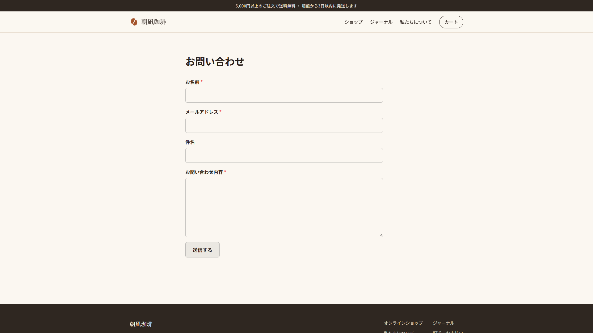
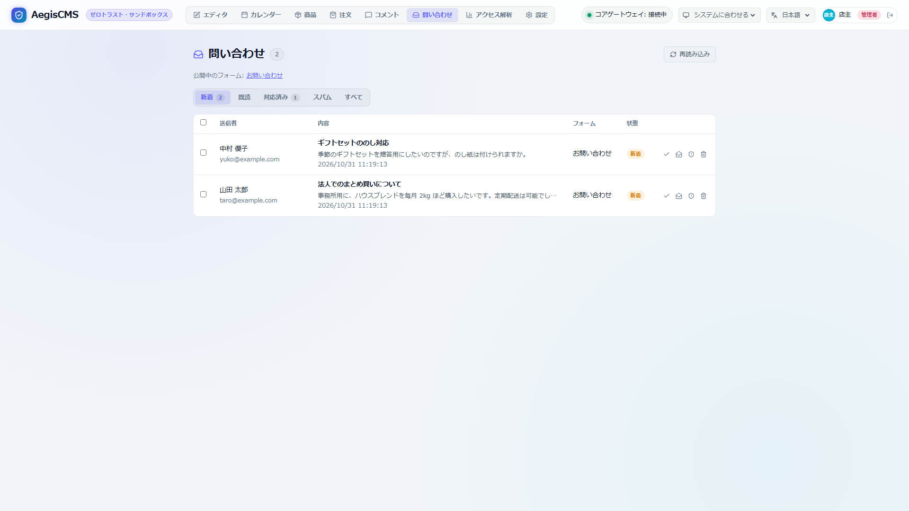

[← Back to the documentation index](README.md)

**English** | [日本語](contact.ja.md)

# Contact Form

Place a contact form on the public site and read the messages that arrive in Admin Studio's **Contact** (Inbox) tab (`[contact]`). The form's fields are decided in the config file and displayed on the `/contact` page or with a body block (`core/contact-form`). Operators are notified by email when one arrives, and an auto-reply to the sender can be chosen per form ([Notifications](notifications.md)).

The feature lives in the `aegis-contact` crate.

```text
 Visitor (the form at /contact/{form}, or a body block)
        │  POST /contact/{form} (works without JavaScript) / POST /api/v1/contact/forms/{form} (JSON)
        ▼
 The invisible bot-trap field has a value → pretend to accept and do not save
        │
 Input validation (required, length, email address, phone number, options, attachments) → errors are shown on the form and returned
        │
 Verify the CAPTCHA token (only when `contact` is in [captcha] targets) → 400 if it fails, 503 if the verification service cannot be reached
        │
 Over the per-IP submission count (max_per_ip_per_hour) → 429
        │
 Spam words / link count ──▶ saved as spam (nobody is notified)
        │
        └──▶ saved as new → contact.received to operators, and contact.auto_reply to the sender if the form has auto_reply
             → the sender gets the "?sent=1" page (the after-submission text)
```

---

## 1. Enabling It

```toml
[contact]
enabled = true
```

With just this, a `default` form with name, email address, subject, and body appears at `/contact`. Emailing operators needs `[notifications]` ([Notifications](notifications.md)) (without it, messages still reach the inbox).

When deciding the forms and fields yourself:

```toml
[contact]
enabled = true
retention_days = 365        # days to keep received inquiries (0 never deletes)
max_per_ip_per_hour = 5     # submissions per hour from the same IP (0 is unlimited)
locale = "en"               # language of built-in text such as input errors (en / ja)
max_links = 3               # more links than this is spam
spam_words = ["casino"]     # containing one is spam (case-insensitive)
notify_staff = true         # notify operators when one arrives
max_attachment_mb = 5       # upper limit on the size of one attachment (1–50)
attachment_extensions = ["jpg", "jpeg", "png", "gif", "webp", "pdf", "txt", "csv", "docx", "xlsx"]  # attachable extensions (default)

[[contact.forms]]
name = "default"            # /contact/default (/contact is this form)
title = "Contact us"
description = "We will reply within 2 business days."
submit_label = "Send"
success_message = "Thank you for contacting us. We will review it and get back to you."
auto_reply = true           # send the sender a receipt email
subject_field = "topic"     # the field used as the subject in the inbox and notifications (default "subject")

[[contact.forms.fields]]
name = "name"
label = "Your name"
required = true

[[contact.forms.fields]]
name = "email"
label = "Email address"
type = "email"
required = true

[[contact.forms.fields]]
name = "topic"
label = "Topic"
type = "select"
options = ["Consultation on adoption", "Bug report", "Other"]
required = true

[[contact.forms.fields]]
name = "message"
label = "Message"
type = "textarea"
required = true
max_length = 3000

[[contact.forms.fields]]
name = "privacy"
label = "I agree to the privacy policy"
type = "checkbox"
required = true
```

### 1.1 Fields

| Key | Description |
| --- | --- |
| `name` | The submitted name (lowercase letters, digits, `_`. `website` is used for bot protection and cannot be used) |
| `label` | The display name (it appears under this name in the inbox and notifications too) |
| `type` | `text` (default) / `email` / `tel` / `textarea` / `select` / `checkbox` / `file` ([Attachments](#13-attachments)) |
| `required` | Required (for a checkbox, it must be checked) |
| `placeholder` | An example for the input (for `select`, the text of the unselected item) |
| `options` | The choices of a `select` (required) |
| `max_length` | Maximum number of characters (default 5000 for `textarea`, 200 otherwise) |

- The field named `name` is shown as the sender's name, and the `subject_field` field (default `subject`) as the subject, in the inbox list and notifications. The first field with `type = "email"` is the sender's email address (the destination for replies and auto-replies).
- If you omit a form's `title`, `submit_label`, and `success_message`, they become the defaults in the `locale` language ("Contact", "Send", etc.). If you omit `fields`, they become the 4 fields of name, email address, subject, and body (also in the `locale` language).
- Input errors (such as "Please enter 'Your name'") and the notice when sending fails are also in the `locale` language.
- A form with `auto_reply = true` needs a required email address field.
- If the settings are invalid (duplicate names, a `select` with no options, etc.), the server does not start.

### 1.2 CAPTCHA (Optional)

You can add CAPTCHA only when there are many bots. If you do not write it, nothing changes (the invisible field, per-IP submission count, and spam word measures always work). CAPTCHA is not a contact-specific setting; you write it in the shared `[captcha]` and choose with `targets` the destinations to apply it to (`contact`, `newsletter`, `comments`, `forum`).

```toml
[captcha]
targets = ["contact"]                  # contact | newsletter | comments | forum
provider = "turnstile"                 # turnstile | hcaptcha | recaptcha | custom
site_key = "0x4AAAA..."                # may be public
secret = "env:TURNSTILE_SECRET"        # read from an environment variable (you may also write it directly in the config file)
# fail_open = false                    # whether to let it through when the verification service cannot be reached (default is to refuse)
# timeout_secs = 5                     # seconds to wait for the verification service's response (1–30)
```

Cloudflare Turnstile, hCaptcha, and reCAPTCHA all use the same mechanism ("the widget adds a token to the form → the server sends the `secret` and token to `siteverify` and checks `success`"), so choosing the `provider` is enough. reCAPTCHA supports v2 (checkbox).

| `provider` | Token field | Verification URL |
| --- | --- | --- |
| `turnstile` | `cf-turnstile-response` | `https://challenges.cloudflare.com/turnstile/v0/siteverify` |
| `hcaptcha` | `h-captcha-response` | `https://api.hcaptcha.com/siteverify` |
| `recaptcha` | `g-recaptcha-response` | `https://www.google.com/recaptcha/api/siteverify` |
| `custom` | `response_field` | `verify_url` |

For another service of the same shape, set `provider = "custom"` and write all of `verify_url`, `script_url`, `widget_class` (the class of the widget's `div`), and `response_field`. Even when `provider` is one of the three above, writing these replaces the defaults. `verify_url` is where the secret is sent, so it must be `https://` only (`http://` to a local `localhost` / `127.0.0.1` is allowed for development).

- **When the verification service is down**: by default it refuses (fail-closed; for an HTML form, "Could not verify" with `503`, and for the API `503 {"code": "captcha_unavailable"}`). When letting bots through is less of a problem than inquiries stopping because of a service outage, set `fail_open = true`. A token the service answers "no" to is not let through even with `fail_open`.
- **HTML forms are covered.** The widget goes before the submit button of the form (`/contact/{form}`, body blocks), and requires JavaScript to run in the browser. The same check applies to the JSON API (`POST /api/v1/contact/forms/{form}`), and without the token field it gives `400 {"code": "captcha_failed"}` (no mechanism for obtaining tokens for the API is provided).
- **Submissions that fail on the invisible field or input errors are not sent to the verification service.** Verification happens before counting submissions per IP, so a bot cannot use up the quota and prevent people on the same IP from sending.
- **CSP**: so the widget's scripts, iframes, and connections are not blocked, the configured provider's hosts (`challenges.cloudflare.com` for Turnstile) are added automatically to the public pages' Content-Security-Policy `script-src` / `frame-src` / `connect-src` / `style-src` (directives where an administrator wrote `'none'` or `*` are not changed).
- **The `secret` is not returned by the API.** If the `env:` environment variable is unset, it is an error at startup.
- If you protect the form's `POST` with a front layer such as Cloudflare (WAF, bot protection), this setting is not needed.

### 1.3 Attachments

Placing a `type = "file"` field lets a file be attached to the form (it can be required with `required`).

```toml
[[contact.forms.fields]]
name = "attachment"
label = "Attachment"
type = "file"
```

- The form is sent as `multipart/form-data` (works without JavaScript). Attachments are not possible with the JSON API (`POST /api/v1/contact/forms/{form}`).
- One file per field. The size is limited by `max_attachment_mb` and the type by `attachment_extensions` (extensions; case-insensitive). Formats that could execute when opened, such as HTML, SVG, and scripts, are not in the default. Add extensions only after understanding the risk on the side that opens them.
- The `code`s for input errors are `required` for a missing file that is `required`, `file_too_large` for too large, and `invalid_file_type` for a disallowed extension.
- Attachments are stored under `contact/{inquiry id}/` ([Storage](architecture.md)). **There is no public URL.** `/uploads/contact/...` on local storage returns 404, and files are downloaded through an authenticated API from Admin Studio's inbox (editor and above) (always returned as `attachment` with `nosniff`). With S3-compatible storage, do not make the bucket public (objects under `contact/` would become readable by URL).
- When an inquiry is deleted, or removed by the retention period (`retention_days`), its attachments are deleted too. Attachments of inquiries judged to be spam are also stored (you can check and delete them from "Spam" in the inbox).
- Notification emails include only the attachment's file name (the file itself is not attached).

## 2. Placing the Form



- **Page**: `/contact` (`default`, or the first form if absent) and `/contact/{name}`. Rendered with the theme's `contact.html` (or the built-in template if absent). Link to it from the header and footer menus.
- **Body block**: place it with the "Contact form" add-block button in Admin Studio and choose which form to show. In Markdown, write `[CONTACT]` (`default`) or `[CONTACT form="sales"]`. Only those placed at the top level of the body are rendered (they cannot be placed inside collapsibles and the like). After submitting, it moves to `/contact/{name}?sent=1`.

The form is a plain HTML form without JavaScript (JavaScript is needed only for the widget when [CAPTCHA](#12-captcha-optional) is configured), shows input errors under the fields, and returns with the entered values kept. Minimal styles are built in for the fields' HTML and classes (`.aegis-contact-form`, `.aegis-contact-field`, `.aegis-contact-error`, `.aegis-contact-required`, `.aegis-contact-submit`) ([blocks.md 3](blocks.md#3-appearance); the theme's CSS takes precedence).

### 2.1 The Theme Template (`contact.html`)

| Value | Description |
| --- | --- |
| `title` | The form's heading (`title`) |
| `fields.form_html` | The built-in form's HTML (escaped; `{{ fields.form_html \| safe }}`) |
| `fields.sent` | `true` on the page after submission (`?sent=1`) |
| `fields.form` | The form's settings (`name`, `title`, `description`, `submit_label`, `success_message`, `fields`, `action`, `honeypot`, `captcha_html`). Used when building the form yourself |
| `fields.values` / `fields.errors` | The input and errors when submission failed (`[{field, code, message}]`) |
| `fields.notice` | A notice when it could not be sent (input errors, too many submissions, etc.; in the `locale` language) |

When building the form yourself, `POST` to `fields.form.action` and always include an invisible field with the name `fields.form.honeypot` (`website`) (hidden so people cannot see it). When [CAPTCHA](#12-captcha-optional) is configured, also place `{{ fields.form.captcha_html | safe }}` before the submit button inside the `<form>` (empty if not configured).

## 3. The Inbox (Admin Studio)



In the **Contact** tab (editor and above; shown only when `[contact].enabled = true`), you can list messages split into new, read, handled, and spam.

- With the search box at the top, you can narrow by name, email address, subject, the input of each field, and attachment file names, matching those that contain all the words separated by spaces (case-insensitive; can be combined with the status and form filters). Search scans the narrowed inquiries on the server side, so it assumes operation that keeps the count down with the retention period (`retention_days`).
- Inquiries with attachments get a paperclip in the list, and opening one lets you download the files.
- Opening shows all fields, and new ones become read. "Reply by email" opens your mail app (the recipient and `Re: subject`).
- Marking as handled or spam, returning to new, and deleting can be done one at a time or in bulk (audit log `contact.update` / `contact.delete`).
- Inquiries past the retention period (`retention_days`) are deleted once a day.

> Replies are not sent from Admin Studio but left to the mail client. If the CMS sent directly to visitors, the CMS would have to carry sending-domain authentication (SPF, DKIM, DMARC), bounce handling, and the features of mail clients such as threading, signatures, and attachments, and the risk of abuse of the sending API would increase too. The inbox opens a new email addressed to the poster with "Reply by email", and the handling status is managed by the statuses above (such as handled).

## 4. Notifications

| Kind | Recipient | Description |
| --- | --- | --- |
| `contact.received` | Operators (`notify_staff`) | The form, all entered fields, the IP address, and the URL to open the inbox (`admin_url`) |
| `contact.auto_reply` | The sender (the form's `auto_reply`) | That it was received, and what was entered |

The text can be edited in Admin Studio's **Settings › Notifications**. Neither is sent for items judged to be spam.

> [!WARNING]
> The auto-reply sends email to the address entered in the form. To prevent its use for sending mail to other people by entering their address, the body contains only what was entered, and the number of submissions is limited per IP. Enable it only when needed.

## 5. API

| Method and path | Permission | Description |
| --- | --- | --- |
| `GET /api/v1/contact/forms` | None | The list of forms and fields |
| `POST /api/v1/contact/forms/{form}` | None | Submit as JSON (`{"name": "...", "email": "...", ...}`; `true` for checkboxes). `201 {"status": "received"}`; input errors are `400 {"error", "errors": [{field, code, message}]}`; too many submissions give `429` |
| `GET /api/v1/contact/messages?status=new&form=default&q=quote&limit=50&offset=0` | editor | The inbox (newest first) and counts per status (`counts`). `q` is full-text search |
| `GET /api/v1/contact/messages/{id}/attachments/{field}` | editor | Download an attachment (`{field}` is the field's name) |
| `GET` / `PATCH` / `DELETE /api/v1/contact/messages/{id}` | editor | Get one, change its status (`{"status": "done"}`), or delete it |
| `POST /api/v1/contact/messages/bulk` | editor | In bulk (`{"ids": [...], "action": "read" \| "done" \| "spam" \| "new" \| "delete"}`) |

The `code`s for input errors are `required` / `too_long` / `invalid_email` / `invalid_tel` / `invalid_option` / `invalid_text` (for attachments `file_too_large` / `invalid_file_type`) (`message` is in the `[contact].locale` language).
