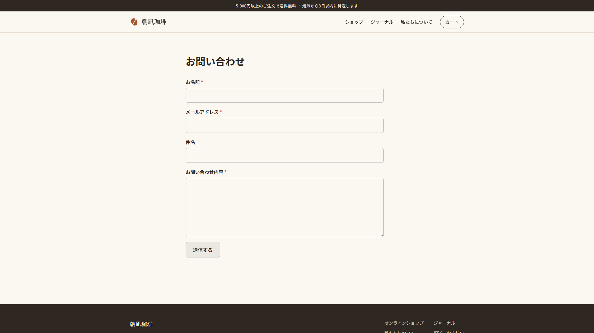
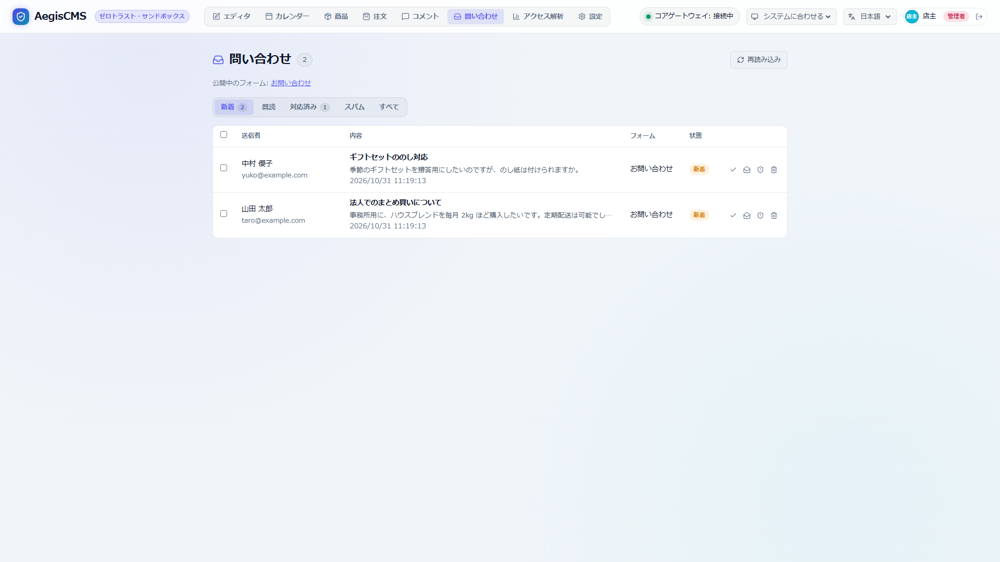

[← ドキュメント一覧に戻る](README.md)

# 問い合わせフォーム

公開サイトに問い合わせフォームを置き、届いたメッセージを Admin Studio の **問い合わせ**（Inbox）タブで読めるようにします（`[contact]`）。フォームの項目は設定ファイルで決め、`/contact` のページか、本文のブロック（`core/contact-form`）で表示します。届いたことは運営者にメールで知らせ、送信した人への自動返信もフォームごとに選べます（[通知](notifications.md)）。

機能はクレート `aegis-contact` にあります。

```text
 閲覧者（/contact/{form} のフォーム、または本文のブロック）
        │  POST /contact/{form}（JavaScript なしで動く）／ POST /api/v1/contact/forms/{form}（JSON）
        ▼
 ボット除けの見えない欄に値がある → 受け付けたふりをして保存しない
        │
 入力の検査（必須・長さ・メールアドレス・電話番号・選択肢・添付ファイル）→ 誤りはフォームに出して返す
        │
 IP ごとの送信数（max_per_ip_per_hour）を超えた → 429
        │
 スパムの語・リンクの数 ──▶ spam として保存（誰にも知らせない）
        │
        └──▶ new として保存 → 運営者に contact.received、フォームの auto_reply なら送信者に contact.auto_reply
             → 送信者には「?sent=1」のページ（送信後の文言）
```

---

## 1. 有効にする

```toml
[contact]
enabled = true
```

これだけで、名前・メールアドレス・件名・本文の `default` フォームが `/contact` に出ます。運営者へのメールには `[notifications]`（[通知](notifications.md)）が要ります（無くても受信箱には届きます）。

フォームと項目を自分で決めるとき:

```toml
[contact]
enabled = true
retention_days = 365        # 届いた問い合わせを残す日数（0 で消さない）
max_per_ip_per_hour = 5     # 同じ IP からの 1 時間あたりの送信数（0 で無制限）
locale = "ja"               # 入力の誤りなど組み込みの文言の言語（en / ja）
max_links = 3               # リンクがこれより多いとスパム
spam_words = ["casino"]     # 含むとスパム（大文字・小文字を区別しない）
notify_staff = true         # 届いたら運営者に知らせる
max_attachment_mb = 5       # 添付ファイル 1 つの大きさの上限（1〜50）
attachment_extensions = ["jpg", "jpeg", "png", "gif", "webp", "pdf", "txt", "csv", "docx", "xlsx"]  # 添付できる拡張子（既定）

[[contact.forms]]
name = "default"            # /contact/default（/contact はこのフォーム）
title = "お問い合わせ"
description = "2 営業日以内にお返事します。"
submit_label = "送信する"
success_message = "お問い合わせありがとうございます。内容を確認してご連絡します。"
auto_reply = true           # 送信した人に受付のメールを送る
subject_field = "topic"     # 受信箱・通知で件名にする項目（既定 "subject"）

[[contact.forms.fields]]
name = "name"
label = "お名前"
required = true

[[contact.forms.fields]]
name = "email"
label = "メールアドレス"
type = "email"
required = true

[[contact.forms.fields]]
name = "topic"
label = "ご用件"
type = "select"
options = ["導入のご相談", "不具合の報告", "その他"]
required = true

[[contact.forms.fields]]
name = "message"
label = "お問い合わせ内容"
type = "textarea"
required = true
max_length = 3000

[[contact.forms.fields]]
name = "privacy"
label = "プライバシーポリシーに同意する"
type = "checkbox"
required = true
```

### 1.1 項目

| キー | 内容 |
| --- | --- |
| `name` | 送信される名前（英小文字・数字・`_`。`website` はボット除けに使うので使えない） |
| `label` | 表示名（受信箱・通知にもこの名前で出る） |
| `type` | `text`（既定）/ `email` / `tel` / `textarea` / `select` / `checkbox` / `file`（[添付ファイル](#12-添付ファイル)） |
| `required` | 必須（チェックボックスなら、チェックが必須） |
| `placeholder` | 入力欄の例（`select` では未選択の項目の文言） |
| `options` | `select` の選択肢（必須） |
| `max_length` | 最大文字数（既定は `textarea` が 5000、それ以外は 200） |

- 名前が `name` の項目は送信者の名前、`subject_field`（既定 `subject`）の項目は件名として受信箱の一覧と通知に出ます。最初の `type = "email"` の項目が送信者のメールアドレスです（返信と自動返信の宛先）。
- フォームの `title`・`submit_label`・`success_message` を省くと、`locale` の言語の既定の文言（「お問い合わせ」「送信する」など）になります。`fields` を省くと、名前・メールアドレス・件名・本文の 4 項目（同じく `locale` の言語）になります。
- 入力の誤り（「「お名前」を入力してください」など）と、送信できなかったときの知らせも `locale` の言語です。
- `auto_reply = true` のフォームには、必須のメールアドレスの項目が要ります。
- 設定が正しくない（名前が重なる、`select` に選択肢が無いなど）とサーバーが起動しません。

### 1.2 添付ファイル

`type = "file"` の項目を置くと、フォームにファイルを添付できます（`required` で必須にもできます）。

```toml
[[contact.forms.fields]]
name = "attachment"
label = "添付ファイル"
type = "file"
```

- フォームは `multipart/form-data` で送ります（JavaScript なしで動く）。JSON の API（`POST /api/v1/contact/forms/{form}`）では添付できません。
- 1 つの項目につき 1 ファイル。大きさは `max_attachment_mb`、種類は `attachment_extensions`（拡張子。大文字・小文字を区別しない）で制限します。HTML・SVG・スクリプトなど、開くと実行されうる形式は既定に含めていません。拡張子の追加は、開く側のリスクを理解したうえで行ってください。
- 入力の誤りの `code` は、ファイルが無い `required`、大きすぎる `file_too_large`、許可されない拡張子の `invalid_file_type` です。
- 添付は `contact/{問い合わせの id}/` の下に保存します（[ストレージ](architecture.md)）。**公開 URL はありません**。ローカルストレージの `/uploads/contact/...` は 404 を返し、Admin Studio の受信箱（editor 以上）から、認証付きの API でダウンロードします（常に `attachment` として返し、`nosniff` を付けます）。S3 互換ストレージでは、バケットを公開設定にしないでください（`contact/` のオブジェクトが URL で読めるようになります）。
- 問い合わせを削除したとき、保存期間（`retention_days`）で消えたときは、添付ファイルも消えます。スパムと判定された問い合わせの添付も保存します（受信箱の「スパム」から確認・削除できます）。
- 通知メールには、添付のファイル名だけが入ります（ファイルそのものは付けません）。

## 2. フォームを置く



- **ページ**: `/contact`（`default`、無ければ最初のフォーム）と `/contact/{name}`。テーマの `contact.html`（無ければ組み込みのテンプレート）で描きます。ヘッダー・フッターのメニューからリンクしてください。
- **本文のブロック**: Admin Studio のブロックの追加ボタン「問い合わせフォーム」で置き、どのフォームを出すかを選びます。Markdown では `[CONTACT]`（`default`）・`[CONTACT form="sales"]` と書きます。本文のトップレベルに置いたものだけを描きます（折りたたみなどの中には置けません）。送信すると `/contact/{name}?sent=1` に移ります。

フォームは JavaScript を使わない普通の HTML のフォームで、入力の誤りは項目の下に出し、入力した値を残して返します。項目の HTML とクラス（`.aegis-contact-form`・`.aegis-contact-field`・`.aegis-contact-error`・`.aegis-contact-required`・`.aegis-contact-submit`）には最低限のスタイルが組み込まれています（[blocks.md 3](blocks.md#3-見た目)。テーマの CSS が優先されます）。

### 2.1 テーマのテンプレート（`contact.html`）

| 値 | 内容 |
| --- | --- |
| `title` | フォームの見出し（`title`） |
| `fields.form_html` | 組み込みのフォームの HTML（エスケープ済み。`{{ fields.form_html \| safe }}`） |
| `fields.sent` | 送信した後のページ（`?sent=1`）なら `true` |
| `fields.form` | フォームの設定（`name`・`title`・`description`・`submit_label`・`success_message`・`fields`・`action`・`honeypot`）。自分でフォームを組み立てるときに使う |
| `fields.values` / `fields.errors` | 送信に失敗したときの入力と誤り（`[{field, code, message}]`） |
| `fields.notice` | 送信できなかったときの知らせ（入力の誤り・送信が多すぎるなど。`locale` の言語） |

自分でフォームを組み立てるときは、`fields.form.action` に `POST` し、`fields.form.honeypot`（`website`）の名前の見えない欄を必ず入れてください（人には見えないように隠す）。

## 3. 受信箱（Admin Studio）



**問い合わせ** タブ（editor 以上。`[contact].enabled = true` のときだけ表示）で、新着・既読・対応済み・スパムに分けて一覧できます。

- 上の検索欄で、名前・メールアドレス・件名・各項目の入力・添付のファイル名を、空白区切りの語がすべて含まれるもので絞り込めます（大文字・小文字を区別しない。状態・フォームの絞り込みと併用できます）。検索は絞り込んだ問い合わせをサーバー側で走査するので、保存期間（`retention_days`）で件数を抑えた運用を想定しています。
- 添付ファイルのある問い合わせには一覧にクリップが付き、開くとファイルをダウンロードできます。
- 開くとすべての項目が見られ、新着は既読になります。「メールで返信」でメールアプリが開きます（宛先と `Re: 件名`）。
- 対応済み・スパム・新着に戻す・削除を、1 件ずつかまとめて行えます（監査ログ `contact.update` / `contact.delete`）。
- 保存期間（`retention_days`）を過ぎた問い合わせは、1 日に 1 回消します。

> 返信は Admin Studio から送らず、メールクライアントに任せます。CMS から訪問者へ直接送ると、送信ドメインの認証（SPF・DKIM・DMARC）やバウンス処理、スレッド・署名・添付といったメールクライアントの機能を CMS が抱えることになり、送信 API の悪用リスクも増えるためです。受信箱は「メールで返信」で投稿者宛ての新規メールを開き、対応状況は上の状態（対応済みなど）で管理します。

## 4. 通知

| 種類 | 宛先 | 内容 |
| --- | --- | --- |
| `contact.received` | 運営者（`notify_staff`） | フォーム、入力されたすべての項目、IP アドレス、受信箱を開く URL（`admin_url`） |
| `contact.auto_reply` | 送信した人（フォームの `auto_reply`） | 受け付けたことと、入力した内容 |

文面は Admin Studio の **設定 › 通知** で編集できます。スパムと判定したものは、どちらも送りません。

> [!WARNING]
> 自動返信は、フォームに入力されたアドレスにメールを送ります。他人のアドレスを入れて送りつける使い方を防ぐため、本文には入力された内容しか入れず、送信数は IP ごとに制限しています。必要なときだけ有効にしてください。

## 5. API

| メソッド・パス | 権限 | 内容 |
| --- | --- | --- |
| `GET /api/v1/contact/forms` | なし | フォームと項目の一覧 |
| `POST /api/v1/contact/forms/{form}` | なし | JSON で送信（`{"name": "...", "email": "...", ...}`。チェックボックスは `true`）。`201 {"status": "received"}`、入力の誤りは `400 {"error", "errors": [{field, code, message}]}`、送信が多すぎると `429` |
| `GET /api/v1/contact/messages?status=new&form=default&q=見積&limit=50&offset=0` | editor | 受信箱（新しい順）と状態ごとの件数（`counts`）。`q` は全文検索 |
| `GET /api/v1/contact/messages/{id}/attachments/{field}` | editor | 添付ファイルのダウンロード（`{field}` は項目の名前） |
| `GET` / `PATCH` / `DELETE /api/v1/contact/messages/{id}` | editor | 1 件の取得・状態の変更（`{"status": "done"}`）・削除 |
| `POST /api/v1/contact/messages/bulk` | editor | まとめて（`{"ids": [...], "action": "read" \| "done" \| "spam" \| "new" \| "delete"}`） |

入力の誤りの `code` は `required` / `too_long` / `invalid_email` / `invalid_tel` / `invalid_option` / `invalid_text`（添付ファイルは `file_too_large` / `invalid_file_type`）です（`message` は `[contact].locale` の言語）。
