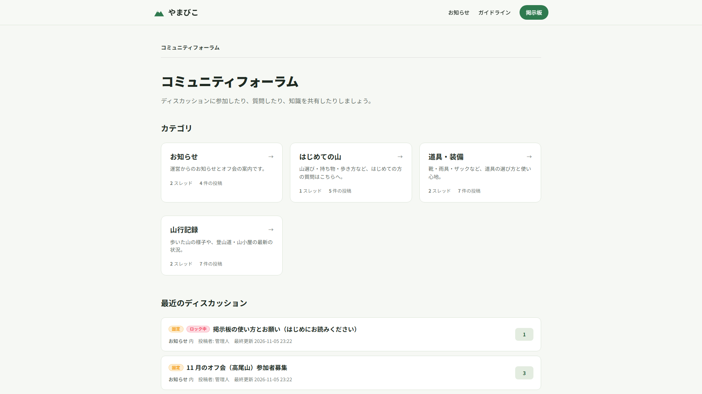
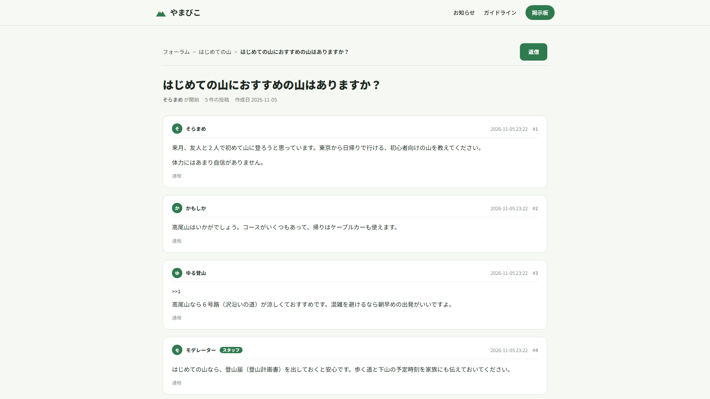
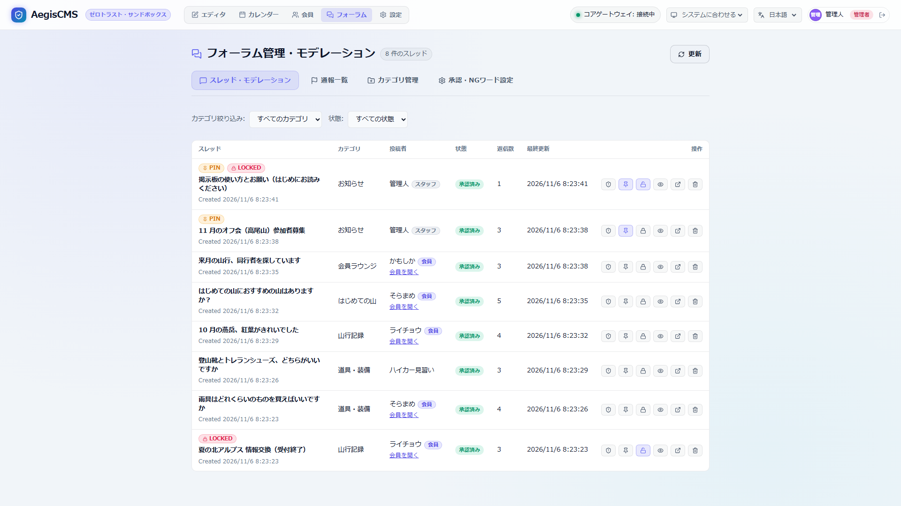
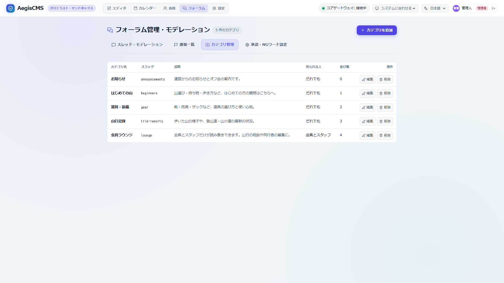

[← Back to the documentation index](README.md)

**English** | [日本語](forum.ja.md)

# Forum (Bulletin Board)

A bulletin board made of categories, threads, and replies (`[forum]`, crate `aegis-forum`). Pages under `/forum` are added to the public site, and in Admin Studio's **Forum** tab you manage categories and moderate (pin, lock, delete). It is stored in tables separate from articles and comments, and can be split into a separate database if needed.

> As a working sample, there is a hiking community forum, [`examples/hiking-forum/`](../examples/hiking-forum) (start it with `task demo:forum`).

---

## 1. Enabling It

```toml
[forum]
enabled = true
# database_url = "sqlite:data/forum.db?mode=rwc"   # put only the forum in a separate DB (if omitted, shares [database].url)
posting = "anyone"          # "anyone": people who are not logged in can post too / "members": only members and staff (requires [members])
rate_limit_secs = 5         # interval between posts from the same IP/user
auto_lock_post_count = 1000 # automatically lock a thread at this many replies (0 is unlimited)
```

For the list of settings, see the [Configuration reference](configuration.md#216-forum--forum).

- The tables are `_aegis_forum_categories` / `_aegis_forum_threads` / `_aegis_forum_posts`. They are created at server startup and by `aegis-server migrate` (in that DB if you specify `database_url`).
- **When splitting into a separate DB**: you can keep write locks (SQLite's `SQLITE_BUSY`) when posts concentrate, and PostgreSQL / MySQL connection counts, from affecting the main data (articles, e-commerce, sessions). SQLite, PostgreSQL, and MySQL can all be specified.

---

## 2. Public Site

| URL                                  | Template              | Description                                                                         |
| ------------------------------------ | --------------------- | ----------------------------------------------------------------------------------- |
| `/forum`                             | `forum_index.html`    | The category list and recently updated threads                                      |
| `/forum/{category slug}` (`?page=N`) | `forum_category.html` | The category's thread list (pinned → newest last post) and the thread creation form |
| `/forum/{category slug}/{thread ID}` | `forum_thread.html`   | The list of replies (with reply numbers) and the reply form                         |





- Forms submit to `POST /forum/{slug}/threads` and `POST /forum/{slug}/{thread ID}/posts`. On success, a `303` returns to the original page (`#post-N` for replies) and shows a result message.
- While logged in, the display name is taken from the account. If not logged in and the name is empty, it is `Anonymous`.
- Placing a template with the same name in the theme uses it instead of the built-in one (the shared part is `forum_common.html`).

---

## 3. Admin Studio

The **Forum** tab (shown when `[forum].enabled = true`):



- **Threads**: a list (filter by category), toggling pin and lock, deleting, the list of replies and deleting them individually, and a link to the public page. If the poster is a member, a "member" badge and an "Open member" link (opens the member's details; only when `[members]` is enabled) are shown, and for staff a "staff" badge.
- **Categories**: create (name, slug, description, sort order, who can read and write), edit, and delete.



> [!NOTE]
> The tab is shown to `editor` and above. Moderating threads and replies (pin, lock, delete) is for `editor` and above, and creating, editing, and deleting categories is for `admin` only (the same split as comment moderation for `editor` and settings for `admin`). `editor` sees only the category list.

---

## 4. API

| API                                                                               | Permission                                                           | Description                                                                                 |
| --------------------------------------------------------------------------------- | -------------------------------------------------------------------- | ------------------------------------------------------------------------------------------- |
| `GET /api/v1/forum/categories`                                                    | Not needed                                                           | The category list                                                                           |
| `GET /api/v1/forum/categories/{slug}`                                             | Not needed                                                           | A category                                                                                  |
| `POST /api/v1/forum/categories`                                                   | `admin`                                                              | Create a category (`201`)                                                                   |
| `PUT` / `DELETE /api/v1/forum/categories/{id}`                                    | `admin`                                                              | Update or delete a category                                                                 |
| `GET /api/v1/forum/threads?category_slug=&limit=&cursor_last_post_at=&cursor_id=` | Not needed                                                           | The thread list (`limit` is 1–100, default `default_page_size`)                             |
| `GET /api/v1/forum/categories/{slug}/threads`                                     | Not needed                                                           | The category's thread list (same query)                                                     |
| `GET /api/v1/forum/threads/{id}`                                                  | Not needed                                                           | A thread                                                                                    |
| `GET /api/v1/forum/threads/{id}/posts?cursor_post_number=&limit=`                 | Not needed                                                           | The list of replies (after `cursor_post_number`)                                            |
| `POST /api/v1/forum/threads`                                                      | Not needed (with `posting = "members"`, a logged-in member or staff) | `{ "category_id", "title", "body", "author_name" }`. `{ "thread", "initial_post" }` (`201`) |
| `POST /api/v1/forum/posts`                                                        | Same                                                                 | `{ "thread_id", "body", "author_name", "reply_to_number" }`. `{ "post" }` (`201`)           |
| `POST /api/v1/forum/threads/{id}/pin`                                             | `editor`                                                             | `{ "pinned": true }`                                                                        |
| `POST /api/v1/forum/threads/{id}/lock`                                            | `editor`                                                             | `{ "locked": true }`                                                                        |
| `DELETE /api/v1/forum/threads/{id}`                                               | `editor`                                                             | Delete a thread and its replies                                                             |
| `DELETE /api/v1/forum/posts/{id}`                                                 | `editor`                                                             | Delete a reply (soft delete; the reply number remains)                                      |

Paging uses cursors. To get the next page, pass the `last_post_at` and `id` of the last thread in the previous response (`post_number` for replies).

| Status | Condition                                                                                                                           |
| ------ | ----------------------------------------------------------------------------------------------------------------------------------- |
| `400`  | The title or body length is out of range, etc.                                                                                      |
| `403`  | Posting to a locked thread, login is required (`posting = "members"`), or you are not in a position that can write in that category |
| `404`  | No such category or thread (a category with a visibility you cannot see also counts as "none"), or the forum is disabled            |
| `429`  | Consecutive posts within `rate_limit_secs`                                                                                          |

### 4.0 Posts by Members and Staff, and Visibility

A post is made in one of the following positions. The position is **decided by the server** from the session attached to the request (values in the body are not read).

| Position  | Authentication                                                               | Name                                                           | Recorded kind (`author_kind`) |
| --------- | ---------------------------------------------------------------------------- | -------------------------------------------------------------- | ----------------------------- |
| Staff     | A CMS session (`Authorization: Bearer` / `X-Session-Id`)                     | `author_name` can be specified (otherwise the display name)    | `staff`                       |
| Member    | A member session (`Authorization: Bearer mses_...`, or the browser's cookie) | The **public name** (`nickname`); a specified value is ignored | `member`                      |
| Anonymous | None                                                                         | `author_name` (otherwise `Anonymous`)                          | None                          |

- A member **cannot post without a public name** (`400` `{"code": "nickname_required"}`; the real name is not shown). It is set in My Page ([Member accounts 13](members.md#13-public-name-nickname-implemented)).
- The approval workflow's "auto-approve people who have approved posts" looks at the pair `(author_kind, author_id)`. A staff member and a member with the same ID are different people.
- The rate limit on consecutive posts (`rate_limit_secs`) is also counted by the pair of kind and ID.

**`posting`**: `"anyone"` (default) lets anyone post, and `"members"` lets only members and staff post. `"members"` requires `[members].enabled = true`, and otherwise it does not start. The former `allow_anonymous` has been removed (if it remains, startup fails with an error).

**Category visibility `visibility`** (specified when creating or updating a category; also selectable in the admin screen's "Categories"):

| Value              | Who can read                        | Who can write     |
| ------------------ | ----------------------------------- | ----------------- |
| `public` (default) | Anyone                              | Follows `posting` |
| `members`          | Members and staff                   | Members and staff |
| `staff`            | Staff (people logged in to the CMS) | Staff             |

- For people who cannot see them, the category and its threads are **treated as nonexistent** (`404`; it does not even reveal their existence). They do not appear in lists either.
- Pages of members-only and staff-only categories vary by viewer, so they are returned with `Cache-Control: private, no-store` and are not put in shared caches. The top (`/forum`) seen by members and staff is the same when those categories are included. **Pages of public categories are cached as before** (they do not change depending on whether you are logged in).
- The former `is_private` (boolean) has been replaced by this `visibility`. When restoring an old backup, categories that were private become `staff`.
- The public API does not return the poster's IP and User-Agent for replies (only operators can see them).

**Form posts (`POST /forum/...`) and CSRF**: members authenticate with a cookie, so to prevent forms planted on other sites from submitting, **it checks that the `Origin` (or `Referer` if absent) is the same as this site's host** (`Host`, `X-Forwarded-Host` behind a proxy, and the host of `[members].public_url`). If it differs or neither is present, it is `403`. Forum pages go into shared caches, so embedding a token in the form is not possible. The JSON API accepts only `Content-Type: application/json`, so it cannot be submitted from other sites.

**The built-in templates** show "Members can log in to post under their public name" and a login link in the form (`theme_vars.forum_members` / `forum_members_only` / `forum_login_url`). In your own templates, add a link with the same variables if needed.

**Withdrawal**: when a member withdraws, their forum posts are **kept and made anonymous** (the link to the member, the name, the IP, and the User-Agent are removed). The screen shows "Former user" (`forum.former_user`).

### 4.1 CAPTCHA (Optional)

Putting `forum` in the shared `[captcha]` `targets` applies it to thread creation and reply posting ([Configuration reference 2.24](configuration.md#224-captcha--shared-captcha)). It is not applied to reports.

- **Only posters who are not logged in** are covered. API calls with a session attached, such as `Authorization: Bearer`, are not verified. The browser's post form (`POST /forum/...`) does not send a session, so it is always covered.
- The built-in templates support it automatically. In your own templates, place `{{ fields.captcha_html | safe }}` before the submit button of the new-thread and reply forms (it is empty if not applied to the forum). Pages are cached, so the widget is shown to logged-in people too.
- For the JSON API, add `captcha_token` to the body. If it fails, it is `400 {"code": "captcha_failed"}`, and if the verification service cannot be reached, `503 {"code": "captcha_unavailable"}`.

The audit log records `forum.category.create` / `update` / `delete`, `forum.thread.create` / `pin` / `lock` / `delete`, and `forum.post.create` / `delete`.

---

## 5. Security and Limitations

- The rate limit on consecutive posts is counted in `[cache]`. Behind a reverse proxy, unless you set `[audit].trust_forwarded_for = true`, everyone is counted as the same IP.
- There is no approval workflow, banned words, or notifications (the moderation mechanism of the comment feature is not yet shared).
