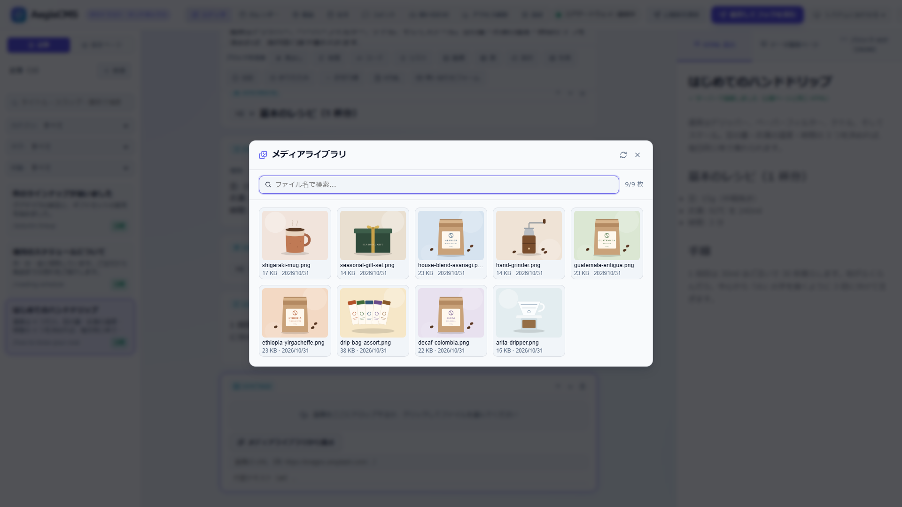

[← Back to the documentation index](README.md)

**English** | [日本語](media.ja.md)

# Media (Uploaded Files) API

Uploaded files such as images are stored in the `[storage]` backend (local disk / S3-compatible; [Configuration reference](configuration.md#23-storage--asset-storage)) and served at public URLs. In Admin Studio you use them through image block uploads and the **Media Library** (list, select, delete).



| API                                    | Required role | Description                                                                                                                                                                                                                                                                                                              |
| -------------------------------------- | ------------- | ------------------------------------------------------------------------------------------------------------------------------------------------------------------------------------------------------------------------------------------------------------------------------------------------------------------------ |
| `POST /api/v1/storage/upload`          | `editor`      | Saves the multipart `file` and returns `201` with `{ key, url, size, content_type }`. The key is `YYYY/MM/<8 chars>-<file name>` (it can also be specified with the `key` / `path` field). The limit is `[storage].max_upload_mb` (exceeding it returns `413`)                                                           |
| `GET /api/v1/storage/objects`          | `viewer`      | A list, newest first. `prefix` (key prefix match), `content_type` (mime type prefix match, e.g. `image/`), `q` (key substring match), `limit` (default 50, max 500), `offset`, `include_avatars` (whether to include avatar images under `avatars/`; by default they are excluded unless `prefix` starts with `avatars`) |
| `DELETE /api/v1/storage/objects/{key}` | `editor`      | Deletes a file (see below)                                                                                                                                                                                                                                                                                               |

All operations are recorded in the audit log (`storage.upload` / `storage.delete`; [Audit log](audit.md#2-recorded-events)).

Files that browsers run as scripts (`.html` / `.htm` / `.xhtml` / `.xml` / `.js` / `.mjs` and similar) are rejected with `415` (`code: "active_content_not_allowed"`), because uploads are served from the same origin as the site. `/uploads` responses carry `X-Content-Type-Options: nosniff`, and any HTML / XML / JavaScript that is already there is served with `Content-Security-Policy: default-src 'none'; sandbox` and `Content-Disposition: attachment`.

---

## Deleting a File — `DELETE /api/v1/storage/objects/{key}`

`{key}` is the `key` in the list and upload responses (e.g. `2026/10/1a2b3c4d-photo.png`). Append it to the path including the `/` (each segment may be URL-encoded).

```bash
curl -i -X DELETE http://127.0.0.1:8080/api/v1/storage/objects/2026/10/1a2b3c4d-photo.png \
  -H "Authorization: Bearer $TOKEN"
```

| Status        | Condition                                                                                                |
| ------------- | -------------------------------------------------------------------------------------------------------- |
| `204`         | Deleted                                                                                                  |
| `400`         | The key is empty or contains `..`                                                                        |
| `401` / `403` | No session or an invalid one / below `editor`                                                            |
| `404`         | No file with that key                                                                                    |
| `409`         | It is referenced from saved content or a user's avatar (when `force=true` is absent). Nothing is deleted |
| `500`         | Storage or DB error                                                                                      |

### Files in Use (`409`)

Before deleting, it checks whether the file's public URL (`url`) appears in the body (blocks) or custom fields of saved content of all content types, and whether the key is set as a user's or member's avatar image (`avatar_key`). If found, it does not delete and returns the referrers (content, `content_type: "user"` or `"member"`).

```json
{
  "error": "File is used by 1 item(s); pass force=true to delete it anyway",
  "references": [
    { "content_type": "article", "id": "2dc94a91-...", "slug": "hello-world", "title": "Hello World" }
  ]
}
```

If it is used as a user's avatar, a referrer with `content_type: "user"` is returned like this:

```json
{
  "content_type": "user",
  "id": "8a9e4ef1-...",
  "slug": "alice",
  "title": "Alice Smith"
}
```

To delete anyway, add `?force=true` (images on pages that reference it become broken links, and the avatar setting of users who used it as an avatar is cleared automatically). In Admin Studio, a confirmation dialog shows the referrers, and **Delete anyway** forces the deletion.

- The check is a string match on the public URL (content) and a storage key match (avatars). It does not detect references written in another form of the URL (a different CDN domain, with a query string, etc.) or references from themes or external sites.
- The reference check loads all content and the user list on every deletion, so it takes time proportional to the amount of content.
- The audit log's `details` records `url`, `force`, and `references` (the number of referrers at the time of deletion).
