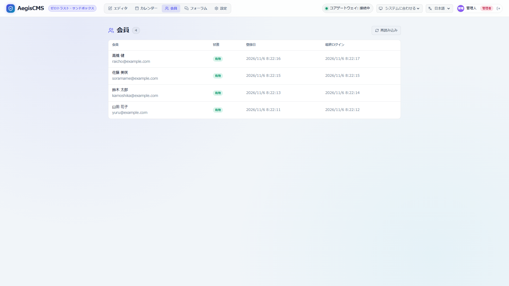
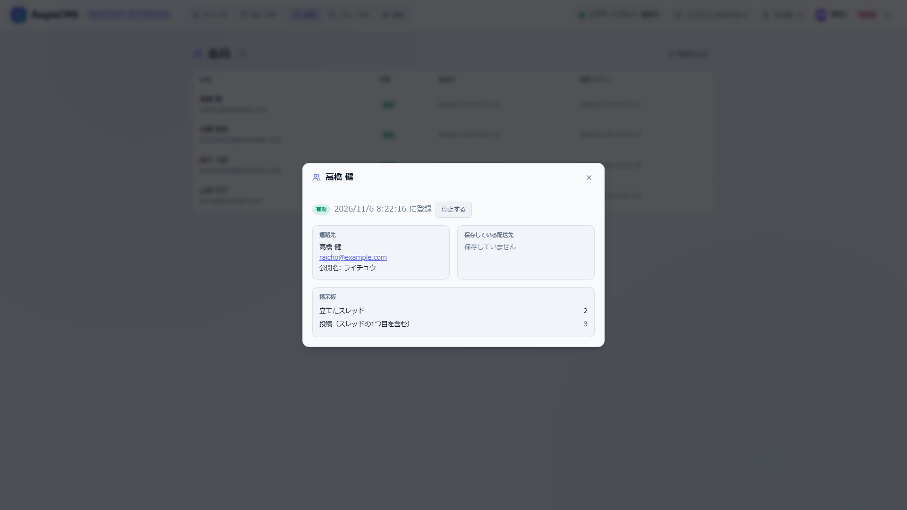

[← ドキュメント一覧に戻る](README.ja.md)

[English](members.ja.md) | **日本語**

# 会員アカウント

サイトの訪問者が作るアカウントです。**CMS の管理アカウント（`_aegis_users`）とは完全に別**で、テーブルも、セッションも、権限も共有しません。ショップ（[EC](commerce.ja.md)）の購入者は、注文履歴の確認、商品レビューの投稿、配送先の保存に使います。**掲示板（[forum](forum.ja.md)）でも同じアカウントを使えるようにする**予定です（§12）。

> [!NOTE]
> **現状と設計**。会員アカウント（§1〜§10）は実装済みです。以前は「顧客アカウント」として `[commerce.customers]` にありましたが、`[members]` に移り、ショップが無効でも使えます（§11。互換は残していません）。掲示板への組み込み・公開名（`nickname`）は設計だけで、**未実装**です（§12〜§14）。

---

## 1. 現状（実装済み）

`[members].enabled = true` のとき、会員アカウントが有効になります（設定は §3）。注文履歴・配送先・レビューは、ショップ（`[commerce].enabled = true`）も有効なときに使えます。

| API | 内容 |
|---|---|
| `POST /api/v1/members/register` | 会員登録（メール・パスワード・名前。電話・配送先は任意） |
| `POST /api/v1/members/login` | ログイン。`{ "token": "mses_...", "expires_at": ..., "member": {...} }` を返す |
| `POST /api/v1/members/logout` | ログアウト |
| `GET` / `PUT /api/v1/members/me` | 自分の情報の取得・更新（パスワード変更は現在のパスワードが要る） |
| `PUT` / `DELETE /api/v1/members/me/avatar` | プロフィール画像の設定・解除（§13a） |
| `GET /api/v1/members/orders`・`/orders/{id}` | 自分の注文履歴（ログイン中に注文すると、注文が会員に紐づく） |
| `GET /api/v1/members/reviews` | 自分のレビュー |
| `GET` / `POST /api/v1/products/{product_id}/reviews` | 商品のレビュー（公開済みの一覧・投稿） |
| `GET /api/v1/admin/members`・`/{id}`、`PATCH` | 会員の一覧・詳細・状態（`active` / `suspended`）の変更（`editor` 以上） |
| `PUT /api/v1/admin/members/{id}/level` | 会員の権限レベルの変更（`admin` のみ。§15） |
| `/api/v1/admin/reviews`・`/settings`・`/bulk`・`/{id}`・`/{id}/reply` | レビューの管理（承認・一括・返信・設定） |
| `POST` / `GET /api/v1/members/purchases` | 記事の購入を始める・自分の購入の一覧（`[members.purchase].enabled` のとき。§16） |
| `GET /api/v1/members/plans`、`POST` / `GET /api/v1/members/subscriptions`、`POST /api/v1/members/billing-portal` | プランの一覧、契約を始める・自分の契約、解約・カード変更の画面（Stripe の Customer Portal）の URL（§16） |
| `POST /api/v1/admin/members/{id}/purchases`、`POST /api/v1/admin/purchases/{id}/revoke` / `refund`、`POST /api/v1/admin/subscriptions/{id}/cancel` | 無料の付与、権利の取り消し、返金、契約の解約（`admin` のみ。§16） |
| `POST /api/v1/members/webhooks/stripe` | 購入の入金・返金の通知（Stripe の署名つき。§16） |

- 認証は `Authorization: Bearer mses_...`（API のクライアント向け）。セッションはキャッシュに置き、既定で 30 日。
- パスワードは Argon2id。登録済みのメールでの登録は `409`。
- レビューは「購入者（Verified Purchase）」だけが、1 注文につき 1 件、★1〜5 で投稿できる。**ゲスト購入の人も、注文のアクセストークンでレビューできる**（アカウントは要らない）。審査（承認待ち・スパム判定）は `[comments.moderation]` の仕組みを共有する。

### 足りないもの

1. 購入者が使う**画面**（ログイン・会員登録・マイページ・商品ページのレビュー欄）がない。API を直接呼ぶしかない。
2. 管理画面に、会員とレビューの**画面**がない。
3. パスワードを忘れたときの**再設定**と、登録したメールアドレスの**確認**がない。
4. **退会**（自分のアカウントの削除）がない。
5. 新規登録を止める、メール確認を必須にする、などの**設定**がない。

---

## 2. 範囲

- ゲスト購入は残します（アカウントなしで注文できる。注文の確認は今までどおり URL のトークン）。アカウントは任意です。
- 会員のアカウントで、CMS の管理画面には入れません（逆も同じ）。
- ソーシャルログイン、ポイント・クーポンの会員別管理、複数の配送先、ウィッシュリストは範囲外です。

---

## 3. 設定

```toml
[members]
enabled = true                      # 会員アカウントを使う（既定 false。使うサイトだけが true にする）
registration = "open"               # "open" | "closed"（closed は新規登録だけを止める。既存の会員はログインできる）
session_days = 30                   # ログインの有効期間（1〜365）
password_reset = true               # パスワードの再設定を使う（要 [notifications] のメールと public_url）
require_email_verification = false  # true は、メールの確認リンクを開くまでログインできない（同上）
public_url = ""                     # メールのリンクの元（例 "https://example.com"）。空だと、メールを使う機能は動かない
```

設定は実装済みです（[設定リファレンス](configuration.ja.md#members)）。`registration = "closed"` の新規登録は `403` です。

- `enabled = false` なら、会員の API と画面は 404 です（ゲスト購入とレビューは使えます）。
- `require_email_verification = true` で `[notifications]` のメールが使えないときは、確認メールを送れず誰もログインできなくなるので、**起動時にエラー**にします。

---

## 4. 購入者向けの画面

### 4.1 ルート

| パス | 内容 |
|---|---|
| `/account` | マイページ（ログイン中: 注文履歴・自分のレビュー・登録情報。未ログイン: ログイン画面へ） |
| `/account/login` | ログイン |
| `/account/register` | 会員登録（`registration = "closed"` なら 404） |
| `/account/forgot` | パスワードを忘れたとき（再設定メールの申し込み） |
| `/account/reset?token=...` | 新しいパスワードの設定 |
| `/account/verify?token=...` | メールアドレスの確認 |

### 4.2 ログインの持ち方

画面（ブラウザ）では、ログインすると **HttpOnly の Cookie** にセッションを持たせます。JavaScript はトークンに触れません（XSS で盗まれにくい）。API のクライアントは、今までどおり `Authorization: Bearer` を使います。会員の API は、どちらの形でも受け付けます（`Authorization` があればそちらを使う）。ログインの応答の本文には、従来どおりトークンも入ります。

- Cookie: 名前は `{名前空間}_member`（既定は `cms_member`。`[server]` の名前空間から作るので、管理画面のものと混ざらない）。`HttpOnly`、`SameSite=Lax`、`Path=/`、`Max-Age` はログインの有効期間（`session_days`）、HTTPS のとき（`X-Forwarded-Proto: https` または `[members].public_url` が `https://`）は `Secure`。ログアウトで `Max-Age=0` にして消す。
- **CSRF**: 状態を変える API は JSON（`Content-Type: application/json`）だけを受け付けます（今のまま）。`SameSite=Lax` で他のサイトからの POST には Cookie が付かず、CORS は認証情報つきの要求を許さない（今のまま）ので、他のサイトから操作できません。
- ログイン中に注文すると、注文が会員に紐づきます（Cookie でも Bearer でも同じ）。
- 会員のトークン（`mses_...`）は管理画面の API では通らず、管理者のトークンは会員の API で通らない。

マイページは、ほかのショップのページ（カート・注文確認）と同じ作りです。サーバーはログインの状態だけを見て（未ログインなら `/account/login` へ、ログイン済みなら `/account` へ転送）、**骨組みのページ**を返します。中身は、スクリプト（`/shop/account.js`）が API を呼んで作ります（注文履歴は最初の応答には入らない）。どの応答も `Cache-Control: private, no-store` で、共有のキャッシュに載りません。

### 4.3 テーマ

- 組み込みのテンプレート `account.html` を用意しています（テーマに `account.html` がなければ、これを使う）。同梱のテーマは、何も変えなくても動きます。
- テーマ制作者は `account.html` を上書きできます。`slug` が表示（`home` / `login` / `register`）、`theme_vars` に次が入ります: `account_enabled`（`"true"` / `"false"`）、`account_url`、`account_login_url`、`account_register_url`（登録を止めているときは空）、`account_script`、`account_api`、`account_min_password`。
- 組み込みの `account.html` は、`<div id="aegis-account" data-view="{{ slug }}">` をスクリプトが埋める作りです。上書きするときは、この要素と、`account_*` を `data-*` に渡すスクリプトの読み込みを残してください（スクリプトの文言は `[theme].locale` の言語）。見た目は、`.aegis-account-*` と `.aegis-field`・`.aegis-button` などのクラスで変えられます。
- ショップのナビゲーション（`shop_common.html`）に、会員アカウントを使うときだけ「アカウント」のリンクが出ます。

### 4.4 商品ページのレビュー

組み込みの `product.html` が、レビュー欄（`reviews.html`）を商品の本文とコメントの間に出します。同梱のテーマは何も変えなくても動きます。

- **一覧と平均**: 承認済みのレビュー（★・タイトル・本文・投稿者名・「購入済み」の印・運営の返信・日付）と、平均・件数を、スクリプト（`/shop/reviews.js`）が API から取って出します（`GET /api/v1/products/{id}/reviews`）。
- **検索結果の星**: 承認済みのレビューがあるときだけ、商品ページの `<head>` に構造化データ（JSON-LD の `Product` + `aggregateRating`。`ratingValue`・`reviewCount`・`bestRating`・`worstRating`）を出します。`<` はエスケープしてあり、商品名で `</script>` を閉じられません。レビューの承認・削除で、ページのキャッシュが更新されます。
- **書けるのは購入者だけ**（サーバーが注文を確かめる。支払い済み以降の注文で、1 注文 1 商品につき 1 件）。
  - **ログイン中の会員**: その商品を含む支払い済みの注文が複数あれば、どの注文のレビューかを選ぶ。書き済みの注文は選べない。
  - **ゲスト購入の人**: 注文確認のページ（`/orders/{id}?token=...`）の各明細に「レビューを書く」のリンクが出る。リンク先は商品ページ（`?review_order=...&token=...`）で、スクリプトが読んだ直後にアドレスバーからトークンを消す。
  - どちらでもない人には、ログインのリンクと、購入者だけが書けるという説明を出す。
- 投稿後の文は、公開されたか承認待ちかで変わる（`POST` の応答の `status` が `approved` / `pending`）。審査は `[comments.moderation]` に従う。
- テーマ制作者は、`theme_vars.reviews_enabled`（`"true"` のとき）で `reviews.html` を読み込みます。上書きするときは、`<div id="aegis-reviews">` と、`reviews_*` / `account_*` を `data-*` に渡すスクリプトの読み込みを残してください。

---

## 5. パスワードの再設定とメールの確認

### 5.1 パスワードの再設定（実装済み）

管理アカウントの再設定（`/api/v1/auth/password-reset`）と同じ作りです（トークンはキャッシュにハッシュで保存し、1 回だけ使える）。

| API | 内容 |
| --- | --- |
| `POST /api/v1/members/password-reset` | `{ "email" }`。登録の有無によらず、メールアドレスの形が正しければ**常に `202`**。登録があり停止中でなければ、再設定のリンクをメールで送る。有効 1 時間 |
| `POST /api/v1/members/password-reset/complete` | `{ "token", "password" }`。パスワードを変え、その会員の**すべてのセッションを失効**させる。リンクは 1 回だけ。無効・期限切れ・使用済みは `400` |

- **画面**: `/account/forgot`（メールアドレスを入れる）、`/account/reset?token=...`（新しいパスワード。読んだ直後に、アドレスバーからトークンを消す）。ログイン画面に「パスワードをお忘れの方」のリンクが出る。
- **使える条件**: `[notifications]` が有効（メールを送れる）で、`[members].public_url` が設定されていること（`[members].password_reset = false` で止められる）。メールのリンクは、**リクエストの `Host` ではなく `public_url` から作る**（`Host` は偽装できるので、攻撃者が被害者に偽のリンクを届けられてしまう）。使えない設定では、API もページも 404 で、ログイン画面はリンクを出さない。
- **制限**: 同じ IP からの申し込みは 1 時間に 5 回まで（登録の有無によらず数える。超えると `429`）。同じ宛先へのメールは 1 時間に 3 通まで（超えた分は、応答は同じで、送らない）。
- **通知**: `member.password_reset`（日本語・英語。文面は `[notifications]` の仕組みで編集できる）。監査ログ: `member.password_reset`（完了したとき）。

### 5.2 セッションの失効（実装済み）

会員のセッションは、次のときにすべて終わります。セッションごとには消さず、会員ごとに「この時刻より前に作ったセッションは無効」の印をキャッシュに置きます（Redis でも全サーバーで効く）。

- 管理者が会員を**停止**したとき（以前は、停止してもログイン中のセッションは使えたままだった）。再開しても、停止前のセッションは戻らない。
- **パスワードを変えた**とき（マイページ・再設定）。マイページで変えた本人のブラウザには、新しい Cookie が渡るので、そのまま使い続けられる。

### 5.3 メールアドレスの確認（実装済み）

`[members].require_email_verification = true` で、会員登録のあと、確認メールのリンクを開くまでログインできません。

| API | 内容 |
| --- | --- |
| `POST /api/v1/members/register` | 確認が必須のときは `202` `{ "status": "verification_sent" }`。会員は `unverified` で作り、確認メールを送る。**登録済みのアドレスでも同じ応答**（メールは送らない）。ログインのトークンは返さない |
| `POST /api/v1/members/verify` | `{ "token" }`。メールアドレスを確認して、会員を `active` にする。リンクは 48 時間・1 回だけ。無効・期限切れ・使用済みは `400` |
| `POST /api/v1/members/verify/resend` | `{ "email" }`。確認メールを送り直す。**常に `202`**（確認待ちのアドレスにだけ送る）。同じ IP から 1 時間に 5 回まで |
| `POST /api/v1/members/login` | パスワードが合っていて確認が済んでいないときは `403` `{ "code": "email_not_verified" }`。パスワードが違うときは、確認待ちかどうかを教えない（`401`） |

- **画面**: 会員登録のあと「確認メールを送りました」と案内する（ログインはしない）。ログイン画面は、`email_not_verified` のとき「確認メールを送り直す」を出す。`/account/verify?token=...` が確認のページで、トークンを読んだ直後にアドレスバーから消す。無効なリンクのときは、送り直しの申し込みを出す。
- **状態は `unverified`**（`active` / `suspended` に加わる）。**テーブルの列は増やさない**（古い DB を拒否する対象を増やさないため。状態は文字列の列にそのまま入る）。管理者が会員の状態を `active` にすれば、確認を待たずに使える。
- **先回りの乗っ取りを防ぐ**: 他人のアドレスで先に（自分のパスワードで）登録されても、確認が済むまでそのアカウントは使えない。本人が同じアドレスで登録し直すと、確認待ちの登録の名前とパスワードは**本人のものに置き換わる**（後から登録した人が勝つ）。確認が済んだアドレスでの登録は、何も変えない。
- **パスワードの再設定でも確認になる**: 確認待ちの会員が再設定のリンクを開けたら、アドレスの確認にもなる（`active` になる）。
- **メールのリンクは `[members].public_url` から作る**（`Host` ヘッダーは使わない。再設定と同じ）。同じ宛先へのメールは 1 時間に 3 通まで（登録・再送を合わせて）。
- **起動時の確認**: `require_email_verification = true` で `[notifications]` が無効、または `public_url` が空だと、確認メールを送れず誰もログインできなくなるので、**サーバーは起動しない**。
- 通知 `member.verify`（日本語・英語）。監査ログ `member.verify`（確認が済んだとき）。確認が必須でない既存の会員（`active`）は、設定を変えても、そのまま使える。

---|---|
| `POST /api/v1/members/password-reset` | `{ "email" }`。**常に `202`**（登録の有無を応答で教えない）。登録があれば再設定のリンクをメールで送る。有効 1 時間 |
| `POST /api/v1/members/password-reset/complete` | `{ "token", "password" }`。パスワードを変え、**すべてのセッションを失効**させる |
| `POST /api/v1/members/verify` | `{ "token" }`。メールアドレスを確認する。有効 48 時間 |
| `POST /api/v1/members/verify/resend` | `{ "email" }`。**常に `202`**。確認メールを送り直す |

- 確認が必要な会員の状態は、新しい `unverified`（`active` / `suspended` に加わる）。ログインは `403`（確認を促すメッセージ）。確認すると `active` になる。**テーブルの列は増やさない**（古い DB を拒否する対象を増やさないため。状態は文字列の列にそのまま入る）。
- 通知のテンプレートを足す: `member.verify`・`member.password_reset`（日本語・英語）。メールの文面は `[notifications]` の仕組みで編集できる。
- 申し込みは IP と宛先のメールごとに回数を制限する。

---

## 6. 退会（実装済み）

`DELETE /api/v1/members/me`（`{ "password" }`）で、自分のアカウントを削除できます。パスワードで本人を確かめる（違えば `401` で、何も変えない）。成功すると `204` で、ログインの Cookie も消えます。

| 対象 | 退会したあと |
| --- | --- |
| 会員の行・ログイン・セッション | **削除**。セッションはその場で使えなくなる |
| **注文** | **残す**（会計の記録）。会員との紐づき（`member_id`）だけを外す。明細・金額・注文時のメールアドレス・氏名・配送先は、注文の記録として残る（注文確認ページの URL は、今までどおり使える） |
| **レビュー** | **残す**（評価・本文・運営の返信・状態）。会員との紐づき・投稿者名・メールアドレス・IP・User-Agent を消す。公開ページでは投稿者名が「退会したお客様」と出る。星の集計は変わらない |
| 監査ログ | `member.delete` を記録する（**メールアドレスは記録しない**） |

- 同じメールアドレスで、あらためて登録できる（新しい会員。過去の注文は結びつかない）。
- 公開の商品ページに出ていた投稿者名が変わるので、その商品のキャッシュ（`reviews-{商品}`）を更新する。
- 途中で失敗しても、同じ手順をやり直せる（紐づきを外す・匿名にする更新は繰り返しても同じ）。会員の行を最後に消す。
- **画面**: マイページの下の「退会する」。パスワードを入れて押すと、確認のダイアログを通ったときだけ送る。成功するとログイン画面に戻る。
- 注文の `member_id` は、紐づきが無いとき（ゲスト購入・退会後）は `None` として読めるようにした（`String` として読むと、NULL が空文字になっていた）。

---

## 7. 管理画面

Admin Studio の「ショップ」に 2 つの画面を足します（API は実装済み）。

- **会員**（`editor` 以上、**実装済み**）: Admin Studio の「会員」タブ（`[members].enabled` のときだけ出る。`GET /api/v1/shop/config` の `members_enabled`）。一覧（名前・メール・状態・登録日・最終ログイン。新しい順、25 件ずつ）、詳細（連絡先・保存している配送先・掲示板の投稿数・注文の一覧と支払い済みの合計）、状態の変更（`active` ⇄ `suspended`。停止するとセッションを失効させる）。メール未確認（`unverified`）の会員は、状態を変えられない（確認が済むまで使えない）。
  - 詳細の「掲示板」は、その会員が立てたスレッドの数と、書いたレスの数（スレッドの 1 つ目の投稿を含む）。`GET /api/v1/admin/members/{id}` の `forum`（`{threads, posts}`。掲示板が無効なら `null` で、欄も出ない）。種類と ID の組で数えるので、同じ ID のスタッフの分は入らない。退会した会員の投稿は匿名なので数えない。
  - 掲示板の管理画面は、スレッドとレスの投稿者が会員なら「会員」の印と「会員を開く」のリンクを出す（スタッフは「スタッフ」の印）。リンクは、この会員の詳細を開く（会員の画面を見られる立場のときだけ）。退会した会員や匿名の投稿は、名前が空なら「退会したユーザー」と出す。
  - 詳細の注文は、番号・状態・金額・日時だけを返す（注文確認ページのトークンのハッシュなどは載せない）。
  - 検索は、まだ無い（API が一覧のページ送りだけのため）。
  - 「会員」タブは、ショップが無効でも出る（会員のアカウントはショップに依存しない）。ショップが無効のときは、詳細に注文の欄を出さない。

  

  
- **レビュー**（`editor` 以上、**実装済み**）: 「レビュー」タブ（ショップが有効なときだけ出る。`reviews_enabled`）。状態での絞り込み（承認待ち・承認済み・非承認・スパム・すべて）、一括の承認・保留・非承認・スパム・削除、本文・評価・購入者の印の確認、ショップからの返信（書く・直す・消す）。非承認とスパムでは、理由（任意）を聞いて、レビューに記録する（投稿者には見せない）。
  - 退会した会員のレビューは、投稿者名が空で、「退会したお客様」と出る。
  - 承認制の設定（`/api/v1/admin/reviews/settings`）の画面は、まだ無い（API は実装済み。有効な値と既定値を返す形にしてから画面を作る）。

---

## 8. 安全性

- **登録の有無を教えない**: パスワードの再設定と確認メールの再送は、常に `202`。ログインの失敗も、メールが無い場合とパスワードが違う場合を区別しない（今のまま）。
- **登録時の重複**: 登録済みのメールでの登録は `409` のまま。`require_email_verification = true` のときは、登録の応答を一律にして（確認メールを送ったとだけ伝える）、登録済みかどうかを漏らさない。
- **レート制限**: 登録・ログイン・再設定・再送を、IP ごとに制限する（既存のキャッシュのカウンター）。
- **セッション**: パスワードを変えたら、ほかのセッションをすべて失効させる。会員を停止したときも失効させる。
- **管理アカウントと混ざらない**: 会員のトークン（`mses_...`）は、管理画面の API では通らない。逆も同じ。
- **個人情報**: 会員の API の応答にパスワードのハッシュは含めない。退会で削除できる。バックアップ（`task dump`）には会員も入る。

---

## 9. テスト方針

- 会員の登録・ログイン・Cookie・ログアウト・停止の流れ（Cookie と Bearer の両方）。
- 他人の注文・レビューが見えないこと。管理アカウントのトークンと会員のトークンが互いに通らないこと。
- 再設定・確認のトークン: 期限切れ・再利用・改ざんの拒否、申し込みが常に `202` であること、レート制限。
- 退会後に、注文が残って会員との紐づきだけが外れること。レビューの匿名化。
- 画面: 組み込みの `account.html` が各 `view` で描画されること。ゲスト購入が今までどおり動くこと。
- 管理画面: Storybook と Playwright の E2E。

---

## 10. 実装の分け方（顧客アカウントのとき）

1. 設定 `[members]`（`enabled`・`registration`・`session_days`）と、このドキュメント、`commerce.md` の誤りの修正。**済**
2. Cookie のセッションと、購入者向けの画面（`/account`、`account.js`、`account.html`）、商品ページのレビュー欄（`reviews.js`、`reviews.html`、JSON-LD）。**済**
3. パスワードの再設定、セッションの失効、メールアドレスの確認。**済**
4. 退会。**済**
5. 管理画面の会員・レビュー。**済**

---

## 11. 顧客アカウントからの切り出し（実装済み）

以前は「顧客アカウント」として `[commerce]` の中にあり、ショップの購入者だけが使えました。これを **`[members]` に切り出し**、ショップ・掲示板が同じアカウントを使えるようにしました。**後方互換は残していません**（破壊的変更）。

### 11.1 呼び方

内部は **member に統一**し、訪問者に見える文言だけを画面の種類で変えます。

| 層 | 呼び方 |
| --- | --- |
| 設定・API・DB・コード・監査ログ・通知 | `member`（`[members]`、`/api/v1/members/*`、`_aegis_members`、`MemberService`、`member.*`） |
| 管理画面 | タブは「会員」 |
| 訪問者に見える文言 | ショップの画面（注文履歴・レビュー）は「お客様」、掲示板の画面は「ユーザー」。メッセージのキー（`js.*`）で出し分け、`[theme].locale` の言語で出す |

ページのパスは変えません（`/account`、`/account/login` …）。

### 11.2 変わったもの

| 変わったもの | 移行 |
| --- | --- |
| 設定 `[commerce.customers]` | `[members]` に移す（`enabled = true` を書く。**既定は `false`**）。古いキーが残っていると、**起動時に移行を案内してエラー**になる |
| メールのリンクの元 | `[members].public_url`（注文確認のリンクは今までどおり `[commerce].public_url`）。`require_email_verification = true` で空なら起動しない |
| `/api/v1/customers/*`・`/api/v1/admin/customers/*` | `/api/v1/members/*`・`/api/v1/admin/members/*`（古いパスは 404） |
| 表 `_aegis_customers`、注文・レビューの `customer_id` | `_aegis_members`、`member_id`。起動時の列の確認が古い DB を拒否する（下の SQL で直す） |
| セッションのトークン・Cookie | `cses_...` → `mses_...`、`{名前空間}_customer` → `{名前空間}_member`。**全員がログアウト**になる |
| キャッシュのキー | `customer_session:` など → `member_session:` など |
| 監査ログ `customer.*`、通知テンプレート `customer.*` | `member.*`（過去の監査ログの行はそのまま読める。通知テンプレートを上書きしているサイトは、ファイル名を `member.password_reset.txt` などに直す） |
| 管理 API の `shop/config` | `customers_enabled` → `members_enabled` |
| バックアップ（`task dump`） | 会員は `database/members.json`、購入は `database/purchases.json`（古いバックアップには無い）。**古いバックアップ（`database/customers.json`、注文・レビューの `customer_id`）も復元できる** |

古い DB の移行は、列と表の名前を直す SQL を実行します（自動では直しません。システム表を途中まで更新しない方針は今までと同じ）。

```sql
ALTER TABLE _aegis_customers RENAME TO _aegis_members;
ALTER TABLE _aegis_members ADD COLUMN nickname VARCHAR(255);    -- 公開名（§13）。SQLite は TEXT
ALTER TABLE _aegis_orders RENAME COLUMN customer_id TO member_id;
ALTER TABLE _aegis_reviews RENAME COLUMN customer_id TO member_id;
-- 索引の名前（idx_aegis_customers_*、idx_aegis_orders_customer、idx_aegis_reviews_customer）は
-- 古いままでも動く。起動時に新しい名前の索引が作られる
```

または、前のバージョンで `task dump` を取り、新しい DB に `task restore` します。

### 11.3 ショップとの関係

- 注文履歴（`GET /api/v1/members/orders`）・会員のレビュー・配送先の保存は、ショップが有効なときに使える。ゲスト購入は残す。会員は任意。
- 会員のサービスは独立したクレート `aegis-members` にあり、注文もレビューも知りません。会員の注文履歴と、退会のときの後始末（注文の紐づきを外す・レビューを匿名にする）は `aegis-commerce` の `member_data` が受け持ち、サーバーが順に呼びます（本人の確認 → 各機能の後始末 → 会員の行の削除）。掲示板の投稿の匿名化も、同じ場所に足します。

---

## 12. 掲示板への組み込み（実装済み）

掲示板は、スタッフ（CMS のアカウント）に加えて、会員のアカウントで投稿できます。仕様は [掲示板 4.0](forum.ja.md)。ここには、会員の側の決めごとを書きます。

- 投稿者の種類 **`author_kind`（`staff` / `member`。匿名は空）** を、スレッドとレスに持つ。`author_id` の接頭辞では区別しない（ユーザー名が会員の ID と同じになりうるため）。
- `author_name` は投稿時の表示名のコピー（会員は公開名。§13）。投稿者が後から名前を変えても、過去の投稿は変わらない。
- 掲示板の表は別の DB に置ける（`[forum].database_url`）ので、`author_id` は会員の表への外部キーにしない（今のスタッフも同じ）。
- `[forum].posting`（`"anyone"` / `"members"`）と、カテゴリごとの公開範囲 `visibility`（`public` / `members` / `staff`）。見られない人には、カテゴリもスレッドも「無い」。
- 会員が自分の投稿を**編集・削除**することは、まだできない（モデレーションの履歴を保つ。スタッフは今までどおり）。要望が出たら別に設計する。
- 退会しても、掲示板の投稿は**残して匿名にする**（スレッドが途切れないように）。`author_id` と `author_kind` を空にし、`author_name` を空にして（画面には「退会したユーザー」）、投稿の IP と User-Agent を消す。退会の手順は §11.3（本人の確認 → ショップの後始末 → 掲示板の後始末 → 会員の行の削除）。掲示板が無効のとき（`[forum].enabled = false`）は、後始末を行わない。
- **古い DB の移行**（§11.2 の SQL に加えて）: カテゴリの `is_private` を `visibility` にし、投稿に `author_kind` を足す。

  ```sql
  ALTER TABLE _aegis_forum_categories ADD COLUMN visibility VARCHAR(255) NOT NULL DEFAULT 'public';
  UPDATE _aegis_forum_categories SET visibility = 'staff' WHERE is_private = 1;
  ALTER TABLE _aegis_forum_categories DROP COLUMN is_private;      -- SQLite 3.35 以降。それ以前は、バックアップから復元する
  ALTER TABLE _aegis_forum_threads ADD COLUMN author_kind VARCHAR(255);
  ALTER TABLE _aegis_forum_posts ADD COLUMN author_kind VARCHAR(255);
  UPDATE _aegis_forum_threads SET author_kind = 'staff' WHERE author_id IS NOT NULL;
  UPDATE _aegis_forum_posts SET author_kind = 'staff' WHERE author_id IS NOT NULL;
  ```

  または、前のバージョンで `task dump` を取り、新しい DB に `task restore` する（`is_private` と `author_kind` の無いバックアップは、上と同じ規則で読み替える）。

---

## 13. 公開名 `nickname`（実装済み）

会員の `name` は配送先にも使う本名で、そのまま掲示板に出すと本名が出てしまいます。そこで、公開の場に出す名前を別に持ちます。

- 会員に **`nickname`（公開名）** の列を足した（未設定なら `null`）。`PUT /api/v1/members/me` の `nickname` で設定する（空文字で消す）。1〜30 文字で、改行などの制御文字は使えない（`400`）。**同じ公開名は重複できる**（なりすまし対策は、掲示板の側で考える）。
- 公開の場には、**公開名があればそれ、なければ `name`** を出す（`MemberResponse::public_name()`）。いまはレビューの投稿者名が使う。投稿のときの値のコピーを保存するので、あとから公開名を変えても、過去のレビューは変わらない。掲示板では**公開名を必須**にする（未設定なら、最初の投稿の前に決めてもらう。§12）。
- **画面**: マイページの登録情報に「公開名（任意）」の欄。管理画面の会員の詳細にも出る。
- 古い DB は `ALTER TABLE _aegis_members ADD COLUMN nickname VARCHAR(255);`（型は他の短い文字列の列に合わせる）。起動時の列の確認が、列が無い DB を断る。

## 13a. アバター画像（プロフィール画像）

- 会員に **`avatar_key`**（ストレージのキー `avatars/{会員 ID}-{ランダム 8 桁}.{拡張子}`）の列を足した（未設定なら `null`）。管理ユーザーのアバター（[authentication.md](authentication.ja.md#3-ユーザー管理-api)）と同じ保存先・同じ検査で、PNG / JPEG / GIF / WebP、2 MB まで。形式はファイルの先頭バイトで判定し、SVG は `415`、2 MB 超は `413`。差し替えるたびにキーを変え、以前の画像を削除する。
- `PUT /api/v1/members/me/avatar`（multipart の `file`）で設定、`DELETE /api/v1/members/me/avatar` で外す。応答は会員情報で、`avatar_url`（公開 URL。未設定なら `null`）を含む。`avatar_key` は応答に載せない。`GET /api/v1/members/me` と管理画面の会員 API（`/api/v1/admin/members*`）にも `avatar_url` が出る。
- Cookie だけで認証した multipart は他のサイトのフォームから送れてしまうので、`Origin` / `Referer` がこのサイトのものに限る（違えば `403`。`Authorization` ヘッダーで認証した場合は対象外）。
- 退会（`DELETE /api/v1/members/me`）では画像のファイルも消す。ストレージ API で、会員が使っている画像を消そうとすると `409`（参照元は `content_type: "member"`）。`?force=true` なら消して、会員の `avatar_key` を外す。
- **掲示板・レビューへの出し方**: 投稿の行にコピーを持たず、表示のたびに投稿者（会員 ID）から**今の** `avatar_key` を引く（重複を除いて、1 回の `SELECT ... WHERE id IN (...)` でまとめて引く。500 件ごとに区切る）。画像を変えれば過去の投稿にも反映され、古いファイルを消してもリンクが切れない。退会した会員の投稿は匿名なので画像も出ない。画像を変えたら掲示板のキャッシュ（`collection:forum` タグ）をパージする。レビューの公開 API は `avatar_url` を返し、`member_id` は返さない。
- **画面**: マイページの登録情報に「プロフィール画像」（選ぶとすぐ保存、「画像を外す」ボタン）。管理画面の会員の詳細、掲示板の投稿者（画像が無ければ頭文字の丸）、商品レビューの投稿者にも出る。
- 古い DB は `ALTER TABLE _aegis_members ADD COLUMN avatar_key VARCHAR(255);`。起動時の列の確認が、列が無い DB を断る。

---

## 14. 実装の分け方（会員アカウント）

1. 設計書。**済**
2. **切り出しと改名**（振る舞いは変えない）。**済**（§11）。`[members]`・API・表・列・Cookie・通知・監査ログ・管理画面・バックアップ・テスト・docs。
3. **`aegis-members` クレートへの切り出し**。**済**（ショップのクレートは会員に依存しない）。
4. **公開名（`nickname`）**（§13）。**済**
5. **掲示板を会員に対応**（§12）: `author_kind`、`posting`、`visibility`、会員の投稿、フォームの CSRF 対策、画面のログイン導線、退会時の匿名化、テスト。**済**
6. **管理画面**: 会員の詳細に掲示板の投稿数を出す、掲示板の管理画面に会員の印とリンクを出す（§7）。**済**

---

## 15. 閲覧の制限（会員レベル）

有料メンバー限定のページや、「ここから先は有料」の記事を作る仕組みです。**閲覧の制御**（このページ）と**レベルを付ける手段**（決済・商品購入との連動）は切り離し、先に前者を作ります。

### 15.1 決めたこと

- **会員に権限レベルを持たせる**。まずは管理画面から手動で付与する。決済や商品購入との連動は、付与の入口として後から足す（制御の仕組みは変えない）。
- **制限の単位は、記事・ページごと＋本文の「ここから先」**。カテゴリ単位は範囲外（掲示板のカテゴリの公開範囲 `visibility` とは別の話）。
- 管理アカウント（`_aegis_users`）とは別のまま。管理者・編集者は、レベルによらず全文を見られる（プレビュー・保存済みの確認のため）。

### 15.2 モデル

- 会員に `level`（文字列。未設定は `free`）を持たせる。取りうる値は `[members].levels`（例 `["free", "paid"]`。順番が低→高）で決め、**高いレベルは低いレベルの内容も見られる**。
- 記事・ページに `access`（必要なレベル。未設定・`public` は誰でも）と `access_from`（「ここから先」を置いたブロックの位置。未設定は全体を制限）を持たせる。
- 閲覧者は 3 種類: **ゲスト**（未ログイン）、**会員（レベル付き）**、**スタッフ**（管理者・編集者）。

### 15.3 本文の「ここから先」

- **区切りのブロック `core/paywall`**（実装済み）。Markdown では **`<!-- paywall -->`**（HTML のコメント）。GitHub ではコメントとして何も表示されないので、区切りを書いた文書も GitHub でそのまま読め、**新しい記法の例外にはならない**（GitHub が上限という方針の内側）。
- **効くのは、記事・ページに `access` があるときだけ**。`access` が無ければ区切りは何も出さず、全文が見える。区切りは、最初の**最上位**のものだけを数える（2 つ目以降と、入れ子の中のものは数えない。数えると、区切りの前後を取り違えて隠すべき本文を出しかねない）。
- 必要なレベルがない閲覧者には、**区切りより前のブロック**（`aegis_ast::public_blocks`）と、そのあとに案内（ログイン・アップグレードのリンク。`[theme].locale` で多言語）を出す。**区切りが無ければ、本文は全部隠す**（案内だけ）。
- 読める閲覧者には、区切りは何も出さない（線も出さない）。
- **隠す側は、HTML に出さない**（CSS で隠すだけにしない）。区切りより前を、フィード・検索の索引・一覧の要約・ヘッドレス API も使う（`excerpt` を書かなくても、区切りの前から要約ができる）。
- ブロックの置き場所が core なのは、読める人を決めるのが**サーバーの制御**で（プラグインのブロックは閲覧者を知らず、ページは共有キャッシュに載りうる）、切り出しがすべての面に及ぶため。[architecture.md 3.1a](architecture.ja.md#31a-core-ブロックの範囲github-でできることが上限)にも書いた。
- **管理画面**: ブロックの追加に「会員向けの区切り」（会員アカウントが有効なときだけ）。エディターには破線の帯で出る。Markdown との往復は `markdown.test.ts`。

### 15.4 漏れる面（すべて同じ判定を通す）

閲覧者の種類によって本文が変わると、本文を出すところ**すべて**が漏れ口になる。1 か所の判定を共通にして、次をすべて通す。

| 面 | 扱い |
|---|---|
| 記事・ページの公開ページ | 閲覧者のレベルで本文を切る。**共有キャッシュ・CDN**に載せるのは「ゲスト向け（切った版）」だけ。会員の Cookie があるときは `Cache-Control: private, no-store`（マイページと同じ）で、全文を共有キャッシュに載せない |
| フィード（`/feed.xml` など） | 切った版（抜粋まで）。全文を出さない。要約は書き手の `excerpt`（無ければ本文の先頭を使わず空） |
| 検索（`/search`・`/api/v1/search`） | 索引に入れる本文・スニペットは、制限より前の部分だけ。制限した部分の語では当たらない |
| 関連記事・一覧の抜粋 | 制限より前の部分から作る |
| ヘッドレス API（公開側の読み取り） | 同じ判定。`blocks` も切る |
| コメントの API | 本文と同じ判定。見られない閲覧者には `403`（`access_restricted`） |
| `oEmbed`・サイトマップ | oEmbed は `excerpt` フィールドだけ、サイトマップは URL だけなので、そのままでよい（`llms.txt` は無い） |
| 構造化データ | 制限したページに schema.org の `isAccessibleForFree: false`（JSON-LD）を付ける。本文はゲスト・クローラーにも出さないので、隠した本文を見せる「クローキング」にならず、`hasPart` の `cssSelector` は要らない |

### 15.5 キャッシュ

- **`access` のある記事・ページは、ゲストの応答も含めて、いつも `Cache-Control: private, no-store`**（`Cache-Tag` も付けない）。ゲスト向けの案内を共有キャッシュ・CDN が覚えると、同じ URL に来た会員（Cookie を見ない CDN）にも案内が返ってしまうため。`Vary: Cookie` で分ける方法もあるが、CDN の設定と相性が悪いので、まずはこちらにする。
- `access` が無い（または `public` の）記事・ページは、これまでどおり共有キャッシュに載せる。
- 保存すると、これまでどおり記事・ページのキャッシュタグがパージされるので、`access` を足した・外した直後に古い応答が残らない。

### 15.6 プレビューとの関係

管理画面のプレビューで、**どの種類の読者として見るか**を選べる（実装済み）。本物の会員になりすますのではなく、「その種類の読者に見える姿」を、公開ページと同じ判定（`handlers::access::decide`）で描画するだけなので、会員のセッションも個人情報も使わない。

- `POST /api/v1/preview` の要求に **`viewer`**: `staff`（省略したときの既定。全文）・`guest`・`member:<レベル>`。ほかの値や `[members].levels` にないレベルは `400`（`invalid_viewer`）。要求の `fields.access` が制限しているときだけ効く（制限がなければ、どの読者も同じ）。
- `guest` と、足りないレベルの会員は、区切りより前と案内（公開ページと同じ HTML）。読めるレベルの会員とスタッフは全文。本文（`html`）も、テーマ適用ページ（`page_html`）も同じ。ブロック AST のタブは編集中の全ブロックのまま。
- **画面**: プレビューの上に「見る人」の選択（スタッフ・ゲスト・会員のレベルごと）。記事・ページに「閲覧できる人」を設定していて、会員アカウントが有効なときだけ出る。

### 15.7 実装の分け方

1. **判定の核**（会員側は**済**）: `[members].levels`、会員の `level`（列 `_aegis_members.level`・API の応答・`PUT /api/v1/admin/members/{id}/level`・管理画面の会員の詳細で付与）、判定の関数 `aegis_members::may_view`（`Viewer` と必要なレベルから見られるかを返す。設定にないレベルは見せない）。記事・ページの `access` の欄と、閲覧者の種類の判定（Cookie / Bearer から）は 2 で、公開ページに効かせるときに足す。
2. **公開ページ**（**済**）: 記事・ページを閲覧者で切る（全体の制限）、案内の表示、キャッシュの扱い（15.5）、テスト。`crates/aegis-server/src/handlers/access.rs` の `gate` が、`fields["access"]` と閲覧者（会員の Cookie / Bearer）から `Open`（制限なし）・`Allowed`・`Denied` を返す。`Denied` は本文を**描画せず**（HTML に出さない）、案内（`<div class="aegis-access-notice">`）を本文の代わりに出し、コメント欄・関連記事・前後の記事も出さない。ゲストにはログインと会員登録（`/account/login?next=<この記事のパス>`。ログイン後にこの記事へ戻る。`next` はサイト内のパスだけ受け付ける）、レベルが足りない会員には必要なレベルと、`[members].upgrade_url` があればそのリンクを出す。会員アカウントが無効なサイトでは、ログインのリンクを出さない。
   - **保存時の検査**: `access` は `public`・空・`null`（=誰でも）か、`[members].levels` にあるレベルだけ。設定にない値は `400`（`code: unknown_access_level`。メッセージに選べるレベルを入れる）で断る（作成も更新も）。タイポでだれも読めなくなるのを防ぐため。レベルを `levels` から消したあと、そのレベルを指した記事を保存し直すときも、付け替えるまで 400 になる。
   - **`access` は組み込みのフィールド**（`category_id` と同じ。`SchemaDefinition::with_builtin_fields` が全コンテンツ型に差し込み、起動時の `ALTER TABLE ... ADD COLUMN` で列が足される）。YAML に書く必要はなく、書いても組み込みの定義（`string`・最大 32 文字・公開）で置き換わるので、書き忘れや型の書き違いで制限が外れない。制限が効くのは、いまは記事とページだけ（ほかの型に値を入れても何もしない）。
3. **「ここから先」**（**済**）: 区切りのブロック `core/paywall`（Markdown は `<!-- paywall -->`。往復テスト・エディター）、本文の切り出し（15.3）。
4. **漏れ口を塞ぐ**（**済**）: 15.4 の表の面を、すべて同じ約束にそろえた。本文を閲覧者によらず出す面（フィード・検索・一覧・関連記事・タグ・ヘッドレス API）は `aegis_ast::public_blocks`（だれにでも見せてよい部分。いまは無し。3 で区切りより前を返す）と `handlers::access::summary_excerpt`（書き手の `excerpt` を優先）を通す。制限した記事のコメントの API は、本文と同じ判定（見られないなら `403`・`access_restricted`）。制限したページの `<head>` に `isAccessibleForFree: false` の JSON-LD を出す。回帰テスト（`access_tests.rs`）は、制限した本文がどの面にも出ないこと、制限していない記事は従来どおりなことを確かめる。管理画面の記事・ページの編集に「閲覧できる人」の選択を足した（会員アカウントが有効なときだけ。選択肢は `GET /api/v1/shop/config` の `member_levels`）。
5. **プレビューの閲覧者切り替え**（**済**。15.6）。
6. **付与の入口**: 購入（記事の単独購入・サブスク）。§16。

---

## 16. 購入（記事の単独購入・サブスク）

会員に閲覧の権利を付ける**入口**です。閲覧を決める判定（§15 の `decide`）は変えず、「権利がある」と判定される条件を 2 つ足します。

- **記事単独購入**: その記事だけを一度の支払いで読めるようにする。
- **サブスク**: 自動更新の支払いで、会員レベル（`[members].levels`）を得る。支払いの単位（月・年・N か月など）は設定で決める。

### 16.1 決めたこと

- 決済は **Stripe Checkout**（カード情報は AegisCMS を通らない）。ほかの決済サービスは、需要が出てから抽象を切る。
- 買えるのは**会員だけ**。ゲストが買うと、権利を結びつける先がない（メールアドレスだけの購入は、ほかの端末で読めない・取り戻せない）。ゲストには、ログイン・登録のあとで購入へ進む案内を出す。
- **ショップ（`[commerce]`）の注文とは独立**。購入は注文・在庫・カートを使わず、`[commerce].enabled = false` でも動く。会計の画面（Orders）にも出ない。
- **金額はサーバーが決める**。購入を始めるリクエストは記事（型とスラッグ）やプランの ID だけを送り、金額・通貨は送らない。入金の通知（Webhook）で、金額と通貨が購入の記録と一致するときだけ権利を付ける。
- **会員の `level` は書き換えない**。手動で付けたレベルと、サブスクで得たレベルの**高いほう**を、判定のときに使う。サブスクが切れても、手動のレベルは残る。
- 権利が効くのは、記事・ページに **`access` があるとき**だけ（`access` が無ければ、もともと全員が読める）。`purchase_price` だけを入れても何も起きない。

### 16.2 設定

```toml
[members.purchase]
enabled = false          # 購入を使う（要 [members].enabled と [members].public_url）
currency = "jpy"         # 記事の購入に使う通貨（ISO 4217 の小文字）。金額は最小単位の整数

[members.purchase.stripe]
secret_key = ""          # 空なら環境変数 AEGIS_STRIPE_SECRET_KEY
webhook_secret = ""      # 空なら環境変数 AEGIS_MEMBERS_STRIPE_WEBHOOK_SECRET
# api_base = "https://api.stripe.com"   # テスト用のモックだけ変える

# サブスクのプラン。interval × interval_count が支払いの単位
[[members.purchase.plans]]
id = "monthly"
label = "Monthly"
level = "paid"           # 契約中に得るレベル（[members].levels のどれか）
amount = 800
interval = "month"       # "day" | "week" | "month" | "year"
interval_count = 1       # 3 で「3 か月ごと」
```

- ショップの Webhook（`/api/v1/shop/webhooks/stripe`）とは**別のエンドポイント**（`/api/v1/members/webhooks/stripe`）を Stripe に登録する。Stripe はエンドポイントごとに署名シークレットを発行するので、環境変数も分ける（キー本体 `AEGIS_STRIPE_SECRET_KEY` は同じアカウントなので共有してよい）。
- 起動時の検査: `enabled` なのに会員アカウントが無効、`public_url` が空、キーが無い、通貨が不正、プランの `level` が `levels` に無い・`id` の重複・`amount` が 0 以下・`interval_count` が 1〜（Stripe の上限: 日 365 / 週 52 / 月 12 / 年 1）の外、はエラーにする。
- 記事の戻り先 URL は `[members].public_url` から作る（Host ヘッダーを信用しない）。

### 16.3 モデル

記事・ページに組み込みのフィールド **`purchase_price`**（整数・最小単位・未設定は単独では売らない・公開）を足す。`access` と同じく全コンテンツ型に差し込む。商品の `price`（ショップ）とは別の名前にして、商品型の定義を上書きしない。

購入の記録 `_aegis_purchases`（第 2 段）:

| 列 | 内容 |
|---|---|
| `id` | 購入の ID |
| `member_id` | 会員 ID（退会で `NULL`。会計の記録として行は残す） |
| `content_type` / `content_id` | 買った記事・ページ |
| `amount` / `currency` | 始めた時点の金額（Webhook で照合する） |
| `status` | `pending`（決済ページを作った）/ `paid` / `refunded` / `cancelled`（期限切れ・失敗） |
| `provider_ref` | Checkout Session の ID（一意） |
| `transaction_id` | Payment Intent の ID（返金の突き合わせ） |
| `created_at` / `paid_at` / `updated_at` | |

サブスクの記録 `_aegis_subscriptions`: `member_id`・`plan_id`・`level`・`status`（`active` / `past_due` / `cancelled`）・Stripe の customer / subscription ID・`current_period_end`・`cancel_at_period_end`。**有効なレベル = `member.level` と、契約中のプランの `level` の高いほう**。契約中とは、状態が `active` / `past_due` で、`current_period_end` を過ぎていない（Webhook の遅れに備えて 3 日の猶予がある）こと。`level` は契約した時点のプランのレベルを写し、プランを設定から消しても契約中は変わらない。レベルが `[members].levels` から消えたときは無視する（制限が外れない）。

### 16.4 記事単独購入の流れ

1. 会員が、案内の「購入」リンク（`GET /account/purchase?content_type=..&slug=..`）または `POST /api/v1/members/purchases`（`{ "content_type", "slug" }`。API のクライアント向け）で始める。リンクにしているのは、既定の CSP の `form-action 'self'` が、フォームの送信先から外部の決済ページへのリダイレクトを止めるため。GET で決済ページを作るだけで入金されなければ何も起きず、Cookie は `SameSite=Lax`。ログインしていなければ、ログインのあとにここへ戻る。公開済み・`access` あり・`purchase_price` が 1 以上・まだ買っていない、を確かめる（外れたら `404` / `409`）。
2. `pending` の行を作り、Checkout Session（`mode=payment`、`price_data` はサーバーの金額、`client_reference_id` = 購入の ID）を作って、決済ページの URL を返す。戻り先は記事のパス（成功・中止とも）。
3. Webhook（署名と時刻を検証。ショップと同じ方式）:
   - `checkout.session.completed`（`payment_status = paid`）・`async_payment_succeeded`: 購入の ID・Session の ID・**金額と通貨が一致**するときだけ `pending` → `paid`（条件付き UPDATE。再送で二重に動かない）。不一致は `paid` にせず、監査ログに残す。
   - `expired` / `async_payment_failed`: `pending` → `cancelled`。
   - `charge.refunded`: 全額の返金で `paid` → `refunded`（権利を外す）。一部返金は権利を残す。
4. 同じ記事を二重に払った（2 つの決済ページを開いた）場合は、どちらも `paid` にし、監査ログに `duplicate_payment` を残す（返金は管理者が判断する）。
5. Webhook は数秒遅れうる。戻ってすぐの記事に案内が残ることがあるので、購入のリンクのそばに「お支払いの確認まで数秒かかることがある」旨を添える。再読み込みで読める。

### 16.5 判定への組み込み

`decide` は、(1) スタッフ、(2) レベル（手動 + サブスク）が足りる、(3) その記事を `paid` で買っている、のどれかで `Allowed`。それ以外は `Denied` で、案内に次を出す。

- ゲスト: ログイン・登録（購入のあとで戻る先つき）。
- レベルが足りない会員: `purchase_price` があり購入が有効なら「この記事を購入（金額）」、プランがあれば「プランを見る」、`upgrade_url` があればそのリンク。

共有キャッシュには載せない（`access` のある記事は、もともと常に `private, no-store`。§15.5）。フィード・検索・一覧・API・コメント API は、いまのとおり同じ判定を通すので、購入で漏れ口は増えない（購入した会員が読める面は、公開ページとコメント API だけ）。

### 16.6 安全性

- 金額・通貨は設定と記事の値だけから作る。リクエストの値を使わない。
- Webhook は署名（HMAC-SHA256、時刻の許容 5 分）を検証してから読む。記録に無い購入の ID は何もせず `200`（Stripe の再送を止める）。
- 退会: `member_id` を外して会計の記録として残す（権利は外れる）。契約中のサブスクは、先に Stripe で解約する（課金が続かないように。解約できなければ退会を断る `502`）。契約の記録は `member_id` を外して残す。
- 監査ログに `purchase.create`（決済ページの作成。契約の開始は `resource_type = subscription`）・`purchase.update`（`paid` / `refunded` / `cancelled` / `revoked`・契約の状態の変化・問題）を残す（[audit.md](audit.ja.md)）。
- サブスクの開始は、Webhook の金額・通貨がプランと合い、会員が存在するときだけ記録する。期間の終わりと状態は、通知の内容でなく Stripe に聞き直す（通知の順序は保証されない）。

### 16.7 実装の分け方

1. 設計書。**済**
2. **記事単独購入**（**済**）: 設定 `[members.purchase]`、`purchase_price`、`_aegis_purchases`（3 つの DB のマイグレーション・バックアップ・退会）、購入の開始、Webhook、判定と案内、監査ログ、記事の編集画面の価格の入力、テスト。コードは `crates/aegis-server/src/handlers/purchase.rs`（購入と Webhook）・`access.rs`（判定と案内）、`crates/aegis-db/src/purchases.rs`（保存）、`crates/aegis-commerce/src/stripe.rs` の `StripeClient` / `verify_webhook_event`（ショップと共有する Stripe の部品。`aegis-commerce` は `aegis-members` に依存するので、会員側のクレートからは使えず、サーバーが呼ぶ）。
3. **サブスク**（**済**）: プラン `[[members.purchase.plans]]`、`_aegis_subscriptions`（マイグレーション・バックアップ・退会）、`mode=subscription` の Checkout（`POST /api/v1/members/subscriptions`・リンク `GET /account/subscribe?plan=..`）、Webhook（`checkout.session.completed` で開始、`customer.subscription.updated` / `deleted` で更新・解約。更新の支払いの失敗は `updated` の `past_due` で分かるので、`invoice.*` は受けない）、有効なレベル（`access.rs` の `member_session` が手動のレベルと契約のレベルの高いほうを使う）、解約・カード変更は Stripe の Customer Portal へ（`POST /api/v1/members/billing-portal`・リンク `GET /account/billing`。Stripe のダッシュボードでポータルを有効にしておく）。コードは `handlers/subscription.rs`、`aegis-db/src/subscriptions.rs`。
4. **管理画面**（**済**）: 会員の詳細に購入・契約の一覧、無料の付与（`POST /api/v1/admin/members/{id}/purchases`）、権利の取り消し（`.../purchases/{id}/revoke`）、全額の返金（`.../purchases/{id}/refund`。Stripe の返金 API）、契約の即時解約（`.../subscriptions/{id}/cancel`）。いずれも `admin` だけ。会員の詳細の API（`GET /api/v1/admin/members/{id}`）が `purchases` / `subscriptions` を返す。
5. **会員の画面**（**済**）: マイページ（`/account`）に「メンバーシップ」（プランの一覧と契約・解約へのリンク）と「購入した記事」。レベルが足りない会員への案内は、`upgrade_url` が無くプランがあれば、プランへのリンクを出す。
