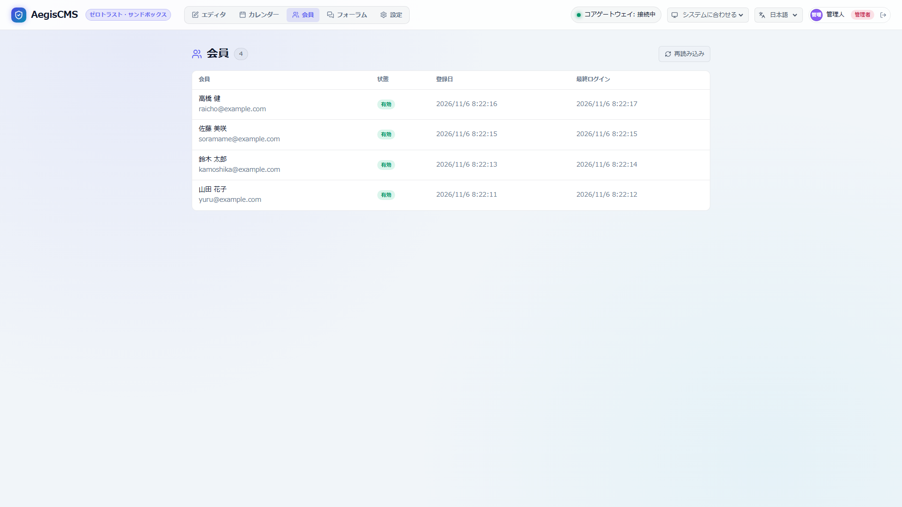
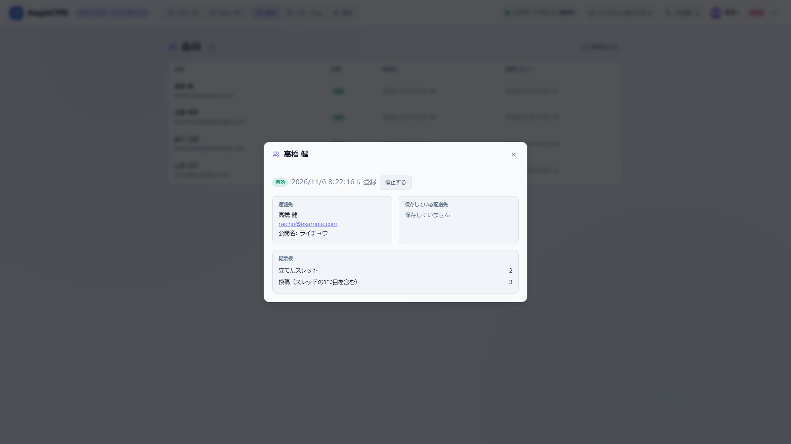

[← Back to the documentation index](README.md)

**English** | [日本語](members.ja.md)

# Member Accounts

Accounts that site visitors create. They are **completely separate from the CMS's admin accounts (`_aegis_users`)**, and share no tables, sessions, or permissions. Purchasers in the shop ([E-commerce](commerce.md)) use them to check order history, post product reviews, and save shipping addresses. **The same accounts are planned to be usable in the forum ([forum](forum.md)) too** (§12).

> [!NOTE]
> **Current state and design.** Member accounts (§1–§10) are implemented. They used to be "customer accounts" under `[commerce.customers]`, but moved to `[members]` and can be used even when the shop is disabled (§11; no compatibility was kept). Integration into the forum and public names (`nickname`) were only designs and were **not implemented** (§12–§14).

---

## 1. Current State (Implemented)

When `[members].enabled = true`, member accounts are enabled (settings are in §3). Order history, shipping addresses, and reviews can be used when the shop (`[commerce].enabled = true`) is also enabled.

| API                                                                                                                                                | Description                                                                                                                                                     |
| -------------------------------------------------------------------------------------------------------------------------------------------------- | --------------------------------------------------------------------------------------------------------------------------------------------------------------- |
| `POST /api/v1/members/register`                                                                                                                    | Member sign-up (email, password, name; phone and shipping address optional)                                                                                     |
| `POST /api/v1/members/login`                                                                                                                       | Login. Returns `{ "token": "mses_...", "expires_at": ..., "member": {...} }`                                                                                    |
| `POST /api/v1/members/logout`                                                                                                                      | Logout                                                                                                                                                          |
| `GET` / `PUT /api/v1/members/me`                                                                                                                   | Get and update your own information (changing the password needs the current password)                                                                          |
| `PUT` / `DELETE /api/v1/members/me/avatar`                                                                                                         | Set and remove the profile image (§13a)                                                                                                                         |
| `GET /api/v1/members/orders`, `/orders/{id}`                                                                                                       | Your own order history (an order placed while logged in is linked to the member)                                                                                |
| `GET /api/v1/members/reviews`                                                                                                                      | Your own reviews                                                                                                                                                |
| `GET` / `POST /api/v1/products/{product_id}/reviews`                                                                                               | A product's reviews (list of published ones, and posting)                                                                                                       |
| `GET /api/v1/admin/members`, `/{id}`, `PATCH`                                                                                                      | List and details of members, and changing the status (`active` / `suspended`) (`editor` and above)                                                              |
| `PUT /api/v1/admin/members/{id}/level`                                                                                                             | Change a member's permission level (`admin` only; §15)                                                                                                          |
| `/api/v1/admin/reviews`, `/settings`, `/bulk`, `/{id}`, `/{id}/reply`                                                                              | Review management (approval, bulk, reply, settings)                                                                                                             |
| `POST` / `GET /api/v1/members/purchases`                                                                                                           | Start purchasing an article, and list your own purchases (when `[members.purchase].enabled`; §16)                                                               |
| `GET /api/v1/members/plans`, `POST` / `GET /api/v1/members/subscriptions`, `POST /api/v1/members/billing-portal`                                   | The plan list, starting a subscription and your own subscriptions, and the URL of the screen for cancelling and changing cards (Stripe's Customer Portal) (§16) |
| `POST /api/v1/admin/members/{id}/purchases`, `POST /api/v1/admin/purchases/{id}/revoke` / `refund`, `POST /api/v1/admin/subscriptions/{id}/cancel` | Free grants, revoking entitlements, refunds, and cancelling subscriptions (`admin` only; §16)                                                                   |
| `POST /api/v1/members/webhooks/stripe`                                                                                                             | Notifications of purchase payments and refunds (with a Stripe signature; §16)                                                                                   |

- Authentication is `Authorization: Bearer mses_...` (for API clients). Sessions are kept in the cache, 30 days by default.
- Passwords use Argon2id. Registering with an already registered email gives `409`.
- Reviews can be posted only by "purchasers (Verified Purchase)", one per order, with ★1–5. **People who purchased as guests can also review with the order's access token** (no account needed). Moderation (awaiting approval, spam judgment) shares the `[comments.moderation]` mechanism.

### What Is Missing

1. There are no **screens** for purchasers (login, sign-up, My Page, the review section on product pages). You can only call the API directly.
2. The admin screen has no **screens** for members and reviews.
3. There are no **reset** for forgotten passwords or **confirmation** of registered email addresses.
4. There is no **withdrawal** (deleting your own account).
5. There are no **settings** such as stopping new registrations or requiring email confirmation.

---

## 2. Scope

- Guest purchases remain (orders can be placed without an account; order confirmation is by the URL's token as before). Accounts are optional.
- A member account cannot enter the CMS admin screen (and vice versa).
- Social login, per-member management of points and coupons, multiple shipping addresses, and wishlists are out of scope.

---

## 3. Settings

```toml
[members]
enabled = true                      # use member accounts (default false. Only sites that use them set true)
registration = "open"               # "open" | "closed" (closed stops only new registrations. Existing members can log in)
session_days = 30                   # login validity (1–365)
password_reset = true               # use password reset (requires [notifications] email and public_url)
require_email_verification = false  # true: cannot log in until the email confirmation link is opened (same requirement)
public_url = ""                     # base of email links (e.g. "https://example.com"). If empty, email-based features do not work
```

The settings are implemented ([Configuration reference](configuration.md#212a-members--member-accounts)). A new registration with `registration = "closed"` is `403`.

- With `enabled = false`, the member API and screens are 404 (guest purchases and reviews can be used).
- When `require_email_verification = true` and `[notifications]` email cannot be used, confirmation emails cannot be sent and no one can log in, so it is a **startup error**.

---

## 4. Purchaser-Facing Screens

### 4.1 Routes

| Path                        | Description                                                                                                 |
| --------------------------- | ----------------------------------------------------------------------------------------------------------- |
| `/account`                  | My Page (logged in: order history, your own reviews, registration info. Not logged in: to the login screen) |
| `/account/login`            | Login                                                                                                       |
| `/account/register`         | Member sign-up (404 if `registration = "closed"`)                                                           |
| `/account/forgot`           | When you forgot your password (applying for a reset email)                                                  |
| `/account/reset?token=...`  | Setting a new password                                                                                      |
| `/account/verify?token=...` | Confirming the email address                                                                                |

### 4.2 How Login Is Held

In screens (the browser), logging in keeps the session in an **HttpOnly cookie**. JavaScript cannot touch the token (hard to steal via XSS). API clients use `Authorization: Bearer` as before. The member API accepts both forms (if `Authorization` is present, it is used). The login response body still includes the token as before.

- Cookie: the name is `{namespace}_member` (default `cms_member`; built from the `[server]` namespace, so it does not mix with the admin screen's). `HttpOnly`, `SameSite=Lax`, `Path=/`, `Max-Age` is the login validity (`session_days`), and `Secure` over HTTPS (`X-Forwarded-Proto: https` or `[members].public_url` is `https://`). Logout clears it with `Max-Age=0`.
- **CSRF**: APIs that change state accept only JSON (`Content-Type: application/json`) (as now). With `SameSite=Lax` the cookie is not attached to POSTs from other sites, and CORS does not allow requests with credentials (as now), so it cannot be operated from other sites.
- An order placed while logged in is linked to the member (the same with a cookie or a Bearer).
- A member token (`mses_...`) does not pass the admin screen's API, and an administrator's token does not pass the member API.

My Page is built the same way as the other shop pages (cart, order confirmation). The server looks only at the login state (not logged in is forwarded to `/account/login`, logged in to `/account`) and returns a **skeleton page**. The contents are built by a script (`/shop/account.js`) calling the API (order history is not in the first response). Every response has `Cache-Control: private, no-store` and does not go into shared caches.

### 4.3 Theme

- A built-in template `account.html` is provided (used if the theme has no `account.html`). The bundled themes work without any change.
- Theme authors can override `account.html`. `slug` is the view (`home` / `login` / `register`), and `theme_vars` contains: `account_enabled` (`"true"` / `"false"`), `account_url`, `account_login_url`, `account_register_url` (empty when registration is stopped), `account_script`, `account_api`, and `account_min_password`.
- The built-in `account.html` is built so that a script fills `<div id="aegis-account" data-view="{{ slug }}">`. When overriding, keep this element and the loading of the script that passes `account_*` to `data-*` (the script's text is in the `[theme].locale` language). The look can be changed with the classes `.aegis-account-*`, `.aegis-field`, `.aegis-button`, and so on.
- In the shop navigation (`shop_common.html`), an "Account" link appears only when member accounts are used.

### 4.4 Reviews on Product Pages

The built-in `product.html` shows the review section (`reviews.html`) between the product's body and the comments. The bundled themes work without any change.

- **List and average**: approved reviews (★, title, body, poster name, a "purchased" mark, the operator's reply, date) and the average and count are fetched from the API and shown by a script (`/shop/reviews.js`) (`GET /api/v1/products/{id}/reviews`).
- **Stars in search results**: only when there are approved reviews, structured data (JSON-LD `Product` + `aggregateRating`; `ratingValue`, `reviewCount`, `bestRating`, `worstRating`) is output in the product page's `<head>`. `<` is escaped, so a product name cannot close `</script>`. Approving or deleting reviews updates the page cache.
- **Only purchasers can write** (the server checks orders; orders that are paid or beyond, one review per product per order).
    - **Logged-in members**: if there are multiple paid orders containing that product, choose which order the review is for. Orders already reviewed cannot be chosen.
    - **Guest purchasers**: a "Write a review" link appears on each line of the order confirmation page (`/orders/{id}?token=...`). The link goes to the product page (`?review_order=...&token=...`), and the script removes the token from the address bar right after reading it.
    - For anyone else, a login link and an explanation that only purchasers can write are shown.
- The text after posting changes depending on whether it was published or is awaiting approval (the `status` of the `POST` response is `approved` / `pending`). Moderation follows `[comments.moderation]`.
- Theme authors load `reviews.html` with `theme_vars.reviews_enabled` (when `"true"`). When overriding, keep `<div id="aegis-reviews">` and the loading of the script that passes `reviews_*` / `account_*` to `data-*`.

---

## 5. Password Reset and Email Confirmation

### 5.1 Password Reset (Implemented)

It is built the same way as the admin account reset (`/api/v1/auth/password-reset`) (the token is stored in the cache as a hash and can be used only once).

| API                                            | Description                                                                                                                                                                        |
| ---------------------------------------------- | ---------------------------------------------------------------------------------------------------------------------------------------------------------------------------------- |
| `POST /api/v1/members/password-reset`          | `{ "email" }`. Regardless of registration, **always `202`** if the email address's form is valid. If registered and not suspended, a reset link is sent by email. Valid for 1 hour |
| `POST /api/v1/members/password-reset/complete` | `{ "token", "password" }`. Changes the password and **revokes all of that member's sessions**. The link is single-use. Invalid, expired, or used gives `400`                       |

- **Screens**: `/account/forgot` (enter the email address) and `/account/reset?token=...` (the new password; the token is removed from the address bar right after reading). A "Forgot your password?" link appears on the login screen.
- **Conditions for use**: `[notifications]` is enabled (email can be sent) and `[members].public_url` is set (can be stopped with `[members].password_reset = false`). The email link is **built from `public_url`, not the request's `Host`** (since `Host` can be spoofed, an attacker could deliver a fake link to a victim). With settings where it cannot be used, the API and pages are 404, and the login screen does not show the link.
- **Limits**: applications from the same IP are limited to 5 per hour (counted regardless of registration; exceeding gives `429`). Emails to the same recipient are limited to 3 per hour (the excess gets the same response and is not sent).
- **Notification**: `member.password_reset` (Japanese and English; the text can be edited through the `[notifications]` mechanism). Audit log: `member.password_reset` (on completion).

### 5.2 Session Revocation (Implemented)

A member's sessions all end in the following cases. Rather than deleting per session, a "sessions created before this time are invalid" mark is placed in the cache per member (it works across all servers even with Redis).

- When an administrator **suspends** a member (previously, sessions already logged in remained usable even after suspension). Even on reinstatement, sessions from before the suspension do not return.
- When the **password is changed** (My Page, reset). The browser of the person who changed it on My Page receives a new cookie, so they can keep using it.

### 5.3 Email Address Confirmation (Implemented)

With `[members].require_email_verification = true`, after sign-up you cannot log in until you open the link in the confirmation email.

| API                                  | Description                                                                                                                                                                                                                                          |
| ------------------------------------ | ---------------------------------------------------------------------------------------------------------------------------------------------------------------------------------------------------------------------------------------------------- |
| `POST /api/v1/members/register`      | When confirmation is required, `202` `{ "status": "verification_sent" }`. The member is created as `unverified` and a confirmation email is sent. **The same response even for a registered address** (no email is sent). No login token is returned |
| `POST /api/v1/members/verify`        | `{ "token" }`. Confirms the email address and makes the member `active`. The link is valid for 48 hours and single-use. Invalid, expired, or used gives `400`                                                                                        |
| `POST /api/v1/members/verify/resend` | `{ "email" }`. Resends the confirmation email. **Always `202`** (sent only to addresses awaiting confirmation). Up to 5 per hour from the same IP                                                                                                    |
| `POST /api/v1/members/login`         | If the password is correct but confirmation is not done, `403` `{ "code": "email_not_verified" }`. If the password is wrong, it does not reveal whether confirmation is pending (`401`)                                                              |

- **Screens**: after sign-up, "We sent a confirmation email" is shown (it does not log in). The login screen shows "Resend the confirmation email" on `email_not_verified`. `/account/verify?token=...` is the confirmation page, and the token is removed from the address bar right after being read. For an invalid link, an application to resend is shown.
- **The status is `unverified`** (added to `active` / `suspended`). **No table column is added** (so as not to increase what is rejected for old DBs; the status goes straight into a string column). If an administrator sets a member's status to `active`, it can be used without waiting for confirmation.
- **Preventing pre-emptive takeover**: even if someone registers first (with their own password) using another person's address, that account cannot be used until confirmation is done. If the real owner registers again with the same address, the name and password of the pending registration are **replaced with the owner's** (the later registrant wins). Registration with an already confirmed address changes nothing.
- **A password reset also counts as confirmation**: if a member awaiting confirmation can open the reset link, it also confirms the address (they become `active`).
- **Email links are built from `[members].public_url`** (the `Host` header is not used; same as the reset). Emails to the same recipient are limited to 3 per hour (registration and resend combined).
- **Startup check**: with `require_email_verification = true`, if `[notifications]` is disabled or `public_url` is empty, confirmation emails cannot be sent and no one can log in, so **the server does not start**.
- The notification `member.verify` (Japanese and English). Audit log `member.verify` (when confirmation is done). Existing members (`active`) for whom confirmation was not required can keep being used as is even if you change the setting.

---|---|
| `POST /api/v1/members/password-reset` | `{ "email" }`. **Always `202`** (the response does not reveal registration). If registered, a reset link is sent by email. Valid for 1 hour |
| `POST /api/v1/members/password-reset/complete` | `{ "token", "password" }`. Changes the password and **revokes all sessions** |
| `POST /api/v1/members/verify` | `{ "token" }`. Confirms the email address. Valid for 48 hours |
| `POST /api/v1/members/verify/resend` | `{ "email" }`. **Always `202`**. Resends the confirmation email |

- The status of a member who needs confirmation is the new `unverified` (added to `active` / `suspended`). Login is `403` (with a message urging confirmation). Confirming makes it `active`. **No table column is added** (so as not to increase what is rejected for old DBs; the status goes straight into a string column).
- Add notification templates: `member.verify` and `member.password_reset` (Japanese and English). The email text can be edited through the `[notifications]` mechanism.
- Applications are rate-limited per IP and per recipient email.

---

## 6. Withdrawal (Implemented)

With `DELETE /api/v1/members/me` (`{ "password" }`), you can delete your own account. Identity is confirmed with the password (a wrong one gives `401` and changes nothing). On success it is `204`, and the login cookie is cleared too.

| Target                             | After withdrawal                                                                                                                                                                                                                                                             |
| ---------------------------------- | ---------------------------------------------------------------------------------------------------------------------------------------------------------------------------------------------------------------------------------------------------------------------------- |
| The member's row, logins, sessions | **Deleted**. Sessions become unusable on the spot                                                                                                                                                                                                                            |
| **Orders**                         | **Kept** (accounting records). Only the link to the member (`member_id`) is removed. Lines, amounts, and the email address, name, and shipping address at the time of the order remain as the order's record (the order confirmation page's URL can still be used as before) |
| **Reviews**                        | **Kept** (rating, body, operator reply, status). The link to the member, poster name, email address, IP, and User-Agent are removed. On public pages the poster name appears as "Former customer". Star aggregates do not change                                             |
| Audit log                          | `member.delete` is recorded (**the email address is not recorded**)                                                                                                                                                                                                          |

- You can register again with the same email address (a new member; past orders are not linked).
- The poster name shown on public product pages changes, so that product's cache (`reviews-{product}`) is updated.
- Even if it fails partway, the same procedure can be redone (the updates that remove links and anonymize give the same result when repeated). The member's row is deleted last.
- **Screen**: "Withdraw" at the bottom of My Page. After entering the password and pressing, it is sent only if it passes the confirmation dialog. On success it returns to the login screen.
- An order's `member_id` can now be read as `None` when there is no link (guest purchase, after withdrawal) (reading it as a `String` had turned NULL into an empty string).

---

## 7. Admin Screens

Two screens are added to Admin Studio's "Shop" (the API is implemented).

- **Members** (`editor` and above, **implemented**): Admin Studio's "Members" tab (shown only when `[members].enabled`; `members_enabled` of `GET /api/v1/shop/config`). A list (name, email, status, registration date, last login; newest first, 25 at a time), details (contact, saved shipping address, number of forum posts, list of orders and the total of paid ones), and changing the status (`active` ⇄ `suspended`; suspending revokes sessions). Members with unconfirmed email (`unverified`) cannot have their status changed (they cannot be used until confirmation is done).
    - "Forum" in the details is the number of threads that member started and the number of replies they wrote (including a thread's first post). The `forum` of `GET /api/v1/admin/members/{id}` (`{threads, posts}`; `null` and no field shown if the forum is disabled). It is counted by the pair of kind and ID, so a staff member with the same ID is not included. Posts by withdrawn members are anonymous and not counted.
    - The forum admin screen shows a "member" badge and an "Open member" link if a thread's or reply's poster is a member (staff get a "staff" badge). The link opens that member's details (only for those who may view the members screen). For posts by withdrawn members or anonymous ones, if the name is empty, "Former user" is shown.
    - The orders in the details return only number, status, amount, and date and time (such as the hash of the order confirmation page's token is not included).
    - Search does not exist yet (because the API has only list paging).
    - The "Members" tab is shown even when the shop is disabled (member accounts do not depend on the shop). When the shop is disabled, the orders field is not shown in the details.

    

    

- **Reviews** (`editor` and above, **implemented**): the "Reviews" tab (shown only when the shop is enabled; `reviews_enabled`). Filtering by status (awaiting approval, approved, not approved, spam, all), bulk approve, hold, disapprove, spam, and delete, checking the body, rating, and purchaser mark, and replies from the shop (write, fix, delete). For disapproval and spam, it asks for a reason (optional) and records it on the review (not shown to the poster).
    - Reviews by withdrawn members have an empty poster name and appear as "Former customer".
    - A screen for the approval settings (`/api/v1/admin/reviews/settings`) does not exist yet (the API is implemented; the screen will be built after making it return actual values and defaults).

---

## 8. Safety

- **Not revealing registration**: password reset and resending confirmation emails are always `202`. Login failures also do not distinguish between no email and a wrong password (as now).
- **Duplicates at registration**: registering with an already registered email stays `409`. When `require_email_verification = true`, the registration response is made uniform (it only says a confirmation email was sent) so as not to leak whether it was already registered.
- **Rate limits**: sign-up, reset, and resend are limited per IP (the existing cache counters). Login failures are counted per email address and per IP with the same settings as the administrator login ([`[auth.login_rate_limit]`](configuration.md#29-authlogin_rate_limit--rate-limiting-of-login-attempts)); while locked, even the correct password is refused with `429` and `Retry-After`
- **Sessions**: when a password is changed, all other sessions are revoked. They are also revoked when a member is suspended.
- **Not mixing with admin accounts**: a member token (`mses_...`) does not pass the admin screen's API. The same the other way.
- **Personal information**: member API responses do not include the password hash. It can be deleted by withdrawal. Backups (`task dump`) include members.

---

## 9. Test Policy

- The flow of member sign-up, login, cookies, logout, and suspension (both cookie and Bearer).
- That other people's orders and reviews are not visible. That admin account tokens and member tokens do not pass each other.
- Reset and confirmation tokens: rejection of expired, reused, and tampered ones, that applications are always `202`, and rate limits.
- After withdrawal, that orders remain with only the link to the member removed. Anonymization of reviews.
- Screens: that the built-in `account.html` renders in each `view`. That guest purchases still work as before.
- Admin screens: Storybook and Playwright E2E.

---

## 10. How the Work Was Split (for Customer Accounts)

1. The `[members]` settings (`enabled`, `registration`, `session_days`), this document, and fixing errors in `commerce.md`. **Done**
2. Cookie sessions and purchaser-facing screens (`/account`, `account.js`, `account.html`), and the review section on product pages (`reviews.js`, `reviews.html`, JSON-LD). **Done**
3. Password reset, session revocation, and email address confirmation. **Done**
4. Withdrawal. **Done**
5. Admin screens for members and reviews. **Done**

---

## 11. Split from Customer Accounts (Implemented)

They used to be "customer accounts" inside `[commerce]` and could be used only by shop purchasers. We **split this out into `[members]`** so the shop and the forum can use the same accounts. **No backward compatibility was kept** (a breaking change).

### 11.1 Naming

Internally everything is **unified as member**, and only the text visitors see changes by screen kind.

| Layer                                             | Name                                                                                                                                                    |
| ------------------------------------------------- | ------------------------------------------------------------------------------------------------------------------------------------------------------- |
| Settings, API, DB, code, audit log, notifications | `member` (`[members]`, `/api/v1/members/*`, `_aegis_members`, `MemberService`, `member.*`)                                                              |
| Admin screen                                      | The tab is "Members"                                                                                                                                    |
| Text visitors see                                 | "Customer" on shop screens (order history, reviews), "User" on forum screens. Split by message keys (`js.*`) and shown in the `[theme].locale` language |

Page paths are not changed (`/account`, `/account/login`, ...).

### 11.2 What Changed

| What changed                                                      | Migration                                                                                                                                                                                                       |
| ----------------------------------------------------------------- | --------------------------------------------------------------------------------------------------------------------------------------------------------------------------------------------------------------- |
| The setting `[commerce.customers]`                                | Move to `[members]` (write `enabled = true`; **the default is `false`**). If old keys remain, **startup errors with guidance on migrating**                                                                     |
| The base of email links                                           | `[members].public_url` (order confirmation links are `[commerce].public_url` as before). With `require_email_verification = true` and an empty value, it does not start                                         |
| `/api/v1/customers/*`, `/api/v1/admin/customers/*`                | `/api/v1/members/*`, `/api/v1/admin/members/*` (the old paths are 404)                                                                                                                                          |
| The table `_aegis_customers`, `customer_id` of orders and reviews | `_aegis_members`, `member_id`. The startup column check rejects old DBs (fix with the SQL below)                                                                                                                |
| Session tokens and cookies                                        | `cses_...` → `mses_...`, `{namespace}_customer` → `{namespace}_member`. **Everyone is logged out**                                                                                                              |
| Cache keys                                                        | `customer_session:` etc. → `member_session:` etc.                                                                                                                                                               |
| Audit log `customer.*`, notification templates `customer.*`       | `member.*` (past audit log rows can still be read. Sites that override notification templates should rename the files to `member.password_reset.txt`, etc.)                                                     |
| The admin API's `shop/config`                                     | `customers_enabled` → `members_enabled`                                                                                                                                                                         |
| Backups (`task dump`)                                             | Members are in `database/members.json` and purchases in `database/purchases.json` (absent in old backups). **Old backups (`database/customers.json`, `customer_id` of orders and reviews) can be restored too** |

Migrating an old DB runs SQL that fixes column and table names (it is not fixed automatically; the policy of not partially updating system tables is the same as before).

```sql
ALTER TABLE _aegis_customers RENAME TO _aegis_members;
ALTER TABLE _aegis_members ADD COLUMN nickname VARCHAR(255);    -- public name (§13). TEXT for SQLite
ALTER TABLE _aegis_orders RENAME COLUMN customer_id TO member_id;
ALTER TABLE _aegis_reviews RENAME COLUMN customer_id TO member_id;
-- Index names (idx_aegis_customers_*, idx_aegis_orders_customer, idx_aegis_reviews_customer)
-- work even if left old. Indexes with the new names are created at startup
```

Or take a `task dump` on the previous version and `task restore` into the new DB.

### 11.3 Relation to the Shop

- Order history (`GET /api/v1/members/orders`), member reviews, and saving shipping addresses can be used when the shop is enabled. Guest purchases remain. Membership is optional.
- The member service is in the standalone crate `aegis-members` and knows neither orders nor reviews. A member's order history, and cleanup on withdrawal (detaching orders and anonymizing reviews), are handled by `aegis-commerce`'s `member_data`, and the server calls them in order (confirming identity → each feature's cleanup → deleting the member's row). Anonymizing forum posts is added to the same place.

---

## 12. Integration into the Forum (Implemented)

The forum lets people post with member accounts in addition to staff (CMS accounts). For the specification, see [Forum 4.0](forum.md). Here we write the member side's decisions.

- A poster kind **`author_kind` (`staff` / `member`; anonymous is empty)** is held on threads and replies. They are not distinguished by an `author_id` prefix (because a username could be the same as a member's ID).
- `author_name` is a copy of the display name at posting time (for members, the public name; §13). Even if the poster later changes their name, past posts do not change.
- The forum's tables can be placed in a separate DB (`[forum].database_url`), so `author_id` is not a foreign key to the members table (the same as for staff now).
- `[forum].posting` (`"anyone"` / `"members"`) and the per-category visibility `visibility` (`public` / `members` / `staff`). For people who cannot see them, the category and its threads are "nonexistent".
- Members **editing or deleting** their own posts is not yet possible (to keep the moderation history; staff as before). Design separately if requested.
- Even on withdrawal, forum posts are **kept and made anonymous** (so threads do not break). `author_id` and `author_kind` are cleared, `author_name` is emptied (the screen shows "Former user"), and the post's IP and User-Agent are removed. The withdrawal procedure is §11.3 (confirming identity → shop cleanup → forum cleanup → deleting the member's row). When the forum is disabled (`[forum].enabled = false`), the cleanup is not performed.
- **Migrating old DBs** (in addition to §11.2's SQL): change the category's `is_private` into `visibility` and add `author_kind` to posts.

    ```sql
    ALTER TABLE _aegis_forum_categories ADD COLUMN visibility VARCHAR(255) NOT NULL DEFAULT 'public';
    UPDATE _aegis_forum_categories SET visibility = 'staff' WHERE is_private = 1;
    ALTER TABLE _aegis_forum_categories DROP COLUMN is_private;      -- SQLite 3.35 and later. Before that, restore from a backup
    ALTER TABLE _aegis_forum_threads ADD COLUMN author_kind VARCHAR(255);
    ALTER TABLE _aegis_forum_posts ADD COLUMN author_kind VARCHAR(255);
    UPDATE _aegis_forum_threads SET author_kind = 'staff' WHERE author_id IS NOT NULL;
    UPDATE _aegis_forum_posts SET author_kind = 'staff' WHERE author_id IS NOT NULL;
    ```

    Or take a `task dump` on the previous version and `task restore` into the new DB (backups without `is_private` and `author_kind` are read with the same rules as above).

---

## 13. Public Name `nickname` (Implemented)

A member's `name` is the real name also used for shipping, and showing it as is in the forum would expose the real name. So a separate name is held to show in public.

- A **`nickname` (public name)** column was added to members (`null` if unset). It is set with `nickname` of `PUT /api/v1/members/me` (an empty string clears it). It is 1–30 characters, and control characters such as line breaks cannot be used (`400`). **The same public name can be duplicated** (countermeasures against impersonation are to be considered on the forum side).
- In public, **the public name if there is one, otherwise `name`** is shown (`MemberResponse::public_name()`). Currently the review poster's name uses it. A copy of the value at posting time is stored, so even if the public name is changed later, past reviews do not change. In the forum, the **public name is required** (if unset, they are asked to decide before the first post; §12).
- **Screen**: a "Public name (optional)" field in My Page's registration info. It is shown in the admin screen's member details too.
- For old DBs, `ALTER TABLE _aegis_members ADD COLUMN nickname VARCHAR(255);` (match the type to other short string columns). The startup column check rejects DBs without the column.

## 13a. Avatar Image (Profile Image)

- An **`avatar_key`** column (the storage key `avatars/{member ID}-{random 8 chars}.{extension}`) was added to members (`null` if unset). It has the same storage location and the same checks as admin users' avatars ([authentication.md](authentication.md#3-user-management-api)): PNG / JPEG / GIF / WebP, up to 2 MB. The format is determined by the file's first bytes, SVG gives `415`, and over 2 MB gives `413`. Each replacement changes the key and deletes the previous image.
- Set with `PUT /api/v1/members/me/avatar` (the multipart `file`) and remove with `DELETE /api/v1/members/me/avatar`. The response is the member information, including `avatar_url` (the public URL; `null` if unset). `avatar_key` is not in the response. `avatar_url` also appears in `GET /api/v1/members/me` and the admin screen's member API (`/api/v1/admin/members*`).
- A multipart request authenticated only by cookie could be sent from another site's form, so `Origin` / `Referer` must be this site's (otherwise `403`; requests authenticated with an `Authorization` header are not covered).
- On withdrawal (`DELETE /api/v1/members/me`), the image file is deleted too. In the storage API, trying to delete an image a member uses gives `409` (the referrer is `content_type: "member"`). With `?force=true` it is deleted and the member's `avatar_key` is removed.
- **How it appears in the forum and reviews**: posts' rows hold no copy; on each display, the **current** `avatar_key` is looked up from the poster (the member ID) (duplicates removed and looked up together with one `SELECT ... WHERE id IN (...)`, split by 500). Changing the image is reflected in past posts too, and deleting old files does not break links. Posts by withdrawn members are anonymous, so no image appears. When an image is changed, the forum's cache (the `collection:forum` tag) is purged. The reviews' public API returns `avatar_url` and does not return `member_id`.
- **Screen**: "Profile image" in My Page's registration info (saved as soon as chosen, with a "Remove image" button). It also appears in the admin screen's member details, forum posters (a circle with the initial if no image), and product review posters.
- For old DBs, `ALTER TABLE _aegis_members ADD COLUMN avatar_key VARCHAR(255);`. The startup column check rejects DBs without the column.

---

## 14. How the Work Was Split (Member Accounts)

1. The design document. **Done**
2. **Splitting out and renaming** (no behavior change). **Done** (§11). `[members]`, API, tables, columns, cookies, notifications, audit log, admin screen, backups, tests, docs.
3. **Splitting out to the `aegis-members` crate**. **Done** (the shop crate does not depend on members).
4. **Public name (`nickname`)** (§13). **Done**
5. **Making the forum member-aware** (§12): `author_kind`, `posting`, `visibility`, member posts, CSRF protection for forms, login paths on screens, anonymization on withdrawal, tests. **Done**
6. **Admin screens**: showing forum post counts in member details, and showing the member mark and link in the forum admin screen (§7). **Done**

---

## 15. Viewing Restrictions (Member Levels)

A mechanism for making paid-member-only pages and "paid from here" articles. **Controlling viewing** (this page) is separated from **the means of granting levels** (integration with payments and product purchases), and the former is built first.

### 15.1 Decisions

- **Give members a permission level.** At first it is granted manually from the admin screen. Integration with payments and product purchases will be added later as an entry point for granting (the control mechanism does not change).
- **The unit of restriction is per article/page, plus "from here on" in the body.** Per-category is out of scope (a different matter from the forum category's visibility `visibility`).
- It stays separate from admin accounts (`_aegis_users`). Administrators and editors can see the full text regardless of level (for preview and checking what is saved).

### 15.2 Model

- Members have a `level` (a string; `free` if unset). The possible values are decided by `[members].levels` (e.g. `["free", "paid"]`; ordered low → high), and **a higher level can also view the content of lower levels**.
- Articles and pages have `access` (the required level; unset or `public` means anyone) and `access_from` (the position of the block where "from here on" was placed; unset restricts the whole).
- There are 3 kinds of viewers: **guests** (not logged in), **members (with a level)**, and **staff** (administrators and editors).

### 15.3 "From Here On" in the Body

- **The divider block `core/paywall`** (implemented). In Markdown, **`<!-- paywall -->`** (an HTML comment). On GitHub it is a comment and shows nothing, so a document with the divider can be read on GitHub as is, and **it is not an exception to new syntax** (within the policy that GitHub is the upper limit).
- **It takes effect only when the article/page has `access`.** If there is no `access`, the divider outputs nothing and the full text is visible. Only the first **top-level** divider is counted (the second and later ones and ones inside nesting are not counted; counting them could mix up before and after the divider and expose body text that should be hidden).
- To viewers without the required level, **the blocks before the divider** (`aegis_ast::public_blocks`) are shown, followed by a notice (links for login and upgrade; multilingual via `[theme].locale`). **If there is no divider, the whole body is hidden** (only the notice).
- To viewers who can read, the divider outputs nothing (not even a line).
- **The hidden side is not output into HTML** (it is not merely hidden with CSS). Feeds, search indexing, list summaries, and the headless API also use what is before the divider (even if you don't write `excerpt`, a summary is made from before the divider).
- The block lives in core because who may read is decided by **server control** (plugin blocks do not know the viewer, and pages can go into shared caches), and cutting applies to every surface. It is also written in [architecture.md 3.1a](architecture.md#31a-the-scope-of-core-blocks-githubs-capabilities-are-the-upper-limit).
- **Admin screen**: "Members-only divider" in adding blocks (only when member accounts are enabled). It appears in the editor as a dashed band. Round trips with Markdown are in `markdown.test.ts`.

### 15.4 Surfaces That Can Leak (All Go Through the Same Decision)

If the body changes by viewer kind, **every** place that outputs the body becomes a leak point. One decision is shared and everything below goes through it.

| Surface                              | Handling                                                                                                                                                                                                                                           |
| ------------------------------------ | -------------------------------------------------------------------------------------------------------------------------------------------------------------------------------------------------------------------------------------------------- |
| Public pages of articles and pages   | The body is cut by the viewer's level. Only the "guest version (cut)" goes into **shared caches and the CDN**. When there is a member cookie, `Cache-Control: private, no-store` (same as My Page) so the full text does not go into shared caches |
| Feeds (`/feed.xml`, etc.)            | The cut version (up to the excerpt). The full text is not output. The summary is the author's `excerpt` (if absent, empty without using the start of the body)                                                                                     |
| Search (`/search`, `/api/v1/search`) | The body and snippets entered in the index are only the part before the restriction. Words in the restricted part do not match                                                                                                                     |
| Related articles and list excerpts   | Made from the part before the restriction                                                                                                                                                                                                          |
| Headless API (public-side reads)     | The same decision. `blocks` are cut too                                                                                                                                                                                                            |
| Comments API                         | The same decision as the body. Viewers who cannot see get `403` (`access_restricted`)                                                                                                                                                              |
| `oEmbed` and sitemap                 | oEmbed is only the `excerpt` field and the sitemap only URLs, so they can stay as they are (there is no `llms.txt`)                                                                                                                                |
| Structured data                      | `isAccessibleForFree: false` of schema.org (JSON-LD) is attached to restricted pages. The body is not output to guests and crawlers either, so it is not "cloaking" that shows hidden body text, and the `cssSelector` of `hasPart` is not needed  |

### 15.5 Caching

- **Articles and pages with `access` always get `Cache-Control: private, no-store`, including guest responses** (and no `Cache-Tag`). This is because if a shared cache or CDN remembered the guest notice, a member coming to the same URL (through a CDN that doesn't look at cookies) would also get the notice. Splitting with `Vary: Cookie` is possible too, but it doesn't get along with CDN configurations, so this comes first.
- Articles and pages with no `access` (or `public`) go into shared caches as before.
- On save, the article/page cache tags are purged as before, so no stale response remains right after `access` is added or removed.

### 15.6 Relation to Preview

In the admin screen's preview you can choose **which kind of reader to view as** (implemented). It does not impersonate a real member; it only renders "how it looks to that kind of reader" with the same decision as the public page (`handlers::access::decide`), so no member session or personal information is used.

- The request of `POST /api/v1/preview` gets **`viewer`**: `staff` (the default when omitted; the full text), `guest`, or `member:<level>`. Other values, and levels not in `[members].levels`, give `400` (`invalid_viewer`). It takes effect only when the request's `fields.access` is restricting (without a restriction, every reader is the same).
- `guest` and members of an insufficient level get the part before the divider and the notice (the same HTML as the public page). Members of a readable level and staff get the full text. The body (`html`) and the theme-applied page (`page_html`) are the same. The block AST tab remains all the blocks being edited.
- **Screen**: a "Viewer" selector above the preview (staff, guest, per member level). It is shown only when the article/page has "who can view" set and member accounts are enabled.

### 15.7 How the Work Was Split

1. **The core of the decision** (the member side is **done**): `[members].levels`, a member's `level` (the column `_aegis_members.level`, the API response, `PUT /api/v1/admin/members/{id}/level`, and granting in the admin screen's member details), and the decision function `aegis_members::may_view` (returns whether one may view, from a `Viewer` and the required level; levels not in the settings are not shown). The article/page `access` field and determining the viewer kind (from a cookie / Bearer) are added in 2, when making it take effect on public pages.
2. **Public pages** (**done**): cutting articles and pages by viewer (whole-body restriction), showing the notice, the cache handling (15.5), tests. `gate` in `crates/aegis-server/src/handlers/access.rs` returns `Open` (no restriction), `Allowed`, or `Denied` from `fields["access"]` and the viewer (the member's cookie / Bearer). `Denied` **does not render** the body (it is not output into HTML), outputs a notice (`<div class="aegis-access-notice">`) in place of the body, and does not output the comment section, related articles, or previous/next articles. Guests get login and sign-up (`/account/login?next=<this article's path>`; after login they return to this article; `next` accepts only paths within the site), and members of an insufficient level get the required level and, if `[members].upgrade_url` exists, that link. On sites where member accounts are disabled, the login link is not shown.
    - **Check at save time**: `access` is either `public`, empty, or `null` (= anyone), or only a level in `[members].levels`. A value not in the settings is refused with `400` (`code: unknown_access_level`; the message includes the selectable levels), for both create and update. This is to prevent no one being able to read because of a typo. Even when re-saving an article that pointed to a level after removing that level from `levels`, it is 400 until it is reassigned.
    - **`access` is a built-in field** (like `category_id`; `SchemaDefinition::with_builtin_fields` inserts it into all content types, and the column is added by `ALTER TABLE ... ADD COLUMN` at startup). You need not write it in YAML, and even if you do it is replaced by the built-in definition (`string`, max 32 characters, public), so the restriction doesn't come off because of forgetting or mistyping the type. The restriction currently takes effect only on articles and pages (putting a value in other types does nothing).
3. **"From here on"** (**done**): the divider block `core/paywall` (`<!-- paywall -->` in Markdown; round-trip tests and the editor), and cutting the body (15.3).
4. **Closing the leak points** (**done**): the surfaces in the 15.4 table were all brought to the same promise. Surfaces that output the body regardless of the viewer (feeds, search, lists, related articles, tags, headless API) go through `aegis_ast::public_blocks` (the part that may be shown to anyone; currently nothing; 3 makes it return what is before the divider) and `handlers::access::summary_excerpt` (the author's `excerpt` takes priority). The restricted article's comments API uses the same decision as the body (`403` and `access_restricted` if it cannot be seen). JSON-LD with `isAccessibleForFree: false` is output in restricted pages' `<head>`. Regression tests (`access_tests.rs`) verify that the restricted body appears on none of the surfaces, and that unrestricted articles are as before. A "Who can view" selection was added to the admin screen's article and page editing (only when member accounts are enabled; the choices are `member_levels` of `GET /api/v1/shop/config`).
5. **Switching viewers in the preview** (**done**; 15.6).
6. **The entry point for granting**: purchase (single article purchases and subscriptions). §16.

---

## 16. Purchases (Single Article Purchases and Subscriptions)

The **entry points** that grant a member viewing entitlement. The decision that determines viewing (§15's `decide`) does not change; 2 conditions are added for "entitled" to be judged.

- **Single article purchase**: makes only that article readable for a one-time payment.
- **Subscription**: gets a member level (`[members].levels`) with auto-renewing payments. The unit of payment (month, year, N months, etc.) is decided in the settings.

### 16.1 Decisions

- Payment is **Stripe Checkout** (card information does not pass through AegisCMS). Other payment services will have an abstraction cut once demand appears.
- **Only members can buy.** If a guest bought, there would be nothing to tie the entitlement to (a purchase by email address alone cannot be read on another device or recovered). Guests are shown a notice to proceed to purchase after logging in or registering.
- **Independent of the shop (`[commerce]`) orders.** Purchases use no orders, inventory, or cart, and work even with `[commerce].enabled = false`. They do not appear in the accounting screen (Orders) either.
- **The server decides the amount.** The request to start a purchase sends only the article (kind and slug) or the plan ID, and does not send amount or currency. Entitlement is granted only when the amount and currency in the payment notification (webhook) match the purchase record.
- **A member's `level` is not rewritten.** The **higher** of the manually granted level and the level gained by subscription is used at decision time. Even if the subscription lapses, the manual level remains.
- The entitlement takes effect only when the article/page **has `access`** (without `access`, everyone could read it in the first place). Entering just `purchase_price` does nothing.

### 16.2 Settings

```toml
[members.purchase]
enabled = false          # use purchases (requires [members].enabled and [members].public_url)
currency = "jpy"         # currency for article purchases (ISO 4217 lowercase). Amounts are integers in the smallest unit

[members.purchase.stripe]
secret_key = ""          # if empty, the environment variable AEGIS_STRIPE_SECRET_KEY
webhook_secret = ""      # if empty, the environment variable AEGIS_MEMBERS_STRIPE_WEBHOOK_SECRET
# api_base = "https://api.stripe.com"   # change only for test mocks

# Subscription plans. interval × interval_count is the unit of payment
[[members.purchase.plans]]
id = "monthly"
label = "Monthly"
level = "paid"           # the level gained while subscribed (one of [members].levels)
amount = 800
interval = "month"       # "day" | "week" | "month" | "year"
interval_count = 1       # 3 means "every 3 months"
```

- Register an **endpoint separate** from the shop's webhook (`/api/v1/shop/webhooks/stripe`) with Stripe (`/api/v1/members/webhooks/stripe`). Stripe issues a signing secret per endpoint, so the environment variable is separate too (the key itself `AEGIS_STRIPE_SECRET_KEY` is the same account, so it can be shared).
- Startup checks: these are errors — `enabled` while member accounts are disabled, an empty `public_url`, missing keys, an invalid currency, a plan's `level` not in `levels`, a duplicate `id`, an `amount` of 0 or less, and an `interval_count` outside 1– (Stripe's limits: day 365 / week 52 / month 12 / year 1).
- The article's return URL is built from `[members].public_url` (the Host header is not trusted).

### 16.3 Model

Add a built-in field **`purchase_price`** (integer, smallest unit; unset means not sold individually; public) to articles and pages. Like `access`, it is inserted into all content types. It has a different name from the product's `price` (shop) so as not to overwrite the product type's definition.

The purchase record `_aegis_purchases` (stage 2):

| Column                                  | Description                                                                                    |
| --------------------------------------- | ---------------------------------------------------------------------------------------------- |
| `id`                                    | The purchase ID                                                                                |
| `member_id`                             | The member ID (`NULL` on withdrawal. The row remains as an accounting record)                  |
| `content_type` / `content_id`           | The article/page bought                                                                        |
| `amount` / `currency`                   | The amount at the time it was started (checked by the webhook)                                 |
| `status`                                | `pending` (a payment page was created) / `paid` / `refunded` / `cancelled` (expired or failed) |
| `provider_ref`                          | The Checkout Session ID (unique)                                                               |
| `transaction_id`                        | The Payment Intent ID (to match refunds)                                                       |
| `created_at` / `paid_at` / `updated_at` |                                                                                                |

The subscription record `_aegis_subscriptions`: `member_id`, `plan_id`, `level`, `status` (`active` / `past_due` / `cancelled`), Stripe's customer / subscription IDs, `current_period_end`, and `cancel_at_period_end`. **The effective level = the higher of `member.level` and the `level` of the plan being subscribed to.** "Being subscribed" means the status is `active` / `past_due` and `current_period_end` has not passed (with a 3-day grace to allow for webhook delays). `level` copies the plan's level at the time of subscribing, and does not change during the subscription even if the plan is removed from the settings. A level that has disappeared from `[members].levels` is ignored (the restriction does not come off).

### 16.4 Flow of a Single Article Purchase

1. A member starts it from the notice's "Purchase" link (`GET /account/purchase?content_type=..&slug=..`) or `POST /api/v1/members/purchases` (`{ "content_type", "slug" }`; for API clients). It is a link because the default CSP's `form-action 'self'` stops a redirect from a form's destination to an external payment page. A GET only creates a payment page, and if there is no payment nothing happens, and the cookie is `SameSite=Lax`. If not logged in, they come back here after logging in. It checks that the article is published, has `access`, has a `purchase_price` of 1 or more, and has not been bought yet (otherwise `404` / `409`).
2. It creates a `pending` row, creates a Checkout Session (`mode=payment`, with `price_data` being the server's amount and `client_reference_id` = the purchase ID), and returns the payment page's URL. The return destination is the article's path (for both success and cancel).
3. The webhook (signature and time verified; same method as the shop):
    - `checkout.session.completed` (`payment_status = paid`) and `async_payment_succeeded`: only when the purchase ID, the Session ID, and **the amount and currency match**, `pending` → `paid` (a conditional UPDATE; a resend does not run it twice). A mismatch does not make it `paid` and is left in the audit log.
    - `expired` / `async_payment_failed`: `pending` → `cancelled`.
    - `charge.refunded`: on a full refund, `paid` → `refunded` (removing the entitlement). A partial refund keeps the entitlement.
4. If the same article was paid twice (two payment pages were opened), both are made `paid` and `duplicate_payment` is left in the audit log (an administrator decides on refunds).
5. The webhook can be several seconds late. The notice may remain on the article right after returning, so next to the purchase link a note is added that "payment confirmation may take a few seconds". It becomes readable on reload.

### 16.5 Integration into the Decision

`decide` gives `Allowed` if any of: (1) staff, (2) the level (manual + subscription) is sufficient, (3) the article was bought as `paid`. Otherwise `Denied`, and the notice shows the following.

- Guests: login and sign-up (with a destination to return to after purchase).
- Members of an insufficient level: if there is a `purchase_price` and purchases are enabled, "Purchase this article (amount)"; if there are plans, "See plans"; and if there is an `upgrade_url`, that link.

It is not put in shared caches (articles with `access` are always `private, no-store` in the first place; §15.5). Feeds, search, lists, the API, and the comments API go through the same decision as now, so purchases add no leak points (the surfaces a member who purchased can read are only public pages and the comments API).

### 16.6 Safety

- The amount and currency are built only from the settings and the article's values. Request values are not used.
- The webhook's signature (HMAC-SHA256, time tolerance 5 minutes) is verified before reading. A purchase ID not in the records is ignored with `200` (to stop Stripe's resends).
- Withdrawal: `member_id` is removed and kept as an accounting record (the entitlement is removed). A subscription in progress is first cancelled at Stripe (so billing does not continue; if it cannot be cancelled, withdrawal is refused with `502`). The subscription record is kept with `member_id` removed.
- The audit log records `purchase.create` (creating a payment page; the start of a subscription has `resource_type = subscription`) and `purchase.update` (`paid` / `refunded` / `cancelled` / `revoked`, changes in a subscription's state, problems) ([audit.md](audit.md)).
- The start of a subscription is recorded only when the webhook's amount and currency match the plan and the member exists. The end of the period and the status are asked again of Stripe, not taken from the notification's contents (the order of notifications is not guaranteed).

### 16.7 How the Work Was Split

1. The design document. **Done**
2. **Single article purchases** (**done**): the settings `[members.purchase]`, `purchase_price`, `_aegis_purchases` (migrations for the 3 DBs, backups, withdrawal), starting a purchase, the webhook, the decision and notice, the audit log, a price input in the article edit screen, and tests. The code is in `crates/aegis-server/src/handlers/purchase.rs` (purchases and the webhook), `access.rs` (decision and notice), `crates/aegis-db/src/purchases.rs` (storage), and `StripeClient` / `verify_webhook_event` in `crates/aegis-commerce/src/stripe.rs` (the Stripe components shared with the shop. `aegis-commerce` depends on `aegis-members`, so the members-side crate cannot use it, and the server calls it).
3. **Subscriptions** (**done**): the plans `[[members.purchase.plans]]`, `_aegis_subscriptions` (migrations, backups, withdrawal), Checkout with `mode=subscription` (`POST /api/v1/members/subscriptions` and the link `GET /account/subscribe?plan=..`), the webhook (start with `checkout.session.completed`, update and cancel with `customer.subscription.updated` / `deleted`; a failed renewal payment is known from `past_due` in `updated`, so `invoice.*` is not received), the effective level (`member_session` in `access.rs` uses the higher of the manual level and the subscription level), and cancelling and changing cards go to Stripe's Customer Portal (`POST /api/v1/members/billing-portal` and the link `GET /account/billing`; enable the portal in the Stripe dashboard). The code is in `handlers/subscription.rs` and `aegis-db/src/subscriptions.rs`.
4. **Admin screens** (**done**): in a member's details, the list of purchases and subscriptions, free grants (`POST /api/v1/admin/members/{id}/purchases`), revoking entitlements (`.../purchases/{id}/revoke`), full refunds (`.../purchases/{id}/refund`; Stripe's refund API), and immediate cancellation of subscriptions (`.../subscriptions/{id}/cancel`). All are `admin` only. The member details API (`GET /api/v1/admin/members/{id}`) returns `purchases` / `subscriptions`.
5. **Member screens** (**done**): "Membership" (the plan list and links to subscribe and cancel) and "Purchased articles" on My Page (`/account`). For the notice to members of an insufficient level, if there is no `upgrade_url` and there are plans, a link to the plans is shown.
