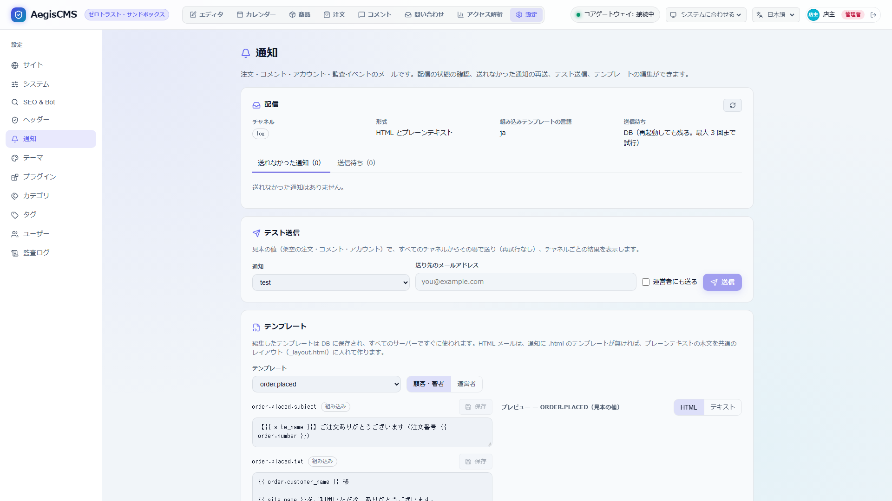

[← Back to the documentation index](README.md)

**English** | [日本語](notifications.ja.md)

# Notifications (Email)

Notifies customers and operators by email of order receipt, payment confirmation, shipping, and cancellation, and notifies operators of audit events such as administrator logins and login lockouts (`[notifications]`). Email is sent from an external SMTP server (your own mail server, Amazon SES, SendGrid, Google Workspace, etc.).

Delivery methods are built to be swappable as "channels", and email (`email`) and the server log (`log`) are built in. For Slack, SMS, and the like, you can add a Wasm plugin as a channel (`plugin:<name>`; [5. Adding delivery methods](#5-adding-delivery-methods)).

Email is sent as both plain text and HTML ([3.1](#31-html-email)). The outbox is stored in the DB, so it is not lost even if the server restarts ([4](#4-delivery-and-reliability)). Test sends, editing templates, and resending failed notifications can be done from Admin Studio's **Settings › Notifications** ([6](#6-managing-from-admin-studio)).

```text
 E-commerce (order creation, status changes)          Audit log (events matching rules; 2.1)
        │  NotificationEvent { kind: "order.placed" / "audit.session.create", recipient, values }
        ▼
 NotificationService (aegis-notify)
        │  Builds the subject and body (text + HTML) from templates per recipient (<kind>.subject / .txt / .html)
        ▼
 Outbox (the DB's _aegis_notification_queue. One entry per recipient and channel)
        │  A worker sends. Transient failures are retried at intervals; ones that cannot be sent remain as "failed notifications"
        ├──▶ email channel ── SMTP server ──▶ customers / staff_recipients
        ├──▶ log channel   ── the server log (aegis::notify)
        └──▶ plugin:<name> ── a Wasm plugin's send-notification hook ──▶ Slack / SMS, etc.
        │
        └── the result is recorded in the audit log (notification.send)
```

---

## 1. Enabling It

```toml
[notifications]
enabled = true
channels = ["email"]
locale = "en"                    # language of the built-in templates (en / ja)

[notifications.email]
smtp_host = "smtp.example.com"
smtp_port = 587                  # if omitted (0), 587 / 465 / 25 depending on tls
tls = "starttls"                 # starttls / tls / none
username = "apikey"
# password is not written in the config file; it can be passed with the environment variable AEGIS_SMTP_PASSWORD
from = "Aegis Shop <shop@example.com>"
reply_to = "support@example.com"
staff_recipients = ["orders@example.com"]   # where to send notices of new orders and cancellations
```

After configuring, check the connection and authentication to the SMTP server with a test notification.

```bash
aegis-server -c config/production.toml notify test --to you@example.com
# email: sent "[Aegis Shop] Test notification"
```

On failure, the SMTP server's response (such as `535 Authentication failed`) is shown. After the server is running, you can also test-send from Admin Studio's **Settings › Notifications** ([6](#6-managing-from-admin-studio)).

- For the list of settings, see the [Configuration reference](configuration.md#213-notifications--notifications-email).
- In a development environment without an SMTP server, `channels = ["log"]` outputs the notification subject and body to the server log.
- URLs in the body (`site_url` and the admin screen URL for operators) are built from `[commerce].public_url`. The URL of the order confirmation page is built from the request host at the time of ordering.
- Set up SPF / DKIM / DMARC for the sender's domain on the SMTP server side (without them, mail is more likely to be classified as spam).

---

## 2. Notifications Sent

| Kind                    | When                                                                                                                                                                                                                                                                                                     | Recipient                                                                                                | Main content                                                                                                                                      |
| ----------------------- | -------------------------------------------------------------------------------------------------------------------------------------------------------------------------------------------------------------------------------------------------------------------------------------------------------- | -------------------------------------------------------------------------------------------------------- | ------------------------------------------------------------------------------------------------------------------------------------------------- |
| `order.placed`          | Order receipt. For `manual` (bank transfer, etc.) and zero-amount orders, when ordered; for `stripe`, when payment is complete                                                                                                                                                                           | Customer, operators                                                                                      | Order contents, shipping address, payment instructions (when awaiting payment), the order confirmation page URL (only when ordered)               |
| `order.paid`            | An administrator confirmed payment (`manual`)                                                                                                                                                                                                                                                            | Customer                                                                                                 | Payment confirmation                                                                                                                              |
| `order.shipped`         | Shipped                                                                                                                                                                                                                                                                                                  | Customer                                                                                                 | Shipping notice. The note entered when changing the status (carrier, tracking number, etc.) goes into the body                                    |
| `order.cancelled`       | Cancelled (administrator operation, payment expiry)                                                                                                                                                                                                                                                      | Customer, operators                                                                                      | The reason for cancellation (`reason`), and refund instructions if paid                                                                           |
| `stock.low`             | An order brought a product's or variant's inventory to the threshold                                                                                                                                                                                                                                     | Operators                                                                                                | Product name and ID, remaining count, threshold, order number                                                                                     |
| `account.verify`        | Applied for account registration from Admin Studio ([Authentication 7](authentication.md#7-account-registration))                                                                                                                                                                                        | The applying email address                                                                               | Confirmation link (`verify_url`), expiry, username                                                                                                |
| `member.password_reset` | A purchaser applied for a reset from "Forgot password" ([Member accounts 5](members.md#5-password-reset-and-email-confirmation)). Not sent for unregistered addresses, suspended customers, or the 4th and later to the same recipient within an hour                                                    | The customer of the applying email address                                                               | Name, reset link (`reset_url`; built from `[commerce].public_url`), validity time (`expires_hours`)                                               |
| `member.verify`         | A purchaser signed up as a member (when `[members].require_email_verification = true`; including resending the confirmation email; [Member accounts 5](members.md#5-password-reset-and-email-confirmation)). Not sent for registered addresses or the 4th and later to the same recipient within an hour | The customer of the registered email address                                                             | Name, confirmation link (`verify_url`; built from `[commerce].public_url`), validity time (`expires_hours`; 48)                                   |
| `account.registered`    | The confirmation link was opened and an account was created                                                                                                                                                                                                                                              | Operators                                                                                                | Username, display name, email address, role, whether approval is needed (`pending_approval`)                                                      |
| `content.published`     | The server published content scheduled for publication (`status: "scheduled"`) when the publication time arrived ([Scheduled publishing](theme_and_publishing_guide.md#scheduled-publishing))                                                                                                            | Author                                                                                                   | Title and kind, the public page's URL (`content_url`), scheduled publication time                                                                 |
| `content.unpublished`   | The server unpublished (archived) published content when the unpublish time (`unpublish_at`) arrived                                                                                                                                                                                                     | Author                                                                                                   | Title and kind, unpublish time                                                                                                                    |
| `content.submitted`     | Content became awaiting review (`pending`) ([Review](theme_and_publishing_guide.md#review-approving-and-publishing-a-contributors-draft))                                                                                                                                                                | Active users of `editor` and above (those with an email address; excluding the requester)                | Title and kind, the requester, note, the URL to open Admin Studio's list awaiting review (`review_url`)                                           |
| `content.approved`      | `editor` or above published or scheduled an item awaiting review                                                                                                                                                                                                                                         | Author                                                                                                   | Title and kind, the approver, note, the public page's URL (when published), and the time if scheduled                                             |
| `content.returned`      | Someone other than the author reverted an item awaiting review to draft (sent back)                                                                                                                                                                                                                      | Author                                                                                                   | Title and kind, who sent it back, note (the reason), the URL to open Admin Studio (`edit_url`)                                                    |
| `comment.posted`        | An approved comment was posted (when published without waiting for approval; [Comments](comments.md))                                                                                                                                                                                                    | Author (`[comments].notify_author`)                                                                      | The poster's name, body, the comment's URL                                                                                                        |
| `comment.pending`       | A comment awaiting approval arrived                                                                                                                                                                                                                                                                      | Author (`notify_author`), operators (`notify_staff`)                                                     | The poster's name, email address, and IP address, body, the URL to open Admin Studio's **Comments** (`moderation_url`)                            |
| `comment.replied`       | A reply to your own comment was published (a reader's reply or a reply from Admin Studio; for a reply awaiting approval, when approved)                                                                                                                                                                  | The poster of the replied-to comment (only those who chose "notify me of replies by email" when posting) | The replier's name and body, your own comment, the reply's URL, the link to stop notifications (`unsubscribe_url`)                                |
| `comment.approved`      | Your own comment was approved (when approved in Admin Studio from awaiting approval or spam)                                                                                                                                                                                                             | That comment's poster (only those who chose "notify me of replies and approval by email" when posting)   | Your own comment, the comment's URL, the link to stop notifications (`unsubscribe_url`)                                                           |
| `forum.posted`          | An approved thread or reply was posted to the forum                                                                                                                                                                                                                                                      | Operators (`[forum].notify_staff`)                                                                       | Category, thread name, poster's name, body, the thread's URL (`thread_url`)                                                                       |
| `forum.pending`         | A thread or reply awaiting approval was posted to the forum                                                                                                                                                                                                                                              | Operators (`[forum].notify_staff`)                                                                       | Category, thread name, poster's name and IP address, body, the URL to open Admin Studio's **Forum** (`moderation_url`)                            |
| `forum.reported`        | A forum thread or post was reported                                                                                                                                                                                                                                                                      | Operators (`[forum].notify_staff`)                                                                       | The report's target (`target_type` / `target_id`), reason, the reporter's IP address, the URL to open Admin Studio's **Forum** (`moderation_url`) |
| `contact.received`      | One arrived from a contact form (excluding spam)                                                                                                                                                                                                                                                         | Operators (`[contact].notify_staff`)                                                                     | The form, all entered fields, the IP address, the URL to open the inbox (`admin_url`) ([Contact form](contact.md#4-notifications))                |
| `contact.auto_reply`    | Same as above                                                                                                                                                                                                                                                                                            | The sender (the form's `auto_reply`)                                                                     | That it was received, and what was entered                                                                                                        |
| `newsletter.confirm`    | Applied for a newsletter subscription ([Newsletter](newsletter.md))                                                                                                                                                                                                                                      | The applying email address                                                                               | The link to confirm the subscription (`confirm_url`), expiry                                                                                      |
| `newsletter.issue`      | An administrator sent published content to subscribers                                                                                                                                                                                                                                                   | Subscribers (one by one)                                                                                 | Title, summary, the page's URL (`url`), the link to stop delivery (`unsubscribe_url`)                                                             |
| `test`                  | `aegis-server notify test`                                                                                                                                                                                                                                                                               | The specified address                                                                                    | A test                                                                                                                                            |
| `audit.<operation>`     | An audit log event matched `[[notifications.audit.rules]]` ([2.1](#21-notifying-audit-events))                                                                                                                                                                                                           | Operators (or the rule's `recipients`)                                                                   | Operation, result, user, IP address, browser, details                                                                                             |

- For an order with `stripe` that went to the payment page but was never paid (cancelled by expiry or failure), receipt was never announced, so the cancellation is not announced either.
- `completed` is not notified.
- The recipient of `content.published` / `content.unpublished` is the email address of the author (the user of the content's `author_id`). It is not sent if there is no author, no email address, or the account is disabled. It is not sent when published by hand from Admin Studio (because the person who published knows).
- The author who is the recipient of `content.approved` / `content.returned` has the same conditions as `content.published` (it is not sent when the author did the operation themselves). `content.submitted` decides recipients by user account role, not by `[notifications.email].staff_recipients` (operators) (because approval is for `editor` and above).
- If you want to notify operators of all scheduled publications, or want to know about failures to publish, use an audit event notification ([2.1](#21-notifying-audit-events)) with `action = "content.publish"` (`outcomes = ["failure"]` for failures only).
- The author who is the recipient of `comment.*` is the user of the content's `author_id` (same conditions as `content.published`). Comments judged to be spam notify no one. `comment.replied` is not sent if the replier and the replied-to party have the same email address. `comment.approved` is not sent after the poster stopped notifications or for replies written by Admin Studio users (nor for comments published without waiting for approval, because the poster saw it on the spot).
- You can stop by kind, as in `[notifications].disabled_events = ["order.shipped"]`.
- The order confirmation page's token is not stored on the server (hash only), so the only place a URL can be put in the body is `order.placed` at the time of ordering.

### 2.1 Notifying Audit Events

Of the events recorded in the audit log ([docs/audit.md](audit.md)), those matching any of `[[notifications.audit.rules]]` are notified to operators. Rules are checked from the top, and the first match is used for sending. `[audit].enabled = true` is required (the `sinks` setting does not matter).

```toml
# Administrator login
[[notifications.audit.rules]]
title = "An administrator logged in"   # heading of the subject and body (if omitted, made from the operation and result)
action = "session.create"
outcomes = ["success"]
roles = ["admin"]

# Login lockout (failures reached the [auth.login_rate_limit] limit)
[[notifications.audit.rules]]
action = "session.create"
details = { locked = "*" }

# Operations without permission. Change the recipient, up to 5 per hour
[[notifications.audit.rules]]
action = "access.denied"
recipients = ["security@example.com"]
max_per_hour = 5
```

| Key            | Description                                                                                                                                                                      |
| -------------- | -------------------------------------------------------------------------------------------------------------------------------------------------------------------------------- |
| `action`       | The audit log operation (`session.create`, `access.denied`, `user.update`, `theme.switch`, etc.; required)                                                                       |
| `outcomes`     | Results (`success` / `failure` / `denied`). If omitted, all                                                                                                                      |
| `roles`        | The actor's role (`admin`, etc.). Events whose actor is unknown (such as failed logins) do not match if this is specified                                                        |
| `details`      | Values of the audit log's `details`. `"*"` means anything as long as the key exists                                                                                              |
| `title`        | Heading of the subject and body                                                                                                                                                  |
| `recipients`   | Recipient email addresses. If omitted, `[notifications.email].staff_recipients`                                                                                                  |
| `max_per_hour` | Upper limit per hour (default 20, 0 is unlimited). So that notifications do not flood in during brute-force attacks and the like, the excess is not sent and a warning is logged |

Commonly used conditions:

| What you want to know                                   | Condition                                                                                         |
| ------------------------------------------------------- | ------------------------------------------------------------------------------------------------- |
| Administrator login                                     | `action = "session.create"`, `outcomes = ["success"]`, `roles = ["admin"]`                        |
| Login lockout (once, at the moment the lock is applied) | `action = "session.create"`, `details = { locked = "*" }`                                         |
| Login attempts during a lockout (on every attempt)      | `action = "session.create"`, `outcomes = ["denied"]`, `details = { error = "rate_limited" }`      |
| Wrong password                                          | `action = "session.create"`, `outcomes = ["failure"]`, `details = { error = "invalid_password" }` |
| Operations without permission (401 / 403)               | `action = "access.denied"`                                                                        |
| Creating, changing, deleting users                      | `action = "user.create"` / `"user.update"` / `"user.delete"`                                      |
| Scheduled publication and unpublication (all)           | `action = "content.publish"` / `"content.unpublish"`                                              |
| Failed scheduled publication                            | `action = "content.publish"`, `outcomes = ["failure"]`                                            |
| Switching the public site's theme                       | `action = "theme.switch"`                                                                         |
| Plugin errors                                           | `action = "plugin.error"`                                                                         |

- The notification kind is `audit.<operation>` (such as `audit.session.create`). It can be stopped with `disabled_events`, and templates are looked up in the order `audit.session.create.subject` → `audit.session.subject` → `audit.subject` (only `audit` is built in). The audit event (`audit.action` / `audit.outcome` / `audit.actor` / `audit.ip` / `audit.user_agent` / `audit.details`, etc.) and `title` are passed to the template.
- Notification delivery results (`notification.send`) are not notified (so that delivery failures do not keep triggering notifications).
- The count toward the limit is kept in the server's memory (reset on restart, per server).

---

## 3. Templates

Subjects and bodies are plain-text templates of [MiniJinja](https://docs.rs/minijinja) (Jinja2-compatible). The built-in ones are in `crates/aegis-notify/src/templates/<language>/`.

Templates are looked up in the following order.

1. Those edited in Admin Studio's **Settings › Notifications** (stored in the DB's `_aegis_settings` as `notification_template:<name>`; [6](#6-managing-from-admin-studio))
2. Files in `[notifications].templates_dir`
3. Built-in (in the `locale` language)

```text
notifications/
├── order.shipped.subject         # subject (one line. Line breaks are collapsed into spaces)
├── order.shipped.txt             # body
├── order.placed.staff.subject    # for operators (if absent, the same one as for customers is used)
├── order.placed.staff.txt
└── _summary.txt                  # shared part of order contents ()
```

```jinja
{# notifications/order.shipped.txt #}
Dear {{ order.customer_name }},

Your order {{ order.number }} has shipped.

{{ order.note }}




```

Values usable in templates:

| Value                                                                                                                      | Description                                                                                                                                                                                                                                                                            |
| -------------------------------------------------------------------------------------------------------------------------- | -------------------------------------------------------------------------------------------------------------------------------------------------------------------------------------------------------------------------------------------------------------------------------------- |
| `site_name`                                                                                                                | The site name (the value at startup. If there is a name changed in Admin Studio's **Settings › Site**, that; otherwise `[theme].site_title`)                                                                                                                                           |
| `site_url` / `admin_url`                                                                                                   | `[commerce].public_url` and its `/admin/` (empty if unset)                                                                                                                                                                                                                             |
| `kind`                                                                                                                     | The notification kind                                                                                                                                                                                                                                                                  |
| `order.number` / `order.status` / `order.created_at` / `order.paid_at` / `order.note`                                      | Order number, status, dates and times, the administrator's note                                                                                                                                                                                                                        |
| `order.lines[]`                                                                                                            | `title`, `sku`, `unit_price`, `quantity`, `line_total`                                                                                                                                                                                                                                 |
| `order.adjustments[]`                                                                                                      | Shipping, discounts, tax (`label`, `amount`, `kind`, `code`)                                                                                                                                                                                                                           |
| `order.subtotal` / `order.total` / `order.currency`                                                                        | Amounts (integers in the currency's smallest unit)                                                                                                                                                                                                                                     |
| `order.customer_name` / `order.customer_email` / `order.shipping_address`                                                  | The customer and the shipping address (`postal_code`, `region`, `city`, `line1`, `line2`, `phone`, etc.)                                                                                                                                                                               |
| `order_url`                                                                                                                | The order confirmation page (only when `order.placed` is sent at the time of ordering)                                                                                                                                                                                                 |
| `payment_instructions` / `payment_due`                                                                                     | Payment instructions (`[commerce.manual].instructions`) and the deadline (when awaiting payment)                                                                                                                                                                                       |
| `reason` / `was_paid`                                                                                                      | What triggered the cancellation (`admin` / `expired`, etc.) and whether it was already paid (`order.cancelled`)                                                                                                                                                                        |
| `username` / `display_name` / `verify_url` / `expires_hours`                                                               | The account registration confirmation email (`account.verify`): username, display name (empty if none), confirmation link, expiry (hours)                                                                                                                                              |
| `username` / `display_name` / `email` / `role` / `pending_approval`                                                        | The new account notice (`account.registered`)                                                                                                                                                                                                                                          |
| `content.title` / `content.label` / `content.content_type` / `content.slug` / `content.id`                                 | Scheduled publication and unpublication notices (`content.published` / `content.unpublished`): the content and the display name of its kind (the schema's `label`)                                                                                                                     |
| `at` / `content_url` / `username` / `display_name`                                                                         | Same: the scheduled publication and unpublication times (RFC 3339, UTC), the public page's URL (`/{slug}` for `page` / `article`, `/products/{slug}` for products; empty if there is no `[commerce].public_url`), the author                                                           |
| `content.status` / `content.published_at` / `note`                                                                         | Review notices (`content.submitted` / `content.approved` / `content.returned`): the status after saving and the publication (scheduled) time, and the note at save time (`review_note`; empty if none). `content.title` and so on are the same as in the scheduled publication notices |
| `submitted_by` / `review_url`                                                                                              | Same (`content.submitted`): the requester (display name, or username if none), Admin Studio's list awaiting review (`<Admin Studio's URL>#review`; empty if none)                                                                                                                      |
| `reviewed_by` / `content_url` / `edit_url` / `username` / `display_name`                                                   | Same (`content.approved` / `content.returned`): who approved or sent back, the public page's URL (only when published), Admin Studio's URL, the author                                                                                                                                 |
| `comment.author_name` / `comment.author_email` / `comment.ip` / `comment.body` / `comment.created_at` / `comment.is_reply` | Comment notices (`comment.posted` / `comment.pending`): the poster, body, whether it is a reply. `content`, `username`, and `display_name` are the same as in the scheduled publication notices                                                                                        |
| `content_url` / `moderation_url`                                                                                           | Same: the comment's location (`…#comment-<id>`; empty if there is no `[commerce].public_url`), Admin Studio's **Comments** (`<Admin Studio's URL>#comments`; empty if none)                                                                                                            |
| `name` / `comment.body` / `reply.author_name` / `reply.body` / `reply.staff` / `unsubscribe_url`                           | Reply notice (`comment.replied`): the recipient's name, your own comment, the reply (`staff` is a reply from Admin Studio), the link to stop reply notifications (empty if there is no `[commerce].public_url`)                                                                        |
| `name` / `comment.body` / `content_url` / `unsubscribe_url`                                                                | Approval notice (`comment.approved`): the recipient's name, your own comment, the comment's URL, the link to stop notifications (the same as for the reply notice; stopping it stops both replies and approvals)                                                                       |
| `{{ amount \| money(order.currency) }}`                                                                                    | Displaying an amount (`¥1,200`, `$12.50`)                                                                                                                                                                                                                                              |

- If a template does not exist, names are tried in turn with the part after the kind's last `.` removed (`audit.session.create` → `audit.session` → `audit`).
- The body (`.txt`) and subject are not escaped (plain text).
- Lines containing only tags such as `` leave no blank line in the output (`trim_blocks`). Three or more consecutive blank lines are collapsed into one.

### 3.1 HTML Email

With `[notifications].html = true` (default), email is sent as both plain text and HTML (`multipart/alternative`). Mail clients that cannot display HTML show the plain text.

HTML is produced even if you do not write a template per kind.

- If there is a `<kind>.html` with the same name as the subject and body (`<kind>.staff.html` for operators), it is used.
- Otherwise the shared layout `_layout.html` is used. The layout is given the plain-text body turned into HTML (`body_html`): paragraphs separated by blank lines become `<p>`, line breaks within a paragraph become `<br>`, `http(s)://` URLs become links, and everything after a line of only `--` (the `_footer.txt` separator) becomes the footer (`footer_html`).
- To change the site's logo or colors, write `_layout.html`; to design only a specific notification, write `<kind>.html` (in Admin Studio or `templates_dir`).

```jinja
{# order.shipped.html: keep the layout as is and add a heading before the body #}


<h1 style="font-size:20px;margin:0 0 16px">Your order {{ order.number }} has shipped</h1>
{{ body_html }}

```

| Value (`.html` only)        | Description                                            |
| --------------------------- | ------------------------------------------------------ |
| `subject` / `body`          | The built subject and plain-text body                  |
| `body_html` / `footer_html` | The body and footer turned into HTML (escaped)         |
| `locale`                    | The language of the built-in templates (`<html lang>`) |

- `.html` templates escape values automatically (even if `{{ comment.body }}` contains `<script>`, it appears as text). Do not use `| safe` on anything other than already escaped values (such as `body_html`).
- When there is an operator body (`<kind>.staff.txt`), the HTML uses `<kind>.staff.html` or `_layout.html`, and not the customer-facing `<kind>.html` (so that the body and HTML contents do not disagree).
- Write styles in `style` attributes so mail clients do not strip them (some mail clients ignore `<style>` and external CSS).
- The HTML body (`html`) is also passed to plugin channels (for plugins that send to email delivery APIs).
- To use plain text only, set `html = false`.

---

## 4. Delivery and Reliability

- Notifications are put into the outbox and then sent, so as not to make order processing wait. Orders succeed even if the SMTP server is down.
- **The outbox is stored in the DB** (`_aegis_notification_queue`; `[notifications.queue].persistent = true`, the default). It is one entry per recipient and channel, and the subject and body are built from the template at this time. Ones that were sent are removed. Even if the server restarts, the outbox and retry schedule are not lost, and the server that starts continues sending.
- New notifications are sent immediately. Retry times are checked every `poll_interval_secs` (default 10 seconds).
- Transient failures (cannot connect, `4xx` responses) are retried up to `max_attempts` times at intervals of 2 seconds, 8 seconds, 32 seconds, and so on. Recipient defects and authentication refusals (`5xx`) are not retried.
- Failures that are not retried and ones that reached the attempt limit remain as "failed notifications" and can be resent or discarded from Admin Studio ([6](#6-managing-from-admin-studio)). Ones past `retention_days` (default 7 days) are deleted automatically.
- The result is recorded per channel in the audit log `notification.send` (`success` / `failure`, attempt count, error). The recipient's address is not kept (only whether it was a customer or an operator). You can filter to `notification.send` in Admin Studio's **Settings › Audit Logs**.
- **Multiple servers**: every server looks at the outbox, but they acquire the right to send in the DB before sending, so only one server sends a given notification. Keep the clocks between servers in sync with NTP or the like.
- **If the server stops while sending**: that notification is resent after 5 minutes by another server (or the restarted server). If it stops right after the SMTP server accepted it, the same email may arrive twice (choosing duplication over non-delivery).
- When the outbox could not be written to the DB (a DB failure), that notification is sent from memory (lost if restarted). With `persistent = false`, it is always sent from memory (the earlier behavior).
- The outbox contains the body as is (including links such as password reset and order confirmation pages). Be careful with how DB backups are handled. Ones that were sent disappear immediately, and ones that failed are removed by `retention_days`.
- `aegis-server notify test` and Admin Studio's test send send on the spot without going into the outbox (to check the settings).

---

## 5. Adding Delivery Methods

### 5.1 Adding with a Wasm Plugin

A plugin that has the `send-notification` hook becomes a notification channel as is. Without changing the Rust core, you can add delivery to Slack, Teams, Discord, LINE, SMS vendor APIs, and so on.

```toml
[notifications]
enabled = true
channels = ["email", "plugin:official-order-notifier"]

[plugins]
enabled = ["official-order-notifier"]

[plugins.settings.official-order-notifier]
webhook_url = "env:SLACK_WEBHOOK_URL"
notify_on = "none"                # stop the old order notification (on-order-status-changed) so it does not arrive twice
channel_recipients = "staff"      # only notifications for operators (all also includes customers)
channel_kinds = "audit.,order.placed,order.cancelled"   # prefix match on kind (all if empty)
```

- The host builds the subject and body from templates and passes them to `send-notification`. Templates, retries (`max_attempts`), the audit log `notification.send` (`channel: plugin:<name>`), and the limit for audit events (`max_per_hour`) are the same as for email.
- A plugin returns `Skipped` for notifications it does not handle (recipient, kind). `Skipped` is not a failure and is not left in the audit log.
- If a plugin written in `channels` is not in `[plugins].enabled`, or has not declared `send-notification` in the manifest, the server does not start.
- To check operation, use `aegis-server notify test --staff` (for operators; `--to` also for customers).
- For how to build a plugin, see [Plugin hooks 1.7](plugin_hooks.md#17-send-notification), and for the ABI, [ABI specification 4.7](plugin_abi_specification.md#47-send_notification).

### 5.2 Adding with Rust

To build it into the core, implement the `aegis_notify::NotificationChannel` trait.

```rust
use aegis_notify::{Delivered, NotificationChannel, NotificationMessage, Recipient, SendError};
use async_trait::async_trait;

pub struct SmsChannel { /* an API client, etc. */ }

#[async_trait]
impl NotificationChannel for SmsChannel {
    fn name(&self) -> &str {
        "sms"
    }

    /// Whether it is a recipient it can send to (ones it cannot send to are not called)
    fn accepts(&self, recipient: &Recipient) -> bool {
        matches!(recipient, Recipient::Staff)
    }

    async fn send(&self, message: &NotificationMessage) -> Result<Delivered, SendError> {
        // send using message.subject / message.body / message.data
        // use SendError::temporary for transient failures and SendError::permanent for failures that are not retried
        Ok(Delivered::Sent)
    }
}
```

- To make it selectable from the settings, add the kind to `aegis_notify::ChannelKind` and how to build it to `NotificationService::from_config_with_plugins` (the settings go in `NotificationsConfig`).
- From code, you can also use it by passing the channel to `NotificationService::with_channels`.
- Templates, retries, and the audit log are done by `NotificationService` regardless of the channel. A channel is responsible only for delivering.

To add more sources of notifications (such as member sign-up confirmation), pass a `NotificationEvent` (kind, recipient, values for the template) to `aegis_core::Notifier` and add a built-in template (`crates/aegis-notify/src/templates/`). Kinds without a template are not sent.

### Relation to Wasm Plugins

The official plugin [`official-order-notifier`](commerce.md#official-order-notifier-slack--webhook-notification) can be used in 2 ways.

- `on-order-status-changed`: sends order status changes to Slack / webhooks without going through the host's templates (the traditional use)
- `send-notification`: a notification channel (5.1). Sends all notifications, including audit events, with the host's template subjects and bodies

When using it as a channel, set `notify_on = "none"` so orders do not arrive twice.

---

## 6. Managing from Admin Studio

Users with `admin` can do the following in **Settings › Notifications**. If notifications are disabled (`[notifications].enabled = false`), only how to enable them is shown.



| Item      | What you can do                                                                                                                                                                                                                                                                                                                          | API                                                                                                                                                                    |
| --------- | ---------------------------------------------------------------------------------------------------------------------------------------------------------------------------------------------------------------------------------------------------------------------------------------------------------------------------------------- | ---------------------------------------------------------------------------------------------------------------------------------------------------------------------- |
| Delivery  | The channels, format (HTML / text), where the outbox is stored, and the list of pending and failed notifications (error, attempt count, next attempt time). Failed notifications can be **resent** (from the first attempt) or **discarded**                                                                                             | `GET /api/v1/notifications`, `GET /api/v1/notifications/queue?status=failed`, `POST /api/v1/notifications/queue/{id}/retry`, `DELETE /api/v1/notifications/queue/{id}` |
| Test send | Choose the notification kind and destination (an email address, or operators) and send on the spot with sample values (a fictional order, comment, or account). Shows the result per channel (such as the SMTP response). No retry                                                                                                       | `POST /api/v1/notifications/test`                                                                                                                                      |
| Templates | Edit the subject, body, and HTML per kind and recipient (customer/author or operator), and preview with sample values (shows HTML and text of the unsaved content). Shared parts (`_footer.txt`, `_summary.txt`, `_layout.html`, etc.) can be edited too. **Reset** discards edits (returns to the `templates_dir` file or the built-in) | `GET /api/v1/notifications/templates`, `GET` / `PUT` / `DELETE /api/v1/notifications/templates/{name}`, `POST /api/v1/notifications/preview`                           |

- Edited templates are stored in the DB and used immediately by all servers (notified over the event bus). The syntax is checked on save, and it is not saved if there is an error. One template can be up to 60,000 bytes.
- If you broke a template (for example, an undefined filter prevents building that kind of notification), an error appears in the preview. **Reset** fixes it.
- Edits and resets are recorded in the audit log `notification.template_update`, and resends and discards in `notification.queue_update` ([Audit log](audit.md)). The result of a test send is recorded in `notification.send`.
- Pending (`pending`) items that are being sent cannot be discarded.
