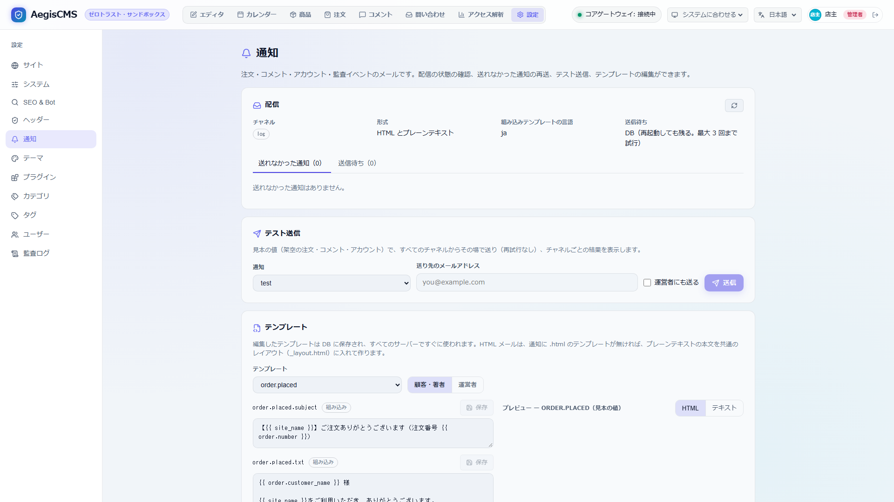

[← ドキュメント一覧に戻る](README.md)

# 通知（メール）

注文の受付・入金確認・発送・取り消しを顧客と運営者に、管理者のログインやログインのロックなどの監査イベントを運営者に、メールで知らせます（`[notifications]`）。メールは外部の SMTP サーバー（自社のメールサーバー、Amazon SES、SendGrid、Google Workspace など）から送ります。

配信方法は「チャネル」として差し替えられる作りで、メール（`email`）とサーバーのログ（`log`）が組み込みです。Slack や SMS などは、Wasm プラグインをチャネルとして加えられます（`plugin:<名前>`。[5. 配信方法を加える](#5-配信方法を加える)）。

メールはプレーンテキストと HTML の両方を送ります（[3.1](#31-html-メール)）。送信待ちは DB に保存するので、サーバーを再起動しても失われません（[4](#4-配信と信頼性)）。テスト送信・テンプレートの編集・送れなかった通知の再送は Admin Studio の **Settings › Notifications** からできます（[6](#6-admin-studio-から管理する)）。

```text
 EC（注文の作成・状態の変化）          監査ログ（ルールに合うイベント。2.1）
        │  NotificationEvent { 種類: "order.placed" / "audit.session.create", 宛先, 値 }
        ▼
 NotificationService（aegis-notify）
        │  宛先ごとにテンプレートから件名・本文（テキスト + HTML）を作る（<種類>.subject / .txt / .html）
        ▼
 送信待ち（DB の _aegis_notification_queue。宛先・チャネルごとに 1 件）
        │  ワーカーが送る。一時的な失敗は時間を空けて再試行、送れなければ「送れなかった通知」として残す
        ├──▶ email チャネル ── SMTP サーバー ──▶ 顧客 / staff_recipients
        ├──▶ log チャネル   ── サーバーのログ（aegis::notify）
        └──▶ plugin:<名前>  ── Wasm プラグインの send-notification フック ──▶ Slack / SMS など
        │
        └── 結果を監査ログに記録（notification.send）
```

---

## 1. 有効にする

```toml
[notifications]
enabled = true
channels = ["email"]
locale = "ja"                    # 組み込みテンプレートの言語（en / ja）

[notifications.email]
smtp_host = "smtp.example.com"
smtp_port = 587                  # 省略（0）なら tls に応じて 587 / 465 / 25
tls = "starttls"                 # starttls / tls / none
username = "apikey"
# password は設定ファイルに書かず、環境変数 AEGIS_SMTP_PASSWORD で渡せる
from = "Aegis Shop <shop@example.com>"
reply_to = "support@example.com"
staff_recipients = ["orders@example.com"]   # 新しい注文・取り消しの知らせ先
```

設定したら、テスト通知で SMTP サーバーへの接続と認証を確かめます。

```bash
aegis-server -c config/production.toml notify test --to you@example.com
# email: sent "【Aegis Shop】テスト通知"
```

失敗した場合は SMTP サーバーの応答（`535 Authentication failed` など）が表示されます。サーバーの起動後は Admin Studio の **Settings › Notifications** からもテスト送信できます（[6](#6-admin-studio-から管理する)）。

- 設定項目の一覧は [設定リファレンス](configuration.md#213-notifications--通知メール) を参照してください。
- SMTP サーバーの無い開発環境では `channels = ["log"]` にすると、通知の件名と本文をサーバーのログに出します。
- 本文中の URL（`site_url` / 運営者向けの管理画面の URL）は `[commerce].public_url` から作ります。注文確認ページの URL は注文したときのリクエストのホストから作ります。
- 差出人のドメインの SPF / DKIM / DMARC は SMTP サーバー側で設定してください（設定が無いと迷惑メールに分類されやすくなります）。

---

## 2. 送る通知

| 種類 | いつ | 宛先 | 主な内容 |
| --- | --- | --- | --- |
| `order.placed` | 注文の受付。`manual`（銀行振込など）・0 円の注文は注文したとき、`stripe` は支払いが済んだとき | 顧客・運営者 | 注文内容、お届け先、支払い方法の案内（支払い待ちのとき）、注文確認ページの URL（注文したときのみ） |
| `order.paid` | 管理者が入金を確認した（`manual`） | 顧客 | 入金の確認 |
| `order.shipped` | 発送した | 顧客 | 発送の知らせ。状態を変えるときのメモ（配送業者・追跡番号など）を本文に入れる |
| `order.cancelled` | 取り消した（管理者の操作・支払い期限切れ） | 顧客・運営者 | 取り消しの理由（`reason`）、支払い済みなら返金の案内 |
| `stock.low` | 注文で商品・バリエーションの在庫が閾値に達した | 運営者 | 商品名・ID、残数、閾値、注文番号 |
| `account.verify` | Admin Studio からアカウント登録を申し込んだ（[認証 7](authentication.md#7-アカウント登録)） | 申し込んだメールアドレス | 確認リンク（`verify_url`）、有効期限、ユーザー名 |
| `account.registered` | 確認リンクが開かれ、アカウントができた | 運営者 | ユーザー名・表示名・メールアドレス・ロール、承認が必要か（`pending_approval`） |
| `content.published` | 予約公開（`status: "scheduled"`）のコンテンツを、公開日時になってサーバーが公開した（[予約公開](theme_and_publishing_guide.md#予約公開スケジュール公開)） | 著者 | タイトル・種類、公開ページの URL（`content_url`）、公開予定日時 |
| `content.unpublished` | 公開中のコンテンツを、非公開日時（`unpublish_at`）になってサーバーが非公開にした（アーカイブ） | 著者 | タイトル・種類、非公開日時 |
| `comment.posted` | 承認済みのコメントが付いた（承認を待たずに公開されたとき。[コメント](comments.md)） | 著者（`[comments].notify_author`） | 投稿者の名前、本文、コメントの URL |
| `comment.pending` | 承認待ちのコメントが来た | 著者（`notify_author`）・運営者（`notify_staff`） | 投稿者の名前・メールアドレス・IP アドレス、本文、Admin Studio の **Comments** を開く URL（`moderation_url`） |
| `comment.replied` | 自分のコメントへの返信が公開された（読者の返信・Admin Studio からの返信。承認待ちの返信は承認したとき） | 返信先のコメントの投稿者（投稿時に「返信をメールで知らせる」を選んだ人だけ） | 返信した人の名前と本文、自分のコメント、返信の URL、通知を止めるリンク（`unsubscribe_url`） |
| `comment.approved` | 自分のコメントが承認された（承認待ち・スパムから Admin Studio で承認したとき） | そのコメントの投稿者（投稿時に「返信・承認をメールで知らせる」を選んだ人だけ） | 自分のコメント、コメントの URL、通知を止めるリンク（`unsubscribe_url`） |
| `forum.posted` | 掲示板に承認済みのスレッド・返信が投稿された | 運営者（`[forum].notify_staff`） | カテゴリ、スレッド名、投稿者の名前、本文、スレッドの URL（`thread_url`） |
| `forum.pending` | 掲示板に承認待ちのスレッド・返信が投稿された | 運営者（`[forum].notify_staff`） | カテゴリ、スレッド名、投稿者の名前・IP アドレス、本文、Admin Studio の **Forum** を開く URL（`moderation_url`） |
| `forum.reported` | 掲示板のスレッド・投稿が通報された | 運営者（`[forum].notify_staff`） | 通報の対象（`target_type` / `target_id`）、理由、通報元の IP アドレス、Admin Studio の **Forum** を開く URL（`moderation_url`） |
| `contact.received` | 問い合わせフォームから届いた（スパムを除く） | 運営者（`[contact].notify_staff`） | フォーム、入力されたすべての項目、IP アドレス、受信箱を開く URL（`admin_url`）（[問い合わせフォーム](contact.md#4-通知)） |
| `contact.auto_reply` | 同上 | 送信した人（フォームの `auto_reply`） | 受け付けたことと、入力した内容 |
| `newsletter.confirm` | ニュースレターの購読を申し込んだ（[ニュースレター](newsletter.md)） | 申し込んだメールアドレス | 購読を確定するリンク（`confirm_url`）、有効期限 |
| `newsletter.issue` | 管理者が公開中のコンテンツを購読者に送った | 購読者（1 人ずつ） | タイトル・要約・ページの URL（`url`）、配信を止めるリンク（`unsubscribe_url`） |
| `test` | `aegis-server notify test` | 指定したアドレス | テスト |
| `audit.<操作>` | 監査ログのイベントが `[[notifications.audit.rules]]` に合った（[2.1](#21-監査イベントの通知)） | 運営者（またはルールの `recipients`） | 操作・結果・ユーザー・IP アドレス・ブラウザ・詳細 |

- `stripe` で決済ページに進んだまま支払われなかった注文（期限切れ・失敗で取り消し）は、受付を知らせていないので取り消しも知らせません。
- `completed`（完了）は知らせません。
- `content.published` / `content.unpublished` の宛先は著者（コンテンツの `author_id` のユーザー）のメールアドレスです。著者がいない・メールアドレスが無い・無効なアカウントなら送りません。Admin Studio から手で公開した場合は送りません（公開した本人が知っているため）。
- 運営者にもすべての予約公開を知らせたい場合や、公開の失敗を知りたい場合は、監査イベントの通知（[2.1](#21-監査イベントの通知)）で `action = "content.publish"`（`outcomes = ["failure"]` で失敗だけ）を使います。
- `comment.*` の宛先の著者はコンテンツの `author_id` のユーザーです（`content.published` と同じ条件）。スパムと判定したコメントは誰にも知らせません。`comment.replied` は返信した人と返信先が同じメールアドレスなら送りません。`comment.approved` は、投稿者が通知を止めた後・Admin Studio のユーザーが書いた返信には送りません（承認を待たずに公開されたコメントにも送りません。投稿した本人がその場で見ているため）。
- `[notifications].disabled_events = ["order.shipped"]` のように、種類ごとに止められます。
- 注文確認ページのトークンはサーバーに保存していない（ハッシュのみ）ため、URL を本文に入れられるのは注文したときの `order.placed` だけです。

### 2.1 監査イベントの通知

監査ログ（[docs/audit.md](audit.md)）に記録されるイベントのうち、`[[notifications.audit.rules]]` のどれかに合うものを運営者に知らせます。ルールは上から順に見て、最初に合ったもので送ります。`[audit].enabled = true` が必要です（出力先 `sinks` の設定は問いません）。

```toml
# 管理者のログイン
[[notifications.audit.rules]]
title = "管理者がログインしました"   # 件名・本文の見出し（省略すると操作と結果から作る）
action = "session.create"
outcomes = ["success"]
roles = ["admin"]

# ログインのロック（失敗が [auth.login_rate_limit] の上限に達した）
[[notifications.audit.rules]]
action = "session.create"
details = { locked = "*" }

# 権限の無い操作。宛先を変え、1 時間に 5 通まで
[[notifications.audit.rules]]
action = "access.denied"
recipients = ["security@example.com"]
max_per_hour = 5
```

| キー | 説明 |
| --- | --- |
| `action` | 監査ログの操作（`session.create`、`access.denied`、`user.update`、`theme.switch` など。必須） |
| `outcomes` | 結果（`success` / `failure` / `denied`）。省略するとすべて |
| `roles` | 操作者のロール（`admin` など）。操作者の分からないイベント（失敗したログインなど）は、指定すると合わない |
| `details` | 監査ログの `details` の値。`"*"` はキーがあれば何でもよい |
| `title` | 件名・本文の見出し |
| `recipients` | 宛先のメールアドレス。省略すると `[notifications.email].staff_recipients` |
| `max_per_hour` | 1 時間あたりの上限（既定 20、0 で無制限）。総当たり攻撃などで通知が殺到しないように、超えた分は送らずログに警告を出す |

よく使う条件:

| 知りたいこと | 条件 |
| --- | --- |
| 管理者のログイン | `action = "session.create"`, `outcomes = ["success"]`, `roles = ["admin"]` |
| ログインのロック（ロックがかかった時点の 1 回） | `action = "session.create"`, `details = { locked = "*" }` |
| ロック中のログイン試行（試行のたび） | `action = "session.create"`, `outcomes = ["denied"]`, `details = { error = "rate_limited" }` |
| パスワードの誤り | `action = "session.create"`, `outcomes = ["failure"]`, `details = { error = "invalid_password" }` |
| 権限の無い操作（401 / 403） | `action = "access.denied"` |
| ユーザーの作成・変更・削除 | `action = "user.create"` / `"user.update"` / `"user.delete"` |
| 予約公開・予約非公開（すべて） | `action = "content.publish"` / `"content.unpublish"` |
| 予約公開の失敗 | `action = "content.publish"`, `outcomes = ["failure"]` |
| 公開サイトのテーマの切り替え | `action = "theme.switch"` |
| プラグインのエラー | `action = "plugin.error"` |

- 通知の種類は `audit.<操作>`（`audit.session.create` など）です。`disabled_events` で止められ、テンプレートは `audit.session.create.subject` → `audit.session.subject` → `audit.subject` の順に探します（組み込みは `audit` のみ）。テンプレートには監査イベント（`audit.action` / `audit.outcome` / `audit.actor` / `audit.ip` / `audit.user_agent` / `audit.details` など）と `title` を渡します。
- 通知の配信結果（`notification.send`）は通知しません（配信の失敗が通知を呼び続けないように）。
- 上限の数はサーバーのメモリ上で数えます（再起動でリセット、サーバーごと）。

---

## 3. テンプレート

件名と本文は [MiniJinja](https://docs.rs/minijinja)（Jinja2 互換）のプレーンテキストのテンプレートです。組み込みのものは `crates/aegis-notify/src/templates/<言語>/` にあります。

テンプレートは次の順に探します。

1. Admin Studio の **Settings › Notifications** で編集したもの（DB の `_aegis_settings` に `notification_template:<名前>` として保存。[6](#6-admin-studio-から管理する)）
2. `[notifications].templates_dir` のファイル
3. 組み込み（`locale` の言語）

```text
notifications/
├── order.shipped.subject         # 件名（1 行。改行は空白にまとめる）
├── order.shipped.txt             # 本文
├── order.placed.staff.subject    # 運営者向け（無ければ顧客向けと同じものを使う）
├── order.placed.staff.txt
└── _summary.txt                  # 注文内容の共通部分（）
```

```jinja
{# notifications/order.shipped.txt #}
{{ order.customer_name }} 様

ご注文 {{ order.number }} を発送しました。

{{ order.note }}




```

テンプレートで使える値:

| 値 | 内容 |
| --- | --- |
| `site_name` | サイト名（起動時の値。Admin Studio の **Settings › Site** で変えた名前があればそれ、無ければ `[theme].site_title`） |
| `site_url` / `admin_url` | `[commerce].public_url` と、その `/admin/`（未設定なら空） |
| `kind` | 通知の種類 |
| `order.number` / `order.status` / `order.created_at` / `order.paid_at` / `order.note` | 注文番号・状態・日時・管理者のメモ |
| `order.lines[]` | `title`, `sku`, `unit_price`, `quantity`, `line_total` |
| `order.adjustments[]` | 送料・割引・税（`label`, `amount`, `kind`, `code`） |
| `order.subtotal` / `order.total` / `order.currency` | 金額（通貨の最小単位の整数） |
| `order.customer_name` / `order.customer_email` / `order.shipping_address` | 顧客とお届け先（`postal_code`, `region`, `city`, `line1`, `line2`, `phone` など） |
| `order_url` | 注文確認ページ（`order.placed` を注文したときに送る場合のみ） |
| `payment_instructions` / `payment_due` | 支払い方法の案内（`[commerce.manual].instructions`）と期限（支払い待ちのとき） |
| `reason` / `was_paid` | 取り消しのきっかけ（`admin` / `expired` など）と、支払い済みだったか（`order.cancelled`） |
| `username` / `display_name` / `verify_url` / `expires_hours` | アカウント登録の確認メール（`account.verify`）: ユーザー名・表示名（無ければ空）・確認リンク・有効期限（時間） |
| `username` / `display_name` / `email` / `role` / `pending_approval` | 新しいアカウントの知らせ（`account.registered`） |
| `content.title` / `content.label` / `content.content_type` / `content.slug` / `content.id` | 予約公開・非公開の知らせ（`content.published` / `content.unpublished`）: コンテンツとその種類の表示名（スキーマの `label`） |
| `at` / `content_url` / `username` / `display_name` | 同上: 公開予定日時・非公開日時（RFC 3339、UTC）、公開ページの URL（`page` / `article` は `/{slug}`、商品は `/products/{slug}`。`[commerce].public_url` が無ければ空）、著者 |
| `comment.author_name` / `comment.author_email` / `comment.ip` / `comment.body` / `comment.created_at` / `comment.is_reply` | コメントの知らせ（`comment.posted` / `comment.pending`）: 投稿者・本文・返信かどうか。`content`・`username`・`display_name` は予約公開の知らせと同じ |
| `content_url` / `moderation_url` | 同上: コメントの位置（`…#comment-<id>`。`[commerce].public_url` が無ければ空）、Admin Studio の **Comments**（`<Admin Studio の URL>#comments`。無ければ空） |
| `name` / `comment.body` / `reply.author_name` / `reply.body` / `reply.staff` / `unsubscribe_url` | 返信の知らせ（`comment.replied`）: 宛先の名前、自分のコメント、返信（`staff` は Admin Studio からの返信）、返信通知を止めるリンク（`[commerce].public_url` が無ければ空） |
| `name` / `comment.body` / `content_url` / `unsubscribe_url` | 承認の知らせ（`comment.approved`）: 宛先の名前、自分のコメント、コメントの URL、通知を止めるリンク（返信の知らせと同じ。止めると返信・承認のどちらも届かなくなる） |
| `{{ amount \| money(order.currency) }}` | 金額の表示（`¥1,200`、`$12.50`） |

- テンプレートが無ければ種類の最後の `.` 以降を外した名前を順に探します（`audit.session.create` → `audit.session` → `audit`）。
- 本文（`.txt`）と件名はエスケープしません（プレーンテキスト）。
- `` などのタグだけの行は出力に空行を残しません（`trim_blocks`）。3 行以上続く空行は 1 行にまとめます。

### 3.1 HTML メール

`[notifications].html = true`（既定）のとき、メールはプレーンテキストと HTML の両方（`multipart/alternative`）で送ります。HTML を表示できないメールソフトではプレーンテキストが表示されます。

HTML は、種類ごとにテンプレートを書かなくても作られます。

- 件名・本文と同じ名前の `<種類>.html`（運営者向けは `<種類>.staff.html`）があればそれを使います。
- 無ければ共通のレイアウト `_layout.html` を使います。レイアウトにはプレーンテキストの本文を HTML にしたもの（`body_html`）を渡します: 空行で区切った段落を `<p>`、段落の中の改行を `<br>`、`http(s)://` の URL をリンクにし、`--` だけの行（`_footer.txt` の区切り）から後はフッター（`footer_html`）にします。
- サイトのロゴや色を変えるには `_layout.html` を、特定の通知だけデザインするには `<種類>.html` を書きます（Admin Studio か `templates_dir`）。

```jinja
{# order.shipped.html: レイアウトはそのままで、本文の前に見出しを足す #}


<h1 style="font-size:20px;margin:0 0 16px">ご注文 {{ order.number }} を発送しました</h1>
{{ body_html }}

```

| 値（`.html` のみ） | 内容 |
| --- | --- |
| `subject` / `body` | 作った件名とプレーンテキストの本文 |
| `body_html` / `footer_html` | 本文・フッターを HTML にしたもの（エスケープ済み） |
| `locale` | 組み込みテンプレートの言語（`<html lang>`） |

- `.html` のテンプレートは値を自動でエスケープします（`{{ comment.body }}` に `<script>` が入っていても文字として出ます）。エスケープ済みの値（`body_html` など）以外に `| safe` を使わないでください。
- 運営者向けの本文（`<種類>.staff.txt`）があるとき、HTML は `<種類>.staff.html` か `_layout.html` を使い、顧客向けの `<種類>.html` は使いません（本文と HTML の内容が食い違わないように）。
- スタイルはメールソフトで消されないよう、`style` 属性に書きます（`<style>` や外部の CSS は効かないメールソフトがあります）。
- プラグインのチャネルにも HTML の本文（`html`）が渡ります（メール配信 API へ送るプラグイン向け）。
- プレーンテキストだけにするには `html = false` にします。

---

## 4. 配信と信頼性

- 通知は注文の処理を待たせないよう、送信待ちに入れてから送ります。SMTP サーバーが落ちていても注文は成功します。
- **送信待ちは DB に保存します**（`_aegis_notification_queue`。`[notifications.queue].persistent = true`、既定）。宛先・チャネルごとに 1 件で、件名・本文はこのときテンプレートから作っておきます。送れたものは消します。サーバーを再起動しても送信待ち・再試行の予定は失われず、起動したサーバーが続きを送ります。
- 新しい通知はすぐに送ります。再試行の時刻は `poll_interval_secs`（既定 10 秒）ごとに確かめます。
- 一時的な失敗（接続できない、`4xx` の応答）は `max_attempts` 回まで、2 秒・8 秒・32 秒…と間隔を空けて再試行します。宛先の不備や認証の拒否（`5xx`）は再試行しません。
- 再試行しない失敗・試行回数の上限に達したものは「送れなかった通知」として残り、Admin Studio から再送・破棄できます（[6](#6-admin-studio-から管理する)）。`retention_days`（既定 7 日）を過ぎたものは自動で消します。
- 結果はチャネルごとに監査ログ `notification.send` に残します（`success` / `failure`、試行回数、エラー）。宛先のアドレスは残しません（顧客か運営者か）。Admin Studio の **Settings › Audit Logs** で `notification.send` に絞り込めます。
- **複数台のサーバー**: どのサーバーも送信待ちを見ますが、送る前に DB で送信の権利を取るので、1 件の通知を送るのは 1 台だけです。サーバー間の時計は NTP などで合わせてください。
- **送信中にサーバーが止まった場合**: その通知は 5 分後にほかのサーバー（または再起動したサーバー）が送り直します。SMTP サーバーが受け取った直後に止まった場合は、同じメールが 2 通届くことがあります（届かないよりは重複を選ぶ）。
- 送信待ちを DB に入れられなかったとき（DB の障害）は、その通知をメモリ上で送ります（再起動すると失われます）。`persistent = false` にすると常にメモリ上で送ります（以前の動作）。
- 送信待ちには本文がそのまま入ります（パスワード再設定・注文確認ページなどのリンクを含む）。DB のバックアップの扱いに注意してください。送れたものはすぐに消え、送れなかったものも `retention_days` で消えます。
- `aegis-server notify test` と Admin Studio のテスト送信は、送信待ちに入れずにその場で送ります（設定を確かめるため）。

---

## 5. 配信方法を加える

### 5.1 Wasm プラグインで加える

`send-notification` フックを持つプラグインは、そのまま通知のチャネルになります。Rust の本体を変えずに、Slack・Teams・Discord・LINE・SMS 業者の API などへの配信を加えられます。

```toml
[notifications]
enabled = true
channels = ["email", "plugin:official-order-notifier"]

[plugins]
enabled = ["official-order-notifier"]

[plugins.settings.official-order-notifier]
webhook_url = "env:SLACK_WEBHOOK_URL"
notify_on = "none"                # 注文の旧来の通知（on-order-status-changed）は止め、二重に届かないように
channel_recipients = "staff"      # 運営者向けの通知だけ（all で顧客向けも）
channel_kinds = "audit.,order.placed,order.cancelled"   # 種類の前方一致（空ならすべて）
```

- ホストはテンプレートから件名・本文を作って `send-notification` に渡します。テンプレート・再試行（`max_attempts`）・監査ログ `notification.send`（`channel: plugin:<名前>`）・監査イベントの上限（`max_per_hour`）はメールと同じです。
- プラグインは扱わない通知（宛先・種類）に `Skipped` を返します。`Skipped` は失敗ではなく、監査ログにも残りません。
- `channels` に書いたプラグインが `[plugins].enabled` に無い、またはマニフェストで `send-notification` を宣言していない場合、サーバーは起動しません。
- 動作確認は `aegis-server notify test --staff`（運営者向け。`--to` で顧客向けも）。
- プラグインの作り方は [プラグインフック 1.7](plugin_hooks.md#17-send-notification)、ABI は [ABI 仕様 4.7](plugin_abi_specification.md#47-send_notification) を参照してください。

### 5.2 Rust で加える

本体に組み込む場合は `aegis_notify::NotificationChannel` トレイトを実装します。

```rust
use aegis_notify::{Delivered, NotificationChannel, NotificationMessage, Recipient, SendError};
use async_trait::async_trait;

pub struct SmsChannel { /* API クライアントなど */ }

#[async_trait]
impl NotificationChannel for SmsChannel {
    fn name(&self) -> &str {
        "sms"
    }

    /// 送れる宛先か（送れないものは呼ばれない）
    fn accepts(&self, recipient: &Recipient) -> bool {
        matches!(recipient, Recipient::Staff)
    }

    async fn send(&self, message: &NotificationMessage) -> Result<Delivered, SendError> {
        // message.subject / message.body / message.data を使って送る
        // 一時的な失敗は SendError::temporary、再試行しない失敗は SendError::permanent
        Ok(Delivered::Sent)
    }
}
```

- 設定から選べるようにするには、`aegis_notify::ChannelKind` に種類を、`NotificationService::from_config_with_plugins` に作り方を加えます（設定項目は `NotificationsConfig` に）。
- コードからは `NotificationService::with_channels` にチャネルを渡しても使えます。
- テンプレート・再試行・監査ログはチャネルに関係なく `NotificationService` が行います。チャネルは届けることだけを担当します。

通知を出す側を増やす（会員登録の確認など）ときは、`aegis_core::Notifier` に `NotificationEvent`（種類・宛先・テンプレートに渡す値）を渡し、組み込みテンプレート（`crates/aegis-notify/src/templates/`）を加えます。テンプレートの無い種類は送りません。

### Wasm プラグインとの関係

公式プラグイン [`official-order-notifier`](commerce.md#official-order-notifierslack--webhook-通知) は 2 つの使い方ができます。

- `on-order-status-changed`: 注文の状態の変化を、ホストのテンプレートを通さずに Slack / Webhook に送る（従来の使い方）
- `send-notification`: 通知のチャネル（5.1）。監査イベントも含むすべての通知を、ホストのテンプレートの件名・本文で送る

チャネルとして使う場合は、注文が二重に届かないよう `notify_on = "none"` にしてください。

---

## 6. Admin Studio から管理する

`admin` のユーザーは **Settings › Notifications** で次のことができます。通知が無効（`[notifications].enabled = false`）なら、有効にする方法だけを表示します。



| 項目 | できること | API |
| --- | --- | --- |
| 配信 | チャネル・形式（HTML / テキスト）・送信待ちの保存先と、送信待ち・送れなかった通知の一覧（エラー・試行回数・次の試行の日時）。送れなかった通知は **再送**（最初の試行から）・**破棄** | `GET /api/v1/notifications`、`GET /api/v1/notifications/queue?status=failed`、`POST /api/v1/notifications/queue/{id}/retry`、`DELETE /api/v1/notifications/queue/{id}` |
| テスト送信 | 通知の種類と送り先（メールアドレス・運営者）を選び、見本の値（架空の注文・コメント・アカウント）でその場で送る。チャネルごとの結果（SMTP の応答など）を表示する。再試行はしない | `POST /api/v1/notifications/test` |
| テンプレート | 種類と宛先（顧客・著者 / 運営者）ごとに件名・本文・HTML を編集し、見本の値でプレビューする（保存前の内容で HTML とテキストを表示）。共通の部品（`_footer.txt`・`_summary.txt`・`_layout.html` など）も編集できる。**元に戻す** で編集を捨てる（`templates_dir` のファイルか組み込みに戻る） | `GET /api/v1/notifications/templates`、`GET` / `PUT` / `DELETE /api/v1/notifications/templates/{名前}`、`POST /api/v1/notifications/preview` |

- 編集したテンプレートは DB に保存し、すべてのサーバーですぐに使われます（イベントバスで知らせる）。保存のときに文法を確かめ、誤りがあれば保存しません。1 つのテンプレートは 60,000 バイトまでです。
- テンプレートを壊してしまった（未定義のフィルタなどでその種類の通知が作れない）場合は、プレビューにエラーが出ます。**元に戻す** で直せます。
- 編集・元に戻すは監査ログ `notification.template_update`、再送・破棄は `notification.queue_update` に残ります（[監査ログ](audit.md)）。テスト送信の結果は `notification.send` に残ります。
- 送信待ち（`pending`）のうち送っている最中のものは破棄できません。
