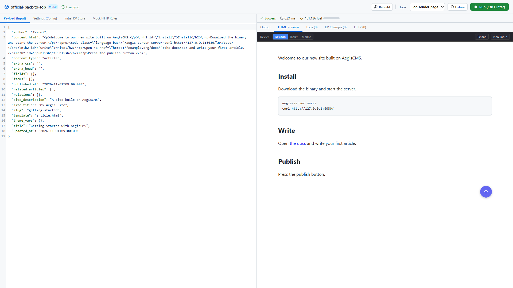
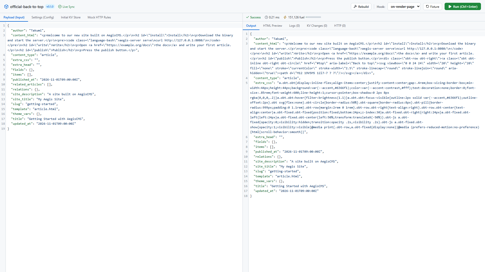

[← ドキュメント一覧に戻る](README.ja.md)

# AegisCMS プラグイン開発サーバー (`aegis-server plugin dev`) & Plugin Builder

`aegis-server plugin dev`（または `task dev:plugin -- <dir>`）は、AegisCMS の Wasm プラグインをデータベースやログイン不要で、単体で即時テスト・デバッグするための軽量開発サーバーです。

`theme dev`（Theme Builder）と同様に、プラグインの変更を監視して自動リロードし、Wasm サンドボックス内でのフック実行結果、CPU 命令数（Fuel）、ミリ秒単位の実行時間、プラグインログ（`log_info!` 等）、KVS 変更、送信 HTTP リクエスト、HTML プレビューをリアルタイムに可視化・操作できる Web UI（Plugin Builder）および REST API を提供します。

---

## 1. クイックスタート

```bash
# 既存の公式プラグインで開発サーバーを起動 (既定: http://127.0.0.1:8091)
task dev:plugin -- plugins/official-code-enhancer

# task を入れていないときは同じ意味のコマンド（独立クレート aegis-plugin-dev により初回でも数秒〜数十秒で起動）
cargo run -p aegis-plugin-dev -- plugins/official-code-enhancer

# フロントエンド開発 UI (Plugin Builder) を起動 (http://localhost:5175)
task dev:plugin-builder
```

---

## 2. API 仕様 (`/__dev/*`)

開発サーバーは以下のエンドポイントを提供します。

### 2.1 プラグイン情報の取得 (`GET /__dev/api/plugin`)

マニフェスト（`plugin.manifest.json`）、エントリポイント、Wasm ファイルサイズ、モジュールがエクスポートしている関数名一覧を返します。

```bash
curl http://127.0.0.1:8091/__dev/api/plugin
```

**レスポンス例**:
```json
{
  "manifest": {
    "name": "official-code-enhancer",
    "version": "0.1.0",
    "entrypoint": "plugin.wasm",
    "capabilities": {
      "hooks": ["transform-content-ast", "on-render-page"]
    },
    "resource_limits": {
      "max_memory_mb": 16,
      "max_fuel_units": 100000000,
      "execution_timeout_ms": 250
    }
  },
  "entrypoint": "plugin.wasm",
  "wasm_exists": true,
  "wasm_size_bytes": 1450280,
  "exports": ["memory", "allocate", "transform_content_ast", "on_render_page"],
  "updated_at": 1730424567890
}
```

### 2.2 標準モックフィクスチャ一覧 (`GET /__dev/api/fixtures`)

全フックの標準の入力を返します。値は、ホストが実際にフックへ渡す JSON そのものです（`{"post": {...}}` のような包みは付きません）。

| フック | 入力（Rust の型） |
| --- | --- |
| `on-before-save` | `PostContext` |
| `transform-content-ast` | `BlockNode` の配列 |
| `render-blocks` | `{"blocks": [BlockNode, ...]}`（結果は `{"html": ["<div>…</div>", null, ...]}`。`null` はそのプラグインが描かないブロック） |
| `on-render-page` | `PageRenderContext` |
| `calculate-order` | `OrderContext` |
| `on-order-status-changed` | `OrderStatusChange` |
| `on-content-published` | `PublishedContent` |
| `check-comment` | `CommentSubmission`（結果は `CommentVerdict`） |
| `send-notification` | `NotificationMessage` |
| `on-user-authenticated` | `UserAuthContext` |

型は `aegis-core` / `aegis-ast` にあり、各フィクスチャが型に読み込めることはテストで検査しています。

```bash
curl http://127.0.0.1:8091/__dev/api/fixtures
```

### 2.3 フックの即時テスト実行 (`POST /__dev/api/invoke`)

フック名・入力データ・初期 KV・モック HTTP ルール・動的設定値を指定して、Wasmtime 上で安全に隔離実行します。
※書き込み系エンドポイントのため、ヘッダー `x-aegis-dev: 1` が必要です。

```bash
curl -X POST http://127.0.0.1:8091/__dev/api/invoke \
  -H "x-aegis-dev: 1" \
  -H "Content-Type: application/json" \
  -d '{
    "hook": "transform-content-ast",
    "input": [
      {
        "name": "core/code",
        "attributes": { "language": "rust" },
        "text": "fn main() { println!(\"Hello\"); }"
      }
    ],
    "config": {
      "highlight_theme": "github-dark"
    }
  }'
```

**レスポンス例**:
```json
{
  "success": true,
  "output": [
    {
      "name": "core/code",
      "attributes": { "language": "rust", "data-enhanced-code": true },
      "text": "fn main() { println!(\"Hello\"); }",
      "children": []
    }
  ],
  "raw_output": "[{\"name\":\"core/code\",...}]",
  "error": null,
  "fuel_consumed": 15420,
  "duration_ms": 1.45,
  "logs": [
    {
      "level": "info",
      "message": "Highlighted 1 code block using github-dark theme",
      "timestamp": "2026-11-01T01:50:00Z"
    }
  ],
  "kv_mutations": {},
  "http_requests": []
}
```

### 2.4 KVS / HTTP 通信のモックとキャプチャ

外部 API 連携（Slack 通知など）や状態保存を行うプラグインも、実環境に影響を与えずに検証できます。

```json
{
  "hook": "on-order-status-changed",
  "input": {
    "order": { "order_id": "ord-123", "currency": "JPY", "lines": [], "subtotal": 0, "total": 0 },
    "from_status": "pending_payment",
    "to_status": "paid",
    "occurred_at": "2026-11-01T09:00:00Z"
  },
  "kv": {
    "notify_count": "5"
  },
  "mock_http": [
    {
      "url_pattern": "https://hooks.slack.com/*",
      "status": 200,
      "body": "{\"ok\":true}"
    }
  ]
}
```

実行後、`kv_mutations` に書き換えられたキーと値、`http_requests` に送信された HTTP メソッド・URL・本文が記録されて返却されます。

### 2.5 ホットリロード用ロングポーリング (`GET /__dev/version?since=<version>`)

プラグインフォルダー内のファイル更新（`plugin.wasm` の再コンパイルなど）を検知すると、即座に新しいタイムスタンプを返します。フロントエンド（Plugin Builder）の自動再実行に使用されます。

### 2.6 HTML ライブプレビュー API (`POST /__dev/api/preview`)

フロントエンド系フック（`on-render-page`, `render-blocks`, `transform-content-ast` など）の出力を受け取り、CSS・JS を埋め込んだ安全なスタンドアロン HTML ドキュメントを動的に合成して返却します。

```bash
curl -X POST http://127.0.0.1:8091/__dev/api/preview \
  -H "x-aegis-dev: 1" \
  -H "Content-Type: application/json" \
  -d '{
    "hook": "render-blocks",
    "output": ["<div class=\"cta-banner\">Special Offer!</div>"]
  }'
```

**レスポンス例**:
```json
{
  "html": "<!DOCTYPE html><html lang=\"en\"><head><meta charset=\"utf-8\"><title>Plugin Preview</title><style>...</style></head><body><div class=\"preview-wrapper\"><div class=\"rendered-blocks\"><div class=\"block-item\"><div class=\"cta-banner\">Special Offer!</div></div></div></div></body></html>"
}
```

### 2.7 ビルドトリガー API (`POST /__dev/api/build`)

プラグインフォルダーのビルドコマンドを実行し、実行結果・出力ログ（stdout/stderr）・所要時間（ms）を返却します。
ビルドコマンドは次の順に決まります。

| 優先 | 指定 | 動き |
| --- | --- | --- |
| 1 | `--build-command "<コマンド>"` | そのコマンドを実行。**成果物を `entrypoint`（`plugin.wasm`）に置くのはコマンドの役目**（例: `cargo build --target wasm32-unknown-unknown --release && cp ... plugin.wasm`） |
| 2 | マニフェストの `"dev": { "build_command": "<コマンド>" }` | 同上（プラグインごとに固定したいとき） |
| 3 | `Cargo.toml`（Rust） | `cargo build --target wasm32-unknown-unknown --release` を実行し、成功したら cdylib の成果物（`target/` の下）を `entrypoint` に**自動でコピー**する。ワークスペースのメンバーでも独立した crate でも動く（`cargo metadata` で成果物を探す）。Fuel を本番と同じ条件で測るため、リリースビルド |
| 4 | `package.json`（AssemblyScript） | `npm run asbuild`、無ければ `npm run build` |

ソース（`.rs`・`.ts` など）を保存すると、このコマンドが自動で走り、成功するとページが読み込み直されます。開発サーバーが読むのは `entrypoint` のファイルだけなので、3 以外では上のとおり `entrypoint` が更新されるコマンドにしてください（更新されないと、ビルドは成功しても表示は変わりません）。

```bash
curl -X POST http://127.0.0.1:8091/__dev/api/build \
  -H "x-aegis-dev: 1"
```

---

## 3. セキュリティ設計

開発サーバーはローカル開発用途に特化していますが、ブラウザの別タブ・悪意ある外部スクリプトからの不正操作を防ぐため、以下の防御機構を備えています。

1. **DNS リバインディング防止**: ループバック接続時、`Host` ヘッダーが `localhost` / `127.0.0.1` / `::1` であることを検証。
2. **CSRF / 不正 Fetch 防止**: `GET` / `HEAD` 以外のすべてのミューテーションリクエストで `x-aegis-dev` カスタムヘッダーを必須化。
3. **パストラバーサル防止**: ファイル API はプラグインディレクトリ配下から脱出するパス（`..` やシンボリックリンク）を遮断。
4. **プレビューサンドボックス**: Plugin Builder の HTML プレビュー iframe は `sandbox="allow-scripts allow-forms allow-popups allow-modals"` 属性で隔離され、親画面への同一オリジンアクセスを防止。

---

## 4. Plugin Builder Web UI (`plugin-builder/`)

React 19 + TypeScript + Vite + CodeMirror 6 で構築された開発用 SPA です。
`task dev:plugin-builder` で起動します（既定ポート: `5175`）。



左で入力（Payload・設定・初期 KV・HTTP モック）を編集して実行すると、右に結果・メトリクス・プレビューが出ます。結果のタブ（Output）には、フックが返した JSON がそのまま出ます。



- **フック切り替え & プリセットフィクスチャ**: マニフェストに定義されたフックを選択すると、即座に対応する標準テストデータがセットされます。
- **コードエディタ (CodeMirror 6)**: Payload (JSON)、Settings (Config)、Initial KV Store、Mock HTTP Rules をタブで切り替え編集可能。Ctrl+Enter で即時実行。
- **メトリクスバー**: Fuel 消費量（最大リソース制限に対するパーセンテージ）と実行時間 (ms) をプログレスバーで可視化。
- **HTML ライブプレビュー**: `on-render-page` などの実行結果を iframe 上で Desktop / Tablet / Mobile サイズに切り替えてリアルタイム描画。別タブ表示やリロードにも対応。
- **ワンクリック Rebuild**: 画面上の「Rebuild」ボタンから Wasm 再ビルドを実行。ビルドエラー時はログを即座に確認可能。
