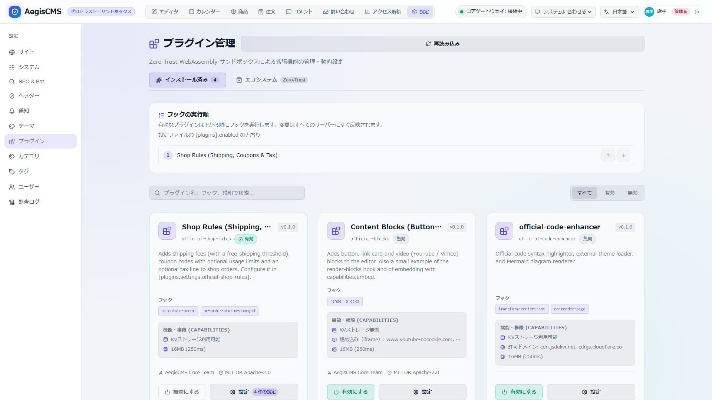

[← ドキュメント一覧に戻る](README.md)

# AegisCMS WebAssembly (Wasm) プラグイン開発公式ガイド

本ドキュメントは、AegisCMS のゼロ・トラスト WebAssembly プラグインを開発するための公式ガイドです。

> [!TIP]
> 利用可能なフック・ホスト API・マニフェスト項目の詳細と現状の制限事項は [プラグインフック & ホスト API リファレンス](./plugin_hooks.md) を参照してください。

---

## 1. アーキテクチャと実行モデル

AegisCMS のプラグインシステムは、**Bytecode Alliance 製 WebAssembly ランタイム `Wasmtime`** をベースに構築されています。

- **完全なメモリ空間の分離**: ホストとゲスト（Wasm）間で物理メモリは共有されず、サンドボックス内で厳格に隔離実行されます。
- **リソース制限 (Fuel & Timeout)**:
  - **Fuel（命令数クォータ）**: 無限ループや DoS 攻撃を防ぐため、Wasm 命令の実行可能上限数を設定。
  - **非同期タイムアウト**: 指定ミリ秒（例: 250ms）を超過したプラグイン実行を強制停止。
- **ケイパビリティベースの権限管理 (Zero-Trust)**:
  - プラグインは `plugin.manifest.json` で宣言した権限（ネットワークドメイン、KVSネームスペース、フック）以外の一切の操作が遮断されます。

---

## 2. クイックスタート: Rust 公式 SDK

公式 SDK [`aegis-plugin-sdk`](file:///d:/projects/cms/crates/aegis-plugin-sdk) を利用することで、低レイヤーのポインタ操作やメモリ管理を意識することなく、型安全にプラグインを開発できます。

### 2.1 テンプレートの準備

公式テンプレート [`sdk/templates/rust`](../sdk/templates/rust) をコピーして新しいプラグインを作成できます。

`Cargo.toml` の設定:

```toml
[package]
name = "my-aegis-plugin"
version = "0.1.0"
edition = "2021"

[lib]
crate-type = ["cdylib", "rlib"]

[dependencies]
aegis-plugin-sdk = { git = "https://github.com/takumi-mr/AegisCMS", tag = "v0.1.0" }
serde = { version = "1.0", features = ["derive"] }
serde_json = "1.0"
```

### 2.2 プラグインマニフェスト (`plugin.manifest.json`)

```json
{
  "name": "my-aegis-plugin",
  "version": "0.1.0",
  "entrypoint": "plugin.wasm",
  "capabilities": {
    "network": {
      "allowed_domains": ["api.slack.com", "hooks.slack.com"]
    },
    "storage": {
      "kv_namespace": "my_plugin_state"
    },
    "hooks": [
      "on-before-save",
      "transform-content-ast"
    ]
  },
  "resource_limits": {
    "max_memory_mb": 16,
    "max_fuel_units": 100000000,
    "execution_timeout_ms": 250
  }
}
```

### 2.3 プラグインコードの実装 (`src/lib.rs`)

```rust
use aegis_plugin_sdk::prelude::*;

#[derive(Default)]
pub struct MyPlugin;

#[aegis_plugin]
impl Plugin for MyPlugin {
    /// 記事保存前フック
    fn on_before_save(&mut self, mut post: PostContext) -> Result<PostContext> {
        log_info!("Processing post: '{}'", post.title);

        // タイトルの加工や検証
        post.title = post.title.trim().to_string();

        // 外部 API へのアクセス権限を検証
        if net::is_allowed("https://hooks.slack.com/services/xxx") {
            log_info!("Slack webhook is authorized");
        }

        // 検証: Err を返すと保存は中止され、API は 422 でメッセージを返す
        if post.title.is_empty() {
            return Err(PluginError::Rejected("title is required".to_string()));
        }

        // KVS に状態を永続化
        kv::set("last_saved_slug", &post.slug)?;

        // 返した title / slug / blocks_json が保存される
        Ok(post)
    }

    /// コンテンツ AST 変換フック
    fn transform_content_ast(&mut self, mut blocks: Vec<BlockNode>) -> Result<Vec<BlockNode>> {
        // 見出しブロックにカスタム属性を注入
        for block in blocks.iter_mut() {
            if block.name == "core/heading" {
                block.set_attribute("enhanced", serde_json::json!(true));
            }
        }

        // 記事末尾にカスタムブロックを追加
        // このフックは保存済み（変換済み）のブロックにも再適用される（再保存・エディタのプレビュー）ため、
        // 追加済みなら追加しない（冪等にする）
        let footer = "— Processed by MyPlugin —";
        if !blocks.iter().any(|b| b.text.as_deref() == Some(footer)) {
            blocks.push(BlockNode::paragraph(footer));
        }

        Ok(blocks)
    }
}
```

---

### 2.4 設定項目を宣言する

プラグインの設定値を Admin Studio で入力できるようにするには、マニフェストの `settings` で項目（キー・種類・名前・既定値・範囲）を宣言します。種類は文字列・複数行・URL・数値・オン/オフ・選択肢・色で、保存時にサーバーが値を検査します。宣言の形式は [フック & ホスト API 3.3](./plugin_hooks.md#33-設定項目-settings)、動く例は [`plugins/official-page-toc`](../plugins/official-page-toc) にあります。値は `config::get("key")` で文字列として読みます。

### 2.5 本文のカスタムブロックを足す

マニフェストの `blocks` でブロックと入力欄を宣言し、`capabilities.hooks` に `render-blocks` を加えて `Plugin::render_blocks` を実装すると、Admin Studio のエディタに自分のブロックを足せます。宣言の形式とフックの決まりは [フック & ホスト API 1.10 / 3.1](./plugin_hooks.md#110-render-blocks)、動く例は公式プラグイン [`plugins/official-blocks`](../plugins/official-blocks) にあります。

## 3. ホスト API リファレンス

SDK からインポートして使用できる標準 API です。

### 3.1 ロギング API (`aegis_plugin_sdk::log`)

ホスト側の `tracing` 構造化ロガーへ直接メッセージを送信します。プラグイン名が自動的にタグ付けされます。

```rust
log_debug!("Debug message: {}", value);
log_info!("Information: {}", message);
log_warn!("Warning encountered");
log_error!("Critical error occurred");
```

### 3.2 ネットワーク検証 API (`aegis_plugin_sdk::net`)

アクセス先 URL が `plugin.manifest.json` の `capabilities.network.allowed_domains` に含まれているかを事前に検証します。

```rust
if net::is_allowed("https://api.github.com/repos/xxx") {
    // 許可されているドメイン
} else {
    // 権限違反
}
```

### 3.3 Key-Value ストレージ API (`aegis_plugin_sdk::kv`)

プラグイン専用のネームスペース（`capabilities.storage.kv_namespace`）内にデータを永続化します。他のプラグインのデータと物理的に隔離されます。

```rust
// 文字列の保存
kv::set("config_key", "config_value")?;

// 任意のシリアライズ可能構造体 (JSON) の保存
kv::set_json("user_state", &my_state_struct)?;
```

---

## 4. テストとデプロイ

### 4.1 ネイティブ単体テスト (高速・モック内蔵)

SDK にはネイティブ実行用のモックが組み込まれているため、Wasm にビルドすることなく通常の `cargo test` で単体テストを実行できます。

```bash
cargo test
```

### 4.2 WebAssembly バイナリのビルド

```bash
# ターゲットのインストール (初回のみ)
rustup target add wasm32-unknown-unknown

# 最適化ビルド
cargo build --target wasm32-unknown-unknown --release

# バイナリの配置 (Linux / macOS)
cp target/wasm32-unknown-unknown/release/<plugin_name>.wasm plugin.wasm
# バイナリの配置 (Windows)
copy target\wasm32-unknown-unknown\release\<plugin_name>.wasm plugin.wasm
```

### 4.3 AegisCMS へのデプロイ

AegisCMS サーバーの `plugins/<name>/` ディレクトリ（`<name>` はマニフェストの `name`）を作成し、以下を配置します。



```
plugins/my-plugin/
  ├── plugin.manifest.json   # "name": "my-plugin"
  └── plugin.wasm
```

配置しただけでは読み込まれません。Admin Studio のプラグイン画面で有効にする（再起動不要）か、設定ファイルの `[plugins].enabled` に名前を追加してサーバーを再起動すると有効になります（フックは有効化リストの順に実行）。

```toml
[plugins]
enabled = ["my-plugin"]
```

`aegis plugin list` でインストール済みのプラグインと有効・無効、読み込めない理由を確認できます。有効にしたプラグインが読み込めない場合はサーバーが起動しません（[プラグインフックリファレンス](plugin_hooks.md#5-インストールと有効化)）。

---

## 5. マルチ言語サポートと公式テンプレート

AegisCMS では、Rust だけでなくフロントエンド/Web 開発者に親和性の高い **AssemblyScript**、および Go 開発者向けの **TinyGo** に対応した公式 SDK および開発テンプレートを提供しています。

| 言語 | 公式パッケージ | 公式テンプレート | パッケージソース | 配布エコシステム (GitHub 中心) |
|---|---|---|---|---|
| **Rust** | `aegis-plugin-sdk` | [`sdk/templates/rust`](../sdk/templates/rust) | [`crates/aegis-plugin-sdk`](../crates/aegis-plugin-sdk) | GitHub (Git 依存 `git = "https://github.com/takumi-mr/AegisCMS"`) |
| **AssemblyScript** | `@takumi-mr/plugin-sdk` | [`sdk/templates/assemblyscript`](../sdk/templates/assemblyscript) | [`sdk/assemblyscript`](../sdk/assemblyscript) | GitHub Packages (`npm.pkg.github.com`) |
| **TinyGo** | `github.com/takumi-mr/AegisCMS/sdk/tinygo` | [`sdk/templates/tinygo`](../sdk/templates/tinygo) | [`sdk/tinygo`](../sdk/tinygo) | GitHub (Go Modules `go get github.com/...`) |

---

### 5.1 AssemblyScript プラグイン開発

AssemblyScript は TypeScript のサブセット構文から WebAssembly を直接出力する言語です。GitHub Packages でホストされる公式 npm パッケージ `@takumi-mr/plugin-sdk` を利用してプラグインを構築できます。

```bash
# テンプレートディレクトリへの移動
cd sdk/templates/assemblyscript

# 依存パッケージ (@takumi-mr/plugin-sdk, assemblyscript) のインストール
npm install

# Wasm ビルド (plugin.wasm を出力)
npm run build
```

ライフサイクルフックの実装例 (`assembly/index.ts`):
```typescript
import {
  allocate as sdkAllocate,
  readString,
  writeString,
  writeError,
  log,
  parsePostContext,
  serializePostContext,
  PostContext
} from "@takumi-mr/plugin-sdk/assembly/index";

export function allocate(len: i32): i32 {
  return sdkAllocate(len);
}

export function on_before_save(ptr: i32, len: i32): i64 {
  const post = parsePostContext(readString(ptr, len));

  if (post.title.trim().length === 0) {
    return writeError("Post title cannot be empty");
  }

  log.info("Processing post: " + post.title);
  post.title = "[AS-Plugin] " + post.title;

  return writeString(serializePostContext(post));
}
```

`asconfig.json` の `"use": ["abort=~lib/@takumi-mr/plugin-sdk/assembly/host/abort"]` は削除しないでください。AssemblyScript は既定で実行時エラーの処理に `env.abort` をインポートしますが、ホストは `host` モジュールしか提供しないため、この設定が無いとプラグインを読み込めません（SDK の `abort` に差し替えて、ログを出してから停止します）。

詳細は [`sdk/templates/assemblyscript/README.md`](../sdk/templates/assemblyscript/README.md) を参照してください。

---

### 5.2 TinyGo プラグイン開発

TinyGo は Go 構文から極めて小さな Wasm バイナリを生成するコンパイラです。公式 Go モジュール `github.com/takumi-mr/AegisCMS/sdk/tinygo` を用いてホスト API を型安全に呼び出せます。

```bash
# テンプレートディレクトリへの移動
cd sdk/templates/tinygo

# Wasm ビルド (plugin.wasm を出力)
tinygo build -target=wasm-unknown -opt=z -no-debug -o plugin.wasm main.go
```

ライフサイクルフックの実装例 (`main.go`):
```go
package main

import (
	"encoding/json"
	"strings"

	"github.com/takumi-mr/AegisCMS/sdk/tinygo"
)

//export allocate
func allocate(size int32) uintptr {
	return sdk.Allocate(size)
}

//export on_before_save
func on_before_save(ptr int32, length int32) int64 {
	inBytes := sdk.ReadBytes(uintptr(ptr), length)

	var post sdk.PostContext
	if err := json.Unmarshal(inBytes, &post); err != nil {
		return sdk.WriteError("Invalid PostContext payload")
	}

	if strings.TrimSpace(post.Title) == "" {
		return sdk.WriteError("Post title cannot be empty")
	}

	sdk.LogInfo("[TinyGo] Processing: " + post.Title)
	post.Title = "[TinyGo] " + post.Title

	return sdk.WriteJSON(&post)
}

func main() {}
```

ターゲットは `wasm-unknown`（TinyGo 0.30+）を使ってください。`wasi` ターゲットはホストが提供しない WASI の関数をインポートするため読み込めません。`wasm-unknown` のモジュールがエクスポートする `_initialize`（ランタイムとグローバル変数の初期化）は、ホストがフックより先に呼び出します。

詳細は [`sdk/templates/tinygo/README.md`](../sdk/templates/tinygo/README.md) を参照してください。

---

## 6. 低水準 ABI 仕様 (共通仕様書)

すべての言語で共通の WebAssembly メモリレイアウト、ポインタパッキング規約、ホスト API インポート・エクスポート仕様、JSON スキーマについては、以下の仕様書を参照してください。

👉 **[AegisCMS WebAssembly プラグイン 共通 ABI 仕様書 (`docs/plugin_abi_specification.md`)](./plugin_abi_specification.md)**

---

## 7. SDK パッケージの GitHub リリースと配布手順 (Publishing Guide)

全言語の SDK は GitHub を中心として配布・リリースされます。

### 7.1 GitHub Actions による自動リリース (推奨・CI 手動トリガー)

リポジトリには手動実行可能な GitHub Actions ワークフロー [`.github/workflows/release-sdk.yml`](../.github/workflows/release-sdk.yml) が用意されています。

1. GitHub リポジトリの **Actions** タブを開きます。
2. 左メニューの **Release Plugin SDKs** を選択します。
3. **Run workflow** をクリックし、以下を指定して実行します：
   - **Target SDK**: `all` / `assemblyscript` / `tinygo` / `rust`
   - **Release version**: `0.1.0` などの SemVer バージョン

ワークフローが自動的に以下を実施します：
- **AssemblyScript**: パッケージ検証後に `npm.pkg.github.com`（GitHub Packages）へ `@takumi-mr/plugin-sdk` を公開。
- **TinyGo**: Go Modules 用 Git タグ（`sdk/tinygo/v<version>`）を作成・プッシュ。
- **Rust**: リポジトリタグ（`v<version>`）を作成・プッシュし、GitHub Release を生成。

---

### 7.2 各言語の手動リリース手順

CI ワークフローを使わずにローカルから手動でリリースする場合の手順です。

#### 1. Rust SDK (`GitHub Git 依存`)

Cargo は GitHub リポジトリを直接指定して依存関係を解決できるため、crates.io へのアップロードは不要です。

1. **バージョンの Git タグを作成・プッシュ**:
   ```bash
   git tag v0.1.0
   git push origin v0.1.0
   ```
2. **利用側の設定**:
   利用者は `Cargo.toml` に以下を記述するだけでインストールできます。内部マクロクレート（`aegis-plugin-macros`）も同一リポジトリから Cargo が自動解決します。
   ```toml
   [dependencies]
   aegis-plugin-sdk = { git = "https://github.com/takumi-mr/AegisCMS", tag = "v0.1.0" }
   ```

#### 2. AssemblyScript SDK (`GitHub Packages`)

1. **事前検証**:
   ```bash
   task sdk:pack:dry-run
   ```
2. **GitHub Packages への公開**:
   Personal Access Token (PAT, `write:packages` 権限) を用いて公開します。
   ```bash
   cd sdk/assemblyscript
   npm publish
   ```
3. **利用側の設定**:
   利用者のプロジェクトルートまたは `~/.npmrc` にレジストリを設定して `npm install` します。
   ```text
   @takumi-mr:registry=https://npm.pkg.github.com
   ```
   ```bash
   npm install @takumi-mr/plugin-sdk
   ```

#### 3. TinyGo SDK (`Go Modules`)

Go Modules では、サブディレクトリに配置されたモジュールは `<ディレクトリパス>/<バージョン>` 形式の Git タグで公開・解決されます。

1. **静的検証**:
   ```bash
   task sdk:check
   ```
2. **Git タグの付与とプッシュ**:
   ```bash
   git tag sdk/tinygo/v0.1.0
   git push origin sdk/tinygo/v0.1.0
   ```
3. **利用側の設定**:
   利用者は標準の `go get` でインストールできます。
   ```bash
   go get github.com/takumi-mr/AegisCMS/sdk/tinygo@v0.1.0
   ```
