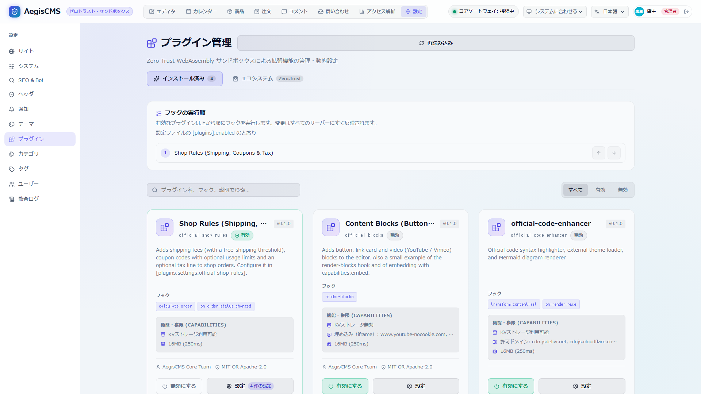

[← ドキュメント一覧に戻る](README.md)

# AegisCMS WebAssembly (Wasm) プラグイン開発公式ガイド

本ドキュメントは、AegisCMS のゼロ・トラスト WebAssembly プラグインを開発するための公式ガイドです。

> [!TIP]
> 利用可能なフック・ホスト API・マニフェスト項目の詳細と現状の制限事項は [プラグインフック & ホスト API リファレンス](./plugin_hooks.md) を参照してください。

---

## 1. アーキテクチャと実行モデル

AegisCMS のプラグインシステムは、**Bytecode Alliance 製 WebAssembly ランタイム `Wasmtime`** をベースに構築されています。

- **完全なメモリ空間の分離**: ホストとゲスト（Wasm）間で物理メモリは共有されず、サンドボックス内で厳格に隔離実行されます。
- **リソース制限 (Fuel & Timeout)**:
  - **Fuel（命令数クォータ）**: 無限ループや DoS 攻撃を防ぐため、Wasm 命令の実行可能上限数を設定。
  - **非同期タイムアウト**: 指定ミリ秒（例: 250ms）を超過したプラグイン実行を強制停止。
- **ケイパビリティベースの権限管理 (Zero-Trust)**:
  - プラグインは `plugin.manifest.json` で宣言した権限（ネットワークドメイン、KVSネームスペース、フック）以外の一切の操作が遮断されます。

---

## 2. クイックスタート: Rust 公式 SDK

公式 SDK [`aegis-plugin-sdk`](../crates/aegis-plugin-sdk) を利用することで、低レイヤーのポインタ操作やメモリ管理を意識することなく、型安全にプラグインを開発できます。

### 2.1 テンプレートの準備とひな形生成 (`task plugin:new`)

新しいプラグインを作成する際は、`task plugin:new` コマンドを使用することで、名前の置換や独立クレート設定（`[workspace]`）を自動で行うひな形を瞬時に生成できます。

```bash
# 通常の Rust プラグインを作成
task plugin:new -- my-plugin

# 本文ブロックプラグインを作成 (sdk/templates/rust-block ベース)
task plugin:new -- my-note --type block

# AssemblyScript または TinyGo のプラグインを作成
task plugin:new -- my-as-plugin --lang as
task plugin:new -- my-go-plugin --lang tinygo
```

手動でコピーする場合は、公式テンプレート [`sdk/templates/rust`](../sdk/templates/rust) をコピーして新しいプラグインを作成できます。本文に置けるブロックを足すプラグインなら、ブロック用のテンプレート [`sdk/templates/rust-block`](../sdk/templates/rust-block) と、手順書 [最初のブロックプラグインを作る](plugin_block_tutorial.md) から始めてください。

`Cargo.toml` の設定:

```toml
[package]
name = "my-aegis-plugin"
version = "0.1.0"
edition = "2021"

[lib]
crate-type = ["cdylib", "rlib"]

[dependencies]
# このリポジトリの plugins/<name>/ に置くとき（テンプレートと同じ）
aegis-plugin-sdk = { path = "../../crates/aegis-plugin-sdk", version = "0.2.0" }
# リポジトリの外に置くとき: tag には使う版のタグ（https://github.com/takumi-mr/AegisCMS/releases）を書く
# aegis-plugin-sdk = { git = "https://github.com/takumi-mr/AegisCMS", tag = "v0.2.0" }
serde = { version = "1.0", features = ["derive"] }
```

- `#[aegis_plugin]` が使う `serde_json` は SDK が再エクスポートしているので、`Cargo.toml` に書く必要はありません。プラグインのコードで `serde_json::json!` などを直接使うなら、`serde_json = "1.0"` を足すか、`use aegis_plugin_sdk::serde_json;` と書きます。
- **このリポジトリの中に新しいプラグインを作るときの注意**: ルートの `Cargo.toml` は `plugins/official-*` と `sdk/templates/rust` をワークスペースのメンバーにしています。メンバーでない新しいフォルダーで `cargo build` すると `error: current package believes it's in a workspace when it's not` で失敗します。次のどちらかにしてください。
  - 公式プラグインとして取り込むなら、ルートの `Cargo.toml` の `[workspace] members` に `"plugins/<name>"` を足す（`cargo test --workspace` / `clippy --workspace` の対象にもなる）。
  - 個人のプラグインなら、プラグインの `Cargo.toml` の末尾に空の `[workspace]` を書き、独立した crate にする。このときは PR 前の確認（`cargo fmt --check`・`cargo clippy -- -D warnings`・`cargo test`）をプラグインのフォルダーの中で自分で実行する。

### 2.2 プラグインマニフェスト (`plugin.manifest.json`)

```json
{
  "name": "my-aegis-plugin",
  "version": "0.1.0",
  "entrypoint": "plugin.wasm",
  "abi_version": 2,
  "capabilities": {
    "network": {
      "allowed_domains": ["api.slack.com", "hooks.slack.com"]
    },
    "storage": {
      "kv_namespace": "my_plugin_state"
    },
    "hooks": [
      "on-before-save",
      "transform-content-ast"
    ]
  },
  "resource_limits": {
    "max_memory_mb": 16,
    "max_fuel_units": 100000000,
    "execution_timeout_ms": 250
  }
}
```

### 2.3 プラグインコードの実装 (`src/lib.rs`)

```rust
use aegis_plugin_sdk::prelude::*;

#[derive(Default)]
pub struct MyPlugin;

#[aegis_plugin]
impl Plugin for MyPlugin {
    /// 記事保存前フック
    fn on_before_save(&mut self, mut post: PostContext) -> Result<PostContext> {
        log_info!("Processing post: '{}'", post.title);

        // タイトルの加工や検証
        post.title = post.title.trim().to_string();

        // 外部 API へのアクセス権限を検証
        if net::is_allowed("https://hooks.slack.com/services/xxx") {
            log_info!("Slack webhook is authorized");
        }

        // 検証: Err を返すと保存は中止され、API は 422 でメッセージを返す
        if post.title.is_empty() {
            return Err(PluginError::Rejected("title is required".to_string()));
        }

        // KVS に状態を永続化
        kv::set("last_saved_slug", &post.slug)?;

        // 返した title / slug / blocks_json が保存される
        Ok(post)
    }

    /// コンテンツ AST 変換フック
    fn transform_content_ast(&mut self, mut blocks: Vec<BlockNode>) -> Result<Vec<BlockNode>> {
        // 見出しブロックにカスタム属性を注入
        for block in blocks.iter_mut() {
            if block.name == "core/heading" {
                block.set_attribute("enhanced", serde_json::json!(true));
            }
        }

        // 記事末尾にカスタムブロックを追加
        // このフックは保存済み（変換済み）のブロックにも再適用される（再保存・エディタのプレビュー）ため、
        // 追加済みなら追加しない（冪等にする）
        let footer = "— Processed by MyPlugin —";
        if !blocks.iter().any(|b| b.text.as_deref() == Some(footer)) {
            blocks.push(BlockNode::paragraph(footer));
        }

        Ok(blocks)
    }
}
```

---

### 2.4 設定項目を宣言する

プラグインの設定値を Admin Studio で入力できるようにするには、マニフェストの `settings` で項目（キー・種類・名前・既定値・範囲）を宣言します。種類は文字列・複数行・URL・数値・オン/オフ・選択肢・色で、保存時にサーバーが値を検査します。宣言の形式は [フック & ホスト API 3.3](./plugin_hooks.md#33-設定項目-settings)、動く例は [`plugins/official-page-toc`](../plugins/official-page-toc) にあります。値は `config::get("key")` で文字列として読みます。

### 2.5 本文のカスタムブロックを足す

マニフェストの `blocks` でブロックと入力欄を宣言し、`capabilities.hooks` に `render-blocks` を加えて `Plugin::render_blocks` を実装すると、Admin Studio のエディタに自分のブロックを足せます。宣言の形式とフックの決まりは [フック & ホスト API 1.10 / 3.1](./plugin_hooks.md#110-render-blocks)、動く例は公式プラグイン [`plugins/official-blocks`](../plugins/official-blocks) にあります。

## 3. ホスト API リファレンス

SDK からインポートして使用できる標準 API です。

### 3.1 ロギング API (`aegis_plugin_sdk::log`)

ホスト側の `tracing` 構造化ロガーへ直接メッセージを送信します。プラグイン名が自動的にタグ付けされます。

```rust
log_debug!("Debug message: {}", value);
log_info!("Information: {}", message);
log_warn!("Warning encountered");
log_error!("Critical error occurred");
```

### 3.2 ネットワーク検証 API (`aegis_plugin_sdk::net`)

アクセス先 URL が `plugin.manifest.json` の `capabilities.network.allowed_domains` に含まれているかを事前に検証します。

```rust
if net::is_allowed("https://api.github.com/repos/xxx") {
    // 許可されているドメイン
} else {
    // 権限違反
}
```

### 3.3 Key-Value ストレージ API (`aegis_plugin_sdk::kv`)

プラグイン専用のネームスペース（`capabilities.storage.kv_namespace`）内にデータを永続化します。他のプラグインのデータと物理的に隔離されます。

```rust
// 文字列の保存
kv::set("config_key", "config_value")?;

// 任意のシリアライズ可能構造体 (JSON) の保存
kv::set_json("user_state", &my_state_struct)?;
```

---

## 4. テストとデプロイ

### 4.1 ネイティブ単体テスト (高速・モック内蔵)

SDK にはネイティブ実行用のモックが組み込まれているため、Wasm にビルドすることなく通常の `cargo test` で単体テストを実行できます。

```bash
cargo test
```

### 4.2 WebAssembly バイナリのビルド

```bash
# ターゲットのインストール (初回のみ)
rustup target add wasm32-unknown-unknown

# 最適化ビルド
cargo build --target wasm32-unknown-unknown --release

# バイナリの配置 (Linux / macOS)
cp target/wasm32-unknown-unknown/release/<plugin_name>.wasm plugin.wasm
# バイナリの配置 (Windows)
copy target\wasm32-unknown-unknown\release\<plugin_name>.wasm plugin.wasm
```

### 4.3 プラグイン開発サーバーでの即時検証 (`task dev:plugin`)

コンパイル後の plugin.wasm と plugin.manifest.json は、実サーバーや DB を起動することなく、開発サーバーでフックの動作、CPU 命令数（Fuel）、実行時間、ログ、KVS/HTTP の挙動を即時検証できます（詳細は [プラグイン開発サーバー (plugin_dev_server.md)](plugin_dev_server.md) 参照）。

```bash
# プラグイン開発サーバーの起動 (ポート 8091)
task dev:plugin -- plugins/my-plugin
# task を入れていないときは、同じ意味のコマンド
cargo run -p aegis-server -- plugin dev plugins/my-plugin
```

開発サーバーは独立クレート `aegis-plugin-dev` に分離されているため、初回でも数秒〜数十秒で高速に起動します。

```bash
# コアサーバー全体を経由しない直接起動コマンド
cargo run -p aegis-plugin-dev -- plugins/my-plugin
```

### 4.4 AegisCMS へのデプロイ

AegisCMS サーバーの `plugins/<name>/` ディレクトリ（`<name>` はマニフェストの `name`）を作成し、以下を配置します。



```
plugins/my-plugin/
  ├── plugin.manifest.json   # "name": "my-plugin"
  └── plugin.wasm
```

配置しただけでは読み込まれません。Admin Studio のプラグイン画面で有効にする（再起動不要）か、設定ファイルの `[plugins].enabled` に名前を追加してサーバーを再起動すると有効になります（フックは有効化リストの順に実行）。

```toml
[plugins]
enabled = ["my-plugin"]
```

`aegis-server plugin list` でインストール済みのプラグインと有効・無効、読み込めない理由を確認できます。有効にしたプラグインが読み込めない場合はサーバーが起動しません（[プラグインフックリファレンス](plugin_hooks.md#5-インストールと有効化)）。

---

## 5. マルチ言語サポートと公式テンプレート

AegisCMS では、Rust だけでなくフロントエンド/Web 開発者に親和性の高い **AssemblyScript**、および Go 開発者向けの **TinyGo** に対応した公式 SDK および開発テンプレートを提供しています。

| 言語 | 公式パッケージ | 公式テンプレート | パッケージソース | 配布エコシステム (GitHub 中心) |
|---|---|---|---|---|
| **Rust** | `aegis-plugin-sdk` | [`sdk/templates/rust`](../sdk/templates/rust) | [`crates/aegis-plugin-sdk`](../crates/aegis-plugin-sdk) | GitHub (Git 依存 `git = "https://github.com/takumi-mr/AegisCMS"`) |
| **AssemblyScript** | `@takumi-mr/plugin-sdk` | [`sdk/templates/assemblyscript`](../sdk/templates/assemblyscript) | [`sdk/assemblyscript`](../sdk/assemblyscript) | GitHub Packages (`npm.pkg.github.com`) |
| **TinyGo** | `github.com/takumi-mr/AegisCMS/sdk/tinygo` | [`sdk/templates/tinygo`](../sdk/templates/tinygo) | [`sdk/tinygo`](../sdk/tinygo) | GitHub (Go Modules `go get github.com/...`) |

---

### 5.1 AssemblyScript プラグイン開発

AssemblyScript は TypeScript のサブセット構文から WebAssembly を直接出力する言語です。GitHub Packages でホストされる公式 npm パッケージ `@takumi-mr/plugin-sdk` を利用してプラグインを構築できます。

```bash
# テンプレートディレクトリへの移動
cd sdk/templates/assemblyscript

# 依存パッケージ (@takumi-mr/plugin-sdk, assemblyscript) のインストール
npm install

# Wasm ビルド (plugin.wasm を出力)
npm run build
```

ライフサイクルフックの実装例 (`assembly/index.ts`):
```typescript
import {
  allocate as sdkAllocate,
  readString,
  writeString,
  writeError,
  log,
  parsePostContext,
  serializePostContext,
  PostContext
} from "@takumi-mr/plugin-sdk/assembly/index";

export function allocate(len: i32): i32 {
  return sdkAllocate(len);
}

export function on_before_save(ptr: i32, len: i32): i64 {
  const post = parsePostContext(readString(ptr, len));

  if (post.title.trim().length === 0) {
    return writeError("Post title cannot be empty");
  }

  log.info("Processing post: " + post.title);
  post.title = "[AS-Plugin] " + post.title;

  return writeString(serializePostContext(post));
}
```

`asconfig.json` の `"use": ["abort=~lib/@takumi-mr/plugin-sdk/assembly/host/abort"]` は削除しないでください。AssemblyScript は既定で実行時エラーの処理に `env.abort` をインポートしますが、ホストは `host` モジュールしか提供しないため、この設定が無いとプラグインを読み込めません（SDK の `abort` に差し替えて、ログを出してから停止します）。

詳細は [`sdk/templates/assemblyscript/README.md`](../sdk/templates/assemblyscript/README.md) を参照してください。

---

### 5.2 TinyGo プラグイン開発

TinyGo は Go 構文から極めて小さな Wasm バイナリを生成するコンパイラです。公式 Go モジュール `github.com/takumi-mr/AegisCMS/sdk/tinygo` を用いてホスト API を型安全に呼び出せます。

```bash
# テンプレートディレクトリへの移動
cd sdk/templates/tinygo

# Wasm ビルド (plugin.wasm を出力)
tinygo build -target=wasm-unknown -opt=z -no-debug -o plugin.wasm main.go
```

ライフサイクルフックの実装例 (`main.go`):
```go
package main

import (
	"encoding/json"
	"strings"

	"github.com/takumi-mr/AegisCMS/sdk/tinygo"
)

//export allocate
func allocate(size int32) uintptr {
	return sdk.Allocate(size)
}

//export on_before_save
func on_before_save(ptr int32, length int32) int64 {
	inBytes := sdk.ReadBytes(uintptr(ptr), length)

	var post sdk.PostContext
	if err := json.Unmarshal(inBytes, &post); err != nil {
		return sdk.WriteError("Invalid PostContext payload")
	}

	if strings.TrimSpace(post.Title) == "" {
		return sdk.WriteError("Post title cannot be empty")
	}

	sdk.LogInfo("[TinyGo] Processing: " + post.Title)
	post.Title = "[TinyGo] " + post.Title

	return sdk.WriteJSON(&post)
}

func main() {}
```

ターゲットは `wasm-unknown`（TinyGo 0.30+）を使ってください。`wasi` ターゲットはホストが提供しない WASI の関数をインポートするため読み込めません。`wasm-unknown` のモジュールがエクスポートする `_initialize`（ランタイムとグローバル変数の初期化）は、ホストがフックより先に呼び出します。

詳細は [`sdk/templates/tinygo/README.md`](../sdk/templates/tinygo/README.md) を参照してください。

---

### 5.3 言語別フック & ホスト API 対応状況一覧

AegisCMS の公式 SDK は、Rust だけでなく AssemblyScript および TinyGo においても全ライフサイクルフックとホスト API を型安全に利用できます。

| フック名 | 契機・用途 | Rust (`aegis-plugin-sdk`) | AssemblyScript (`@takumi-mr/plugin-sdk`) | TinyGo (`sdk/tinygo`) |
|---|---|---|---|---|
| `on-before-save` | 記事保存前検証・タイトル加工 | `Plugin::on_before_save` | `parsePostContext`, `serializePostContext` | `RunHook`, `PostContext` |
| `transform-content-ast` | 記事 AST の構文走査・変換 | `Plugin::transform_content_ast` | `readHookJson`, `writeJson` | `RunHook`, `[]BlockNode` |
| `on-render-page` | 公開 HTML への CSS/JS/広告/目次注入 | `Plugin::on_render_page`, `InjectedScript` | `parsePageRenderContext`, `serializePageRenderContext`, `InjectedScript` | `RunHook`, `PageRenderContext`, `InlineScript`, `ExternalScript` |
| `calculate-order` | カート・注文金額計算（送料・割引） | `Plugin::calculate_order` | `OrderContext`, `writeOrderResult` | `RunHook`, `OrderContext`, `OrderAdjustment` |
| `on-order-status-changed` | 注文状態変更通知（Webhook連携など） | `Plugin::on_order_status_changed` | `OrderStatusChange`, `writeOk` | `RunNotificationHook`, `OrderStatusChange` |
| `send-notification` | 通知配信（Slack/メール/外部連携） | `Plugin::send_notification` | `NotificationMessage`, `writeDelivery`, `writeDeliveryError` | `RunDeliveryHook`, `NotificationMessage`, `Delivery` |
| `on-content-published` | 記事公開通知（外部配信・SNS） | `Plugin::on_content_published` | `PublishedContent`, `writeOk` | `RunNotificationHook`, `PublishedContent` |
| `check-comment` | コメント投稿前のスパム検査 | `Plugin::check_comment` | `CommentSubmission`, `CommentVerdict`, `writeVerdict` | `RunCheckCommentHook`, `CommentSubmission`, `CommentVerdict` |
| `render-blocks` | カスタムブロックの HTML 描画 | `Plugin::render_blocks` | `readBlocks`, `writeBlocksHtml`, `BlockNode` | `RunRenderBlocksHook`, `BlockNode`, `HTML` |

#### ホスト API 対応一覧

| ホスト API | 用途 | Rust | AssemblyScript | TinyGo |
|---|---|---|---|---|
| ログ出力 (`host.log`) | サンドボックスからのデバッグログ | `log_info!`, `log_warn!`, `log_error!` | `log.info`, `log.warn`, `log.error` | `LogInfo`, `LogWarn`, `LogError` |
| 設定値取得 (`config_get`) | `[plugins.settings.<plugin>]` の読み取り | `config_get`, `config_get_or` | `config.get`, `config.getOr` | `ConfigGet`, `ConfigGetOr` |
| KVS (`kv_get`, `kv_set`) | 永続キーバリューストア | `kv_get`, `kv_set` | `kv.get`, `kv.set` | `KVGet`, `KVSet` |
| HTTP 通信 (`http_fetch`) | 許可ドメインへの外部リクエスト | `http_fetch`, `http_post_json` | `http.fetch`, `HttpRequest.postJson` | `HTTPFetch`, `NewHTTPPostJSON` |

---

### 5.4 カスタムブロック（`render-blocks`）の実装

Admin Studio や公開サイトでカスタムブロックを描画するフックです。複数ブロックがまとめて渡されるため、入力ブロックと同じ順序・同じ長さの HTML 配列を返します（描画しないブロックは `null` / `nil`）。

#### AssemblyScript 実装例 (`assembly/index.ts`)

```typescript
import {
  allocate as sdkAllocate,
  readBlocks,
  writeBlocksHtml,
  writeError,
  BlockNode,
} from "@takumi-mr/plugin-sdk/assembly/index";

export function allocate(len: i32): i32 {
  return sdkAllocate(len);
}

export function render_blocks(ptr: i32, len: i32): i64 {
  const blocks = readBlocks(ptr, len);
  if (blocks === null) return writeError("Invalid render-blocks payload");

  const htmlList = new Array<string | null>(blocks.length);
  for (let i = 0; i < blocks.length; ++i) {
    const block = blocks[i];
    if (block.name === "my-plugin/note") {
      const text = block.attributes.get("text").asString();
      htmlList[i] = `<aside class="my-note"><p>${text}</p></aside>`;
    } else {
      htmlList[i] = null;
    }
  }
  return writeBlocksHtml(htmlList);
}
```

#### TinyGo 実装例 (`main.go`)

```go
package main

import (
	"strings"
	"github.com/takumi-mr/AegisCMS/sdk/tinygo"
)

//export allocate
func allocate(size int32) uintptr {
	return sdk.Allocate(size)
}

//export render_blocks
func render_blocks(ptr int32, length int32) int64 {
	return sdk.RunRenderBlocksHook(ptr, length, func(blocks []sdk.BlockNode) ([]*string, error) {
		results := make([]*string, len(blocks))
		for i, block := range blocks {
			if block.Name == "my-plugin/note" {
				text, _ := block.Attributes["text"].(string)
				html := "<aside class=\"my-note\"><p>" + strings.TrimSpace(text) + "</p></aside>"
				results[i] = sdk.HTML(html)
			} else {
				results[i] = nil
			}
		}
		return results, nil
	})
}

func main() {}
```

> [!TIP]
> 全フック（コマース、通知、コメント、ブロック、ページ描画）の実装を含むサンプルコードは、以下を参照してください。
> - AssemblyScript: [`sdk/examples/assemblyscript-hooks`](../sdk/examples/assemblyscript-hooks)
> - TinyGo: [`sdk/tinygo/examples/hooks`](../sdk/tinygo/examples/hooks)

---

### 5.5 ページ描画（`on-render-page`）と構造化したスクリプト注入 (ABI 2)

公開ページの `<head>` に `<script>` を足すときは、`extra_head` や `append_content` に生の `<script>` タグを書かず（ホストが除去します）、`scripts`（`InjectedScript`）に追加します。外部スクリプトのホストはマニフェストの `capabilities.csp.script_domains`、インラインスクリプトは `capabilities.inline_scripts: true` で宣言します（詳細は [CSP 設計書の 4](csp.md#4-プラグインの-abi破壊的変更)）。

#### AssemblyScript 実装例 (`assembly/index.ts`)

```typescript
import {
  readString,
  writeString,
  parsePageRenderContext,
  serializePageRenderContext,
  InjectedScript,
} from "@takumi-mr/plugin-sdk/assembly/index";

export function on_render_page(ptr: i32, len: i32): i64 {
  const ctx = parsePageRenderContext(readString(ptr, len));
  ctx.extra_css += ".my-banner { padding: 8px; }";
  if (ctx.content_length > 0) {
    ctx.append_content = "<aside class=\"my-banner\">Thank you for reading</aside>";
  }
  ctx.scripts.push(InjectedScript.inline("window.__myPlugin = true;"));
  ctx.scripts.push(
    InjectedScript.external("https://cdn.example.com/widget.js")
      .asyncLoad()
      .deferred()
      .withConsent("analytics"),
  );
  return writeString(serializePageRenderContext(ctx));
}
```

#### TinyGo 実装例 (`main.go`)

```go
//export on_render_page
func on_render_page(ptr int32, length int32) int64 {
	return sdk.RunHook(ptr, length, "PageRenderContext", func(ctx *sdk.PageRenderContext) error {
		ctx.ExtraCSS += ".my-banner { padding: 8px; }"
		if ctx.ContentLength > 0 {
			ctx.AppendContent = "<aside class=\"my-banner\">Thank you for reading</aside>"
		}
		ctx.Scripts = append(
			ctx.Scripts,
			sdk.InlineScript("window.__myPlugin = true;"),
			sdk.ExternalScript("https://cdn.example.com/widget.js").
				Async().
				Deferred().
				WithConsent("analytics"),
		)
		return nil
	})
}
```

---

## 6. 低水準 ABI 仕様 (共通仕様書)

すべての言語で共通の WebAssembly メモリレイアウト、ポインタパッキング規約、ホスト API インポート・エクスポート仕様、JSON スキーマについては、以下の仕様書を参照してください。

👉 **[AegisCMS WebAssembly プラグイン 共通 ABI 仕様書 (`docs/plugin_abi_specification.md`)](./plugin_abi_specification.md)**

---

## 7. SDK パッケージの GitHub リリースと配布手順 (Publishing Guide)

全言語の SDK は GitHub を中心として配布・リリースされます。

### 7.1 release-please による自動リリース (推奨)

バージョンの上げ方・タグ・CHANGELOG は release-please が Conventional Commits から自動で行います（詳細は [versioning.md](versioning.md)）。

- **Rust SDK**（`crates/aegis-plugin-sdk`）はコアと同じバージョンです。タグは `v<version>`。
- **AssemblyScript SDK** と **TinyGo SDK** は個別のバージョンです。タグはそれぞれ `sdk-assemblyscript-v<version>`、`sdk/tinygo/v<version>`（Go モジュールの規約）。

`main` に出る **リリース PR** をマージすると、タグと GitHub Release が作られます。AssemblyScript SDK は続けて [`.github/workflows/release-sdk.yml`](../.github/workflows/release-sdk.yml) で `npm.pkg.github.com`（GitHub Packages）に公開され、TinyGo SDK はタグがそのまま配布になります。

公開に失敗したときは、Actions の **Release Plugin SDKs** を **Run workflow** で再実行できます（`ref` にタグを指定すると、そのバージョンを公開します）。

---

### 7.2 各言語の手動リリース手順

CI ワークフローを使わずにローカルから手動でリリースする場合の手順です。

#### 1. Rust SDK (`GitHub Git 依存`)

Cargo は GitHub リポジトリを直接指定して依存関係を解決できるため、crates.io へのアップロードは不要です。

1. **バージョンの Git タグを作成・プッシュ**:
   ```bash
   git tag vX.Y.Z   # 例: v0.2.0
   git push origin vX.Y.Z
   ```
2. **利用側の設定**:
   利用者は `Cargo.toml` に以下を記述するだけでインストールできます。内部マクロクレート（`aegis-plugin-macros`）も同一リポジトリから Cargo が自動解決します。
   ```toml
   [dependencies]
   aegis-plugin-sdk = { git = "https://github.com/takumi-mr/AegisCMS", tag = "v0.2.0" }
   ```

#### 2. AssemblyScript SDK (`GitHub Packages`)

1. **事前検証**:
   ```bash
   task sdk:pack:dry-run
   ```
2. **GitHub Packages への公開**:
   Personal Access Token (PAT, `write:packages` 権限) を用いて公開します。
   ```bash
   cd sdk/assemblyscript
   npm publish
   ```
3. **利用側の設定**:
   利用者のプロジェクトルートまたは `~/.npmrc` にレジストリを設定して `npm install` します。
   ```text
   @takumi-mr:registry=https://npm.pkg.github.com
   ```
   ```bash
   npm install @takumi-mr/plugin-sdk
   ```

#### 3. TinyGo SDK (`Go Modules`)

Go Modules では、サブディレクトリに配置されたモジュールは `<ディレクトリパス>/<バージョン>` 形式の Git タグで公開・解決されます。

1. **静的検証**:
   ```bash
   task sdk:check
   ```
2. **Git タグの付与とプッシュ**:
   ```bash
   git tag sdk/tinygo/v0.1.0
   git push origin sdk/tinygo/v0.1.0
   ```
3. **利用側の設定**:
   利用者は標準の `go get` でインストールできます。
   ```bash
   go get github.com/takumi-mr/AegisCMS/sdk/tinygo@v0.1.0
   ```
