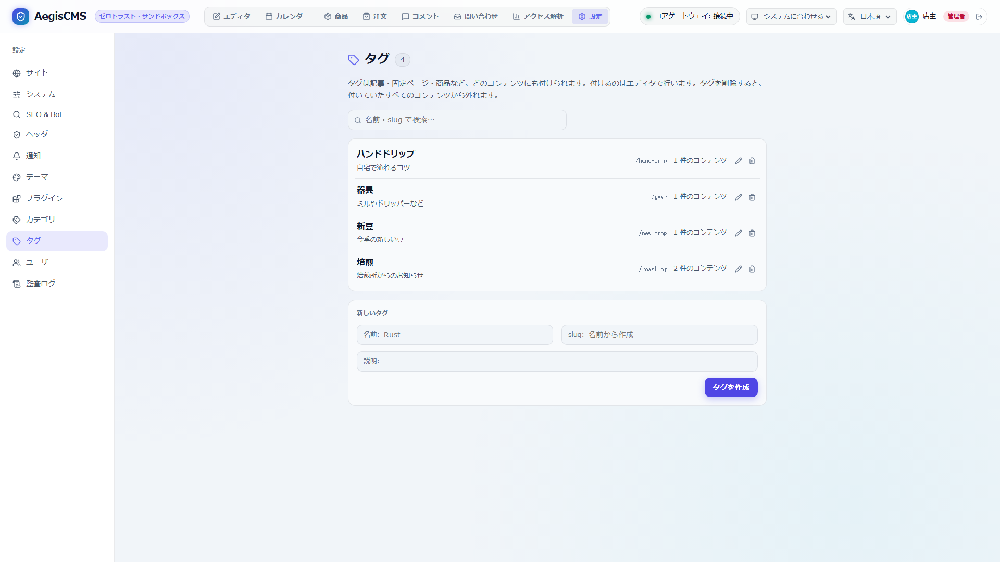

[← Back to the documentation index](README.md)

**English** | [日本語](tags.ja.md)

# Tags

Tags that can be attached to **any kind of content**, such as articles, static pages, and products (`[tags]`). A tag is an independent item with a name, slug, and description; you create it first and then choose to attach it to content (for pages on the public site, see [§6](#6-public-site)).

The feature lives in the `aegis-tags` crate, and the tables are `_aegis_tags` (tags) and `_aegis_content_tags` (the links between tags and content). The link is `(content_type, content_id, tag_id)`, so it does not depend on the kind of content. It is built the same way as comments (`_aegis_comments`).

---

## 1. Settings

Enabled by default.

```toml
[tags]
enabled = true
max_per_content = 20   # how many can be attached to one content item (1–100)
```

With `enabled = false`, the API returns `404`, and "Settings → Tags" in Admin Studio and the editor's tag field disappear. Attached tags remain in the DB. For the list of settings, see the [Configuration reference](configuration.md#221-tags--tags).

## 2. Tag Rules

- **Name**: up to 50 characters. Leading and trailing whitespace is trimmed and consecutive whitespace is collapsed into one. **It is case-insensitive**, and tags with the same name cannot be created (`409`).
- **Slug**: ASCII lowercase letters, digits, and hyphens (up to 64 characters). Duplicates are not allowed (`409`). If omitted when creating, it is made from the name (`Rust Lang` → `rust-lang`). For names with no ASCII alphanumerics (such as Japanese only), the slug is `tag-` plus a random value, so decide it yourself if you want to use it in a URL.
- **Update**: if you omit the slug, it **stays as it is** (changing the name does not change the URL).
- **Delete**: deleting a tag detaches it from all content that had it. When content is deleted, that content's tag links are removed too (even with `[tags].enabled = false`).
- **Description**: up to 500 characters; can be omitted.

## 3. Admin Studio



- **Settings → Tags**: a list (by name, 25 at a time, search by name or slug), the number of content items attached, and create, edit, and delete. Creating and changing require `editor` or above; viewing is for everyone.
- **Editor (articles, static pages) and product editing**: in the "Tags" field, type a name to find and attach an existing tag. If no tag matches, you can create one on the spot and attach it (`editor` or above). Tags are saved **when the content is saved** (even if saving the tags alone fails, the content save is not rolled back).
- **Content list (Articles / Pages)**: the "Tag" dropdown at the top filters content that has a specific tag (the tag's slug or ID; for a nonexistent tag, an empty list is shown).

## 4. API

For authorization, listing and reading need `viewer` or above, and creating, updating, deleting, and attaching/detaching need `editor` or above.

| Method and path                                 | Description                                                                                                                                                                                  |
| ----------------------------------------------- | -------------------------------------------------------------------------------------------------------------------------------------------------------------------------------------------- |
| `GET /api/v1/tags?q=&limit=&offset=`            | A list of tags (ascending by name). `q` is a substring match on name and slug, and `limit` is 50 by default and 200 at most. Each tag includes `usage`, the number of content items attached |
| `POST /api/v1/tags`                             | Create. `{"name": "Rust", "slug": "rust", "description": "…"}` (`slug` and `description` can be omitted). `201`                                                                              |
| `PUT /api/v1/tags/{id}`                         | Change the name, slug, and description. `name` is required, and if `slug` is omitted it stays as is                                                                                          |
| `DELETE /api/v1/tags/{id}`                      | Delete. `204`                                                                                                                                                                                |
| `GET /api/v1/contents/{type}/{slug_or_id}/tags` | The content's tags (ascending by name)                                                                                                                                                       |
| `PUT /api/v1/contents/{type}/{slug_or_id}/tags` | Replace the content's tags. `{"tag_ids": ["…"]}` (empty detaches all; duplicates are merged into one; nonexistent tags and a count over `max_per_content` return `400`)                      |
| `GET /api/v1/contents/{type}?tag={slug_or_id}`  | Tag filtering of the content list. Specify the tag's slug or ID. Returns `404` when `[tags].enabled = false`                                                                                 |

Errors are returned with an English `error` ([Implementation conventions](../CLAUDE.md#1a-実装規約)).

## 5. Audit Log and Backups

- Audit log: `tag.create` / `tag.update` / `tag.delete` (creating, changing, and deleting tags) and `content.tags` (changing a content's tags; records the list of tag slugs).
- Backups: they go into `database/tags.json` and `database/content_tags.json` and come back on restore (if a slug overlaps with another tag, it is an error even with an overwrite option).

## 6. Public Site

When `[tags].enabled = true`, the following pages are added to the public site. With `[tags].enabled = false`, all of them are `404`.

| URL                     | Description                                                                                                                                                                                                                 |
| ----------------------- | --------------------------------------------------------------------------------------------------------------------------------------------------------------------------------------------------------------------------- |
| `/tags/{slug}`          | **Published** articles, static pages, and products (when e-commerce is enabled) with that tag, newest publication date first. `?page=N` pages through them (`[theme].posts_per_page` at a time). The template is `tag.html` |
| `/tags`                 | A list of tags that have one or more published content items (by name) and their counts. The template is `tags.html`                                                                                                        |
| `/tags/{slug}/feed.xml` | The Atom feed of **articles** with that tag (static pages and products are not included)                                                                                                                                    |
| `/sitemap.xml`          | Includes `/tags` and the pages of tags that have published content                                                                                                                                                          |

- **Article, static page, and product pages**, and each article in article lists (top, `/articles`, categories), get their tags in `fields.tags`. Each tag has `id`, `slug`, `name`, `description`, and `url` (the tag's page, including `base_path`). If the schema has a field named `tags`, that one takes priority and `fields.tags` is not overwritten.
- **The built-in templates** (`tag.html`, `tags.html`), the built-in article and static page templates, and the `article.html` of the 5 bundled themes output links to the tags (`rel="tag"`). In your own theme you can write:

```html

<ul>
  
  <li><a href="{{ tag.url }}" rel="tag">{{ tag.name }}</a></li>
  
</ul>

```

- **Cache**: pages have the dependency tags `tag-<id>` (and `tag-<slug>`). Changing a tag's name or slug, deleting it, or attaching/detaching it to content clears the `[cdn]` cache (Cache-Tag) of that tag's page, feed, list, sitemap, and the pages that display the tag.
- **How lists are fetched**: the tag page reads published content per kind and then filters by tag and sorts (the same method as the category article list). At a scale beyond tens of thousands of published content items, consider moving the filtering to SQL.
- **No collision with pages**: `/tags` takes precedence over a static page's `/{slug}`, so with `[tags].enabled = true`, a static page whose slug is `tags` is not displayed.

## 7. Related Features

- **Site search**: tag filtering is possible with `GET /api/v1/search?q=...&tag={slug}` ([Site search](search.md)).
- **Admin Studio**: tag filtering in the content list (Articles / Pages) is supported.
