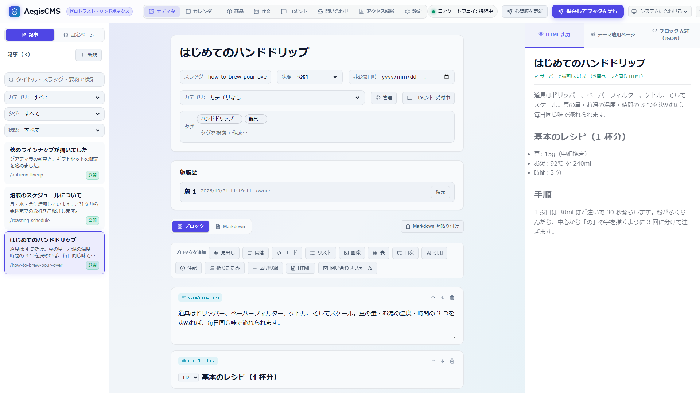
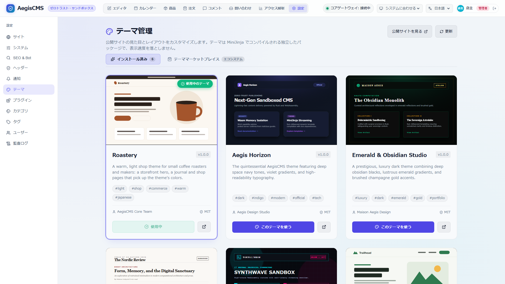

[← Back to the documentation index](README.md)

**English** | [日本語](theme_and_publishing_guide.ja.md)

# AegisCMS Content Publishing & Theme Engine Development Guide

Explains AegisCMS's Public Publishing Engine, the theme engine (MiniJinja), and the specification for dynamic theme rewriting by plugins.

> The steps for building a theme (directory layout, `theme.json`, variables per template, CSS and smartphone support, how to check) are collected in the [Theme authoring guide](./theme_authoring_guide.md).

---

## 1. Public Routing Architecture

AegisCMS safely hosts the Headless API Gateway, the Admin Studio admin screen, and a fast public frontend website in a single binary.

| Path / route                    | What is served                               | Notes                                                                                                                                                                            |
| ------------------------------- | -------------------------------------------- | -------------------------------------------------------------------------------------------------------------------------------------------------------------------------------- |
| `GET /`                         | The public top page                          | Switched with `[theme].front_page`: `posts` (default; the article list `index.html`, paged with `?page=N`), `template` (the theme's `front.html`), `page:<slug>` (a static page) |
| `GET /articles`                 | The article list                             | Rendered with the template `index.html`. `[theme].posts_per_page` at a time, paged with `?page=N` (out of range is 404)                                                          |
| `GET /category/{slug}`          | A category's article list                    | Rendered with the template `category.html`. Filtered by the article's relation field to `category` (`category_id`). Paging as above                                              |
| `GET /feed.xml`                 | An Atom feed of new articles                 | The latest 20. A `<link>` for auto-discovery is put in each page's `<head>`                                                                                                      |
| `GET /category/{slug}/feed.xml` | An Atom feed of a category's articles        | Same as above                                                                                                                                                                    |
| `GET /articles/{slug}`          | An article detail page                       | Rendered with the template `article.html` (only `status == "published"` is public)                                                                                               |
| `GET /{slug}`                   | A static page or article detail              | Rendered with the template `page.html` or `article.html`                                                                                                                         |
| `GET /theme/assets/*`           | Theme-specific static assets (CSS/JS/images) | Served faster than `themes/{active}/assets/`                                                                                                                                     |
| `GET /admin`, `/admin/*`        | The Admin Studio admin SPA                   | The Vite + React admin client                                                                                                                                                    |
| `GET /api/v1/*`                 | REST API Gateway                             | Schemas, content CRUD, storage, authentication                                                                                                                                   |
| `GET /uploads/*`                | Local storage assets                         | Serving uploaded images and media                                                                                                                                                |

### Zero-Trust Publication Control

- Content in the draft state (`status: "draft"`), awaiting review (`status: "pending"`), waiting for scheduled publication (`status: "scheduled"`), and archived (`status: "archived"`) is never shown at the public endpoints (`/`, `/articles/{slug}`, `/{slug}`, `/category/{slug}`, `/feed.xml`, `/products`), and the `404 Not Found` template is safely rendered.
- After deterministic HTML generation by `HtmlRenderer`, the article body passes transparently through Cloudflare's `lol-html` streaming rewriter (`StreamingHtmlRewriter`), which guarantees automatic `rel="noopener noreferrer"` on external links and forced `loading="lazy"` / `decoding="async"` on images.

### Scheduled Publishing



- If you save with `status: "scheduled"` and a publication date and time `published_at` (RFC 3339, with time zone), the server automatically makes it `published` at that time. In Admin Studio, choose "Scheduled" as the status in the editor or product form and enter the publication date and time.

    ```bash
    curl -X POST http://localhost:8080/api/v1/contents/article \
      -H "Authorization: Bearer $TOKEN" -H "Content-Type: application/json" \
      -d '{"title": "New product announcement", "slug": "new-product", "status": "scheduled",
           "published_at": "2026-11-01T09:00:00+09:00", "blocks": []}'
    ```

- The publication time is normalized and stored in UTC (e.g. `2026-11-01T00:00:00Z`), and after publication it stays as the article's `published_at` (publication date).
- The server checks the scheduled times every 30 seconds, so publication is delayed by up to about 30 seconds from the specified time. Content whose time arrived while the server was stopped is published at the first check after startup.
- If `published_at` is missing or unreadable, it is `400 Bad Request`. Specifying a past time publishes immediately (`published`, with the publication time being the time of saving). In statuses other than `scheduled`, `published_at` is ignored.
- If you change the time or revert to draft before publication, that takes priority (publishing is done only "while it is still scheduled at the same time", so even with several servers it is not published twice).
- Publication by schedule is recorded in the audit log `content.publish` (with no operator) ([Audit log](audit.md)).
- If notifications (`[notifications]`) are enabled, the author is notified by email of the publication (`content.published`; [Notifications 2](notifications.md#2-notifications-sent)).

### Unpublishing on a Schedule (Time-Limited Publication)

- For content that is published (`status: "published"`) or scheduled (`status: "scheduled"`), you can set an unpublish date and time `unpublish_at` (RFC 3339, with time zone). Use it for campaign information, time-limited sale products, and so on.
- `unpublish_at` must always be later than the publication time (the scheduled `published_at` or the current time) (specifying a past time or one at or before the publication time gives `400 Bad Request`). When reverted to draft (`draft`), `unpublish_at` is cleared automatically.
- **Defensive check at request time**: the public endpoints (`/`, `/articles/{slug}`, `/products`, etc.) immediately treat content as 404 once `unpublish_at <= now` at the time of the request, without waiting for the scheduler's periodic run (30-second interval).
- **Archiving by the scheduler**: every 30 seconds the server detects published content whose time has come and updates it automatically to `status = "archived"`. This unpublishing is recorded in the audit log `content.unpublish` (with no operator), and if notifications are enabled the author is told (`content.unpublished`).

### Review (Approving and Publishing a Contributor's Draft)

When you want to separate the person who writes from the person who decides on publication, make the writer's role `contributor` ([Roles](authentication.md#roles-and-api-permissions)). A contributor can only put their own content into draft (`draft`) and awaiting review (`pending`), and publication is done by `editor` and above. There is no workflow with freely composable stages (legal → editor-in-chief → publish, etc.).

| Operation        | Who                                      | How to save                                                                                 | Notification ([Notifications 2](notifications.md#2-notifications-sent)) |
| ---------------- | ---------------------------------------- | ------------------------------------------------------------------------------------------- | ----------------------------------------------------------------------- |
| Request a review | Contributor (`editor` and above can too) | Save with the status **awaiting review** (`pending`)                                        | `content.submitted` to all active users of `editor` and above           |
| Approve          | `editor` and above                       | Save the item awaiting review as **published** (`published`) or **scheduled** (`scheduled`) | `content.approved` to the author                                        |
| Send back        | `editor` and above                       | Save the item awaiting review as **draft** (`draft`)                                        | `content.returned` to the author                                        |
| Withdraw         | The author                               | Save one's own item awaiting review as draft                                                | None                                                                    |

- When saving with a status change, you can attach a note (`review_note`; up to 2,000 characters). The note is not stored in the content; it remains in the version history's note, the audit log, and notifications. In Admin Studio, a note field appears when you change the status.

    ```bash
    # An editor sends it back (the body is the same as a normal update)
    curl -X PUT http://localhost:8080/api/v1/contents/article/spring-sale \
      -H "Authorization: Bearer $TOKEN" -H "Content-Type: application/json" \
      -d '{"title": "Spring sale", "slug": "spring-sale", "status": "draft",
           "review_note": "Please fix the price notation", "blocks": []}'
    ```

- A contributor can change or delete only items where they are the author and that are draft or awaiting review (the same for restoring versions and attaching/detaching tags). Trying to publish, schedule, or archive, or to change someone else's, gives `403`.
- **Changing something published**: a contributor can put changes to their own published content up for review by saving it with the status `pending` (`draft` or `published` gives `403`; deleting, restoring versions, and attaching/detaching tags are not possible). The published version remains, and visitors do not see the changes until approved (a slug change is also not reflected until approval). Approval (saving as `published`) publishes the new version, and sending back (saving as `draft`) leaves the published version. The publication time stays as the original. The same applies when an editor saves a published item as `pending`. To take it off public pages, use `draft` (when not awaiting review) or `archived`.
- While changes to a published item are up for review, `unpublish_at` (scheduled unpublish) does not take effect on the published version. To take it off at a deadline, have an editor archive it before approval.
- Review events are recorded in the audit log `content.review` (`details.decision` is `submitted` / `approved` / `returned` / `withdrawn`) ([Audit log](audit.md)).
- In Admin Studio, the number awaiting review appears above the editor's list, and pressing it filters to only those awaiting review. The link in notification emails (`admin_url` + `#review`) opens the same list.

### Publishing Schedule Calendar

- From the "Calendar" tab at the top of Admin Studio (`GET /api/v1/schedule`), you can check scheduled publications, scheduled unpublications, and published content in a monthly calendar grid and a timeline agenda format.
- Open the detail modal from a date cell or an agenda card to change or clear the unpublish time directly (quick edit), or jump straight to the editor to fix the body.
- Filtering by content type (articles, products, etc.) and by schedule kind (scheduled publication, with an unpublish schedule, published) is also supported.

---

## 2. Template Engine (MiniJinja)

AegisCMS uses `MiniJinja`, a Jinja2 / Django-compatible template engine that is fast, lightweight, and robust.

### Three-Layer Fallback for Loading Templates

When resolving a template, it is searched in the following order of priority:

1. **Plugin / dynamically registered templates (highest priority)**:
    - In-memory templates that Wasm plugins or runtime code registered with `ThemeEngine::register_template(name, content)`.
2. **File system theme (`themes/{active}/templates/`)**:
    - HTML templates placed in the theme directory on disk.
3. **Built-in default templates (fallback)**:
    - Polished modern-design templates compiled into the core binary (`base.html`, `index.html`, `article.html`, `page.html`, `404.html`). They work beautifully on their own even if no additional files exist.

### Standard Template Layout

- `base.html`: HTML5 skeleton, responsive, modern typography, navigation bar, footer, ambient background glow, and CSS/Head injection slots for plugins.
- `index.html`: extends `base.html`. Hero section, card grid, category badges, publication date, excerpts.
- `article.html`: extends `base.html`. Breadcrumbs, title, meta information, prose body styles, previous/next navigation.
- `page.html`: layout for static pages.
- `404.html`: the 404 error page.

### Global Variables Available in Templates

- `base_path`: the path where the site is published (`[server].base_path`, e.g. `/cms`; an empty string when published at the root). Prefix links within the site and theme assets with it, as in `{{ base_path }}/articles/{{ item.slug }}` and `{{ base_path }}/theme/assets/style.css`. Without it things work when published at the root, but links break under a subpath ([Configuration reference](./configuration.md#42-publishing-under-a-subpath)).
- `admin_url`: the URL of the link to Admin Studio (including `base_path` and `[server].admin_path`, e.g. `/cms/admin/`). **It is an empty string when the setting is not to show it**, so wrap it like `<a href="{{ admin_url }}">...</a>` (writing `/admin/` directly breaks the link on sites that changed `admin_path`, and also exposes a path you wanted to hide). The condition for showing it is `[theme].show_admin_link`.
- `locale`: the display language (`[theme].locale`, `en` / `ja`; used for `<html lang="{{ locale }}">`).
- `t("key", n=count, name=value)`: a function that returns built-in text in the display language (e.g. `{{ t("nav.home") }}` → `Home` / `ホーム`). The keys are in the table in `crates/aegis-theme/src/messages.rs`. Passing `n` selects singular or plural (`key.one` / `key.other`), and the value is inserted (HTML-escaped) at the position of `{name}`. The result is an escaped string, and some contain `<strong>` and so on. Write your own text directly in the theme.
- `show_powered_by`: whether to show a notice such as "Powered by AegisCMS" in the footer (`[theme].show_powered_by`, default `true`). In your own themes, too, wrap the notice in `...`.
- `pagination` (`index.html` only): `page` (1-based), `per_page`, `total_items`, `total_pages`, `prev_url` / `next_url` (including `base_path`; empty if none). Example:

```jinja

<nav>
  <a href="{{ pagination.prev_url }}" rel="prev">Newer</a>
  Page {{ pagination.page }} / {{ pagination.total_pages }}
  <a href="{{ pagination.next_url }}" rel="next">Older</a>
</nav>

```

### Template Cache

Compiled templates are reused and reloaded when the theme is switched (`PUT /api/v1/themes/active`) and when a plugin registers a template. When checking while editing theme files, set `[theme].reload_templates = true` to reload on every render (leave it `false` in production).

---

## 3. Theme Rewriting Mechanism by Plugins

In AegisCMS, plugins can rewrite a web page's theme and context dynamically and programmatically.

### 3.1 Rewriting Context and Styles with the `on-render-page` Hook

Just before a page is rendered, the plugin's `on_render_page` hook is called, and it can receive and change a `PageRenderContext`.

- In addition to displaying public pages, it is also called for Admin Studio's preview (`page_html` of `POST /api/v1/preview`, the "Themed Page" tab) on every edit (each time input pauses for 300ms). In the preview, `published_at` / `updated_at` are `null` and `author` is the logged-in user. **Do not give it side effects (writing to the KVS, external notifications, etc.).**
- The preview page is shown in a `sandbox`ed `iframe` (scripts disabled) inside Admin Studio. Scripts injected via `extra_head` and the like do not run in the preview (they run on public pages).

#### Main Properties of `PageRenderContext`

```rust
pub struct PageRenderContext {
    pub site_title: String,                  // site title
    pub site_description: String,            // site description
    pub template: String,                    // template name to use (e.g. "article.html")
    pub content_type: String,                // "article", "page", "index", etc.
    pub title: String,                       // article/page title
    pub slug: String,                        // slug
    pub content_html: String,                // body HTML
    pub prepend_content: String,             // HTML to add before the body (write-only; the host joins it once at the end)
    pub append_content: String,              // HTML to add after the body (same)
    pub content_length: usize,               // body size in bytes (computed by the host)
    pub author: Option<String>,              // author name
    pub published_at: Option<String>,        // publication time
    pub fields: HashMap<String, Value>,      // custom fields
    pub relations: HashMap<String, Value>,   // resolved relations
    pub items: Vec<ContentSummary>,          // article list for list pages
    pub extra_css: String,                   // custom CSS to inject
    pub extra_head: String,                  // HTML tags to inject into <head>
    pub theme_vars: HashMap<String, String>, // dynamic variables such as theme colors
    pub pagination: Option<Pagination>,      // paging for the top page (index.html only)
}
```

If you only want to add HTML to the body, it is faster to not rewrite `content_html` and return only the HTML to add in `prepend_content` / `append_content`. A plugin that does not use the body (or uses only some fields) can narrow the fields passed with the manifest's `capabilities.render_page.input`. Both are in [Plugin ABI specification 5.3.2 / 5.3.3](plugin_abi_specification.md#532-adding-before-and-after-the-body-in-on_render_page-prepend_content--append_content).

#### Example with the Rust Plugin SDK

```rust
use aegis_plugin_sdk::prelude::*;

#[derive(Default)]
pub struct CyberpunkThemePlugin;

#[aegis_plugin]
impl Plugin for CyberpunkThemePlugin {
    fn on_render_page(&mut self, mut ctx: PageRenderContext) -> Result<PageRenderContext> {
        // 1. Dynamically decorate the site title
        ctx.site_title = format!("{} [Cyberpunk Neon]", ctx.site_title);

        // 2. Inject theme variables (override CSS variables and specific classes)
        ctx.extra_css.push_str(r#"
            :root {
                --accent: #00ffcc;
                --bg-primary: #050508;
                --bg-card: rgba(10, 15, 30, 0.85);
            }
            .brand-logo { text-shadow: 0 0 10px #00ffcc; }
        "#);

        // 3. Inject meta tags and analytics scripts
        ctx.extra_head.push_str(r#"<meta name="theme-color" content="#00ffcc">"#);

        // 4. Switch to a different template for certain content types or slugs
        if ctx.slug.starts_with("special-") {
            ctx.template = "special_layout.html".to_string();
        }

        Ok(ctx)
    }
}
```

### 3.2 Dynamic Template Override

A plugin can dynamically register a specific template (such as `article.html` or `custom_header.html`) as a string by calling `ThemeEngine::register_template(name, content)`.
MiniJinja's dynamic loader recognizes this with the highest priority, so the theme's look can be replaced completely without restarting the server or placing files.

---

## 4. Config File (`config/default.toml`)

```toml
[theme]
active = "default"
site_title = "AegisCMS Official Site"
site_description = "Next-Generation High-Performance Secure CMS with Sandboxed WebAssembly Extensibility"
# favicon = "/uploads/favicon.png"  # optional: favicon (a path starting with / or an http(s) URL)
# custom_css = ":root { --accent: #10b981; }" # optional: global custom CSS
posts_per_page = 10        # articles per page of the article list (paged with ?page=N)
related_posts_limit = 4    # maximum number of related articles on an article detail page (default: 4, 0 hides them)
front_page = "posts"       # top page: "posts" (article list) / "template" (the theme's front.html) / "page:<slug>" (a static page)
reload_templates = false   # true reloads templates on every render (for theme development)
locale = "en"              # language of the built-in templates, comment section, and cart (en / ja)
show_powered_by = true     # false hides "Powered by AegisCMS" in the footer
# show_admin_link = false  # whether to show a link to Admin Studio on public pages (unspecified: shown only when [server].admin_path is the default /admin)

[paths]
themes_dir = "themes"
```

### Installing from a ZIP

You can install a theme package from the "Upload ZIP" button on Admin Studio's themes screen or with `POST /api/v1/themes/install` (`admin`, the multipart `file` field). It looks for `theme.json` at the root of the ZIP or one level down, validates it with `ThemeEngine::validate_theme_package`, and then places it in `themes/<id>/` (a theme with the same ID is replaced; it is not enabled; audit log `theme.install`). The extraction limits and signatures (`signature.json`) are the same as for plugins, configured with `[theme].require_signatures` / `[theme].trusted_public_keys` ([Installing plugins and signatures](./plugin_hooks.md#74-installing-from-a-zip-package-and-signatures)).



### Site Name and Favicon (Admin Studio)

`site_title` and `favicon` can also be changed from Admin Studio's **Settings › Site** (`admin` only). Saved values go into the DB (`_aegis_settings`) and take precedence over the config file's values. They are reflected on the public site without restarting the server, and saving a field empty returns it to the config file's value.

- The favicon goes into the template's `extra_head` as `<link rel="icon" href="...">` (a variable all themes output, so no theme-side work is needed). It is visible to and can be rewritten by `on-render-page` plugins too.
- What can be used as a favicon is a path starting with `/` (such as the URL of an uploaded image) or an http(s) URL. `javascript:` / `data:` / `//host` are not accepted.
- API: `GET /api/v1/site` returns `{"title", "favicon", "defaults": {"title", "favicon"}}` (`title` / `favicon` are the values set in Admin Studio, or `null` if unset). Sending `{"title": "...", "favicon": "..."}` to `PUT /api/v1/site` changes them, and items that are `null` or empty return to the config file's value (both `admin` only; audit log `site.update`).
- For the notification templates' `site_name`, the site name at startup is used. A name changed in Admin Studio is reflected in notifications after the server restarts.
