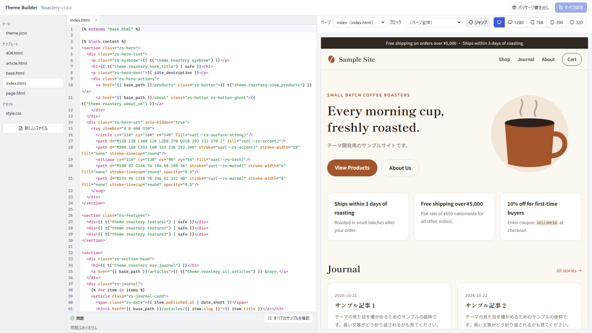
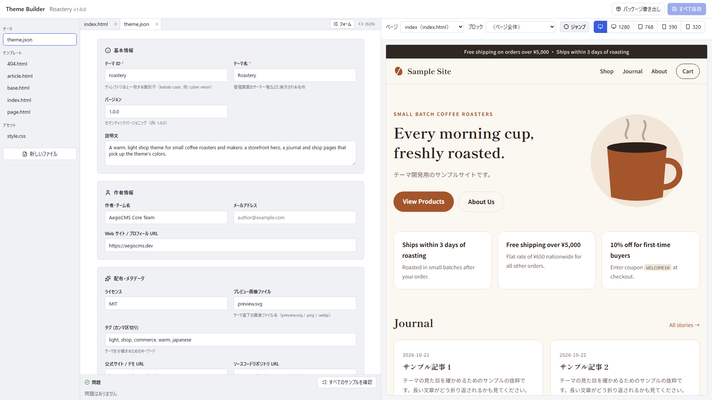
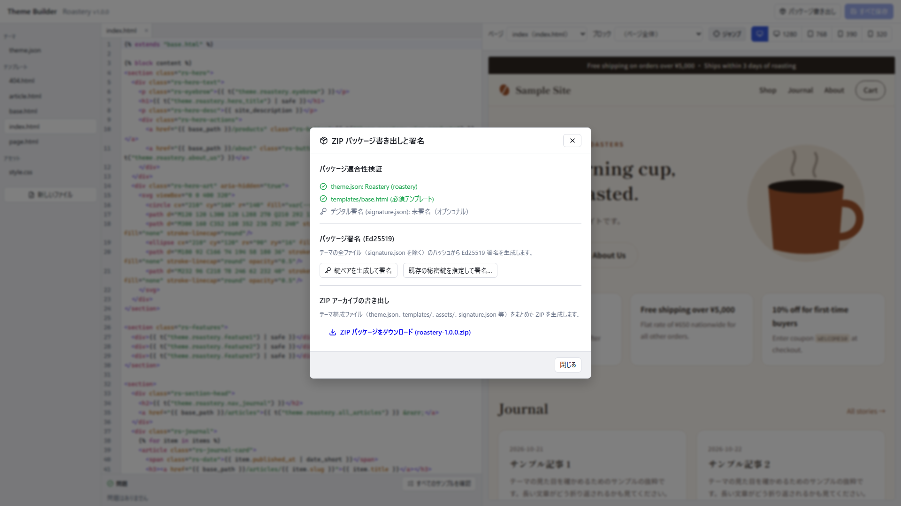

[← Back to the documentation index](README.md)

**English** | [日本語](theme_authoring_guide.ja.md)

# Theme Authoring Guide

Collects how to build the public site's look (themes). For how the theme engine works (the template search order, rewriting by plugins), see the [Content publishing & theme engine development guide](./theme_and_publishing_guide.md).

As a model, `themes/roastery` (the theme of the sample shop "Asanagi Coffee") is the best put together. Even the shop pages are displayed in the theme's colors, and it supports smartphone widths.

---

## 1. Generating a Theme Scaffold (`task theme:new`)

When creating a new theme, the `task theme:new` command generates in one go a set of working templates (`base.html`, `index.html`, `article.html`, `page.html`, `404.html`), a responsive `style.css`, a preview SVG, and `theme.json`.

```bash
# Generate a scaffold for a new theme (themes/my-theme/)
task theme:new -- my-theme

# Generate with a display name or an existing theme as the base
task theme:new -- coffee-craft --title "Coffee Craft"
task theme:new -- custom-trailhead --from trailhead
```

---

## 2. Directory Layout

Place a theme under `[paths].themes_dir` (default `themes/`) as a directory with the same name as the theme's ID.

```text
themes/my-theme/
├── theme.json          # manifest (required)
├── preview.svg         # preview image shown in Admin Studio's theme list (preview.png / .webp / .jpg also work)
├── templates/
│   ├── base.html       # the skeleton common to all pages (required)
│   ├── index.html      # article list (also the top when the top page is the article list)
│   ├── front.html      # top page (when [theme].front_page = "template")
│   ├── category.html   # a category's article list
│   ├── search.html     # site search results
│   ├── contact.html    # contact form
│   ├── article.html    # article
│   ├── page.html       # static page
│   └── 404.html        # not found / unpublished page
└── assets/
    └── style.css       # served at /theme/assets/style.css
```

- Templates missing from `templates/` are rendered with the built-in templates. You can start by making only `base.html` and checking with the built-in ones for the rest.
- However, the validation used for distribution in a future theme marketplace (`validate_theme_package`) does not pass without `theme.json` and `templates/base.html`.
- The contents of `assets/` are served at `{{ base_path }}/theme/assets/<path>` (images, fonts, and JS can be placed too).

## 3. `theme.json`

```json
{
  "id": "my-theme",
  "name": "My Theme",
  "version": "1.0.0",
  "description": "The theme's description. Shown in Admin Studio's theme list.",
  "author": { "name": "Your Name", "url": "https://example.com" },
  "license": "MIT",
  "preview_image": "preview.svg",
  "tags": ["light", "blog"],
  "homepage": "https://example.com/themes/my-theme",
  "min_aegis_version": "0.1.0"
}
```

| Key | Required | Description |
|---|---|---|
| `id` | ✓ | The theme's ID (kebab-case). Make it the same as the directory name. If empty, the directory name is used |
| `name` | ✓ | Display name |
| `version` | | Semantic version (default `1.0.0`) |
| `description` | | Description text |
| `author` | | A string, or `{ "name", "email", "url" }` |
| `license` / `homepage` / `repository` / `min_aegis_version` | | Information for distribution |
| `preview_image` | | The preview image's file name. If absent, `preview.svg` → `.png` → `.webp` → `.jpg` are tried in order |
| `tags` | | Tags for classification |

If `theme.json` is missing or cannot be read as JSON, the theme appears in the list with a name made from the directory name (`my-theme` → `My Theme`) and a default description (when unreadable, a warning appears in the server log).

## 4. Templates

Templates are written in [MiniJinja](https://docs.rs/minijinja) (Jinja2-compatible). In `.html` templates, variables are HTML-escaped automatically.

### 3.1 Which Template Is Used at Which URL

| URL | Template | Main variables |
|---|---|---|
| `/` (`[theme].front_page = "posts"`, the default) | `index.html` | `title` (`Latest Stories`), `items`, `pagination` |
| `/` (`front_page = "template"`) | `front.html` | `content_type` (`front`), `items` (the latest `posts_per_page` articles), `pagination` (continues at `/articles?page=2`) |
| `/` (`front_page = "page:<slug>"`) | Same as a static page (`page.html`, etc.) | Same as a static page. URLs such as canonical are `/` |
| `/articles` | `index.html` | `title` (`Latest Stories`), `items`, `pagination` |
| `/category/{slug}` | `category.html` | `title` (category name), `slug`, `fields` (the category's fields, such as `description`), `items`, `pagination` |
| `/tags/{slug}` | `tag.html` | `title` (tag name), `slug`, `fields` (`description`), `items` (articles, static pages, and products, newest first; the public page URL is `item.fields.url`), `pagination` ([Tags](tags.md#6-public-site)) |
| `/tags` | `tags.html` | `items` (tags that have published content; `item.title` is the name, with `item.fields.url`, `item.fields.count`, `item.fields.description`) ([Tags](tags.md#6-public-site)) |
| `/search` | `search.html` | [Site search](search.md#3-the-search-page-search) (`fields.query`, `items`, `pagination`) |
| (inserted before `</body>` of each page) | `consent.html` | [Cookie consent banner](consent.md#3-building-the-banner-in-a-theme-templatesconsenthtml) (a fragment that does not extend `base.html`. `fields.consent`, `fields.categories`, `fields.message`. The script operates it with `data-aegis-consent-*` attributes) |
| (inserted right after `<body>` of each page) | `notices.html` | [Notice banners](notices.md#3-building-notices-in-a-theme-templatesnoticeshtml) (a fragment that does not extend `base.html`. `fields.notices`. The script operates it with `data-aegis-notice-*` attributes) |
| `/newsletter`, `/newsletter/confirm`, `/newsletter/unsubscribe` | `page.html` | [Newsletter](newsletter.md#3-the-sign-up-page) (`content_html` holds the description and form, confirm and unsubscribe buttons, and results. `slug` is `newsletter`) |
| `/contact`, `/contact/{name}` | `contact.html` | [Contact form](contact.md#21-the-theme-template-contacthtml) (`fields.form_html`, `fields.sent`, `fields.form`) |
| `/articles/{slug}` | `article.html` | `title`, `content_html`, `author`, `published_at`, `updated_at`, `fields`, `relations`, `comments` ([Comments](#6-comment-section)) |
| `/{slug}` | `page.html` (static page) or `article.html` | Same as above |
| `/{slug}` (a static page whose `layout` is `blank`) | `blank.html` | Same as above. A blank page with no header, footer, or width constraints (for landing pages). If you put another name in `layout` (e.g. `landing`), the theme's `landing.html` is used |
| Under `/forum` | `forum_index.html` / `forum_category.html` / `forum_thread.html` | [Forum](forum.md#2-public-site) |
| Not found / unpublished | `404.html` | `title` (`Page Not Found`), `content_html` (a sentence of reason) |
| `/products` | `products.html` | `title`, `items`, `pagination`, `theme_vars` |
| `/products/{slug}` | `product.html` | `title`, `content_html`, `fields` (`price` / `stock`, etc.), `relations`, `theme_vars` (including `reviews_*`; for the review section see [Member accounts 4.4](members.md#44-reviews-on-product-pages)) |
| `/cart` | `cart.html` | `theme_vars` |
| `/orders/{id}` | `order.html` | `slug` (the order ID), `theme_vars` |
| `/account`, `/account/login`, `/account/register` | `account.html` | `slug` (`home` / `login` / `register`), `theme_vars` (`account_*`; [Member accounts 4.3](members.md#43-theme)) |

### 3.1.1 The Top Page (`[theme].front_page`)

| Value | What is shown at `/` | Article list |
|---|---|---|
| `"posts"` (default) | The article list (`index.html`) | Both `/` and `/articles`. Inside the template they cannot be told apart, so elements you want only on the top, like a hero, also appear on `/articles` |
| `"template"` | The theme's `front.html`. For landing pages. The latest articles go into `items`, so you can use them for a "news" section and the like. If the theme has none, the same display as `index.html` | `/articles` |
| `"page:<slug>"` | A static page (editable in Admin Studio; the "Blank LP" layout can be used too). If the page does not exist or is unpublished, the article list | `/articles` |

When using anything other than `"posts"`, make the theme navigation's link to the article list `{{ base_path }}/articles`.

### 3.1.2 A Category's Article List and Feeds

- `/category/{slug}` lists articles whose relation field of `target: category.<field>` in the article schema (`category_id` is built into all content types and can be used without writing it in YAML) points to that category. If the theme has no `category.html`, the built-in template is used. A link to a category can be written like `{{ base_path }}/category/{{ item.relations.category_id.slug }}`.
- Atom feeds are `/feed.xml` (new articles) and `/category/{slug}/feed.xml` (a category's articles). Both are the latest 20 and include the body HTML. The discovery `<link rel="alternate" type="application/atom+xml">` is put into `extra_head` by the server, so the theme does not need to output it (category pages also get the category's feed).
- Feed URLs are based on the canonical URL in Admin Studio's **Settings › SEO**. If unset, they are built from the request's Host (and the reverse proxy's `X-Forwarded-Proto`).

For the shop templates (`products.html` onward), even if the theme has none, the built-in templates are rendered inside the theme's `base.html` ([5. Shop pages](#5-shop-pages)). `blank.html` and the forum templates also have built-in versions, and placing a file with the same name in the theme replaces them.

A static page's layout is chosen in Admin Studio's editor ("Theme default" / "Blank LP") and saved in the `layout` field of the `page` schema. The contents of a Blank LP can be written freely in a "Custom HTML" block (`core/html`). This block's HTML is output as is without escaping (only the `[security]` link and image attribute additions apply, and `<script>` remains too).

### 3.2 Variables

Variables usable on all pages:

| Variable | Description |
|---|---|
| `base_path` | The path where the site is published (e.g. `/cms`; an empty string when published at the root). **Always prefix links within the site and assets with it** |
| `site_title` / `site_description` | The site name (the value changed in Admin Studio's **Settings › Site**, or else `[theme].site_title`) / `[theme].site_description` |
| `title` / `slug` | The page's title and slug |
| `content_type` | `index` / `article` / `page` / `error`, etc. |
| `extra_css` | `[theme].custom_css` and CSS added by plugins |
| `extra_head` | HTML to add to `<head>` (the site's favicon `<link rel="icon">` and what plugins added). **Always output `{{ extra_head \| safe }}` inside `<head>`** |
| `theme_vars` | A dictionary of strings passed by plugins and the shop |
| `locale` | The display language (`[theme].locale`, `en` / `ja`). Used for `<html lang="{{ locale }}">` |
| `t("key", ...)` | A function that returns built-in text in the display language (`{{ t("nav.home") }}`; keys are in `crates/aegis-theme/src/messages.rs`). Write your own text directly in the theme. Do not use `t` as a loop variable (it would hide this function) |
| `admin_url` | The URL of the link to Admin Studio (including `base_path` and `[server].admin_path`). **It is an empty string when the setting is not to show it**, so wrap it in `...`. Do not write `/admin/` directly |
| `show_powered_by` | Whether to show a notice such as "Powered by AegisCMS" in the footer (`[theme].show_powered_by`, default `true`). Wrap the notice in `...` |

> [!NOTE]
> Names that built-in features output (`aegis-consent-*`, `data-aegis-*`, `/_aegis/consent.js`, etc.) are replaced with the prefix of `[server].namespace` (default `cms`) just before the response is returned. In templates and CSS you can keep writing `aegis-`, and since the same replacement applies to HTML, CSS, and JS they do not disagree. In the browser's developer tools and on the site they are visible under names such as `cms-consent-*` ([configuration.md 4.6](configuration.md#46-making-it-harder-to-identify-the-cms-in-use)).

List (each element of `items`): `title`, `slug`, `excerpt` (the first 140 characters of the body), `published_at`, `created_at`, `content_type`, `fields` (custom fields), `relations` (resolved relations; e.g. `item.relations.category_id.title`).

Results of declarative queries (the global variable `queries`): the aggregations and lists declared in `queries/<name>.yaml` can be read regardless of the page, like `{{ r.brand }}: {{ r.n }}` (usable on every page). For how to write definitions, see [queries.md](queries.md). Strings in results are values that users entered, so do not add `safe`.

Paging (`pagination`): `page`, `per_page`, `total_items`, `total_pages`, `prev_url` / `next_url` (including `base_path`; empty if none).

### 3.3 Filters

| Filter | Example | Result |
|---|---|---|
| `date_short` | `{{ published_at \| date_short }}` | `2026-10-23` (the first 10 characters) |
| `datetime_short` | `{{ created_at \| datetime_short }}` | `2026-10-23 14:05` (to the minute; still UTC, with `T` turned into a space) |
| `truncate(n)` | `{{ item.excerpt \| truncate(90) }}` | Cuts past n characters and appends `...` (counted in characters, so safe for Japanese too) |
| `money(currency)` | `{{ fields.price \| money(theme_vars.currency) }}` | `¥1,780` (amounts are integers in the smallest unit) |
| `safe` | `{{ content_html \| safe }}` | Do not escape |

`safe` may be added only to `content_html` (already sanitized by the server), `extra_css`, and `extra_head`. Do not add it to values users entered, such as custom fields.

### 3.4 What `base.html` Must Contain

```html
<!DOCTYPE html>
<html lang="en">
<head>
  <meta charset="UTF-8">
  <meta name="viewport" content="width=device-width, initial-scale=1.0">
  <title>{{ title }} | {{ site_title }}</title>
  <meta name="description" content="{{ site_description }}">
  <link rel="stylesheet" href="{{ base_path }}/theme/assets/style.css">
  
  <style>{{ extra_css | safe }}</style>
  
  {{ extra_head | safe }}
</head>
<body>
  <header>
    <a href="{{ base_path }}/">{{ site_title }}</a>
    <nav>
      <a href="{{ base_path }}/articles">Articles</a>
    </nav>
  </header>
  <main>
    
  </main>
</body>
</html>
```

- **The `viewport` meta**: without it, smartphones show the PC width scaled down.
- **`base_path`**: without it things work when published at the root, but links break with subpath publishing ([Configuration reference](./configuration.md#42-publishing-under-a-subpath)).
- **`extra_css | safe`**: without `safe`, `"` and `>` are escaped and the `[theme].custom_css` CSS breaks.
- **``**: other templates (including the built-in shop templates) put their contents in this block. Do not rename it.

Other templates extend `base.html`.

```html



<article>
  <h1>{{ title }}</h1>
  <time>{{ published_at | date_short }}</time>
  <div class="prose">{{ content_html | safe }}</div>
</article>

```

## 4. Writing CSS

### 4.1 Put Colors in CSS Variables and Define `--accent`

```css
:root {
  --my-bg: #fbf8f3;
  --my-text: #2b211b;
  --my-accent: #a4552c;
  --accent: var(--my-accent); /* the color of shop buttons and badges */
}
```

The built-in shop pages use `--accent` for colors such as buttons (purple `#6366f1` if absent). Other lines and backgrounds are translucent gray, so they are readable as is on both light and dark themes.

### 4.2 Restore What a Reset Removed

Using a `* { margin: 0; padding: 0; }` reset also removes the indentation of lists and the spacing of paragraphs in the body. For the body of articles and static pages (the element that holds `content_html`), write styles for headings, paragraphs, lists, quotes, code, and images.

```css
.prose p { margin-bottom: 1.5rem; }
.prose h2 { margin: 2.5rem 0 1rem; }
.prose ul,
.prose ol { padding-left: 1.4rem; margin-bottom: 1.5rem; }
.prose img { max-width: 100%; height: auto; }
.prose pre { overflow-x: auto; }
```

The product page body (the `.prose` of the built-in `product.html`) has minimal zero-specificity spacing and indentation built in. If the theme has `.prose` rules, they take precedence.

### 4.3 Body Blocks (Tables, Table of Contents, Notes, Quotes, Collapsibles)

Minimal zero-specificity styles are built in for the body's tables, table of contents, notes, quote sources, and collapsibles ([Body blocks 3](blocks.md#3-appearance)). To change the look in a theme, specify `.aegis-table`, `.aegis-toc`, `.aegis-callout` (the color per kind is `--aegis-callout`), and so on. If the theme has rules such as `.prose table`, they take precedence.

### 4.4 Do Not Break on Smartphones (Width 320–390px)

A summary of points to watch from breakages that actually happened.

- **Let the header wrap, and do not let the site name wrap.** Japanese can break between characters, so when pushed by a horizontal menu the site name lines up vertically one character at a time.

  ```css
  .header-inner { display: flex; justify-content: space-between; align-items: center; flex-wrap: wrap; gap: 0.75rem 1.5rem; }
  .brand { white-space: nowrap; }
  .nav { display: flex; flex-wrap: wrap; gap: 0.5rem 1rem; }
  ```

- **Wrap a grid's minimum width in `min(..., 100%)`.** `minmax(320px, 1fr)` overflows horizontally when the screen width minus margins is under 320px.

  ```css
  .cards { display: grid; grid-template-columns: repeat(auto-fill, minmax(min(320px, 100%), 1fr)); }
  ```

- **Add `min-width: 0` to inputs placed side by side.** A `flex: 1` `<input>` has a minimum width set by the browser and pushes the neighboring button off the screen.
- **Avoid fixed `width`s.** Use `max-width: 900px; width: 100%` rather than `width: 900px`. Put large decorative elements (such as background glows) inside a parent with `position: fixed` or `overflow: hidden`.
- **Reduce margins on narrow screens.** Left and right margins of `1.5rem` are large at 320px width, so make them about `1rem` with `@media (max-width: 600px)`.

## 5. Shop Pages

When `[commerce].enabled = true`, `/products`, `/products/{slug}`, `/cart`, and `/orders/{id}` are available. If the theme has no `products.html` and the like, the built-in templates are used. The built-in templates are rendered inside the `content` block of the theme's `base.html`, with colors matched to `--accent` in 4.1. Many themes are fine without writing shop templates.

When you want to change the look, first override the built-in classes (`.aegis-shop`, `.aegis-card`, `.aegis-button`, `.aegis-product`, etc.) with CSS. When writing templates yourself, start by copying the built-in templates (such as `PRODUCTS_TEMPLATE` in `crates/aegis-theme/src/builtins.rs`). In doing so, keep these 2 points.

- Keep ``. The cart script (`/shop/cart.js`) and the navigation that shows the cart count are in it.
- Give the add-to-cart button the same attributes as the built-in one, such as `data-aegis-add-to-cart`. The contents of the cart and order confirmation (`#aegis-cart`, `#aegis-order`) are rendered by the script.

`theme_vars` usable in the shop: `shop_enabled` (`"true"` / `"false"`), `currency`, `products_url`, `cart_url`, `shop_api`, `cart_script` (all including `base_path`).

## 6. Comment Section

With `[comments].enabled = true`, the variable `comments` is passed to pages (`article.html` / `page.html` / `product.html`) of the kinds in `[comments].content_types` ([Comments](comments.md#3-public-site)). Load the built-in comment section after the body (such as before `</article>`). On pages that do not accept comments there is no `comments`, so nothing is shown.

```jinja

```

- The built-in comment section specifies colors with translucency based on the theme's text color and `--accent`, so many themes can use it as is. Override the look in CSS with `.aegis-comments`, `.aegis-comment`, `.aegis-comment-form`, and so on.
- To write your own, place it at the theme's `templates/comments.html` (start by copying the built-in `COMMENTS_TEMPLATE`). The list is `comments["items"]` (`.items` overlaps with a dict method name), each comment's body is `{{ c.body_html | safe }}` (escaped), and the reply indent is `c.depth`. The form submits JSON to `comments.post_url`. Keep the honeypot field (`website`).

## 6a. How to Write Scripts (Do Not Write Inline)

The public page CSP is **Strict by default** (no `'unsafe-inline'` in `script-src`; `[security].strict_csp = "on"`; [csp.md](csp.md)). **`<script>…</script>` written directly in templates (without `src`) and `on*` attributes such as `onclick` do not run.** Write them as follows (to return to the previous behavior, `[security].strict_csp = "off"`).

- **Put scripts in `themes/{name}/assets/*.js` and load them with `<script src="{{ base_path }}/theme/assets/x.js" defer></script>`** (it is a file of your own origin, so the CSP does not block it).
- **Do not use `on*` attributes; use `addEventListener` on the script side** (for example, bind `<button data-scroll-top>` from an external script. A plain in-page link `<a href="#">` is sometimes enough).
- **When it must be inline, output it with `{{ inline_script("code") }}`** (`{{ inline_script("code", consent="analytics") }}` makes it run after consent). The host builds the tag and registers the body's hash in the CSP (it works when `[security].strict_csp` is `on` too). A directly written `<script>` has no hash and does not run. `</script` and `<!--` are neutralized automatically.
- To pass values to a script, use `data-*` attributes or `<script type="application/json">` (a data block; it is not executed, so it does not hit the CSP).
- **The bundled themes and built-in templates already output no inline code** (the `aegis-theme` test renders all templates to verify). The built-in comment section, initial setup screen, and analytics beacon are external files at `/_aegis/…js`.
- Plugin scripts are added by plugins in structured form ([ABI specification 5.3.3a](plugin_abi_specification.md#533a-adding-scripts-in-on_render_page-scripts-abi-2)). The theme does not need to worry about them.

### 6a-2. How to Write `<style>`

`style-src` also lacks `'unsafe-inline'` (Strict), so `<style>…</style>` written directly in templates is blocked. Wrap it in **`…`** (`{{ inline_style("CSS") }}` also works), or load `assets/*.css` with `<link>`. The host builds the tag and registers the body's hash in the CSP. **`style="…"` attributes are blocked too** (the CSP's `style-src` also applies to attributes). Make them classes and write them in `<style>` (`inline_style`) or a stylesheet. When the value is dynamic, prepare a class per value, or use `data-*` attributes with CSS `attr()` or switching classes. The bundled themes have already been replaced with classes (`ts-<number>`) in `assets/style.css` ([csp.md 6.1](csp.md#61-styles-style-by-hash-no-style-attributes)).

## 6b. Fonts (External Stylesheets Are Blocked by the CSP)

The public page CSP does not allow external stylesheets such as `fonts.googleapis.com`. Do one of the following (for details see [csp.md 8](csp.md#8-theme-fonts-and-external-styles-csp-in-themejson)).

- **Put the font in the theme**: place woff2 in `themes/{name}/assets/fonts/` and load it with `@font-face` in `style.css` (not `url('../assets/fonts/x.woff2')` — either output `{{ base_path }}/theme/assets/fonts/x.woff2` from the template side, or use a relative path in `style.css`). It depends on nothing external, so you need not worry about the CSP or visitors' IPs.
- **Write `csp` in `theme.json`**: `"csp": { "style_domains": ["fonts.googleapis.com"], "font_domains": ["fonts.gstatic.com"] }`. For when it is hard to serve them yourself, such as Japanese web fonts. The external hosts appear on the admin screen's theme card.

The built-in default theme serves the Latin subsets of Plus Jakarta Sans and JetBrains Mono itself (Japanese uses system fonts).

## 7. Development Flow

1. Copy an existing theme (such as `roastery`) into `themes/` and change the directory name and the `id` in `theme.json`.
2. Set `[theme].reload_templates = true` in the settings. Templates are reread on every render, so you can check without restarting the server (`false` in production). Assets such as CSS are served from files each time.
3. Switch to the theme. Switch in Admin Studio's **Settings → Themes**, with `PUT /api/v1/themes/active` (`{"theme_id": "my-theme"}`, admin only), or with `[theme].active`.
4. Check with a site that has content. Using the sample shop (`task demo:shop`, and `task demo:shop:seed` in another terminal; for steps see [examples/coffee-shop](../examples/coffee-shop)) gives you articles, static pages, products, and categories.

### `theme dev` (Check Quickly Without a DB)

```bash
task dev:theme -- themes/my-theme      # = cargo run -p aegis-theme-dev -- themes/my-theme (http://127.0.0.1:8090/)
```

The dev server is split into the standalone lightweight crate `aegis-theme-dev` and starts quickly, in seconds to over ten seconds, even the first time. It reads the theme folder directly and renders sample data without a DB, plugins, or login. When you save files in `templates/`, `assets/`, and `samples/`, the open page is reloaded automatically. Template syntax errors show the reason on the page (fix and save, and it comes right back). You can choose any editor.

- **Samples**: for everything in `templates/` other than `base.html`, `/preview/<name>` (`/preview/index` for `index.html`) is provided with default data (title, body, 3 articles in the list, paging).
- **Changing and adding data**: writing items of `PageRenderContext` ([3.2 Variables](#32-variables)) in `samples/<name>.json` overrides the default data (per top-level key). If the name is not among the defaults, a page is added. `"template": "article.html"` chooses the template to use (if omitted, `<name>.html`). `samples/` is not used at install time, so you can leave it in place.
- **CSP (Strict)**: the preview page gets the public site's default CSP ([csp.md](csp.md)). Things that would stop working once published, such as directly written inline `<script>`, `<style>`, and `on*` attributes, appear at the bottom right of the page with the reason and how to fix it (hosts declared in `theme.json`'s `csp` are allowed). To not enforce, use `--csp report-only`; to not attach, use `--csp off`.
- **Assets**: served at `/theme/assets/...` and `/themes/<id>/assets/...`.
- **Samples for declarative queries (`queries`)**: when a template reads `queries.<name>` ([queries.md](queries.md)), write **query name → array of results** in `samples/queries.json`. It becomes the `queries` for all pages, not a page sample (saving reflects it in the next render; Theme Builder can render even unsaved content being edited). A name that does not exist is undefined, and reads such as `queries.x[0]` are rendering errors. Results must be arrays (aggregations are an array of rows, and a list with `select` omitted has the same shape as `items`), and anything else shows as an error. To make a scaffold from the site's definitions:

  ```bash
  cargo run -p aegis-theme-dev -- themes/my-theme --init-queries --queries-dir ../site/queries --schemas-dir ../site/schemas
  ```

  It does not run queries; it writes fixed values matching the definitions' shapes (3 rows for aggregations, up to 3 items for lists) to `samples/queries.json` and finishes (the server is not started). Results of existing queries are kept, and only missing names are added (`--force` recreates). The values have no meaning, so edit them by hand to fit the situations you want to check, such as empty results, long strings, and 0. `theme dev` does not issue real queries (because it uses no DB).
- **Differences from the public site**: plugins' `on-render-page`, the data of the comment section, shop, and forum, and the `[theme]` settings (`theme_vars`, `custom_css`) are not reflected. Write them in `samples/*.json` if needed. Do the final check on a real site.
- **Listening and display language**: the default is `127.0.0.1:8090` (`--host`, `--port`). The display language can be specified with `--locale <LOCALE>` (`-l`, default `en`; e.g. `-l ja`). Templates are a development feature that can run arbitrary code, so do not expose it to a public network.
- **Error location**: when it fails, you can tell which line of which template (when it happens beyond an `` or ``, the file and line beyond).
- **JSON API** (for the Theme Builder UI):
  - `GET /__dev/api/theme`: the manifest, templates, and list of samples
  - `GET /__dev/api/samples/<name>`: the rendering data
  - `GET /__dev/api/check`: renders all samples and returns failures (`message`, `template`, `line` in `error`). Usable in CI
  - `GET /__dev/api/package/validate`: validates conformance as a theme package (required manifest items, base.html, signature status)
  - `POST /__dev/api/package/sign`: computes the theme package digest and generates and saves an Ed25519 signature file (`signature.json`) (automatic key pair generation or specifying a private key)
  - `GET /__dev/api/package/export`: downloads a ZIP archive for distribution (excluding `samples/` and hidden files)
  - `GET /__dev/api/files`, `GET`, `PUT`, `DELETE /__dev/api/files/<path>`, `POST /__dev/api/rename`: list, read, save, delete, and rename files. The targets are `theme.json` (cannot be deleted or renamed) and text files under `templates/`, `samples/`, and `assets/` (`.html`, `.css`, `.js`, `.json`, `.svg`, etc., up to 1MiB). `..`, hidden files, and anything outside the folder are rejected
  - `POST /__dev/api/render`: renders reflecting unsaved content (`templates` as name → contents, `samples` as name → JSON, and optionally `block` for a block name), and returns the list of available `blocks`. It writes nothing
  - Writes (`PUT`, `POST`) are available only when listening on loopback. The header `x-aegis-dev` is required, and requests whose `Host` is not a loopback name are rejected (to prevent writes from other sites' pages and DNS rebinding). CORS is not allowed

### Theme Builder (Editor + Live Preview)

```bash
task dev:theme -- themes/my-theme      # first terminal: dev server (:8090)
task dev:theme-builder                 # second terminal: Theme Builder (http://localhost:5174/, the first time npm --prefix theme-builder ci)
```

Files are on the left, the editor (with syntax coloring for Jinja, HTML, CSS, and JSON) is in the center, and the preview is on the right.



- **Preview while unsaved**: as you type, after about 0.25 seconds it renders again with the unsaved content (templates and samples through `POST /__dev/api/render`, CSS appended to the preview). Files are not rewritten until you save (`Ctrl+S`, or "Save all").
- **Errors**: when rendering fails, a squiggle and a mark appear on that line of the editor and it shows in the "Problems" list (clicking jumps to the line). The preview keeps the last successfully rendered display, dimmed.
- **Pages and widths**: switch the page (sample) to preview and the width (fit to width, 1280, 768, 390, 320px). It switches automatically to the page that fits the file being edited.
- **Check**: "Check all samples" renders all samples with the saved files.
- **Using it with other editors**: files saved in VS Code or the like are reloaded automatically if you have not edited them. When the file you are editing changes, a notification appears.
- **Creating, renaming, and deleting files**: "New file" creates under `templates/`, `samples/`, and `assets/`, and the icons in the file list let you rename (inline editing) and delete (with confirmation) (`theme.json` cannot be renamed or deleted, for protection). A file's line endings (LF / CRLF) are kept as that file's, so merely opening does not produce a diff.
- **Form editing of theme.json**: opening `theme.json` shows a form UI for intuitively editing the manifest (ID, theme name, version, description, author information, license, tags, repository, supported Aegis version, etc.). The toggle buttons at the top right of the editor ("Form" / "JSON") let you switch freely to the raw JSON code editor, and it stays fully in sync with unsaved buffers and saving with `Ctrl+S`. If there is a syntax error, a warning and a path to fix it in raw JSON are shown.
- **Block-level preview**: from the "Block" dropdown at the top of the preview, choose a block defined in the template or a parent template (such as `content` or `header`) and preview just that block's HTML on its own with the theme's styles applied (choosing "(whole page)" returns to normal page display).
- **Jumping from a preview element to its line**: enable the "Jump" button on the preview toolbar, or click any element in the preview while holding the `Alt` key (`Option` on Mac), and the editor's cursor instantly moves to and focuses that line in the template. On hover, a dotted outline and highlight are shown.
- **ZIP package export and signing**: open the modal from the "Export package" button in the header to run package conformance validation (manifest, required templates, signature), one-click automatic Ed25519 key pair generation and package signing (creating `signature.json`), and export (download) of a ZIP archive for distribution.
- The preview is shown in a `sandbox`ed `iframe` (without `allow-same-origin`), and clicking a link does not leave the page. The screen text is Japanese only.





### Pages and Widths to Check

| Page | Example URL (sample shop) |
|---|---|
| Top / article list | `/`, `/articles` |
| An article (with headings and lists) | `/articles/how-to-brew-pour-over` |
| A static page | `/about` |
| Product list / product | `/products`, `/products/ethiopia-yirgacheffe` |
| Cart (empty / with items) | `/cart` |
| 404 | `/no-such-page` |

Check at widths **320 / 360 / 390px** (smartphones) and **1280px** (PC). Browser developer tools are fine, and with Playwright or the like you can compare the following values to check mechanically whether horizontal scrolling appears.

```js
document.documentElement.scrollWidth > document.documentElement.clientWidth // true means it overflows horizontally
```

Check the site name and titles in both Japanese and English. Japanese wraps between characters, so a layout that is fine in English can still break.
