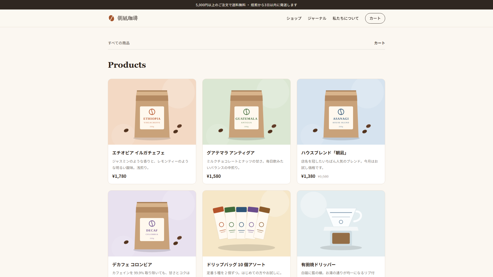
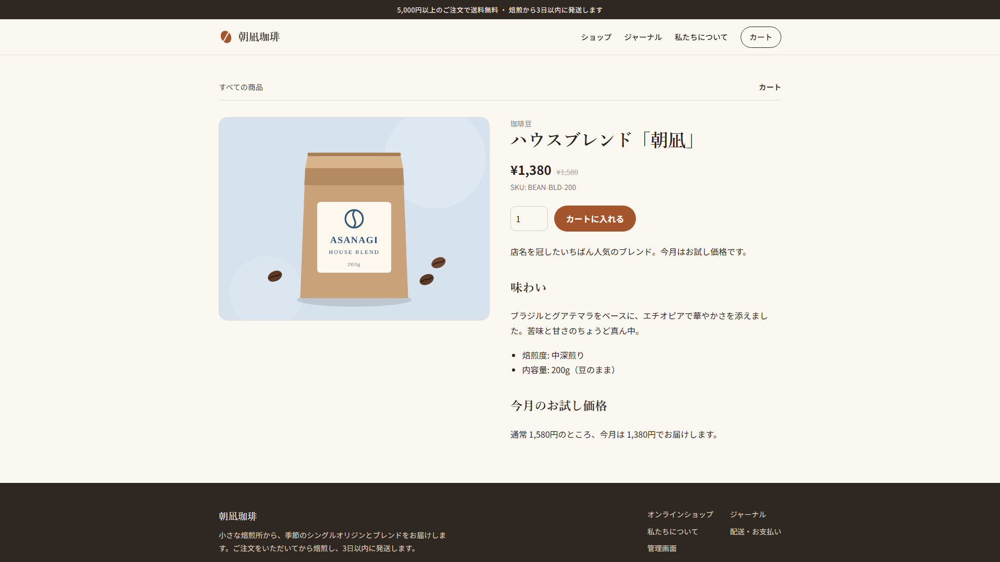
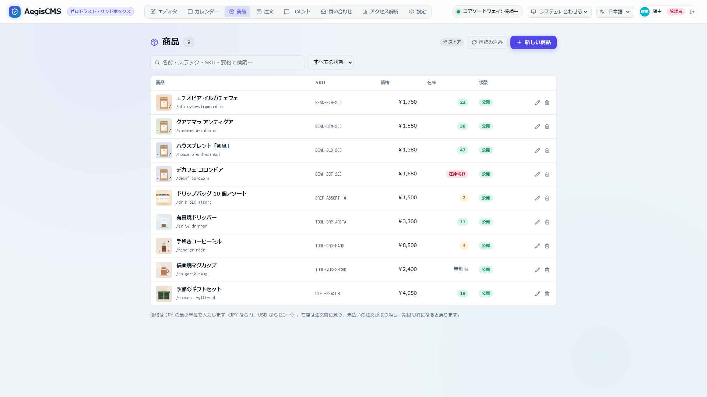
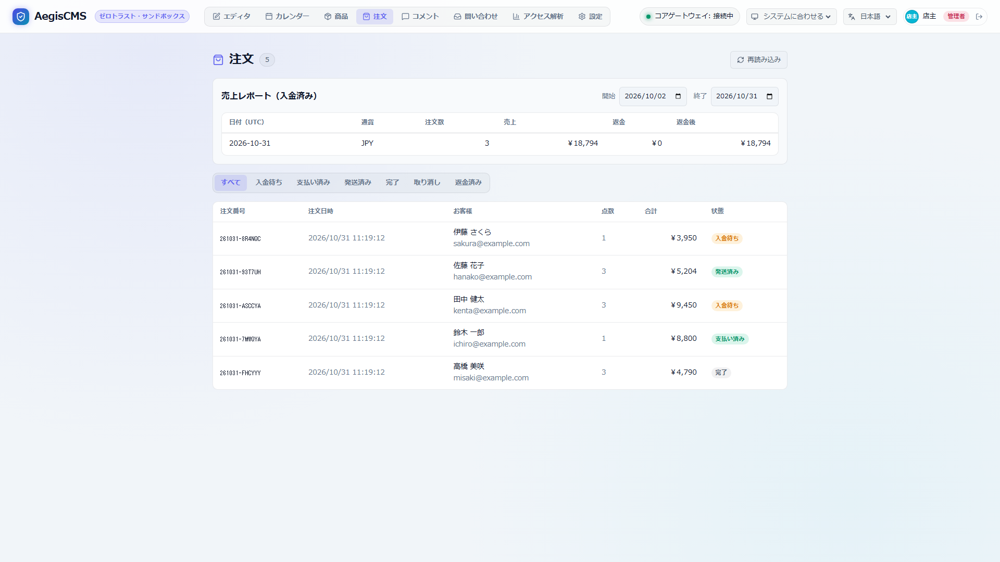

# Sample Shop "Asanagi Coffee" (朝凪珈琲)

**English** | [日本語](README.ja.md)

A sample online coffee bean shop built with AegisCMS's e-commerce feature ([docs/commerce.md](../../docs/commerce.md)). The products, orders, and shop name are all fictional. The sample content (product names, article text) is in Japanese.





In the admin screen you can manage products and check orders and sales.





| Content | Location |
| --- | --- |
| Settings (shop, shipping fees and coupons, theme, bank transfer instructions, notifications) | [`aegis.toml`](aegis.toml) |
| The "Roastery" theme (top page, articles, static pages. The shop pages use the built-in templates with the theme's colors applied) | [`themes/roastery/`](../../themes/roastery) |
| Data to load (4 categories, 9 products, 3 articles, 2 static pages) and the loading script | [`seed.mjs`](seed.mjs) |
| Product images | [`images/`](images) |
| Database and uploaded files (not tracked by Git) | `shop.db`, `uploads/` (created when you start it) |

## Starting It

Run these at the repository root. Rust, Node.js 18 or later, and [go-task](https://taskfile.dev) are required.

```bash
# Build Admin Studio (first time only)
task build:admin

# Create the administrator owner (password sample-password) and start the server
task demo:shop

# In another terminal, load the products, articles, and pages
task demo:shop:seed
```

<http://127.0.0.1:8080/> is the shop, and <http://127.0.0.1:8080/admin/> is the admin screen (`owner` / `sample-password`).

Without go-task:

```bash
AEGIS_USER_PASSWORD=sample-password cargo run -p aegis-server -- -c examples/coffee-shop/aegis.toml user add owner --role admin
cargo run -p aegis-server -- -c examples/coffee-shop/aegis.toml run
node examples/coffee-shop/seed.mjs      # in another terminal
```

`seed.mjs` skips slugs that already exist, so you can run it as many times as you like. To load into a different server or user, specify `--url` / `--user` / `--password` (or the environment variable `AEGIS_SEED_PASSWORD`).

To start over, stop the server and delete `shop.db*` and `uploads/` in `examples/coffee-shop/`.

## What You Can Try

| Feature | How to try it |
| --- | --- |
| Product list and product page | `/products`. The House Blend shows its pre-discount price (struck through), the decaf shows out of stock (Sold out), and the drip bags show low stock (Only 3 left) |
| Cart and quote | "Add to cart" on a product page → `/cart`. The server calculates the total |
| Shipping (plugin `official-shop-rules`) | Orders under 5,000 yen have a 650 yen shipping fee; orders at or above are free |
| Coupons (same plugin) | `WELCOME10` (10% off), `COFFEE300` (300 yen off). Anything else returns 422 with "invalid coupon" |
| Orders and inventory | Placing an order reduces inventory, and the order confirmation page shows the bank transfer details. If there is no payment within 72 hours, the order is cancelled automatically and the inventory is restored |
| Order management | In the admin screen's **Orders**, move an order from paid → shipped → completed. The status on the customer's order confirmation page changes too |
| Notifications ([docs/notifications.md](../../docs/notifications.md)) | In the sample, emails for orders, payment confirmation, shipping, and cancellation go to the server log (`aegis::notify`). A note entered when marking an order as shipped (such as a tracking number) goes into the shipping email. Administrator logins and login lockouts after 5 wrong passwords are also reported. With an SMTP server, `channels = ["email"]` lets you actually send them |
| Product management | Edit prices, inventory, and images in the admin screen's **Products** |
| Audit log | Orders (`order.create` / `order.update`) and product changes are recorded in the admin screen's **Settings › Audit Logs** |

## Switching to Card Payments (Stripe)

Changing `[commerce]` in `aegis.toml` as follows makes payment go through Stripe Checkout (you can try it with test-mode keys). For details, see [docs/commerce.md "4.2 stripe"](../../docs/commerce.md).

```toml
[commerce]
enabled = true
currency = "jpy"
provider = "stripe"

[commerce.stripe]
# Can also be passed via AEGIS_STRIPE_SECRET_KEY / AEGIS_STRIPE_WEBHOOK_SECRET
secret_key = "sk_test_..."
webhook_secret = "whsec_..."
```
