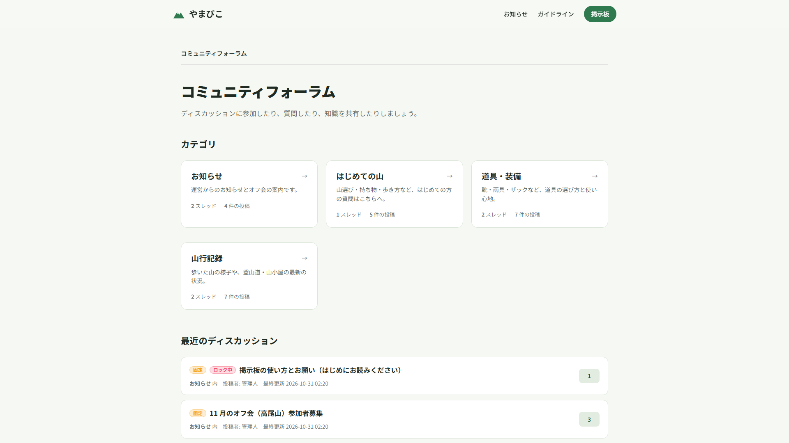
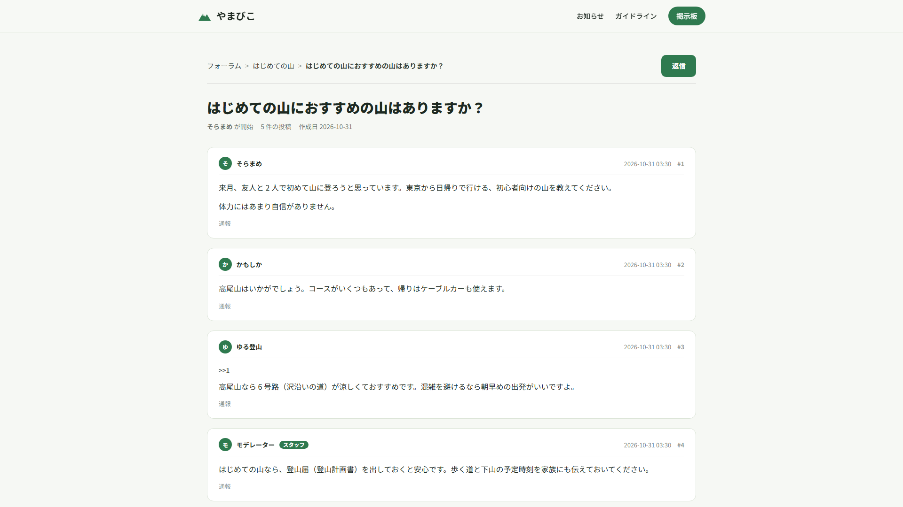
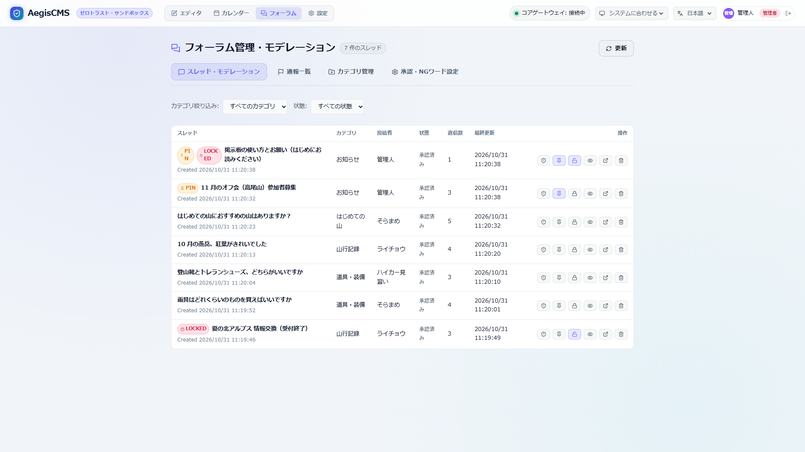

# サンプル掲示板「やまびこ」

AegisCMS の掲示板（[docs/forum.md](../../docs/forum.md)）で作った、山歩きのコミュニティサイトのサンプルです。投稿・人物・オフ会はすべて架空のものです。





管理画面では、スレッドのピン留め・ロック・削除などのモデレーションができます。



| 内容 | 場所 |
| --- | --- |
| 設定（掲示板・専用のデータベース・連投の制限・テーマ） | [`aegis.toml`](aegis.toml) |
| テーマ「Trailhead」（トップページ・お知らせ・固定ページ。掲示板のページは組み込みのテンプレートにテーマの色を合わせる） | [`themes/trailhead/`](../../themes/trailhead) |
| 投入するデータ（掲示板のカテゴリ 4・スレッド 7・レス 16、お知らせ 2・固定ページ 2）と投入スクリプト | [`seed.mjs`](seed.mjs) |
| データベース（Git の管理外） | `site.db`（記事・ユーザーなど）・`forum.db`（掲示板）。起動すると作られる |

## 起動する

リポジトリのルートで実行します。Rust・Node.js 18 以上と [go-task](https://taskfile.dev) が必要です。

```bash
# Admin Studio をビルド（初回のみ）
task build:admin

# 管理者 owner とモデレーター moderator（パスワードはどちらも sample-password）を作ってサーバーを起動
task demo:forum

# 別のターミナルでカテゴリ・スレッド・レス・お知らせ・ページを投入（連投の制限があるので 1 分ほどかかる）
task demo:forum:seed
```

<http://127.0.0.1:8080/> がサイト、<http://127.0.0.1:8080/forum> が掲示板、<http://127.0.0.1:8080/admin/> が管理画面です。

| ユーザー | ロール | できること |
| --- | --- | --- |
| `owner`（管理人） | `admin` | すべて。掲示板のカテゴリの作成・編集・削除 |
| `moderator`（モデレーター） | `editor` | スレッドのピン留め・ロック・削除、レスの削除 |

go-task を使わない場合:

```bash
export AEGIS_USER_PASSWORD=sample-password
cargo run -p aegis-server -- -c examples/hiking-forum/aegis.toml user add owner --role admin --display-name 管理人
cargo run -p aegis-server -- -c examples/hiking-forum/aegis.toml user add moderator --role editor --display-name モデレーター
cargo run -p aegis-server -- -c examples/hiking-forum/aegis.toml run
node examples/hiking-forum/seed.mjs     # 別のターミナルで
```

`seed.mjs` は作成済みのカテゴリ（slug）・スレッド（同じカテゴリの同じタイトル）を飛ばすので、何度実行しても構いません。別のサーバーに投入するときは `--url` / `--password`（または環境変数 `AEGIS_SEED_PASSWORD`）を指定します。

最初からやり直すときは、サーバーを止めて `examples/hiking-forum/` の `site.db*` と `forum.db*` を削除します。

> [!NOTE]
> [コーヒー豆のショップ](../coffee-shop) と同じポート 8080 を使うので、同時には起動できません。

## 試せること

| 機能 | 試し方 |
| --- | --- |
| 掲示板のトップ | `/forum`。カテゴリごとのスレッド数・レス数と、最近更新されたスレッド。「お知らせ」の 2 つのスレッドはピン留め（PIN）、使い方のスレッドと夏の北アルプスのスレッドはロック（LOCKED） |
| スレッド・レス | スレッドのページの下のフォームから、ログインしないで書き込める（名前を空にすると `Anonymous`）。スレッドの作成はカテゴリのページの下から |
| スタッフの印 | ログインしているユーザーの書き込みには **Staff** が付く。「はじめての山におすすめの山はありますか？」のモデレーターのレスなど |
| ロック | ロックしたスレッドには返信フォームが出ず、API で投稿しても `403` |
| 連投の制限 | 同じ IP から 3 秒以内（`rate_limit_secs = 3`）に続けて書き込むとエラーになる（API は `429`） |
| モデレーション | 管理画面の **Forum** タブで、`moderator` でログインしてピン留め・ロック・削除。`moderator` にはカテゴリの一覧だけが表示され、作成・編集・削除は `owner` で |
| 掲示板専用のデータベース | スレッドとレスは `forum.db` に、記事・ユーザー・セッションは `site.db` に入る（`[forum].database_url`） |
| 監査ログ | 管理画面の **Settings › Audit Logs** に `forum.thread.create` / `forum.post.create` / `forum.thread.pin` / `forum.thread.lock` などが残る |
