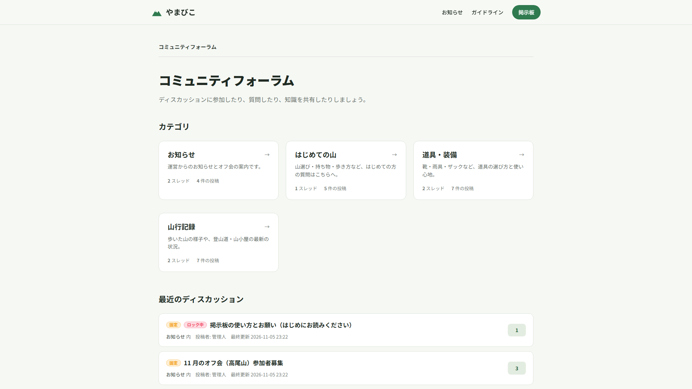
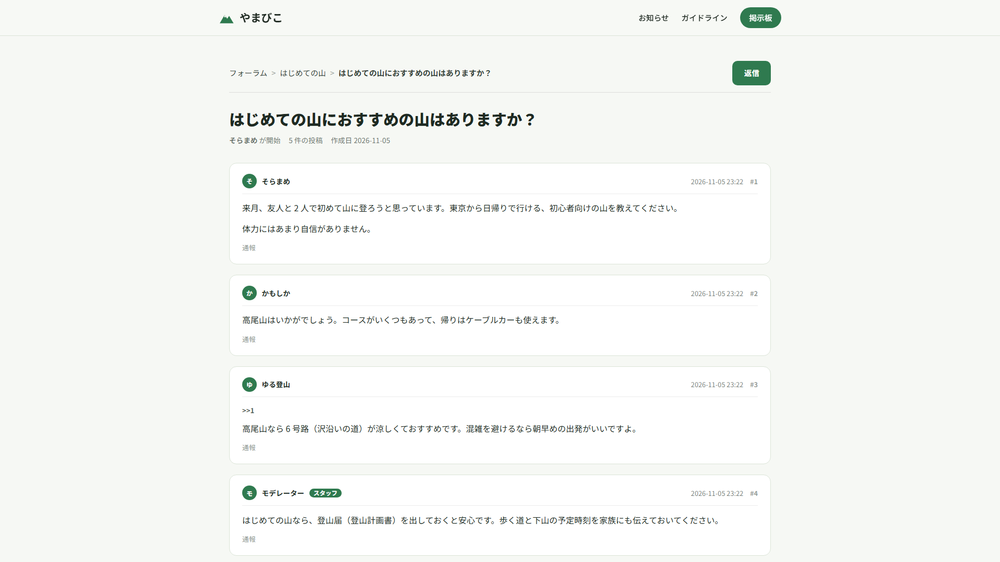
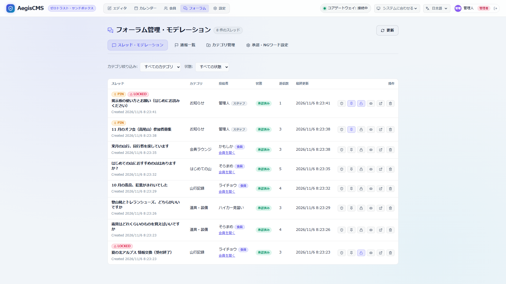

# Sample Forum "Yamabiko" (やまびこ)

**English** | [日本語](README.ja.md)

A sample hiking community site built with AegisCMS's forum ([docs/forum.md](../../docs/forum.md)). The posts, people, and meetups are all fictional. The sample content (posts, article text) is in Japanese.





In the admin screen you can moderate threads by pinning, locking, deleting, and so on. Threads written by members get a "member" badge and a link to the member's details.



| Content | Location |
| --- | --- |
| Settings (member accounts, forum, dedicated database, rate limiting of consecutive posts, theme) | [`aegis.toml`](aegis.toml) |
| The "Trailhead" theme (top page, announcements, static pages. The forum pages use the built-in templates with the theme's colors applied) | [`themes/trailhead/`](../../themes/trailhead) |
| Data to load (4 members, 5 forum categories, 8 threads, 18 replies, 2 announcements, 2 static pages) and the loading script | [`seed.mjs`](seed.mjs) |
| Databases (not tracked by Git) | `site.db` (articles, users, etc.) and `forum.db` (the forum). Created when you start it |

## Starting It

Run these at the repository root. Rust, Node.js 18 or later, and [go-task](https://taskfile.dev) are required.

```bash
# Build Admin Studio (first time only)
task build:admin

# Create the administrator owner and the moderator moderator (both with password sample-password) and start the server
task demo:forum

# In another terminal, load the categories, threads, replies, announcements, and pages (takes about a minute because of the rate limit on consecutive posts)
task demo:forum:seed
```

<http://127.0.0.1:8080/> is the site, <http://127.0.0.1:8080/forum> is the forum, and <http://127.0.0.1:8080/admin/> is the admin screen.

| User | Role | What they can do |
| --- | --- | --- |
| `owner` (administrator) | `admin` | Everything. Creating, editing, and deleting forum categories |
| `moderator` (moderator) | `editor` | Pinning, locking, and deleting threads, and deleting replies |

Without go-task:

```bash
export AEGIS_USER_PASSWORD=sample-password
cargo run -p aegis-server -- -c examples/hiking-forum/aegis.toml user add owner --role admin --display-name 管理人
cargo run -p aegis-server -- -c examples/hiking-forum/aegis.toml user add moderator --role editor --display-name モデレーター
cargo run -p aegis-server -- -c examples/hiking-forum/aegis.toml run
node examples/hiking-forum/seed.mjs     # in another terminal
```

`seed.mjs` skips categories (by slug) and threads (same title in the same category) that already exist, so you can run it as many times as you like. To load into a different server, specify `--url` / `--password` (or the environment variable `AEGIS_SEED_PASSWORD`).

To start over, stop the server and delete `site.db*` and `forum.db*` in `examples/hiking-forum/`.

> [!NOTE]
> It uses the same port 8080 as the [coffee bean shop](../coffee-shop), so the two cannot run at the same time.

## What You Can Try

| Feature | How to try it |
| --- | --- |
| Forum top | `/forum`. Thread and reply counts per category, and recently updated threads. The two threads in "Announcements" are pinned (PIN), and the how-to thread and the summer Northern Alps thread are locked (LOCKED) |
| Threads and replies | You can post without logging in from the form at the bottom of a thread page (leave the name empty to post as `Anonymous`). Create threads from the bottom of a category page |
| Members | Many of the forum posts were written by members (`ゆる登山`, `かもしか`, `そらまめ`, `ライチョウ`; the password for all of them is `sample-password`). The name becomes the member's public name. After logging in at `/account/login`, you can post in the forum form under your public name. You can also read the members' lounge |
| Members-only category | The "Members' Lounge" (会員ラウンジ) can be read and written only by members and staff (`visibility = "members"`). Without logging in, neither the category nor its threads are visible (`404`) |
| Staff badge | Posts by logged-in users get **Staff**, such as the moderator's reply in "Is there a mountain you'd recommend for a first climb?" |
| Locking | A locked thread shows no reply form, and posting through the API returns `403` |
| Rate limiting of consecutive posts | Posting again from the same IP within 3 seconds (`rate_limit_secs = 3`) causes an error (`429` for the API) |
| Moderation | In the admin screen's **Forum** tab, log in as `moderator` to pin, lock, and delete. `moderator` sees only the category list; create, edit, and delete as `owner` |
| Dedicated forum database | Threads and replies go into `forum.db`, and articles, users, and sessions go into `site.db` (`[forum].database_url`) |
| Audit log | `forum.thread.create` / `forum.post.create` / `forum.thread.pin` / `forum.thread.lock` and so on are recorded in the admin screen's **Settings › Audit Logs** |
