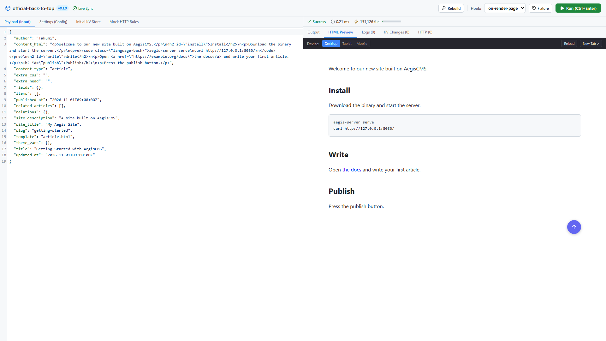

# Plugin Builder

**English** | [日本語](README.ja.md)

A development tool for building AegisCMS Wasm plugins with an editor and an instant-execution sandbox (React 19 + Vite + CodeMirror 6).
It needs no database and no login, and connects to the JSON API of `aegis-server plugin dev`.

```bash
task dev:plugin -- plugins/official-code-enhancer   # dev server (http://127.0.0.1:8091)
npm --prefix plugin-builder ci                      # first time only
task dev:plugin-builder                             # http://localhost:5175/
```

| Command                                 | Description                                          |
| --------------------------------------- | ---------------------------------------------------- |
| `npm run dev`                           | Dev server (change the target with `PLUGIN_DEV_URL`) |
| `npm run test`                          | Unit tests (Vitest)                                  |
| `npm run lint` / `npm run format:check` | oxlint (zero warnings) / Prettier                    |
| `npm run build`                         | Type check and production build (`dist/`)            |



## Features

- **Instant hook execution**: select a hook defined in the manifest and run it inside the Wasm sandbox with one click (or `Ctrl+Enter`)
- **Standard fixtures**: load the standard input data for each hook with one click
- **Sandbox inspection**:
  - Real-time log capturing `log_info!`, `log_warn!`, and `log_error!` from inside Wasm
  - Visualization of CPU instruction count (fuel) and execution time in milliseconds
  - Diff display of the KVS changes made by the plugin
  - A record of the external HTTP requests the plugin sent
- **Mock settings**:
  - Injecting plugin settings (`config_get`)
  - Setting initial KVS data (`kv_get` / `kv_set`)
  - Defining mock response rules for external APIs (Slack, webhooks, etc.)
- **Hot reload**: metadata is synced automatically when the Wasm binary or manifest is recompiled
