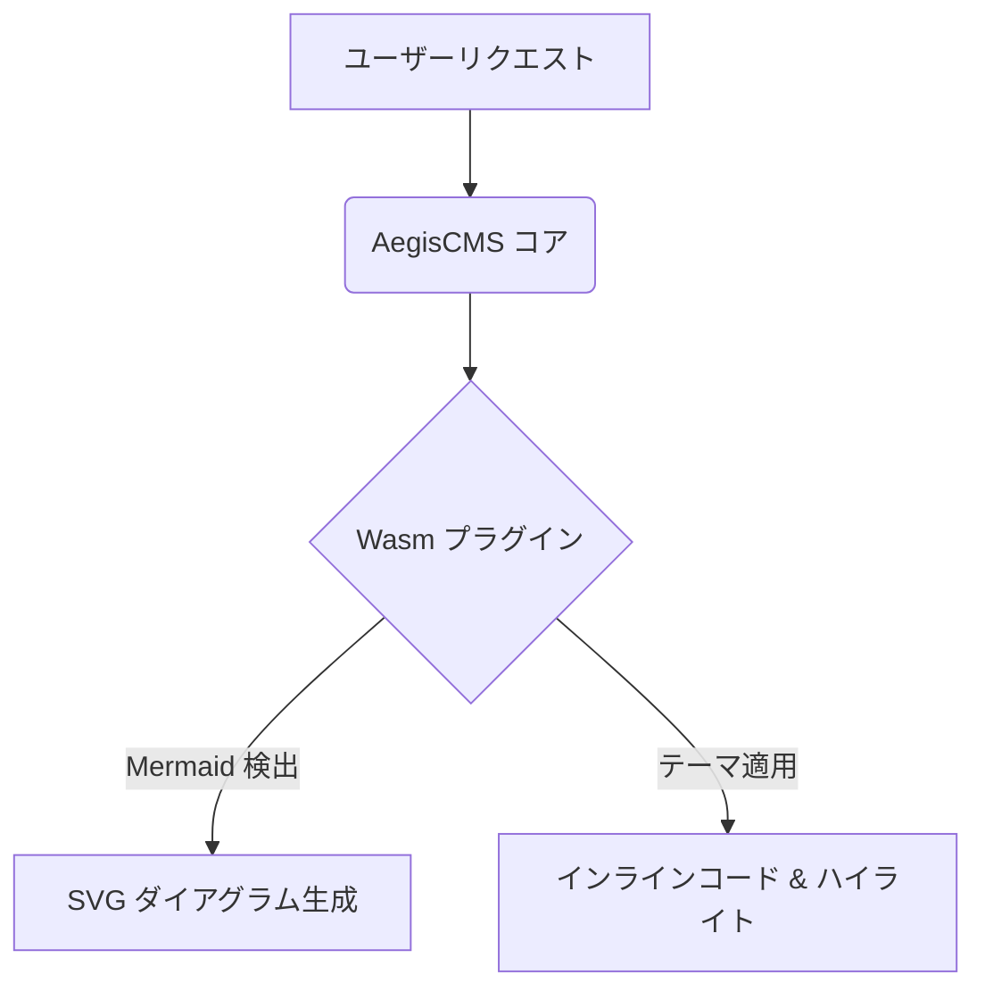

# AegisCMS 公式 Code & Diagram Enhancer プラグイン (`official-code-enhancer`)

本プラグインは、AegisCMS の公式 WebAssembly プラグインです。  
Markdown 本文中の **Mermaid ダイアグラムの自動レンダリング**、**インラインコードの美麗スタイリング**、および **外部読み込み対応のマルチコードテーマシステム** を提供します。

---

## 🌟 主な機能

1. **Mermaid ダイアグラムの自動レンダリング**:
   - ` ```mermaid ... ``` ` で記述されたコードブロックを検出し、ブラウザ上で美麗な SVG ダイアグラムへ自動変換・描画します。
   - フローチャート、シーケンス図、ガントチャート、ER図、マインドマップなど、すべての Mermaid 記法に対応。
2. **インラインコード（`` `code` ``）のスマート整形**:
   - 本文（段落・箇条書き・引用）内の `` `inline code` `` を、XSS 安全（TextNode 分割方式）に `<code>` 要素へ自動整形・スタイリング。
   - JetBrains Mono 等幅フォント、角丸、微細なシャドウ、テーマ別アクセントカラーを適用。
3. **外部読み込み対応マルチコードテーマ**:
   - 6 つのビルトインプリセットテーマ（Dracula, GitHub Dark, One Dark, Nord, GitHub Light, Monokai）。
   - **外部 CSS URL（CDN）読み込み**: Prism.js や Highlight.js の任意のテーマスタイルシート URL を指定可能。
   - **カスタム CSS 注入**: 独自の CSS スタイルシートを直接指定して上書き可能。
4. **ワンクリックコードコピー**:
   - コードブロックの右上に、ホバー時に浮かび上がる洗練された「Copy」ボタンを自動付与。
5. **動的テーマ切り替え API (`window.AegisCodeEnhancer`)**:
   - フロントエンドや Admin Studio プレビューから JavaScript API で動的にスタイルシートを切り替え可能。

---

## 🎨 ビルトインテーマ一覧

| テーマ ID | テーマ名 | Mermaid 連動 | 特徴 |
|---|---|---|---|
| `dracula` (デフォルト) | Dracula | `dark` | 上品なダーク背景に鮮やかなピンク・パープル・シアンアクセント |
| `github-dark` | GitHub Dark | `dark` | GitHub 公式の落ち着いたダークブルーグレー配色 |
| `one-dark` | One Dark Pro | `dark` | VS Code / Atom 定番のモダンダークテーマ |
| `nord` | Nord Arctic | `dark` | 北欧アークティックブルーとスノーホワイトの上質な配色 |
| `github-light` | GitHub Light | `default` | アイボリーや白基調の洗練されたエディトリアルライトテーマ |
| `monokai` | Monokai Pro | `dark` | 高コントラストで視認性に優れたクラシックテーマ |

---

## ⚙️ テーマの指定・外部読み込み方法

テーマは、**記事ごとのカスタムフィールド** または **テーマ変数 (`theme_vars`)** で柔軟に指定できます。

### 1. プリセットテーマの切り替え
記事作成時またはテンプレート側で `code_theme` を指定します：

```json
{
  "code_theme": "nord"
}
```

### 2. 外部 CSS URL（CDN）の読み込み
Prism.js などの外部 CDN テーマを直接読み込みたい場合は、`code_theme_url` を指定します：

```json
{
  "code_theme_url": "https://cdnjs.cloudflare.com/ajax/libs/prism/1.29.0/themes/prism-tomorrow.min.css"
}
```

### 3. カスタム CSS の直接注入
独自のインラインコード装飾やスタイルを適用したい場合は、`code_theme_css` を指定します：

```json
{
  "code_theme_css": ".prose code.inline-code-enhanced { background: #ffeaa7; color: #d63031; }"
}
```

---

## 📊 Mermaid の記述例

エディタ（Blocks または Markdown）で、言語を `mermaid` に指定して記述します：

````markdown

````

公開サイトおよび管理画面の「Themed Page」プレビューで、自動的にインタラクティブな SVG ダイアグラムとして描画されます。

---

## 🛠️ ビルド方法

```bash
# Wasm バイナリのビルドと plugin.wasm への反映
task plugin:build:code-enhancer
```
