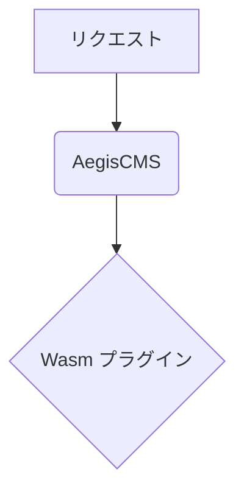

# official-mermaid

[English](README.md) | **日本語**

` ```mermaid ` のコードブロックを、[Mermaid](https://mermaid.js.org/) の図（フローチャート・シーケンス図・ガントチャート・ER 図など）として表示する公式プラグインです。コードのハイライトは別のプラグイン [`official-code-enhancer`](../official-code-enhancer/) です（両方を有効にしても、ぶつかりません）。

````markdown

````

## 動き

- 本文に ` ```mermaid ` のブロック（`language-mermaid`）があるページだけ、Mermaid を読み込みます。図の無いページには、スクリプトも CSS も入れません（Mermaid は重いため）。
- 図にできなかったブロック（構文の誤り・スクリプトが読めない）は、元のコードのまま残ります。ページの表示は止まりません。
- Mermaid は CDN（既定は `cdn.jsdelivr.net`、バージョンは `10.9.3` に固定）から読みます。**図のあるページを開いた人の IP アドレスなどが、CDN に送られます**。プライバシーポリシーに書くか、自分のサーバーに置いた Mermaid を使ってください（下記の `script_url`）。
- このプラグインを有効にしている間、サーバーはマニフェストの `capabilities.csp.script_domains`（`cdn.jsdelivr.net`）を、CSP の `script-src` に足します。

## 設定

Admin Studio の **Settings › Plugins** のこのプラグインの設定画面か、`[plugins.settings.official-mermaid]` で変えます。

| キー | 内容 | 既定 |
| --- | --- | --- |
| `theme` | 図のテーマ。`auto`（ページの背景の明るさで、暗ければ `dark`、明るければ `default`）、`default`、`dark`、`neutral`、`forest` | `auto` |
| `security_level` | `strict`（図の中の HTML・クリック処理を許さない）、`antiscript`、`loose`、`sandbox`。信頼できる人が書く図のときだけ緩める | `strict` |
| `script_url` | Mermaid のスクリプトの URL。`/` で始まるパス（自分のサイトに置くときは `/assets/mermaid.min.js` のようにする）か、`https://cdn.jsdelivr.net/...`。**ほかのホストの URL は、ホストが捨てる**（スクリプトは、マニフェストで宣言したホストのものだけ足せる。[csp.md](../../docs/csp.md)） | `https://cdn.jsdelivr.net/npm/mermaid@10.9.3/dist/mermaid.min.js` |

不正な値（知らないテーマ・`javascript:` の URL など）は、既定の値になります。

## `official-code-enhancer` から分かれました

以前は `official-code-enhancer` が Mermaid の図も扱っていました。分けたので、**Mermaid の図を使うサイトは、このプラグインを有効にしてください**（`[plugins].enabled` に `"official-mermaid"` を足す。同梱の `config/default.toml` は両方を有効にしています）。

## ビルド

```bash
task plugin:build:mermaid
```
