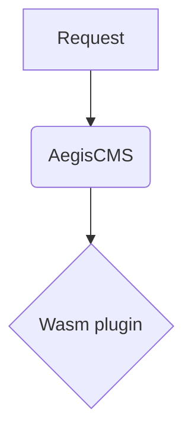

# official-mermaid

**English** | [日本語](README.ja.md)

An official plugin that displays ` ```mermaid ` code blocks as [Mermaid](https://mermaid.js.org/) diagrams (flowcharts, sequence diagrams, Gantt charts, ER diagrams, and more). Code highlighting is handled by a separate plugin, [`official-code-enhancer`](../official-code-enhancer/) (enabling both causes no conflicts).

````markdown

````

## How It Works

- It loads Mermaid only on pages that have a ` ```mermaid ` block (`language-mermaid`) in the body. It adds neither script nor CSS to pages without diagrams (Mermaid is heavy).
- Blocks that could not be turned into diagrams (syntax errors, or the script could not be loaded) remain as the original code. Page rendering does not stop.
- Mermaid is loaded from a CDN (by default `cdn.jsdelivr.net`, with the version pinned to `10.9.3`). **The IP address and other details of people who open a page with a diagram are sent to the CDN.** Mention it in your privacy policy, or use a Mermaid you host on your own server (`script_url` below).
- While this plugin is enabled, the server adds the manifest's `capabilities.csp.script_domains` (`cdn.jsdelivr.net`) to the CSP `script-src`.

## Settings

Change them in this plugin's settings screen under Admin Studio's **Settings › Plugins**, or in `[plugins.settings.official-mermaid]`.

| Key | Description | Default |
| --- | --- | --- |
| `theme` | Diagram theme. `auto` (by the brightness of the page background: `dark` if dark, `default` if light), `default`, `dark`, `neutral`, `forest` | `auto` |
| `security_level` | `strict` (disallows HTML and click handling inside diagrams), `antiscript`, `loose`, `sandbox`. Loosen it only for diagrams written by trusted people | `strict` |
| `script_url` | URL of the Mermaid script. A path starting with `/` (when hosting on your own site, use something like `/assets/mermaid.min.js`), or `https://cdn.jsdelivr.net/...`. **URLs on other hosts are dropped by the host** (scripts can only be added from hosts declared in the manifest. [csp.md](../../docs/csp.md)) | `https://cdn.jsdelivr.net/npm/mermaid@10.9.3/dist/mermaid.min.js` |

Invalid values (an unknown theme, a `javascript:` URL, etc.) fall back to the default.

## Split from `official-code-enhancer`

`official-code-enhancer` used to handle Mermaid diagrams too. Since they were split, **sites that use Mermaid diagrams should enable this plugin** (add `"official-mermaid"` to `[plugins].enabled`; the bundled `config/default.toml` enables both).

## Build

```bash
task plugin:build:mermaid
```
