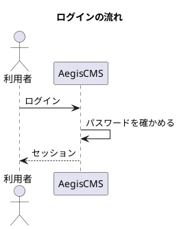

# official-plantuml

[English](README.md) | **日本語**

` ```plantuml `（` ```puml ` も可）のコードブロックを、[PlantUML](https://plantuml.com/) の図（シーケンス図・クラス図・アクティビティ図・コンポーネント図など）の画像として表示する公式プラグインです。Mermaid の図は別のプラグイン [`official-mermaid`](../official-mermaid/) です（両方を有効にしても、ぶつかりません）。

````markdown

````

`@startuml` / `@enduml` は省略できます（無ければ包んで送ります）。

## 動き

- サーバー側で、本文の PlantUML のブロックを `<figure class="opu-diagram">/svg/<符号化した図>"></figure>` に置き換えます。図のソースの符号化（deflate と PlantUML 独自の base64）もこのプラグインが行うので、**ページにスクリプトを入れません**。描くのは PlantUML サーバーで、ブラウザーは画像を読むだけです。
- 図の無いページには、何も足しません（CSS も入れません）。
- 画像の代替テキスト（`alt`）は、図の `title` の行です。無ければ「PlantUML diagram」（テーマの `locale` が `ja` なら「PlantUML の図」）。
- 図は白地で描かれるので、暗いページでも読めるよう、枠の中は白にしています。
- 符号化した図が長すぎる（約 6000 文字を超える。URL が長すぎて、多くのサーバーが受け付けない）ブロックは、元のコードのまま残します。構文の誤りは、PlantUML サーバーがエラーの画像を返します。
- 画像は既定で公開の PlantUML サーバー（`www.plantuml.com`）から読みます。**図のソースと、図のあるページを開いた人の IP アドレスなどが、そのサーバーに送られます**。社外に出したくない図は、自分の PlantUML サーバー（[plantuml-server](https://github.com/plantuml/plantuml-server)。Docker の `plantuml/plantuml-server` など）を立てて、下記の `server_url` に設定してください。
- このプラグインを有効にしている間、サーバーはマニフェストの `capabilities.csp.img_domains`（`www.plantuml.com`）を、CSP の `img-src` に足します（既定の CSP は `img-src` に `https:` を含むので、元から読めます。`img-src` を絞ったサイトのための宣言です）。

## 設定

Admin Studio の **Settings › Plugins** のこのプラグインの設定画面か、`[plugins.settings.official-plantuml]` で変えます。

| キー | 内容 | 既定 |
| --- | --- | --- |
| `server_url` | PlantUML サーバーの URL（`/svg/…` の手前まで）。`http(s)://` か `/` で始まるパス。同じホストのリバースプロキシの下に置くときは `/plantuml` のようにする（`'self'` なので CSP の許可は要らない）。`www.plantuml.com` 以外のホストは、`img-src` を絞ったサイトでは CSP（`[security]`）で許可が要る | `https://www.plantuml.com/plantuml` |
| `format` | 画像の形式。`svg`（拡大しても粗くならない）か `png` | `svg` |

不正な値（知らない形式・`javascript:` や `?` を含む URL など）は、既定の値になります。

## ビルド

```bash
task plugin:build:plantuml
```
