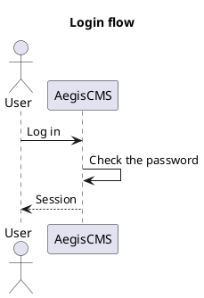

# official-plantuml

**English** | [日本語](README.ja.md)

An official plugin that displays ` ```plantuml ` (` ```puml ` also works) code blocks as images of [PlantUML](https://plantuml.com/) diagrams (sequence diagrams, class diagrams, activity diagrams, component diagrams, and more). Mermaid diagrams are handled by a separate plugin, [`official-mermaid`](../official-mermaid/) (enabling both causes no conflicts).

````markdown

````

`@startuml` / `@enduml` can be omitted (if absent, they are wrapped around the source before sending).

## How It Works

- On the server, it replaces PlantUML blocks in the body with `<figure class="opu-diagram">/svg/<encoded diagram>"></figure>`. The plugin also encodes the diagram source (deflate and PlantUML's own base64), so **no script is added to the page**. The PlantUML server draws the diagram, and the browser just loads an image.
- It adds nothing to pages without diagrams (not even CSS).
- The image's alternative text (`alt`) is the diagram's `title` line. If there is none, it is "PlantUML diagram" ("PlantUML の図" when the theme's `locale` is `ja`).
- Diagrams are drawn on a white background, so the frame is white to stay readable on dark pages.
- Blocks whose encoded diagram is too long (over about 6000 characters; the URL gets too long and many servers refuse it) remain as the original code. For syntax errors, the PlantUML server returns an error image.
- Images are loaded by default from the public PlantUML server (`www.plantuml.com`). **The diagram source and the IP address and other details of people who open a page with a diagram are sent to that server.** For diagrams you do not want to leave your organization, run your own PlantUML server ([plantuml-server](https://github.com/plantuml/plantuml-server), e.g. Docker's `plantuml/plantuml-server`) and set it as the `server_url` below.
- While this plugin is enabled, the server adds the manifest's `capabilities.csp.img_domains` (`www.plantuml.com`) to the CSP `img-src` (the default CSP includes `https:` in `img-src`, so it could be loaded anyway; the declaration is for sites that narrowed `img-src`).

## Settings

Change them in this plugin's settings screen under Admin Studio's **Settings › Plugins**, or in `[plugins.settings.official-plantuml]`.

| Key          | Description                                                                                                                                                                                                                                                                                                                                                   | Default                             |
| ------------ | ------------------------------------------------------------------------------------------------------------------------------------------------------------------------------------------------------------------------------------------------------------------------------------------------------------------------------------------------------------- | ----------------------------------- |
| `server_url` | URL of the PlantUML server (up to just before `/svg/…`). `http(s)://` or a path starting with `/`. When placing it under a reverse proxy on the same host, use something like `/plantuml` (it is `'self'`, so no CSP permission is needed). Hosts other than `www.plantuml.com` need to be allowed in the CSP (`[security]`) on sites that narrowed `img-src` | `https://www.plantuml.com/plantuml` |
| `format`     | Image format. `svg` (stays sharp when enlarged) or `png`                                                                                                                                                                                                                                                                                                      | `svg`                               |

Invalid values (an unknown format, a URL containing `javascript:` or `?`, etc.) fall back to the default.

## Build

```bash
task plugin:build:plantuml
```
